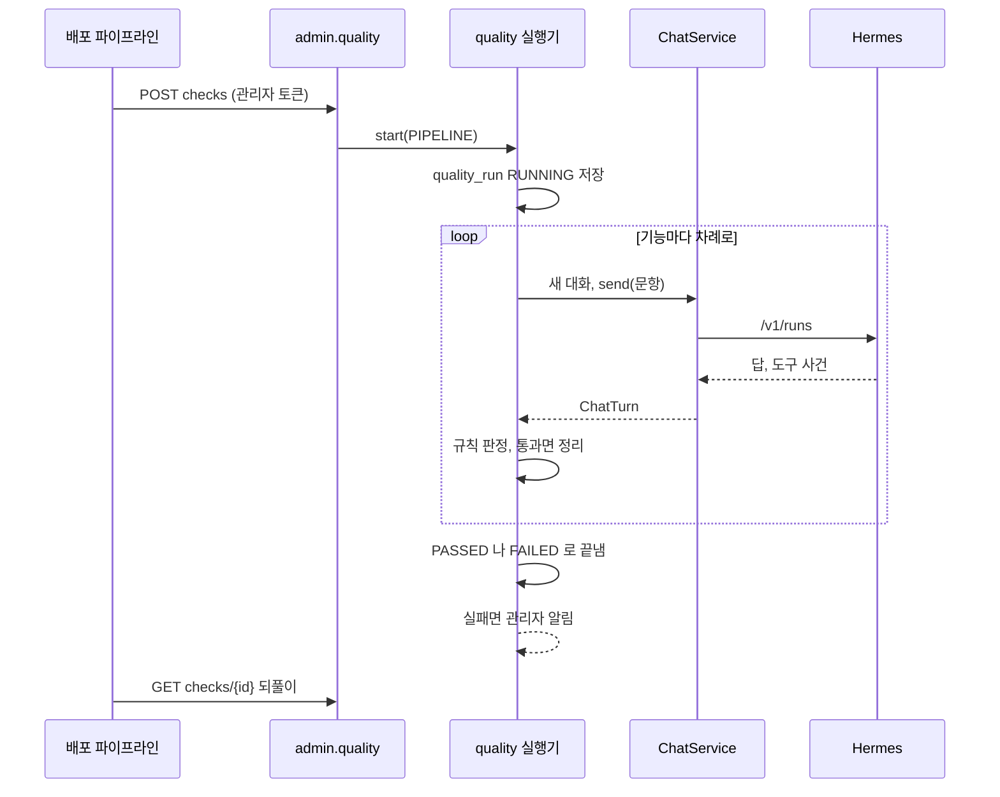

# 에이전트 품질 기술 설계

스펙 [`spec.md`](spec.md) 의 PR1(REQ1 부터 REQ4 까지)을 설계한다. PR2 와 PR3 은 이 PR 이 정하는 경계(저장 표, 평가 전용 사용자, 실행기)만 적고, 그 PR 을 시작할 때 이 문서에 절을 더한다.

## 요구사항 연결

| ID | 해결 방법 |
| --- | --- |
| REQ1 | 새 최상위 패키지 `quality` 의 실행기가 평가 전용 사용자로 기능마다 새 대화를 만들어 `ChatService.send` 로 문항을 보내고, 끝난 turn 의 실행 트리, 실행 사건, 결과물, 그 사용자의 데이터로 규칙 판정한다. 배포 파이프라인은 관리자 API `POST /api/v1/admin/quality/checks` 로 시작하고 결과를 조회한다 |
| REQ2 | `app_user.evaluation` 칸이 평가 전용 사용자를 표시한다. 실행기는 이 사용자의 `CurrentUser` 로만 돌고, 사용자 목록·에이전트 고르기·멘션·반응·사용량 집계의 조회가 이 사용자를 뺀다 |
| REQ3 | 확인이 실패로 끝나면 `NotificationService` 로 그룹의 `ADMIN` 마다 새 알림 종류 `QUALITY_CHECK_FAILED` 를 남긴다. 파이프라인은 같은 조회 API 의 `status` 로 자기 알림을 보낸다 |
| REQ4 | 웹 `/admin/quality` 첫 칸이 확인 목록 API 를 그린다. 실패 줄은 남겨 둔 평가 대화의 관리자 실행 상세로 잇고, 「다시 확인」 은 같은 기능 묶음으로 새 확인을 시작한다 |
| REQ5 | PR2 가 설계한다. 이 PR 의 실행기와 `quality_run` 을 다시 쓴다 |
| REQ6 | PR2 가 설계한다. 이 PR 의 실행기와 `quality_run` 을 다시 쓴다 |
| REQ7 | PR2 가 설계한다. 이 PR 의 실행기와 `quality_run` 을 다시 쓴다 |
| REQ8 | PR2 가 설계한다. 이 PR 의 실행기와 `quality_run` 을 다시 쓴다 |
| REQ9 | PR2 가 설계한다. 이 PR 의 실행기와 `quality_run` 을 다시 쓴다 |
| REQ10 | PR2 가 설계한다. 이 PR 의 실행기와 `quality_run` 을 다시 쓴다 |
| REQ11 | PR3 가 설계한다. 반응은 `decision_feedback_event`, 문항 후보는 `quality_run` 의 JSON 칸으로 받는다(스펙 DECISION18, 이 문서 DECISION1) |
| REQ12 | PR3 가 설계한다. 반응은 `decision_feedback_event`, 문항 후보는 `quality_run` 의 JSON 칸으로 받는다(스펙 DECISION18, 이 문서 DECISION1) |
| REQ13 | PR3 가 설계한다. 반응은 `decision_feedback_event`, 문항 후보는 `quality_run` 의 JSON 칸으로 받는다(스펙 DECISION18, 이 문서 DECISION1) |
| REQ14 | PR3 가 설계한다. 반응은 `decision_feedback_event`, 문항 후보는 `quality_run` 의 JSON 칸으로 받는다(스펙 DECISION18, 이 문서 DECISION1) |

## 책임과 경계

| 모듈 | 맡는 것 |
| --- | --- |
| `backend` 의 `quality` | 평가 전용 사용자 준비, 확인 한 번의 시작과 상태 전이, 기능별 문항 실행과 규칙 판정, 끝난 확인의 정리, 실패 알림, `quality_run` 저장 |
| `backend` 의 `admin.quality` | 관리자 API. `requireAdmin` 뒤 `quality.application` 만 부른다(rule-5 의 `admin` 규칙) |
| `backend` 의 `people`, `user`, `agent` | 평가 전용 사용자의 허용 목록 행, Hermes profile, `app_user`, 에이전트를 기존 흐름으로 만든다. 목록 조회가 평가 전용 사용자를 뺀다 |
| `web` | `/admin/quality` 화면의 첫 칸, 관리자 메뉴 자리(관리자 영역 재편 스펙의 「살펴보기」 묶음 두 번째) |
| `fos-home-infra` | 배포 끝에 확인을 시작하고 결과를 받아 파이프라인 알림을 보낸다. 범위 밖이며 아래 「운영 저장소에 넘길 요청」 으로 넘긴다 |

**`quality` 는 최상위 패키지 층 순서에서 `workspace` 다음, `admin` 앞에 둔다.** 실행기가 `chat`, `usage`, `memory`, `task`, `workspace`, `people`, `notification`, `agent`, `orchestration` 을 부르고 아무 패키지도 `quality` 를 부르지 않는다. `TopLevelPackageOrder` 의 목록과 `backend/docs/code-architecture.md` 의 최상위 패키지 표에 더한다.
하위 기능은 두지 않는다. `application` 직하가 25개를 넘을 만큼 커지면 그때 나눈다.

**실행기는 Control Plane 안에 둔다(스펙 DECISION17).** 결과를 품질 화면과 앱 안 알림에 남기려면 Control Plane 이 결과를 가져야 하고, 실행기가 서비스를 바로 부르면 평가 전용 사용자의 토큰을 만들 필요가 없다.
`test/model-eval/` 의 TypeScript 실행기는 PR2 가 답변 품질 묶음을 옮길 때까지 그대로 둔다.

**문항은 사람이 보낸 질문과 같은 길로 보낸다.** `ChatService.send` 가 대화 잠금, 사용자 실행 한도, 공통 답변 지침, 실행 기록을 그대로 탄다. 확인을 위한 판정이나 허락을 따로 두지 않는다. 쓰기 도구의 승인 카드가 뜨면 그 기능은 실패로 판정한다(승인을 기다리는 확인 문항은 두지 않는다).

## 인터페이스와 데이터

### 평가 전용 사용자

| 무엇 | 정한 것 |
| --- | --- |
| 표시 | `app_user.evaluation` BOOLEAN NOT NULL DEFAULT FALSE. 사용자당 참/거짓 하나라 본체 컬럼에 둔다(data-schema 「테이블을 추가하는 기준」). 그룹마다 많아야 하나다 |
| 만들기 | 관리자가 품질 화면에서 「평가 사용자 준비」 를 한 번 누른다(`POST /api/v1/admin/quality/evaluation-user`). 예약 주소(`evaluation@quality.invalid` 꼴, `.invalid` 는 메일이 가지 않는 예약 도메인)로 차례대로 만든다. (1) `PersonRegistrar.register` 가 허용 목록 행과 Hermes profile, key, MCP 토큰을 만든다. (2) `UserProvisioningService.resolve` 가 `app_user`(역할 `MEMBER`)를 만들고 첫 로그인 리스너(`FirstAgentCreator`)가 첫 에이전트를 만든다. (3) 같은 트랜잭션에서 전용 `UPDATE` 로 `evaluation` 을 켠다(data-schema 「테이블을 추가하는 기준」 의 전용 `UPDATE` 규칙). (4) `AgentLifecycleService.create` 로 위임 대상 에이전트를 만든다. (5) 같은 트랜잭션에서 기본 비서의 기본 도구 대기 목록(`agent.pending_default_toolsets`)에 첫 로그인 기본 도구와 `image_gen`, `vision` 을 더한다. 첫 로그인의 백그라운드 작업이 커밋 뒤 기본 도구를 쓰고, 이어서 `AgentPendingToolsets.attempt` 가 행 잠금 안에서 그 목록을 실행 공간 안으로 켠다. 준비가 Hermes 도구 목록을 따로 읽고 통째로 쓰면 백그라운드 쓰기와 겹쳐 나중에 쓴 쪽이 다른 쪽 이름을 지우므로 직접 쓰지 않는다. 이미 있으면 빠진 것만 채우고, 도구는 같은 목록에 더한 뒤 `attempt` 를 바로 부른다. 실행 공간과 첨부 정책에 평가 profile 을 등록하는 일은 운영 저장소가 먼저 한다(아래 「운영 저장소에 넘길 요청」). 등록 전에 준비하면 그 도구가 켜지지 않으므로, 상태는 셸·파일 도구까지 모두 켜졌는지 보고 빠졌으면 「정책 등록 필요」(`POLICY_REGISTRATION_REQUIRED`), Hermes 가 목록을 돌려주지 않으면 `TOOLS_UNREADABLE` 로 돌려준다. 처음 준비한 직후에는 백그라운드 작업이 도는 중이라 잠시 「정책 등록 필요」 가 남을 수 있다 |
| 에이전트 | 기본 에이전트 하나와 위임 대상 에이전트 하나. 기본 에이전트의 기본 도구는 첫 에이전트를 만들 때처럼 실행 공간 여부를 보고 켜지고, `image_gen` 과 `vision` 은 기본 도구 대기 목록을 거쳐 `AgentDefaultToolsets.enablePending` 으로 실행 공간 안에서만 켠다. 셸·파일 도구를 실행 공간 밖으로 켜는 쓰기(`AgentToolService.writeAsAdmin`)는 쓰지 않는다. Hermes 내장 위임(`delegation`, `delegate_task`)은 켜지 않는다. 켜면 모델이 자식 실행 줄이 남지 않는 내부 하위 작업을 써 위임 확인이 흔들린다. 위임 확인은 늘 켜진 Control Plane MCP 의 `agent_delegate` 로 위임 대상 에이전트의 code 를 지정해 맡긴다. 그 code 를 문항에 넣어 다른 사용자의 공개 에이전트로 가지 않게 한다. 평가 사용자의 에이전트는 기본 도구 대기 알림(`DEFAULT_TOOLS_PENDING`)에서 뺀다 |
| 미리 넣는 기억 | 기억 읽기 확인용 개인 기억 한 줄. 그날 바뀌지 않는 지어낸 사실(예: 「평가 사용자가 좋아하는 색은 청록이다」)을 준비할 때 한 번 넣는다 |
| 로그인 | 하지 않는다. Google 동의 화면에 주소를 더하지 않는다. 실행기가 `app_user` 행으로 `CurrentUser` 를 만든다 |
| 숨기기 | 아래 「숨기는 곳」 표 |

**숨기는 곳.** 모두 `user` 보다 위 패키지라 `app_user.evaluation` 을 읽을 수 있다.

| 화면이나 경로 | 바꿀 패키지 | 바꾸는 것 |
| --- | --- | --- |
| 로그인 확인과 매 요청 인증 | `people`(`SignInPolicy.admit`, `recordCompletion`), `user`(`AllowedUserResolver.resolveAllowed`) | `evaluation` 행을 거절한다. 그래서 그 주소로 서명된 토큰이 생겨도 통과하지 못한다. 예약 작업 경로가 쓰는 `SignInPolicy.revoked` 는 거절하지 않는다 |
| 관리자 사용자 목록 | `people`(`PersonAccessService.list`) | 남기고 「평가용」 표시를 붙인다. 끄기와 지우기는 막지 않는다 |
| 에이전트 고르기, 공개 목록, 멘션 후보 | 없음 | 두 에이전트가 `PRIVATE` 이라 주인 말고는 읽지 못한다(`AgentService.readableBy`). 별도 필터를 두지 않는다. 관리자 에이전트 목록에는 남는다 |
| 사용량 집계 | `usage` | 사용자별 행에서 빼고 「평가」 한 줄로 합친다 |
| 기본 도구 대기 알림 | `agent`(`AgentPendingToolsets`) | 평가 사용자의 에이전트를 뺀다 |
| 반응 집계 | `feedback` | PR3 이 뺀다 |

### 저장: `quality_run`

확인이나 평가 한 번이 한 줄이다. 2026-11-01 「테이블을 늘리지 않는다」 의 예외로 사용자가 승인했다(이 문서 DECISION1). 답 본문, 질문 본문, 도구 인자는 담지 않는다.

| 칸 | 뜻 |
| --- | --- |
| `id`, `public_id` | 내부 번호와 화면·API 가 쓰는 공개 식별자 |
| `group_id` | 그룹 |
| `kind` | `DEPLOY_CHECK`. PR2 가 `EVAL`, PR3 가 `CANDIDATE` 를 더한다 |
| `trigger_type` | `PIPELINE`, `ADMIN`. PR2 가 `SCHEDULED` 를 더한다 |
| `status` | `RUNNING`, `PASSED`, `FAILED`. 끝난 줄은 다시 바뀌지 않는다 |
| `started_at`, `finished_at` | UTC |
| `item_count`, `model_call_count`, `elapsed_ms` | 문항 수, 모델 호출 수(실행 줄 수), 걸린 시간. 스펙 DECISION8 |
| `result_json` | 기능별 결과 배열. 항목마다 `feature`, `status`(`PASSED`, `FAILED`, `TIMED_OUT`), `reasonCode`, `elapsedMs`, `conversationPublicId`(실패만, 30일), `executionIds`(그 기능이 돈 루트 실행 번호 목록. 사진 조회의 두 turn, 위임의 자동 turn 을 모두 담는다. 실패만, 30일). 글은 고정 까닭 코드로만 담고 모델이 쓴 글을 넣지 않는다 |
| `requested_by_user_id` | 관리자가 시작했으면 그 사용자. 파이프라인도 관리자 토큰으로 부르므로 그 토큰의 사용자다 |

색인은 `(group_id, kind, started_at)` 이다. 줄은 지우지 않는다(스펙 DECISION16). 마이그레이션 번호는 구현 때 `orch queue reserve` 로 받는다.

### 관리자 API

| 요청 | 응답 |
| --- | --- |
| `POST /api/v1/admin/quality/checks` | 202 와 확인 한 줄(`trigger` `PIPELINE`). 도는 `DEPLOY_CHECK` 가 있으면 새로 만들지 않고 그 줄을 `200` 으로 돌려준다(같은 배포에서 두 번 불러도 하나). 평가 전용 사용자가 없으면 409 `EVALUATION_USER_MISSING` |
| `GET /api/v1/admin/quality/checks/{publicId}` | 한 줄과 기능별 결과. 파이프라인이 이 `status` 를 읽는다 |
| `GET /api/v1/admin/quality/checks?cursor=` | 최근 순 목록. 품질 화면 첫 칸 |
| `POST /api/v1/admin/quality/checks/{publicId}/retry` | 같은 기능 묶음으로 새 확인을 시작한다(`trigger_type` `ADMIN`). 도는 확인이 있으면 첫 줄처럼 그 줄을 돌려주고, 화면은 「이미 확인이 돌고 있다」 를 보인다 |
| `GET /api/v1/admin/quality/executions/{executionId}/tree` | 평가 사용자의 실행 트리만 연다. 응답은 `/api/v1/usage/executions/{id}/tree` 와 같은 모양이고, 내부 값은 보는 관리자 기준으로 싣는다(`ExecutionTreeService.ofOwner`). 다른 사용자의 실행은 404 다. 지금 실행 트리 조회(`ExecutionTreeService`)는 주인만 열어 관리자가 평가 사용자의 실패를 볼 길이 없다(ADR-063 의 관리자 영역 규칙대로 `admin.quality` 에 둔다) |
| `POST /api/v1/admin/quality/evaluation-user` | 평가 전용 사용자를 준비하고 상태를 돌려준다 |
| `GET /api/v1/admin/quality/evaluation-user` | 준비됐는지, 빠진 것 |

### 확인 한 번의 흐름

**기능은 차례로 돈다.** 사용자 실행 한도(`assistant.user-execution.max-running`)가 평가 전용 사용자에게도 걸리고, 위임 확인은 자식 실행 자리를 하나 더 쓴다. 차례로 돌면 한도에 닿지 않는다. 한 확인의 최대 시간은 기능 수 × 10분이고, 보통은 기능마다 1~3분이다.

**기능마다 10분 마감(스펙 DECISION19).** `ChatService.send` 는 끝날 때까지 막히고, 그 안의 `TurnCancellation.cancel` 은 표시만 바꿔 Hermes run 을 멈추지 않는다. 그래서 아래 순서로 한다.

1. 문항은 별도 작업(`BackgroundTasks`)에서 `send` 로 보낸다. 실행기 스레드는 그 기능의 끝남 조건을 1초 남짓 간격으로 본다.
2. 끝남 조건은 기능마다 다르다. 보통은 `send` 가 돌아온 것이다. 위임은 `send` 가 돌아오고, 자식 실행이 끝났고, `ChatService.deliveryStates` 의 그 대화 전달이 `DELIVERED` 이고, 대화에 도는 turn(`TurnCancellation.markOf`)이 없을 때다.
3. 10분이 지나면 도는 turn 의 실행 번호를 `TurnCancellation.markOf(conversationId)` 로 읽어 `ChatService.stop` 을 부르고, 도는 위임 자식은 `AgentDelegationService` 의 중지로 멈춘다. 그 기능을 `TIMED_OUT` 으로 적는다.
4. `send` 가 `HERMES_RUN_TIMEOUT` 으로 끝나면(Hermes 기다림 상한 `hermes.run-timeout`) 원격 run 이 남아 있을 수 있다. 그 실행을 `ChatService.stop` 으로 멈추고 `TIMED_OUT` 으로 적는다.
5. 대화에 도는 turn 이 없어진 뒤에 다음 기능으로 간다. 사용자 실행 자리를 겹쳐 쓰지 않게 한다.

**확인 하나는 서버 하나에서 돈다.** 시작은 `BackgroundTasks` 로 띄운다. 서버가 도중에 다시 뜨면 기동 때 `RUNNING` 인 줄을 `FAILED`, 까닭 `INTERRUPTED` 로 끝낸다. 다시 돌리지 않는다.

### 기능별 문항과 판정

문항 글은 실행기 코드의 상수로 둔다. 판정은 네트워크를 쓰지 않는 순수 함수로 나눠 단위 테스트한다.

| 기능 | 문항이 하는 일 | 통과 규칙 | 정리 |
| --- | --- | --- | --- |
| 검색과 출처 | 그날 바뀌는 일반 사실을 묻는다 | 트리에 `web_search` 의 `TOOL_COMPLETED` 가 실패 없이 있고, 답 끝 「출처」 절에 링크가 있다(`test/model-eval/answer/score.ts` 의 출처 절 규칙을 Java 로 옮긴다) | 대화 |
| 위임 | 위임 대상 에이전트에게 짧은 일을 맡기라고 한다 | 루트 트리에 `agent_delegate` 자식 실행이 성공으로 있고, 그 대화에 위임 결과를 전하는 자동 turn 이 성공으로 끝난다 | 대화 |
| 내 파일 넣기 | 짧은 글 파일을 만들어 파일 공간에 넣으라고 한다 | `file_space_put` 이 성공하고 평가 전용 사용자의 보관함에 그 대화의 `vault_origin` 행이 생긴다 | 보관본, 대화 |
| 그림 만들기 | 단순한 그림 하나를 만들라고 한다 | 답 메시지에 그림 결과물이 묶인다 | 결과물, 대화 |
| 기억 읽기 | 미리 넣은 기억을 물어본다 | 답에 미리 넣은 사실의 낱말이 든다 | 대화. 미리 넣은 한 줄은 남긴다 |
| 예약 작업 발화 | 문항을 보내지 않는다. 실행기가 `TaskService` 로 평가 전용 사용자의 `TURN` 작업을 한 번(`ONCE`, 지금 뒤 1분. `ONCE` 는 지금보다 뒤여야 한다)으로 만들어 발화기에 맡긴다. 끝남 조건은 그 작업의 `task_run` 이 끝난 상태가 된 것이다. 지시는 짧은 고정 글이다 | 그 작업의 `task_run` 이 `SUCCEEDED` 로 끝나고 `execution_id` 가 찬다 | 예약 작업과 그 대화 |
| 원본 사진 조회 | 앞 메시지에 합성 사진(심은 글자)을 올리고 다음 메시지에서 글자를 묻는다 | 답에 심은 글자가 들고, 둘째 turn 트리에 `attachment_inspect` 의 `TOOL_COMPLETED` 가 실패 없이 있다. `inspected` 단계 사건은 로그에만 남아 Control Plane 이 읽지 못한다(`MediaPipelineEvents`) | 첨부, 대화 |

합성 사진은 표지판에 심은 글자를 그린 단순한 그림 하나를 `backend/src/main/resources/quality/deploy-check-photo.png` 에 둔다.
확인 시작 뒤 평가 사용자에게 생긴 기억 가운데 미리 넣은 한 줄이 아닌 것은 확인이 끝날 때 기능의 통과와 상관없이 지운다(문항이 돌다 `memory_remember` 로 생길 수 있다). 「정리」 는 통과한 기능에만 바로 한다. 실패한 기능의 대화와 만든 것은 30일 뒤 정리 작업이 지운다(스펙 DECISION16, DECISION19). 정리 작업은 하루 한 번 돌고, 대화를 지운 뒤 `quality_run.result_json` 의 `conversationPublicId` 와 `executionIds` 를 비운다. 그래서 30일 뒤에는 화면에 링크가 없다. 줄과 숫자는 남는다. 실행 기록 줄 자체는 기존 실행 기록 보존(rule-49)을 따른다.

### 실패 알림

새 `NotificationKind.QUALITY_CHECK_FAILED`. 받는 사람은 기존 관리자 알림 관례(`DEFAULT_TOOLS_PENDING` 등)와 같이 그룹의 차단되지 않은 `ADMIN` 이다. `target_type` 은 새 값 `ADMIN_QUALITY` 이고 목록 화면을 가리키는 종류라 `target_public_id` 를 비운다. 그래서 `NotificationTargetType.list()`, data-schema 의 `notification` 절(목록 화면 종류 목록), 웹의 알림 이동 대상, `docs/features/attention.md` 의 알림 종류 표를 같은 PR 에서 고친다. `source_public_id` 는 `quality_run.public_id` 다. `quality_run` 을 `FAILED` 로 바꾸는 트랜잭션에서 알림을 함께 만든다(알림과 그 원인은 한 트랜잭션). 본문은 실패한 기능 이름만 담는다. 다음 확인이 통과하면 앞 실패 알림을 `resolve` 로 읽음 처리하지 않는다. 실패 기록은 사람이 보고 지운다.

### 화면

`/admin/quality` 를 새로 만들고 첫 칸만 그린다. 나머지 칸은 PR2 와 PR3 이 더한다.
평가 전용 사용자가 없으면 칸 대신 「평가 사용자 준비」 단추와 한 줄 안내를 보인다.
확인 목록은 시각, 계기, 결과, 걸린 시간을 한 줄로, 펼치면 기능별 결과와 까닭을 보인다. 실패 기능은 `executionIds` 마다 관리자 품질 화면 안의 실행 트리 보기로 잇는다. 그 보기는 위 `admin.quality` 의 트리 조회를 쓴다. 30일이 지나 비워진 줄은 링크를 그리지 않는다.
관리자 메뉴 자리는 관리자 영역 재편 스펙을 따른다. 그 스펙이 아직 머지되지 않았으면 지금 관리자 메뉴 끝에 「품질」 로 더하고 재편 PR 이 옮긴다.

### 실행기 구현 메모

계획 검토(2026-11-20)에서 나온 실행기 쪽 제약이다. 실행기 PR 의 계획이 이 절을 따른다.

- **시작 잠금은 평가 사용자 행으로 한다.** `AppUserRepository.findByIdForUpdate(평가 사용자 번호)` 로 잠근 뒤 `RUNNING` 인 `DEPLOY_CHECK` 를 찾는다. `group_setting` 은 키마다 줄이라 잠글 줄이 없을 수 있다.
- **기능 결과는 기능이 끝날 때마다 `result_json` 에 더해 저장한다.** 도중에 재기동돼도 실패 기능의 대화 번호가 남아 30일 정리가 지울 수 있다. 재기동 때 끝내지 못한 기능은 `FAILED`, 까닭 `INTERRUPTED` 로 적고 줄을 `FAILED` 로 끝낸다.
- **조회 값은 `quality/application/dto` 의 record 로 돌려준다.** `admin` 은 기능의 `domain` 을 쓰지 못한다(`ADMIN_USES_ONLY_FEATURE_APPLICATION`).
- **보관함 판정과 정리에 쓸 조회를 `chat.artifact` 에 더한다.** 지금 `ArtifactVaultService.list` 의 항목에는 대화 번호와 `vault_origin` 이 없다. 그 대화로 `vault_origin` 이 있는 보관 행 번호를 돌려주는 조회를 둔다.
- **예약 작업 발화 기능은 결과와 상관없이 끝날 때 작업을 보관 처리한다.** 시간 초과로 끝나도 발화하지 않은 `ONCE` 작업이 뒤 기능 도중에 발화하지 않게 한다. 작업 입력은 알림 `NotifyPolicy.NEVER`, 시간대 `Asia/Seoul`.
- **위임 기능은 `send` 가 돌아온 뒤 트리에 위임 자식이 없으면 바로 `NO_CHILD` 로 끝낸다.** 10분을 기다리지 않는다.
- **설정은 `application.yml` 에 `${ASSISTANT_QUALITY_FEATURE_TIMEOUT:10m}` 꼴 자리를 둔다.** e2e 가 환경 변수로 줄인다.
- **통합 테스트가 실행기를 끝까지 돌리지 않게 `start` 를 「줄 만들기」 와 「띄우기」 로 나눈다.** 끝내기와 알림은 따로 부를 수 있는 메서드로 두고 직접 테스트한다. 마감 값은 `LiveProperties` 로 읽어 테스트에서 줄일 수 있게 한다.
- **e2e 시나리오는 `test/e2e/run.ts` 의 맨 끝에 등록한다.** 사용자를 하나 더 만들어 앞 시나리오의 사람 수 세기를 깨지 않게 한다.
- **화면 PR 전까지 알림의 이동 대상 `/admin/quality` 는 없는 화면이다.** 실행기 PR 과 화면 PR 을 같은 배포에 묶거나, 화면 PR 이 먼저 머지되게 한다.
- 까닭 코드에는 기능 규칙의 코드와 함께 `BUSY`, `INTERRUPTED`, `RUN_FAILED`, `TIMED_OUT` 을 둔다.
- **문항을 보내기 전에 빈 평가 대화를 먼저 만든다(`ChatService.startEmpty`).** 마감이 지났을 때 실행기 스레드가 그 대화의 도는 turn 을 찾아 멈추려면 `send` 가 돌아오기 전에 대화 번호를 알아야 한다. 사진 조회도 이 대화에 사진을 먼저 올린다.
- **실행 줄이 생기기 전의 거절은 `USER_BUSY`, `CONVERSATION_BUSY` 만 `BUSY` 로 적는다.** 그 밖의 거절과 실행기 쪽 예외는 `RUN_FAILED` 다. 실행이 실패한 것은 실행 줄에 남아 판정이 읽는다.
- **30일 정리는 `assistant.quality.cleanup-cron`(기본 매일 05:15) 에 돈다.** 보관 기간은 `assistant.quality.link-retention`(기본 30일)이다.

## 실패와 일관성

| 상황 | 처리 |
| --- | --- |
| 확인을 두 번 시작 | 도는 `DEPLOY_CHECK` 를 그대로 돌려준다. 시작은 평가 사용자 행 잠금(`AppUserRepository.findByIdForUpdate`) 안에서 `RUNNING` 인 `DEPLOY_CHECK` 를 찾아 하나만 만든다(「실행기 구현 메모」) |
| `USER_BUSY`, `CONVERSATION_BUSY` | 평가 전용 사용자는 실행기만 쓰므로 정상이면 일어나지 않는다. 일어나면 그 기능을 `FAILED`, 까닭 `BUSY` 로 적는다 |
| Hermes 연결 실패, 시간 초과, 실행 실패 | 그 기능 `FAILED`, 까닭은 실행 줄의 오류 종류를 고정 코드로 옮긴다 |
| 정리 실패 | 결과는 바꾸지 않는다. 경고 로그를 남기고 하루 정리 작업이 다시 지운다 |
| 서버 재기동 | 「확인 하나는 서버 하나에서 돈다」 대로 `INTERRUPTED` |
| 배포 순서 | 마이그레이션(칸과 표)과 코드가 한 PR 이다. 파이프라인 요청은 이 PR 이 배포되고 평가 사용자를 준비한 뒤에 켠다 |

## 검증 전략

| ID | 경계와 환경 |
| --- | --- |
| REQ1 | 기능별 판정 함수는 단위 테스트(통과, 실패, 경계). 실행기 전체는 가짜 Hermes e2e(`test/e2e/`)에서 기능 하나가 통과하고 하나가 실패하는 시나리오로 상태 전이, `result_json`, 정리를 본다. 실제 모델이 문항을 따르는지는 배포 뒤 운영에서 확인 한 번을 돌려 본다 |
| REQ2 | 사용자 목록, 에이전트 목록, 멘션 후보, 사용량 집계의 조회 테스트가 평가 전용 사용자를 빼는지 본다. 실행기가 다른 사용자의 데이터를 바꾸지 않는지는 e2e 에서 다른 사용자의 기억·파일·예약 수를 전후로 센다 |
| REQ3 | 실패로 끝난 확인이 `ADMIN` 마다 알림 한 줄을 남기는지 통합 테스트. 파이프라인 알림은 운영 저장소 몫이다 |
| REQ4 | 관리자 API 의 권한(관리자만)과 응답 모양은 통합 테스트, 화면 첫 칸은 브라우저 테스트 |

## PR1 나눔

PR1 은 운영 코드 상한을 넘어 셋으로 나눈다. 각 PR 이 그 단계의 설계와 구현을 함께 담는다.

| PR | 범위 | 남은 확인 |
| --- | --- | --- |
| 기반 | `app_user.evaluation`, `quality_run`, 평가 전용 사용자 준비와 관리자 API, 숨기는 곳, 기능별 규칙 판정(REQ1 의 판정, 사용량 「평가」 한 줄을 뺀 REQ2) | 배포하고 아래 요청 5 를 마친 뒤 관리자가 평가 사용자를 준비해 상태에 빠진 것이 없고, 관리자 사용자 목록에 「평가용」 줄이 하나인지 본다 |
| 실행기 | 확인 시작·조회 API, 평가 사용자 실행 트리 조회, 기능 차례 실행과 10분 마감, 실패 알림과 그 알림의 웹 이동, 30일 정리, 가짜 Hermes e2e(REQ1, REQ3) | 배포 뒤 관리자가 평가 사용자를 준비하고 확인 한 번을 돌려 본다 |
| 화면 | `/admin/quality` 첫 칸과 사용량 「평가」 한 줄(REQ4, REQ2 의 나머지). 실행기 PR 과 같은 배포에 묶는다 | 브라우저 테스트 |

## 운영 저장소에 넘길 요청

이 PR 이 배포된 뒤 `fos-home-infra` 에 요청한다. 접속 값과 토큰을 만드는 방법은 그쪽이 갖는다.

1. 배포가 끝나고 Control Plane 이 응답하면 관리자 토큰으로 `POST /api/v1/admin/quality/checks` 를 부른다.
2. `GET /api/v1/admin/quality/checks/{publicId}` 를 1분마다 부르고, `status` 가 `PASSED` 나 `FAILED` 가 되면 멈춘다. 기다리는 상한은 기능 수에 10분을 곱하고 10분을 더한 값이다. 넘거나 Control Plane 이 응답하지 않으면 실패로 본다.
3. `FAILED` 나 실패로 본 경우 파이프라인 알림을 보낸다. 되돌리기는 하지 않는다.
4. 평가 전용 사용자의 Hermes profile 은 Control Plane 이 만든다. 운영 저장소는 profile 을 따로 만들지 않는다.
5. 평가 사용자를 준비하기 전에 그 profile 을 실행 공간 정책과 첨부(`vision`) 정책에 등록한다. 그림 만들기와 사진 조회 도구는 등록된 profile 에서만 켜진다(ADR-20261119 / image-gen-defaults, ADR-091). 공유 gateway 를 다시 띄우는 배포 단계가 그 profile 도 포함하는지 확인한다.

## 결정

| ID | 결정 | 답 | 누가 | 근거 |
| --- | --- | --- | --- | --- |
| DECISION1 | 결과를 저장할 곳 | 새 테이블 `quality_run` 하나. PR2 정기 평가와 PR3 문항 후보도 이 표와 JSON 칸으로 받는다 | 사용자 2026-11-20 | 확인 한 번은 예약 작업과 수명과 뜻이 다르다(data-schema 「테이블을 추가하는 기준」 의 「본체와 수명이 다를 때」). `task_run` 은 예약 작업 줄과 예정 시각 유일 제약에 매여 가짜 작업 줄이 필요하고, `decision_feedback_event` 는 365일 뒤 지워진다 |
| DECISION2 | 평가 전용 사용자의 표시 | `app_user.evaluation` 컬럼 | 작성자 | 사용자당 참/거짓 하나는 본체 컬럼에 둔다(data-schema). 역할 값에 넣으면 권한 판정 코드가 모두 새 값을 알아야 한다 |
| DECISION3 | 평가 전용 사용자를 만드는 길 | 관리자가 품질 화면에서 한 번 준비한다. Control Plane 이 사람 더하기 흐름을 다시 쓴다. 실행 공간과 첨부 정책 등록만 운영 저장소가 먼저 한다 | 작성자 | 사람 더하기를 Control Plane 이 끝내는 기존 결정(ADR-018)과 같은 길이다. 정책 등록은 Control Plane 이 하지 못한다(`AgentPendingToolsets`) |
| DECISION4 | 파이프라인의 인증 | 기존 관리자 토큰. 새 인증 경계를 만들지 않는다 | 작성자 | 답변 품질 평가가 이미 운영 저장소가 만든 토큰으로 Control Plane 을 부른다. 서비스 토큰을 새로 두면 비밀값과 필터가 하나 더 는다 |
| DECISION5 | 기능을 도는 방식 | 차례로, 기능마다 10분 | 작성자 | 사용자 실행 한도에 닿지 않고 실패 원인이 서로 섞이지 않는다. 보통 수 분이면 끝난다 |
| DECISION6 | 문항과 판정의 자리 | 실행기 코드의 상수와 순수 판정 함수 | 작성자 | PR1 의 문항은 기능마다 하나라 파일 형식을 만들 까닭이 없다. PR2 의 묶음 파일 형식이 생기면 그때 옮긴다 |
| DECISION8 | 관리자가 평가 사용자의 실행을 여는 길 | `admin.quality` 에 평가 사용자 실행만 여는 트리 조회를 둔다 | 작성자 | 지금 실행 트리 조회는 주인만 연다. 모든 사용자의 실행을 여는 관리자 조회는 범위가 넓어 평가 사용자로 좁힌다 |
| DECISION7 | 재기동 때 도는 확인 | `INTERRUPTED` 로 끝내고 다시 돌리지 않는다 | 작성자 | 배포 자체가 재기동이라 다시 돌리면 같은 배포의 확인이 겹친다. 파이프라인이 실패로 보고 사람이 「다시 확인」 한다 |

## 결정 기록 연결

| 결정 | 종류 | ADR 또는 필요 없음의 이유 | 현재 규칙의 원본 |
| --- | --- | --- | --- |
| DECISION1 | data-model | 필요 없음. 예외 근거를 `backend/docs/data-schema.md` 의 `quality_run` 절에 적는다 | `backend/docs/data-schema.md` |
| 스펙 DECISION2 | 평가 정책 | PR2 에서 새 ADR 을 만든다(스펙 「결정 기록 연결」) | 스펙 DECISION2 |
| DECISION3, DECISION4 | architecture | 필요 없음. 기존 ADR-018 과 관리자 토큰 경계를 그대로 쓴다 | ADR-018, `ControlPlaneJwtFilter` |
