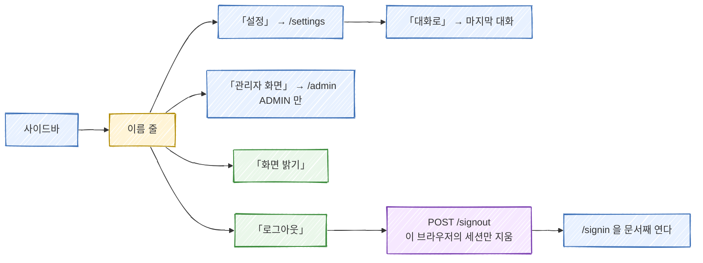

# 화면 틀과 메뉴 배치

대화에 집중하도록 사이드바, 이름 메뉴, 「설정」 화면, 입력창, 작업 과정 표시를 다시 배치하는 기능이다.

covers: `web/src/components/shell/sidebar.tsx`, `web/src/components/shell/main-nav.tsx`, `web/src/components/shell/app-shell.tsx`, `web/src/components/chat/composer.tsx`, `web/src/components/chat/agent-switcher.tsx`

요구와 결정은 스펙 [`app-shell/spec.md`](app-shell/spec.md), 구조와 실패 처리는 설계 [`app-shell/design.md`](app-shell/design.md) 가 갖는다.
스펙의 PR1(사이드바, 이름 메뉴, 로그아웃, 설정 틀), PR2(입력창 안 아래 줄, 새 대화 화면의 이름표), PR3(작업 과정 표시), PR4(알림을 「지금 볼 것」 의 탭으로 합치기), PR5(같은 머리 틀과 같은 안내)가 들어왔다.

## 화면 틀의 흐름

화면 틀(`AppShell`)이 경로로 틀 하나를 고른다.

| 경로 | 틀 |
| --- | --- |
| `/signin`, 로그인하지 않은 `/privacy` | 로그인 전 화면 |
| `/admin` 아래 | 관리자 틀 |
| `/settings` 와 설정 묶음의 화면들, `/executions/{id}`, 로그인한 `/privacy` | 설정 틀 |
| 그 밖의 대화 쪽 화면 | 사이드바 틀 |

- 사이드바에는 대화방, 새 대화, 대화 검색, 「지금 볼 것」, 「예약 작업」, 「기억」, 대화 목록, 이름 줄만 있다. 배치와 높이 규칙은 [`web/docs/code-architecture.md`](../../web/docs/code-architecture.md) 의 「화면 틀」 이 갖는다.
- 설정 틀의 묶음과 좁은 화면의 목록·본문 나눔은 같은 문서의 「설정 틀」 이 갖는다.
- 알림 단추는 없다. 알림 목록은 「지금 볼 것」 화면의 「알림」 탭이고, 「지금 볼 것」 줄과 좁은 화면 위 막대의 단추가 할 것의 수나 새 알림의 점을 붙인다. 규칙은 [`attention.md`](attention.md) 의 「화면(알림)」 이 갖는다.
- 사이드바와 설정에서 여는 화면(에이전트, 외부 서비스 연결, 내 브라우저, 파일 공간, 개발 문서, 예약 작업, 기억, 「지금 볼 것」)은 같은 머리 틀을 쓴다. 왼쪽에 제목과 한 줄 설명, 오른쪽에 주 단추가 있고 본문 폭이 같다. 그 아래 상세 화면은 같은 폭에 뒤로 가기와 제목을 둔다. 빈 목록, 불러오기 실패(「다시 읽기」), 읽는 중의 안내도 같은 모양이다. 부품은 [`web/docs/code-architecture.md`](../../web/docs/code-architecture.md) 의 「화면 머리 틀과 세 안내」 가 갖는다.
- 로그아웃이 실패하면 이름 줄 위에 안내가 보이고 로그인은 그대로다. 다른 기기와 다른 브라우저의 로그인은 그대로다.
- Google 로그인은 늘 계정 고르기 화면을 먼저 보인다.
- 입력창은 두 줄이다. 위 줄은 글 칸, 아래 줄은 왼쪽에 「＋」(사진 첨부)와 모델 단계 단추, 오른쪽에 중지와 보내기다. 입력창 밖에 따로 떠 있는 줄은 없다.
- 새 대화 화면에는 에이전트 카드가 없다. 넓은 화면은 대화 영역 맨 위 머리 줄, 휴대폰은 위 막대 가운데의 이름표 단추를 눌러 목록에서 고른다. 사진이나 모델 단계를 먼저 골라 대화가 만들어졌으면 이름표가 잠기고, 누르면 바꿀 수 없는 까닭이 보인다.

이 기능이 기대는 기존 규칙은 아래 문서가 갖는다.

- 지금의 화면 목록과 화면 틀, 관리자 영역의 틀: [`web/docs/code-architecture.md`](../../web/docs/code-architecture.md) 의 「화면 틀」
- 지금 화면과 알림: [`attention.md`](attention.md)
- 작업 과정 블록과 도구를 보이는 말: [`execution.md`](execution.md) 의 「작업 과정 블록」
- 새 대화 화면과 대화의 에이전트: [`chat.md`](chat.md) 의 「새 대화 화면」
- 관리자 영역에 두는 것과 일반 화면에 남긴 것: [`users.md`](users.md) 의 「관리자 영역」
