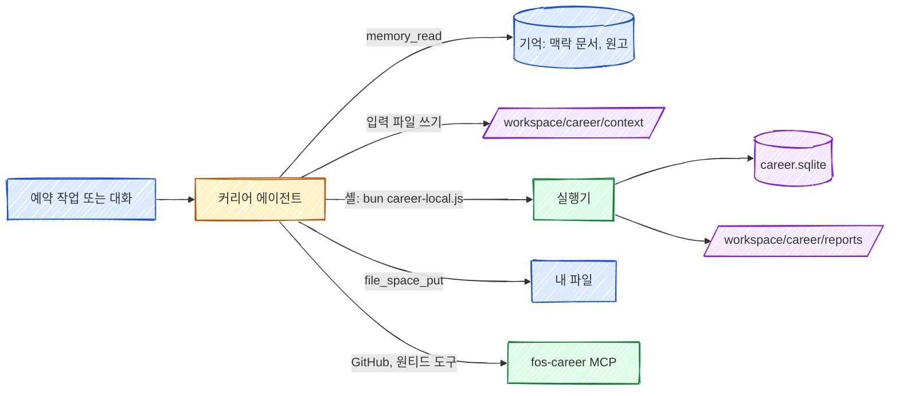

# 커리어 Backend 이전 기술 설계

스펙은 [`spec.md`](spec.md) 다. 코드 대부분은 fos-agents 저장소의 `career-os/` 에 있다. 이 문서의 `career-os/...` 경로는 그 저장소 기준이다.

## 요구사항 연결

| ID | 해결 방법 |
| --- | --- |
| REQ1 | 공고 추천 실행기의 Backend HTTP client 를 같은 질의 단위의 로컬 저장 모듈로 바꾼다. 저장 모듈은 Backend 의 positions 서비스·저장소 규칙을 `bun:sqlite` 위로 옮긴 것이고 작업 폴더의 SQLite 파일 하나를 쓴다. 리포트는 에이전트가 `file_space_put` 으로 「내 파일」 에 넣는다 |
| REQ2 | 운영이 커리어 에이전트에 예약 작업 둘(공고 추천, 공부 추천)을 만들고 알림을 「항상」 으로 둔다. 지시문은 비서용 스킬을 부르고, 할 말이 없으면 답 전체를 `[SILENT]` 로 끝내게 한다(docs/features/schedule.md 의 「보고할 것 없음」). Hermes cron 의 커리어 작업은 운영이 지운다 |
| REQ3 | 수집 실행, 공고 버전, 분석 정책, 분석 실행과 임차, 회사 평가, 제외 규칙, 추천 실행을 Backend 와 같은 테이블 구성으로 SQLite 에 둔다. 재사용과 큐 규칙은 Backend 코드를 옮겨 그대로 지킨다 |
| REQ4 | 공부 소스, 커서, 자료, 후보 판정, 추천, 게시 기록을 같은 방식으로 SQLite 에 둔다. 서울 날짜 하루 한 번 저장 규칙을 옮긴다 |
| REQ5 | 면접 복습 상태, 연습 기록, 개인 질문을 SQLite 에 두고, 지금 MCP 도구가 하던 일을 실행기 명령으로 낸다. 이미 있는 JSON 파일 저장소(`scripts/interview-drill/store/`)와 `CAREER_STORE` 선택은 지우고 저장소를 SQLite 하나로 둔다. `interview-practice` 는 비서용 스킬(`agent-skills/`)로 옮긴다 |
| REQ6 | 에이전트가 기억에서 맥락 문서를 읽어 작업 폴더의 입력 파일로 쓰고 실행기에 넘긴다. 실행기는 「역할 선호」 본문의 해시로 분석 기준 버전을 낸다. 고친 안은 `memory_remember` 로 남긴다. 프로필 원고는 작업 폴더 `library/profiles/<wanted\|linkedin\|github>.md` 가 원본이고 에이전트가 파일 도구로 고친다 |
| REQ7 | 플러그인 선언(`connector.json`, `.mcp.json`, `.claude-plugin/plugin.json`)에서 Backend token 칸, `operator_env` 와 MCP env 의 Backend 이름, Backend 도구 18개, 스킬의 Backend env 를 함께 지운다. 공고 제외 판정(career-os ADR-142)은 실행기 명령 `position check-exclusions` 로 옮긴다. 운영이 Backend 서비스와 DB 를 내린다 |
| REQ8 | 지원 준비 스킬 넷을 `agent-skills/` 로 옮기고, 작업본 동기화 대신 작업 폴더의 `applications/`, `library/`, `state/verified-claims/` 를 쓴다. 지원서 공통 프로필은 맥락 문서처럼 에이전트가 기억에서 읽어 `context/` 로 넘긴다. 이력서 PDF 는 실행 공간에서 Chrome 을 찾지 못하면 HTML 만 낸다 |
| REQ9 | `agent-skills/` 를 스킬의 원본으로 올린 뒤 Claude Code 전용 `plugin/skills/`, `sync-profile`, `scripts/career-workspace/`, 공통 프로필 client(`scripts/application-profile/client.ts`)를 지운다. `plugin/scripts/agent-skills.ts` 는 사본 생성기에서 금지 표현 검사기로 바꾼다. 사용량 작업은 노트북 파일에 쓴다 |
| REQ10 | fos-assistant 의 실행 공간 env 허용 목록(`hermes/plugins/dashboard-profile-api/sandbox.py` 의 `SANDBOX_PATH_ENV`, `SANDBOX_ALLOWED_ENV`)에서 `CAREER_BACKEND_URL`, `CAREER_BACKEND_TOKEN_FILE` 을 빼고 URL 검사 갈래를 지운다. `hermes/README.md`, `hermes/docs/hermes-contract.md` 의 token 파일 문단, `docs/features/agent-skill/design.md`, 이 이름을 표본으로 쓰는 테스트(`test_dashboard_profile_api_sandbox_policy.py`, `test_dashboard_profile_api_sandbox_terminal.py`, `test_connector_manifest.py`, `test_connector_agent_skills.py`)를 함께 고친다 |

## 책임과 경계

| 무엇 | 소유 | 근거 |
| --- | --- | --- |
| 커리어 표 데이터와 그 규칙(큐, 임차, 재사용, 하루 한 번) | fos-agents `career-os` 의 로컬 저장 모듈. 새 디렉터리 `career-os/scripts/lib/career-store/` | Backend 의 규칙을 옮기는 것이라 같은 저장소가 계속 갖는다. 실행기만 이 모듈을 import 한다 |
| Backend 소스에 있던 스키마와 규칙 코드(`services/career-backend/src/**/schema.ts`, `review-schedule.ts` 등) | 단계 1, 2 에서 `career-store/` 로 옮기고 `scripts/`, `plugin/` 의 import 를 바꾼다 | 지금 `scripts/` 와 `plugin/` 이 Backend 소스를 직접 import 한다. 단계 5 는 지우기만 하게 한다 |
| 커리어 데이터 파일 | 커리어 에이전트 주인의 작업 폴더 `/workspace/career/` | 스펙 DECISION3, DECISION15 |
| 맥락 문서 | 그 사용자의 기억 | 스펙 DECISION5 |
| 프로필 원고 | 작업 폴더 `library/profiles/` | 스펙 DECISION5 |
| 실행 공간 env 허용 목록 | fos-assistant `hermes/plugins/dashboard-profile-api/sandbox.py` | [ADR-20261120 / plugin-agent-skills](../../../hermes/docs/adr/ADR-20261120-plugin-agent-skills.md) |
| 예약 작업, Hermes cron, Backend 배포와 DB, 실행 공간 정책 값 | 운영 저장소 | AGENTS.md 「운영」 |

fos-assistant 는 커리어 데이터를 읽지 않는다. Control Plane 과 웹은 바뀌지 않는다.
작업 폴더 파일은 비서의 기존 화면(`/files/workspace`)에서 보이고 지울 수 있을 뿐이다.

**소유 경계 분리 신호 대조.** 새 업무 영역을 fos-assistant 에 두지 않으므로 대조 대상은 `career-os` 안의 배치다.
쓰는 사람(커리어 에이전트 주인), 배포 환경(플러그인 실행기 묶음), 데이터 생명주기(사용자 작업 폴더)가 실행기와 같다. Backend 가 하던 일을 실행기 묶음 안으로 옮기는 것이라 새 서비스를 만들지 않는다.

## 인터페이스와 데이터

**작업 폴더 배치.** 실행기는 `CAREER_WORKSPACE_ROOT` 를 루트로 쓰고 없으면 `/workspace/career` 다. 이 env 는 이미 허용 목록에 있다.

| 경로 | 내용 |
| --- | --- |
| `state/career.sqlite` | 공고, 공부, 면접 표 전체. WAL 모드 |
| `context/<문서 키>.md` | 에이전트가 실행 직전에 기억에서 옮겨 쓴 맥락 문서. 실행기의 입력일 뿐 원본이 아니다 |
| `runs/<실행 id>/` | 한 번 실행의 중간 산출물. 지금은 시스템 임시 폴더의 직접 자식이어야 한다는 검사(`run-dir.ts`, `study-topic-recommender/runtime-paths.ts`)가 있어, 그 검사를 작업 폴더 `runs/` 아래를 받게 바꾼다. 실행 공간 `/tmp` 는 512m tmpfs 라 큰 수집에서 넘칠 수 있다. 끝난 실행 폴더는 실행기가 지운다 |
| `library/` | 이력서 로고, 검증한 주장 근거처럼 지원 준비 스킬이 읽는 자료. 지금 `library/` 의 하위 구조를 그대로 쓴다 |
| `state/verified-claims/` | 이력서 주장 검증 기록(career-os ADR-116) |
| `reports/<YYYY-MM-DD>-<종류>.html` | 리포트. 스펙 DECISION22 |
| `applications/<회사>/<역할>/` | 지원 패키지, 이력서, 검토 결과. 지금 `applications/` 구조(career-os ADR-109)를 그대로 쓴다 |

**저장 모듈.** Backend 의 HTTP 경로 하나가 저장 모듈의 함수 하나다. 함수의 입력과 출력은 지금 HTTP 요청과 응답 본문과 같다. 그래서 실행기 쪽 호출부는 transport 만 바꾸고 판단 코드는 고치지 않는다.
테이블은 `career-os/services/career-backend/prisma/schema.prisma` 의 model 중 공고, 회사, 공부, 면접 묶음을 SQLite 타입으로 옮긴다. `candidate_context_*`, `profile_*`, `agent_usage_snapshots` 는 옮기지 않는다(스펙 DECISION5, DECISION8). `request_receipts` 는 같은 명령의 재시도를 막으려고 옮긴다.
스키마 버전은 SQLite `user_version` 으로 관리하고, 실행기가 열 때 모자란 단계만 적용한다.

**기준 버전.** Backend 는 `position-preferences` 문서 버전으로 분석 기준 버전을 냈다(career-os ADR-134). 새 실행기는 `context/position-preferences.md` 본문을 정규화(줄바꿈 LF 통일, 줄끝 공백과 앞뒤 빈 줄 제거)한 뒤 SHA-256 을 기준으로 쓴다. 모델이 옮겨 쓰며 생긴 공백 차이로 다시 분석하지 않게 한다. 본문이 같으면 같은 기준이라 스펙 DECISION20 을 지킨다. 공부 추천의 `learning-interests` 도 같다(career-os ADR-131).

**맥락 문서를 넘기는 절차.** 스킬 절차의 첫 단계다. 에이전트가 `memory_search` 와 `memory_read` 로 맥락 문서를 찾아 본문을 `context/` 에 쓴다. 문서가 없으면 실행기를 부르지 않고 스펙 DECISION19 의 안내로 끝낸다. 같은 제목의 기억이 둘 이상이면 고르지 않고 멈춰 알린다. 기억 제목은 「커리어: 역할 선호」 처럼 고정 접두를 쓴다. 커리어 에이전트는 그 기억이 든 영역을 받아야 하고, 이것은 운영 확인 항목이다.

**플러그인 선언.** `plugin/connector.json` 의 변화다.

| 칸 | 지금 | 바뀐 뒤 |
| --- | --- | --- |
| `fields` | `token`(필수), `github_token` | `github_token` 만. 필수 칸 없음 |
| `tools` | 22개 | `check_connection`, `get_github_profile`, `update_github_profile`, `get_wanted_resume`, `update_wanted_resume` |
| `check_connection` | Backend 와 GitHub | GitHub 만. token 이 없으면 `github: not_configured` 로 성공 |
| `update_github_profile` | README 와 사용량 차트를 한 커밋으로, 배지 대조 | README 만. `months` 인자와 차트, 배지 대조를 지운다(스펙 DECISION25) |
| `agent_skills.sandbox_env` | `CAREER_BACKEND_URL`, `CAREER_BACKEND_TOKEN_FILE` 포함 | `CLAUDE_PLUGIN_ROOT`, `CAREER_WORKSPACE_ROOT`, 공고 추천만 `CAREER_EVIDENCE_DIR` |
| `connector-skills/` | 대화용 스킬 셋 | 지운다. 셋 다 `agent-skills/` 로 옮긴다 |
| `.claude-plugin/plugin.json` 의 `skills` | `./connector-skills` | `[]`. 디렉터리를 지우면 경로 검사가 실패하고, 키를 빼면 기본값 `./skills` 를 본다(fos-assistant `hermes/plugins/dashboard-profile-api/connector_manifest.py`) |
| `operator_env`, `.mcp.json` 의 env | `CAREER_BACKEND_URL` 등 Backend 이름 포함 | Backend 이름을 둘에서 함께 지운다. MCP env 는 `fields` 와 `operator_env` 의 합과 같아야 한다(fos-assistant `hermes/connectors/README.md`). 운영의 `operator_env` 값은 단계 4 에서 지운다 |
| `errors` | Backend 오류 코드 포함 | 남는 도구의 오류만 둔다 |

필수 칸이 없는 선언은 지금 정책 검사가 받는다(fos-assistant `hermes/plugins/dashboard-profile-api/connector_policy.py` 의 `_connector_fields`).

## 실패와 일관성

- **동시 쓰기**: SQLite WAL 과 `busy_timeout` 짧은 값(수 초)을 쓴다. 넘으면 실행기가 `CAREER_STORE_BUSY` 로 끝나고 에이전트가 결과 글 첫 줄에 적는다(스펙 DECISION16, DECISION24). 여러 단계에 걸친 분석 실행은 지금 Backend 의 임차 행 규칙을 그대로 옮겨, 다른 실행이 같은 공고를 집지 않게 한다.
- **트랜잭션**: Backend 의 쓰기 transaction 경계(`career-os/docs/flow.md` 「커리어 Backend」)를 SQLite `BEGIN IMMEDIATE` 로 옮긴다. 행 잠금 대신 파일 잠금이라 동시성은 낮아지지만 쓰는 사람이 한 명이다.
- **파일이 없거나 깨짐**: 파일이 없으면 만든다. 열기나 `PRAGMA integrity_check` 가 실패하면 덮어쓰지 않고 `CAREER_STORE_CORRUPT` 로 끝낸다(스펙 DECISION17). 고치는 방법은 사용자가 작업 폴더에서 파일을 지우고 다시 쌓는 것이다(스펙 DECISION11).
- **시각**: Backend 는 프로세스 시간대를 UTC 로 고정했다. 저장 모듈도 시각을 UTC ISO 문자열로 저장하고 하루 경계만 서울 날짜로 계산한다.
- **배포 순서([rule-66](../../code-rules/rule-66.md))**: 허용 목록에서 이름을 먼저 빼면 그 이름을 가진 운영 정책 전체가 틀린 것이 돼 모든 실행 공간이 꺼진다(`_sandbox_env_ok`). 그래서 순서를 지킨다. (1) fos-agents 선언이 Backend env 를 요구하지 않는다 → (2) 운영 정책에서 그 env 를 지운다 → (3) fos-assistant 가 허용 목록에서 뺀다. 단계 5 의 fos-assistant PR 은 운영 정책에서 지운 것을 확인한 뒤 머지한다.
- **단계 사이**: 단계 1 이 배포되면 공고와 공부 추천은 새 SQLite 를 쓰고 Backend 의 그 데이터는 더 읽지 않는다(스펙 DECISION4). 면접과 맥락 문서는 단계 2 전까지 Backend 를 쓴다. 단계마다 운영에서 쓸 수 있다.

## 검증 전략

| 요구사항 | 경계 | 환경 |
| --- | --- | --- |
| REQ1, REQ3 | 저장 모듈이 Backend 와 같은 응답을 내는지. `career-os/services/career-backend/test/fixtures/legacy-contract/cases.json` 의 요청과 응답을 저장 모듈에 다시 돌려 응답을 대조한다. 이 기록은 ADR-134 전 구현의 positions 만 담으므로 지금 Backend 테스트의 보정 계층(`test/support/legacy-contract.ts`)도 함께 옮긴다. 공부와 면접은 Backend 의 기존 테스트를 옮겨 쓴다. 지금 실행기 파이프라인 테스트는 저장 모듈의 임시 SQLite 로 돈다 | fos-agents 로컬과 CI |
| REQ4, REQ5 | 공부, 면접 저장 모듈의 단위 테스트. 하루 한 번, 커서 이어 읽기, 복습일 계산을 Backend 테스트에서 옮긴다 | fos-agents 로컬과 CI |
| REQ6 | 같은 본문이면 같은 기준 버전, 본문이 바뀌면 다시 분석하는지 실행기 테스트 | fos-agents 로컬과 CI |
| REQ1, REQ2, REQ6, REQ8 | 커리어 에이전트에서 스킬을 한 번씩 부르고, 예약 작업을 한 번 발화시켜 작업 폴더 파일, 「내 파일」 리포트, 알림을 본다. 실행 공간에 `bun` 과 Chrome 이 있는지도 여기서 본다 | 운영(단계마다). 절차는 운영 저장소 |
| REQ7, REQ9 | 플러그인 선언 검사와 스킬 사본 검사(`plugin/scripts/agent-skills.ts`)가 Backend 이름과 Claude Code 전용 표현을 찾지 못한다 | fos-agents 로컬과 CI |
| REQ10 | `hermes/tests/test_dashboard_profile_api_sandbox_policy.py` 가 Backend env 를 준 정책을 거절하고, 남은 env 는 받는지 본다 | fos-assistant 로컬과 CI |

## 결정

| ID | 결정 | 답 | 누가 | 근거 |
| --- | --- | --- | --- | --- |
| DECISION1 | 저장 방식 | `bun:sqlite` 로 파일 하나. 새 의존성 없음 | 작성자 | 실행기가 이미 `bun` 으로 돈다(docs/features/agent-skill/spec.md 의 실행기 호출). JSON 파일들은 임차와 하루 한 번 같은 조건부 쓰기를 원자적으로 할 수 없다 |
| DECISION2 | 저장 모듈의 모양 | Backend HTTP 경로마다 같은 입출력의 함수. 실행기 판단 코드는 고치지 않는다 | 작성자 | 기존 계약 기록(legacy-contract)으로 옮긴 규칙을 대조할 수 있다 |
| DECISION3 | 기준 버전 | 맥락 문서 본문의 SHA-256 | 작성자 | 스펙 DECISION20. 기억 revision 은 본문 밖 변경에도 오른다 |
| DECISION4 | 맥락 문서를 실행기에 넘기는 길 | 에이전트가 기억에서 읽어 `context/` 파일로 쓴다 | 작성자 | 실행 공간은 기억에 닿지 못하고, 서비스 토큰 경로는 이미 내렸다([ADR-056](../../../backend/docs/adr/archive/ADR-056-다른-서비스는-사용자에-묶인-서비스-토큰으로-문서를-읽기만-한다.md)) |
| DECISION5 | 데이터 루트 | `CAREER_WORKSPACE_ROOT`, 없으면 `/workspace/career` | 작성자 | 이미 허용 목록에 있는 이름이라 fos-assistant 를 더 고치지 않는다 |
| DECISION6 | 이력서 PDF | 실행기가 Chrome 을 찾으면 PDF, 아니면 HTML 과 「PDF 도구 없음」 안내 | 작성자 | 스펙 DECISION12 |
| DECISION7 | 배포 순서 | 선언 → 운영 정책 → fos-assistant 허용 목록 | 작성자 | 허용 목록을 먼저 줄이면 운영 정책 전체가 거절된다([rule-66](../../code-rules/rule-66.md)) |
| DECISION8 | Backend 를 대신할 ADR | fos-agents `career-os` 에 「커리어 데이터는 작업 폴더 SQLite 가 갖는다」 ADR 을 단계 1 에서 만들고 ADR-118, ADR-121, ADR-131, ADR-134, ADR-138, ADR-142 를 대체로 표시한다. fos-assistant 에는 ADR 을 만들지 않는다 | 작성자 | 결정을 지키는 코드가 fos-agents 에 있다. fos-assistant 는 허용 목록 두 이름만 뺀다 |
| DECISION9 | 스킬 원본 | `agent-skills/` 가 원본이다. `agent-skills.ts` 는 Claude Code 전용 표현(`HOST_ONLY_PATTERNS`)을 찾는 검사만 한다 | 작성자 | 사본의 원본인 `plugin/skills/` 를 지운다(스펙 DECISION2) |
| DECISION10 | 면접 저장 | 기존 JSON 파일 저장소를 지우고 SQLite 하나로 둔다. `CAREER_STORE` env 는 쓰지 않는다 | 작성자 | 저장소가 하나면 백업 없는 데이터의 복구 단위도 파일 하나다. `CAREER_STORE` 는 실행 공간 허용 목록에 없다 |
| DECISION11 | 실행 폴더 | 작업 폴더 `runs/` | 작성자 | 실행 공간 `/tmp` 가 작다 |

## 결정 기록 연결

| 결정 | 종류 | ADR 또는 필요 없음의 이유 | 현재 규칙의 원본 |
| --- | --- | --- | --- |
| DECISION1, DECISION2, DECISION8 | architecture | fos-agents `career-os/docs/adr/` 의 새 ADR(단계 1) | `career-os/scripts/lib/career-store/` |
| DECISION7 | operations | 필요 없음. 이 설계와 rule-66 이 갖는다 | 이 문서 「실패와 일관성」 |
