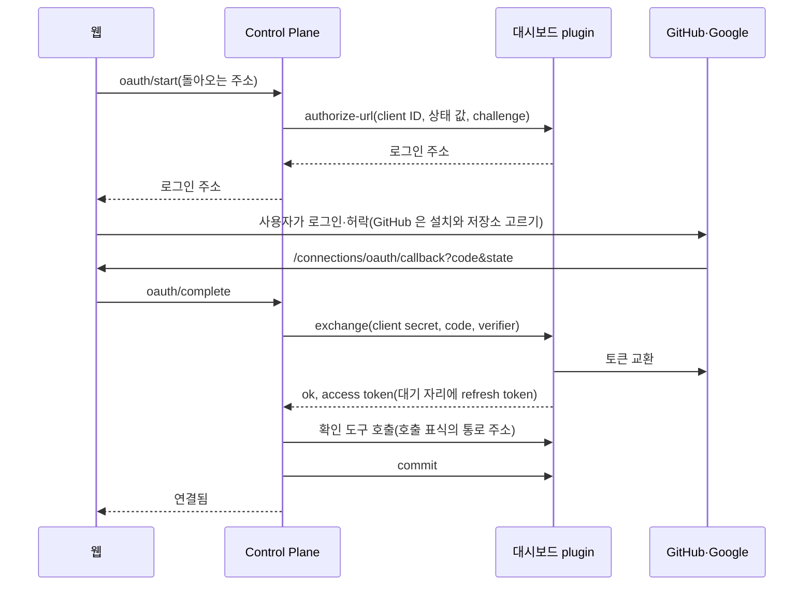

# 플러그인 계정 연결 단추(OAuth) 기술 설계

스펙: [`spec.md`](spec.md). 장기 결정은 [ADR-20261120 / connector-oauth](../../adr/ADR-20261120-connector-oauth.md) 가 갖는다.
서버 비밀값 저장소(`server_secret`, `ServerSecrets`)는 서버 비밀값 기능의 PR1a 가 만든다. 이 설계는 그 인터페이스를 이름으로만 쓴다.

## 요구사항 연결

| ID | 해결 방법 |
| --- | --- |
| REQ1 | `assistant.json` 에 `oauth` 객체를 더한다(아래 「선언」). 대시보드 plugin 의 manifest 검사가 제공자 표에 있는 이름만 받고, 틀리면 카탈로그의 `oauth` 만 null 로 내고 경고 로그를 남긴다(`icon` 과 같은 처리) |
| REQ2 | OAuth 앱 값은 `server_secret` 의 이름 `oauth_app:github:<플러그인 id>` 와 `oauth_app:google` 에 둔다. 서버 비밀값 화면은 카탈로그에서 OAuth 를 선언한 플러그인을 읽어 그 줄을 보인다. client ID 와 GitHub App 이름(slug)은 공개 값으로 원문을 보이고 client secret 만 감춘다 |
| REQ3 | 카탈로그 응답(`ConnectorSummary`)에 `oauth: {provider, ready}` 를 더한다. `ready` 는 그 앱 줄의 값이 모두 있을 때 참이다. 웹은 `ready` 면 단추와 접힌 「직접 입력」 을, 아니면 입력 칸만 그리고 `ADMIN` 에게만 서버 비밀값 링크를 보인다 |
| REQ4 | 시작은 Control Plane 이 상태 값을 만들고 대시보드에 로그인 주소를 받아 웹이 그리로 보낸다. 돌아오면 웹 경로가 Control Plane 에 넘기고, Control Plane 이 대시보드에 교환을 맡긴다. 대시보드가 받은 토큰을 보관 파일의 대기 자리에 쓰고, Control Plane 이 지금 등록 흐름의 확인 도구를 부른 뒤 대기 자리를 본 자리로 올린다(아래 「흐름」) |
| REQ5 | 상태 값 검사와 서비스의 `error` 응답, 부분 허락, 확인 도구 실패를 모두 `OAuthOutcome` 하나로 모아 웹의 돌아오는 경로가 연결 화면에 까닭과 「다시 시도」 를 그린다. 실패하면 대기 자리를 지우고 받은 토큰은 취소한다 |
| REQ6 | Control Plane 의 토큰 통로가 바인딩 표식을 받아 지금 유효한 access token 을 준다. Control Plane 은 access token 을 메모리에만 두고, 비었거나 곧 만료면 대시보드에 갱신을 맡긴다. 대시보드는 보관 파일의 refresh token 으로 갱신하고 바뀐 refresh token 을 같은 잠금 안에서 보관 파일에 쓴다. 통로 주소와 표식은 바인딩마다 고정이라 갱신이 서버 정의를 바꾸지 않는다 |
| REQ7 | 대시보드가 서비스 응답을 `ok`, `grant_revoked`, `app_rejected`, `unavailable` 로 나눠 답한다. `grant_revoked` 면 Control Plane 이 연결을 `PENDING` 과 `auth.reconnectRequired` 로 바꾸고 바뀌는 순간에만 알림을 남긴다. `app_rejected` 는 연결을 두고 관리자 알림을, `unavailable` 은 그 호출만 실패시킨다 |
| REQ8 | 해제 흐름이 보관 파일을 지우기 전에 대시보드에 취소를 맡긴다. 실패하면 해제를 그대로 잇고 응답에 `oauthRevokeFailed` 와 제공자 설정 주소를 담는다. GitHub 은 성공해도 앱 설치 화면 주소를 담는다 |
| REQ9 | 연결의 `fields` JSON 에 `auth.method`(`oauth` 나 `manual`)를 둔다. 방식을 바꾸는 등록은 지금처럼 보관 파일 전체를 다시 써서 앞 방식의 칸을 없앤다 |
| REQ10 | PR2. Gmail 선언에 `oauth`(google, 두 scope, 칸 `client_id`, `client_secret`, `refresh_token`)를 더하고, Gmail 서버가 토큰 env 가 있으면 통로에서 받고 없으면 지금처럼 스스로 갱신한다 |
| REQ11 | 시작과 돌아오기 API 는 로그인한 사용자의 연결만 다룬다. 상태 값에 사용자 번호가 들어 있고 돌아올 때 요청자와 같아야 한다 |

## 책임과 경계

| 모듈 | 맡는 것 |
| --- | --- |
| `hermes/plugins/dashboard-profile-api` | 제공자 표(로그인·토큰·취소 주소, 갱신 토큰이 바뀌는지, 오류 응답의 분류, 설정 화면 주소). 로그인 주소 만들기, 코드 교환, 갱신, 취소. 보관 파일의 OAuth 칸과 대기 자리. manifest 의 `oauth` 검사 |
| Control Plane `connector.connection` | 상태 값과 PKCE 만들기와 검사, 시작·돌아오기·해제의 흐름, 연결의 `auth` 칸, 갱신 주기, 끊김과 알림 |
| Control Plane `connector.connection` 의 토큰 통로 | 바인딩 표식과 호출 표식 검사, access token 메모리 보관, 연결마다 한 번에 하나인 갱신 |
| Control Plane `crypto` | `oauth_app:*` 와 `connector_oauth_signing` 줄. 서버 비밀값 기능의 저장소를 그대로 쓴다 |
| 웹 `/connections` | 단추, 시작 요청, 돌아오는 경로(`/connections/oauth/callback`), 결과 표시 |
| 플러그인(Gmail, 저장소 밖 커리어) | 토큰 env 가 있으면 도구를 부를 때 그 주소에서 토큰을 받아 쓴다 |

**제공자 표는 대시보드 plugin 이 갖고 Control Plane 은 제공자 이름을 불투명한 값으로만 다룬다.**
Control Plane 이 아는 것은 이름과 그 이름의 앱 줄 이름 규칙(GitHub 은 플러그인마다, Google 은 하나)뿐이다. 서비스 주소와 응답 모양은 모른다.
그래서 [ADR-043](../../../backend/docs/adr/ADR-043-커넥터는-plugin-의-connector-json-으로-선언하고-control-plane-은-범용-흐름만-갖는다.md) 이 적은 「Control Plane 은 서비스 이름과 주소를 모른다」 는 결과는 주소에 대해서는 지켜지고, 바뀌는 것은 「서비스 주소는 플러그인 선언만 갖는다」 다. 그 부분을 새 ADR 이 대체한다.

**토큰은 Control Plane DB 에 들어가지 않는다.** refresh token 은 보관 파일에만 있고 Control Plane 을 지나지 않는다. access token 은 Control Plane 메모리와 토큰 통로 응답에만 있다. client secret 은 서버 비밀값에서 꺼내 교환·갱신·취소 요청마다 대시보드에 보내고 대시보드는 저장하지 않는다.

토큰 통로를 Control Plane 이 여는 까닭: 플러그인 프로세스에서 Control Plane 에 닿는 길은 브라우저 중계가 이미 쓴다([ADR-20261008 / browser-gateway-token](../../../backend/docs/adr/ADR-20261008-browser-gateway-token.md)). 대시보드는 서비스 토큰으로 오는 Control Plane 요청만 받고 플러그인 프로세스가 부르는 길이 없다.

## 인터페이스와 데이터

### 선언

```json
"oauth": {
  "provider": "github",
  "fields": ["github_token"],
  "token_env": "CAREER_GITHUB_TOKEN_URL"
}
```

| 칸 | 뜻 |
| --- | --- |
| `provider` | 제공자 표의 이름. `github`, `google` |
| `scopes` | Google 만. 요청할 scope 목록. 빈 목록은 틀린 선언이다. GitHub 은 권한이 앱 등록에서 정해져 받지 않는다 |
| `fields` | 단추로 연결하면 채우지 않는 `secret: true` 칸 key 목록. 이 칸들은 단추 화면에서 「직접 입력」 아래로 접히고, 나머지 칸은 단추 위에 보인다(스펙 DECISION18) |
| `token_env` | 토큰 통로 주소를 받을 env 이름. `.mcp.json` 서버 env 의 합에 들어가고 다른 env 이름과 겹치지 않는다 |

`fields` 에 없는 칸만 있거나 모든 칸이 `fields` 에 들어 단추 밖 입력이 없어도 된다. 입력 칸이 하나도 없는 선언(단추 전용)은 받지 않는다. `fields` 의 칸은 `required` 여도 단추 연결에서는 비어 있어도 된다.

### 서버 비밀값 줄

| 이름 | 값 | 공개 값 |
| --- | --- | --- |
| `oauth_app:github:<플러그인 id>` | client secret | client ID, App 이름(slug) |
| `oauth_app:google` | client secret | client ID |
| `connector_oauth_signing` | 상태 값과 토큰 통로 표식의 HMAC 비밀 | 없음 |

`connector_oauth_signing` 은 처음 쓸 때 Control Plane 이 만든다. 화면에는 「자동 관리」 로 보이고 「새로 만들기」 를 누르면 OAuth 연결의 바인딩을 모두 다시 설치한다(브라우저 중계 서명 비밀과 같은 규칙).

### 연결의 `fields` JSON

`{"values", "secretPrefixes"}` 에 `auth` 를 더한다. 옛 글에는 없고 `manual` 로 읽는다.

```json
"auth": {"method": "oauth", "provider": "github", "reconnectRequired": false, "appRejectedAt": null}
```

단추 연결은 `fields` 의 칸을 `values` 와 `secretPrefixes` 에 두지 않는다. 테이블과 마이그레이션은 바뀌지 않는다. 칸의 뜻은 [`backend/docs/data-schema.md`](../../../backend/docs/data-schema.md) 의 「connector_connection」 에 더한다.

### 보관 파일

연결의 보관 파일에 예약 key `__oauth` 를 둔다. 값은 `{provider, refresh_token, granted_scopes, installation_id?}` 다. 칸 key 규칙(`^[a-z]...`)과 겹치지 않아 실행기가 env 로 넣지 않는다.
교환 직후에는 같은 디렉터리의 대기 자리(`<보관 파일 id>.pending`)에 쓰고, 확인 도구가 통과한 뒤 본 자리로 옮긴다. 대시보드가 기동할 때와 대기 자리를 쓸 때 10분 지난 대기 자리를 지운다.

### 대시보드 plugin 경로(서비스 토큰)

| 경로 | 받는 것 | 답하는 것 |
| --- | --- | --- |
| `POST /api/connector-oauth/authorize-url` | 플러그인 id, client ID, App 이름, 돌아오는 주소, 상태 값, PKCE challenge | 로그인 주소. GitHub 은 App 설치 화면, Google 은 동의 화면(`access_type=offline`, `prompt=consent`) |
| `POST /api/connector-oauth/exchange` | 보관 파일 id, 플러그인 id, client ID·secret, 코드, PKCE verifier, 돌아오는 주소 | `outcome`. 성공하면 대기 자리를 쓰고 access token 과 만료 시각을 답한다. Google 은 받은 scope 가 요청과 다르면 받은 토큰을 취소하고 `scope_denied` |
| `POST /api/connector-oauth/commit` | 보관 파일 id | 대기 자리를 본 자리로 옮긴다 |
| `POST /api/connector-oauth/discard` | 보관 파일 id, client ID·secret | 대기 자리의 토큰을 취소하고 지운다 |
| `POST /api/connector-oauth/refresh` | 보관 파일 id, client ID·secret | `outcome`, access token, 만료 시각. 바뀐 refresh token 은 답하기 전에 보관 파일에 쓴다 |
| `POST /api/connector-oauth/revoke` | 보관 파일 id, client ID·secret | `outcome`. 보관 파일은 지우지 않는다. 지우기는 지금 해제 경로가 한다 |

`outcome` 은 `ok`, `grant_revoked`, `app_rejected`, `scope_denied`, `unavailable` 가운데 하나다. 서비스 응답 원문과 토큰은 로그에 쓰지 않는다. 카탈로그 응답은 플러그인마다 정규화한 `oauth` 와 제공자의 설정 화면 주소를 함께 낸다.

### Control Plane API

| 경로 | 하는 일 |
| --- | --- |
| `POST /api/connections/{connectorId}/oauth/start` | 웹이 돌아오는 주소를 보낸다. 앱 값이 없으면 409 `CONNECTOR_OAUTH_NOT_CONFIGURED`. 상태 값과 PKCE 를 만들고 로그인 주소를 답한다 |
| `POST /api/connections/oauth/complete` | 웹이 받은 `state`, `code`, `error`, GitHub 의 `setup_action` 을 넘긴다. 결과 `OAuthOutcome` 과 연결 화면으로 갈 플러그인 id 를 답한다 |
| `GET <중계 주소의 호스트>/api/connector-token/{표식}` | 토큰 통로. `{access_token, expires_at}`. 표식이 틀리거나 바인딩이 없으면 404, 연결이 `READY` 가 아니면 409, 갱신이 `unavailable` 이면 503 |

상태 값은 `v1.<사용자 번호>.<플러그인 id>.<만료 epoch 초>.<무작위 16바이트>.<HMAC>` 이다. 서명할 글에 돌아오는 주소를 넣는다. PKCE verifier 는 `HMAC(서명 비밀, "pkce" + 무작위 값)` 으로 만들어 저장하지 않는다. 쓴 무작위 값은 만료까지 메모리 집합에 넣어 한 번만 받는다(서버 한 대 전제).
토큰 통로 표식은 바인딩이면 `b<바인딩 번호>.<HMAC>`, 바인딩 없이 확인 도구와 선택지를 부를 때는 `c<연결 번호>.<만료 epoch 초>.<HMAC>`(5분)다. 서명할 글은 `v1`, 종류, 번호, 만료다. 같은 바인딩은 늘 같은 표식을 받는다.
통로 주소는 브라우저 중계와 같은 설정 `assistant.browser.gateway-base-url` 의 호스트를 쓴다. 플러그인 프로세스에서 Control Plane 에 닿는 주소가 하나이기 때문이다. 비어 있으면 OAuth 플러그인의 `ready` 를 거짓으로 둔다.

### 흐름



GitHub 에서 App 이 이미 설치돼 있으면 설치 화면이 저장소 설정으로 끝나고 `setup_action=update` 에 코드가 없을 수 있다. 그때 Control Plane 은 같은 플러그인으로 상태 값을 새로 만들어 GitHub 의 일반 허락 주소를 답하고, 웹이 한 번 더 보낸다. 대시보드는 `authorize-url` 에 `mode: authorize` 를 받으면 그 주소를 만든다.

확인 도구는 지금 등록의 확인 경로를 그대로 쓴다. 다른 점은 비밀 칸 값 대신 `token_env` 에 호출 표식 주소를 넣는 것이다. 통과하면 commit, 연결 `READY`, `auth.method=oauth`, 붙은 바인딩 다시 설치 순서는 지금 등록 표([connector.md](../connector.md) 「연결의 등록, 확인, 해제」)와 같다.

바인딩 설치는 OAuth 연결이면 `token_env` 에 바인딩 표식 주소를 서버 정의 env 로 넣는다(브라우저 중계 주소와 같은 자리). 붙여 넣기 연결이면 빈 값이다.

### 갱신 주기

Control Plane 의 예약 작업이 10분마다 `READY` 인 OAuth 연결을 훑어, 메모리에 access token 이 없거나 15분 안에 만료되는 연결을 갱신한다. 재기동 뒤 첫 주기는 모든 OAuth 연결을 갱신한다. 토큰 통로 요청도 같은 갱신 함수를 부른다.
갱신은 연결 번호마다 한 번에 하나다(메모리 잠금). 이미 도는 갱신이 있으면 그 결과를 기다린다. GitHub 은 갱신마다 refresh token 이 바뀌므로 두 갱신이 겹치면 한쪽이 옛 값으로 실패해 끊김으로 잘못 보인다.

### 끊김과 알림

| `outcome` | 연결 | 알림 |
| --- | --- | --- |
| `grant_revoked` | `READY` 면 `PENDING`, `auth.reconnectRequired=true`. 메모리 토큰을 지운다 | 그 사용자에게 하나. `target_type` 은 `CONNECTIONS`, `source_public_id` 는 연결의 공개 번호. 이미 `reconnectRequired` 면 남기지 않는다 |
| `app_rejected` | 바꾸지 않는다. `auth.appRejectedAt` 을 적는다 | `ADMIN` 마다 하나. 갈 곳은 서버 비밀값 화면. 같은 앱 줄로 읽지 않은 알림이 있으면 남기지 않는다. 그 앱 줄이 바뀌면 `appRejectedAt` 을 비운다 |
| `unavailable` | 바꾸지 않는다 | 없다. 그 호출만 「잠시 뒤 다시」(`unavailable`) |

다시 연결(돌아오기 성공)은 `reconnectRequired` 를 비우고 그 연결의 끊김 알림을 읽음으로 바꾼다.

## 실패와 일관성

- **돌아오기의 순서**: 교환(대기 자리) → 확인 도구 → commit → 연결 커밋 → 바인딩 다시 설치. 확인 도구가 실패하면 discard 로 취소하고 지운다. commit 전에는 본 자리의 옛 값(붙여 넣기 연결 포함)이 그대로라 실패가 기존 연결을 깨지 않는다
- **commit 뒤 연결 커밋 실패**: 보관 파일은 새 토큰, 연결은 옛 상태다. 연결을 `PENDING` 으로 두고 `CONNECTOR_OPERATION_FAILED` 로 끝낸다. 지금 등록의 「보관 파일 쓰기가 실패한다」 와 같은 복구(다시 연결)다
- **동시 돌아오기**: 같은 사용자의 같은 연결은 지금 등록의 사용자 행 잠금 안에서 commit 과 연결 커밋을 한다. 나중 것이 이긴다(스펙 DECISION16). 대기 자리는 보관 파일 id 하나에 하나라 나중 교환이 앞 대기 자리를 덮는다. 앞 흐름의 commit 은 대기 자리가 바뀐 것을 대기 자리에 적은 무작위 값으로 알아채 409 로 끝난다
- **갱신 중 프로세스 종료**: 대시보드는 바뀐 refresh token 을 보관 파일에 쓴 뒤 답한다. Control Plane 이 답을 못 받으면 다음 갱신이 새 refresh token 으로 돈다
- **보관 파일 쓰기 실패**: 갱신은 받은 refresh token 을 쓰지 못하면 `unavailable` 로 답하고 access token 을 주지 않는다. GitHub 은 옛 refresh token 이 이미 무효라 다음 갱신이 `grant_revoked` 가 된다. 이 경우를 로그로 구분한다
- **해제**: 취소 → 지금 해제(바인딩 떼기, 보관 파일 지우기, 연결 `DISCONNECTED`). 취소 실패는 해제를 막지 않는다. 메모리 토큰을 지운다
- **배포 순서**: 대시보드 plugin 이 먼저다. Control Plane 이 새 경로를 부르는데 옛 plugin 이면 404 이고, Control Plane 은 OAuth 플러그인의 `ready` 를 거짓으로 둔다(카탈로그에 `oauth` 가 없으므로 같은 결과). 옛 Control Plane 은 새 카탈로그의 `oauth` 칸을 무시한다
- **서버 비밀값 PR1a 가 없으면** 이 기능을 시작하지 않는다(스펙 「선행 조건」)

## 검증 전략

| ID | 경계와 환경 |
| --- | --- |
| REQ1 | 대시보드 plugin 의 manifest 검사 테스트(맞는 선언, 모르는 제공자, Google 빈 scope, `token_env` 겹침, 단추 전용) |
| REQ2, REQ3 | Control Plane 카탈로그와 관리자 서버 비밀값 API 테스트, 웹 연결 화면 컴포넌트 테스트(`ready` 참·거짓, `ADMIN`·`MEMBER`) |
| REQ4, REQ5, REQ11 | Control Plane 통합 테스트에서 가짜 대시보드로 시작·돌아오기·실패 경로를 돈다. 상태 값 위조, 만료, 다른 사용자, 재사용. 웹 돌아오는 경로 테스트 |
| REQ6 | Control Plane 토큰 통로 테스트(표식, 만료 직전 갱신, 동시 요청 한 번 갱신, 갱신이 서버 정의를 바꾸지 않음). 대시보드 refresh 테스트(로컬 HTTP 가짜 제공자, refresh token 교체 저장) |
| REQ7 | `outcome` 별 상태와 알림 테스트(알림 한 번, 다시 연결 뒤 해제) |
| REQ8 | 해제 테스트(취소 성공, 실패해도 해제, 응답의 주소) |
| REQ9 | 방식 바꾸기 테스트(보관 파일의 앞 칸 없음), 옛 `fields` 글 읽기 |
| REQ10 | PR2. Gmail 플러그인 테스트(토큰 env 있음·없음) |
| 실제 서비스 | 배포 뒤 실제 GitHub App 으로 왕복한다. 설치와 허락, 이미 설치된 계정, 8시간 뒤 갱신, 허락 거두기, 해제. 원격 검증 목록은 plan 이 만든다 |

가짜 대시보드와 실제 대시보드의 경로 모양이 어긋나지 않게 Control Plane 테스트와 plugin 테스트가 같은 JSON 예시 파일을 읽는다(저장소 「Hermes 연동을 바꿨으면 배포 뒤 왕복시켜 본다」).

## 바꾸는 문서

| 문서 | 바꿀 것 |
| --- | --- |
| [`hermes/connectors/README.md`](../../../hermes/connectors/README.md) | 「assistant.json」 표에 `oauth`, 「비밀값과 권한」 에 토큰 통로를 쓰는 규칙 |
| [`hermes/plugins/dashboard-profile-api/README.md`](../../../hermes/plugins/dashboard-profile-api/README.md) | `connector-oauth` 경로와 보관 파일의 `__oauth` |
| [`docs/features/connector.md`](../connector.md) | 등록 표에 단추 흐름, 해제에 취소 |
| [`docs/code-architecture.md`](../../code-architecture.md) | 「플러그인 비밀값을 두는 곳」 에 refresh token 과 access token 의 자리 |
| [`backend/docs/data-schema.md`](../../../backend/docs/data-schema.md) | `connector_connection.fields` 의 `auth` |
| [ADR-043](../../../backend/docs/adr/ADR-043-커넥터는-plugin-의-connector-json-으로-선언하고-control-plane-은-범용-흐름만-갖는다.md) | 「대체된 부분」 줄 |

## 결정

| ID | 결정 | 답 | 누가 | 근거 |
| --- | --- | --- | --- | --- |
| DECISION1 | 제공자 표를 두는 곳 | 대시보드 plugin. Control Plane 은 이름만 안다 | 작성자 | 스펙 DECISION10. 교환·갱신·취소를 보관 파일 옆에서 해 refresh token 이 Control Plane 을 지나지 않는다 |
| DECISION2 | access token 의 자리 | Control Plane 메모리. DB 와 보관 파일 밖 | 작성자 | 토큰 통로가 Control Plane 에 있다. 재기동하면 다시 갱신하면 된다 |
| DECISION3 | 토큰 통로를 여는 쪽 | Control Plane, 바인딩 표식은 브라우저 중계와 같은 HMAC 방식 | 작성자 | 플러그인 프로세스에서 닿는 길이 이미 있다. 표식이 바인딩마다 고정이라 갱신이 재시작을 만들지 않는다(스펙 DECISION14) |
| DECISION4 | 상태 값 | 서명한 값과 메모리의 한 번 쓰기 집합. 테이블 없음 | 작성자 | 스펙 DECISION12. 서버 한 대 전제(서버 비밀값 설계와 같음) |
| DECISION5 | 서명 비밀 | `connector_oauth_signing` 하나를 상태 값과 통로 표식이 함께 쓰고 Control Plane 이 처음 쓸 때 만든다 | 작성자 | 둘 다 이 기능 안에서만 쓰여 바꿀 때의 영향이 같다. 관리자 일을 늘리지 않는다 |
| DECISION6 | 교환 직후의 자리 | 보관 파일의 대기 자리, 확인 뒤 commit | 작성자 | 확인이 실패해도 기존 연결 값이 그대로 남는다 |
| DECISION7 | 갱신 주기 | 10분마다 훑고 15분 안에 만료되는 것을 갱신 | 작성자 | 스펙 DECISION17. Google 1시간, GitHub 8시간 토큰에 모두 맞는다 |
| DECISION8 | 통로 주소의 설정 | 브라우저 중계의 `gateway-base-url` 호스트를 함께 쓴다 | 작성자 | 운영 설정을 늘리지 않는다. 플러그인 프로세스에서 Control Plane 에 닿는 주소는 하나다 |
| DECISION9 | 돌아오는 주소 | 웹이 자기 공개 주소로 만들어 시작 요청에 보낸다. 상태 값 서명에 넣는다 | 작성자 | Control Plane 에 웹 공개 주소 설정이 없다. 서명에 넣어 바꿔치기를 막는다 |

## 결정 기록 연결

| 결정 | 종류 | ADR 또는 필요 없음의 이유 | 현재 규칙의 원본 |
| --- | --- | --- | --- |
| DECISION1, DECISION2, DECISION3, 스펙 DECISION4·DECISION10 | architecture(areas: security) | [ADR-20261120 / connector-oauth](../../adr/ADR-20261120-connector-oauth.md) | 이 설계, `hermes/connectors/README.md`, 대시보드 plugin README |
| DECISION4 - DECISION9 | architecture | 필요 없음. 이 설계 안의 선택이고 되돌릴 때 외부 계약이 바뀌지 않는다 | 이 설계 |
