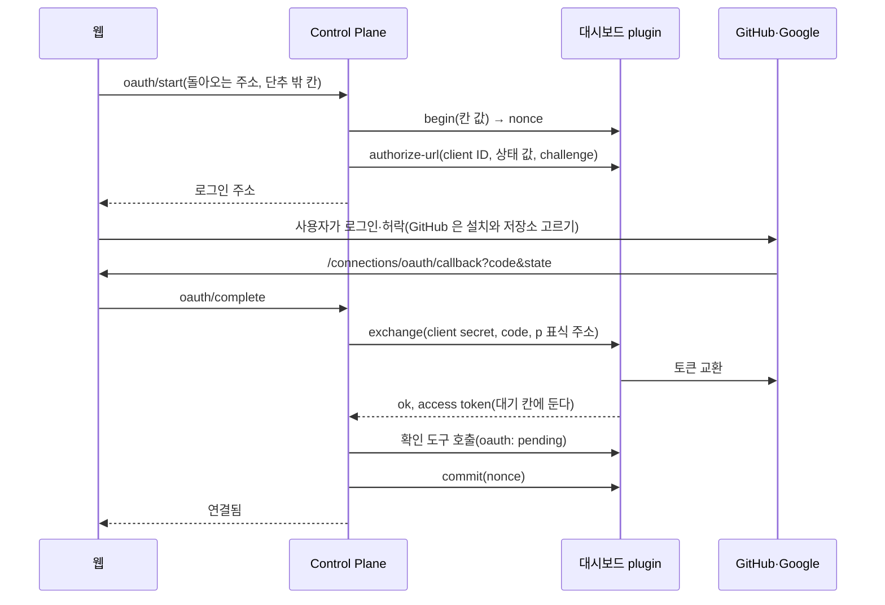

# 플러그인 계정 연결 단추(OAuth) 기술 설계

스펙: [`spec.md`](spec.md). 장기 결정은 [ADR-20261120 / connector-oauth](../../adr/ADR-20261120-connector-oauth.md) 가 갖는다.
서버 비밀값 저장소(`server_secret`, `ServerSecrets`)는 서버 비밀값 기능의 PR1a 가 만든다. 이 설계는 그 인터페이스를 이름으로만 쓴다.

## 요구사항 연결

| ID | 해결 방법 |
| --- | --- |
| REQ1 | `assistant.json` 에 `oauth` 객체를 더한다(아래 「선언」). 대시보드 plugin 의 manifest 검사가 제공자 표에 있는 이름만 받고, 틀리면 카탈로그의 `oauth` 만 null 로 내고 경고 로그를 남긴다(`icon` 과 같은 처리) |
| REQ2 | OAuth 앱 값은 `server_secret` 의 이름 `oauth_app:github:<플러그인 id>` 와 `oauth_app:google` 에 둔다. 서버 비밀값 화면은 카탈로그에서 OAuth 를 선언한 플러그인을 읽어 그 줄을 보인다. client ID 와 GitHub App 이름(slug)은 공개 값으로 원문을 보이고 client secret 만 감춘다 |
| REQ3 | 카탈로그 응답(`ConnectorSummary`)에 `oauth: {provider, ready, fields}` 를 더한다. `ready` 는 그 앱 줄의 값이 모두 있고 토큰 통로 주소를 만들 수 있을 때 참이다. 웹은 `ready` 면 단추 위에 `fields` 밖 칸을, 접힌 「직접 입력」 에 `oauth.fields` 에 든 칸을 그린다. 아니면 입력 칸만 그리고 `ADMIN` 에게만 서버 비밀값 링크를 보인다 |
| REQ4 | 시작 요청이 단추 밖 칸 값을 함께 받아 대기 보관 파일에 쓴다. 돌아오면 대시보드가 코드를 교환해 대기 OAuth 파일에 쓰고, Control Plane 이 대기 자리로 확인 도구를 부른 뒤 두 대기 파일을 본 자리로 올린다(아래 「흐름」) |
| REQ5 | 상태 값 검사, 서비스의 `error` 응답, 부분 허락, 확인 도구 실패, 앱 자격 거절을 `OAuthOutcome` 하나로 모아 웹의 돌아오는 경로가 연결 화면에 까닭과 「다시 시도」 를 그린다. 실패하면 대기 파일을 지운다 |
| REQ6 | Control Plane 의 토큰 통로가 연결 표식을 받아 지금 유효한 access token 을 준다. 통로 주소는 OAuth 파일에 있고 실행기가 칸처럼 `token_env` 로 넣는다. OAuth 파일은 보관 파일 리비전 밖이라 갱신이 서버 정의를 바꾸지 않는다 |
| REQ7 | 대시보드가 서비스 응답을 `ok`, `grant_revoked`, `app_rejected`, `unavailable` 로 나눠 답한다. `grant_revoked` 면 연결을 `PENDING` 과 `auth.reconnectRequired` 로 바꾸고 바뀌는 순간에만 사용자 알림을 남긴다. `app_rejected` 는 연결을 두고 관리자 알림을, `unavailable` 은 그 호출만 실패시킨다 |
| REQ8 | 해제가 보관 파일을 지우기 전에 대시보드에 취소를 맡긴다. 실패하거나 건너뛰면 해제를 그대로 잇고 응답에 `oauthRevoke: failed` 와 제공자 설정 주소를 담는다. GitHub 은 성공해도 앱 설치 화면 주소를 담는다 |
| REQ9 | 연결의 `fields` JSON 에 `auth.method`(`oauth` 나 `manual`)를 둔다. 붙여 넣기 등록은 OAuth 파일을 지우고, 단추 연결의 commit 은 보관 파일을 단추 밖 칸만으로 바꾼다 |
| REQ10 | PR2. Gmail 선언에 `oauth`(google, 두 scope, 칸 `client_id`, `client_secret`, `refresh_token`)를 더하고, Gmail 서버가 토큰 env 가 있으면 통로에서 받고 없으면 지금처럼 스스로 갱신한다 |
| REQ11 | 시작과 돌아오기 API 는 로그인한 사용자의 연결만 다룬다. 상태 값에 사용자 번호가 들어 있고 돌아올 때 요청자와 같아야 한다 |

## 책임과 경계

| 모듈 | 맡는 것 |
| --- | --- |
| `hermes/plugins/dashboard-profile-api` | 제공자 표(로그인·토큰·취소 주소, 갱신 토큰이 바뀌는지, 오류 응답의 분류, 설정 화면 주소). 로그인 주소 만들기, 코드 교환, 갱신, 취소. OAuth 파일과 대기 파일. manifest 의 `oauth` 검사. 실행기와 직접 실행의 `token_env` 넣기 |
| Control Plane `connector.connection` | 상태 값과 PKCE, 시작·돌아오기·확인·해제의 OAuth 갈래, 연결의 `auth` 값, 갱신 주기, 끊김과 알림 |
| Control Plane 토큰 통로 | 표식 검사, access token 메모리(현재 칸과 대기 칸), 연결마다 한 번에 하나인 갱신 |
| Control Plane `crypto` | `oauth_app:*` 와 `connector_oauth_signing` 줄. 서버 비밀값 기능의 저장소를 그대로 쓴다 |
| 웹 `/connections` | 단추, 시작 요청, 돌아오는 경로(`/connections/oauth/callback`), 결과 표시 |
| 플러그인(Gmail, 저장소 밖 커리어) | 토큰 env 가 있으면 도구를 부를 때 그 주소에서 토큰을 받아 쓴다 |

**제공자 표는 대시보드 plugin 이 갖고 Control Plane 은 제공자 이름을 불투명한 값으로만 다룬다.**
Control Plane 이 아는 것은 이름과 그 이름의 앱 줄 이름 규칙(GitHub 은 플러그인마다, Google 은 하나)뿐이다. 서비스 주소와 응답 모양은 모른다.
그래서 [ADR-043](../../../backend/docs/adr/ADR-043-커넥터는-plugin-의-connector-json-으로-선언하고-control-plane-은-범용-흐름만-갖는다.md) 이 적은 「Control Plane 은 서비스 이름과 주소를 모른다」 는 결과는 주소에 대해서는 지켜지고, 바뀌는 것은 「서비스에 관한 것은 플러그인 선언만 갖는다」 다. 그 부분을 새 ADR 이 대체한다.

**토큰은 Control Plane DB 와 서버 정의에 들어가지 않는다.** refresh token 과 통로 주소는 OAuth 파일에만 있고, refresh token 은 Control Plane 을 지나지 않는다. access token 은 Control Plane 메모리와 토큰 통로 응답에만 있다. client secret 은 서버 비밀값에서 꺼내 교환·갱신·취소 요청마다 대시보드에 보내고 대시보드는 저장하지 않는다.

토큰 통로를 Control Plane 이 여는 까닭: 플러그인 프로세스에서 Control Plane 에 닿는 길은 브라우저 중계가 이미 쓴다([ADR-20261008 / browser-gateway-token](../../../backend/docs/adr/ADR-20261008-browser-gateway-token.md)). 대시보드는 서비스 토큰으로 오는 Control Plane 요청만 받고 플러그인 프로세스가 부르는 길이 없다.

## 인터페이스와 데이터

### 선언

```json
"oauth": {
  "provider": "github",
  "fields": ["github_token"],
  "token_env": "CAREER_GITHUB_TOKEN_URL"
}
```

| 칸 | 뜻 |
| --- | --- |
| `provider` | 제공자 표의 이름. `github`, `google` |
| `scopes` | Google 만. 요청할 scope 목록. 빈 목록은 틀린 선언이다. GitHub 은 권한이 앱 등록에서 정해져 받지 않는다 |
| `fields` | 단추로 연결하면 비워 두는 비밀 칸(`secret: true`)의 key 목록. 하나 이상이다 |
| `token_env` | 토큰 통로 주소를 받을 env 이름. `.mcp.json` 서버 env 의 합에 들어가고 다른 env 이름과 겹치지 않는다 |

입력 칸이 하나도 없는 선언(단추 전용)은 `fields` 가 모든 칸이어도 「직접 입력」 으로 그 칸들을 넣을 수 있어 생기지 않는다.

**`oauth.fields` 에 든 칸의 필수 검사는 OAuth 연결에서 건너뛴다.** 칸 값 검사를 하는 세 곳이 OAuth 연결이면 `oauth.fields` 에 든 칸이 비어도 받는다.

| 자리 | 바꿀 것 |
| --- | --- |
| Control Plane `ConnectorValues.validated` | 등록 방식(`oauth`)을 받아 `oauth.fields` 에 든 칸을 필수에서 뺀다 |
| 대시보드 `connector_vault.py` 의 보관 파일 쓰기 검사 | OAuth 파일이 있거나 함께 쓰는 쓰기면 `oauth.fields` 에 든 칸을 필수에서 뺀다 |
| 대시보드 `connector_install.py` 의 설치 검사 | 같은 판정을 쓴다 |

### 서버 비밀값 줄

| 이름 | 값 | 공개 값 |
| --- | --- | --- |
| `oauth_app:github:<플러그인 id>` | client secret | client ID, App 이름(slug) |
| `oauth_app:google` | client secret | client ID |
| `connector_oauth_signing` | 상태 값과 토큰 통로 표식의 HMAC 비밀 | 없음 |

`connector_oauth_signing` 은 처음 쓸 때 Control Plane 이 만든다. 화면에는 「자동 관리」 로 보이고 「새로 만들기」 를 누르면 모든 OAuth 연결의 OAuth 파일에 새 통로 주소를 다시 쓴다. 통로 주소가 실행기 밖 파일에 있어 바인딩 재설치와 재시작이 필요 없고, 떠 있는 플러그인은 다음 프로세스부터 새 주소를 받는다. 그 사이 옛 표식은 401 이므로 「새로 만들기」 확인 창이 그 사실을 알린다.

### 연결의 `fields` JSON

`{"values", "secretPrefixes"}` 에 `auth` 를 더한다. 옛 글에는 없고 `manual` 로 읽는다.

```json
"auth": {"method": "oauth", "provider": "github", "reconnectRequired": false}
```

단추 연결은 `oauth.fields` 에 든 칸을 `values` 와 `secretPrefixes` 에 두지 않는다. 테이블과 마이그레이션은 바뀌지 않는다. 칸의 뜻은 [`backend/docs/data-schema.md`](../../../backend/docs/data-schema.md) 의 「connector_connection」 에 더한다.

### OAuth 파일

보관 파일(`<보관 파일 id>`) 옆에 **OAuth 파일** `<보관 파일 id>.oauth` 을 둔다. 보관 파일과 같은 key 로 암호화하고 형식은 따로다. 풀기는 실행기가 plugin 패키지 없이 읽는 `connector_vault_format.py` 에 둔다. 보관 파일 key 를 바꿀 때 기동 이관이 OAuth 파일과 대기 파일도 새 key 로 다시 쓰고 「옛 key 파일 수」 에 센다.
보관 파일의 `values` 는 문자열 사전만 받고(`connector_vault_format.py`) 리비전이 파일 메타데이터의 해시(`connector_launch.py` 의 `_vault_revision`)라 둘 다 OAuth 상태를 담기에 맞지 않는다.

| 칸 | 뜻 |
| --- | --- |
| `provider` | 제공자 이름 |
| `refresh_token` | 원문 |
| `granted_scopes` | 받은 scope |
| `token_url` | 토큰 통로 주소. 연결 표식을 담는다 |
| `nonce` | 대기 파일에만 있다. 이 흐름을 가리킨다 |

begin 이 단추 밖 칸을 담은 대기 보관 파일 `<보관 파일 id>.pending` 과, 토큰 없이 `nonce` 만 담은 대기 OAuth 파일 `<보관 파일 id>.oauth.pending` 을 만든다. 교환은 `nonce` 가 같을 때만 대기 OAuth 파일에 토큰을 채운다. commit 은 대기 보관 파일의 값을 지금 보관 파일 쓰기(`_write_vault`)로 본 자리에 써서 값이 같으면 파일을 바꾸지 않고, 대기 OAuth 파일만 rename 한다. 보관 파일을 rename 하면 값이 같아도 리비전(inode, 수정 시각, 크기)이 바뀌어 재시작 대기가 되기 때문이다. 대시보드가 기동할 때와 대기 파일을 쓸 때 10분 지난 대기 파일을 지운다.

**보관 파일 id 마다 잠금을 두고, 잡는 순서는 보관 파일 잠금이 먼저, 전역 `PROFILE_WRITE_LOCK` 이 나중이다.** 갱신, begin, commit, discard, 취소, 보관 파일 `PUT`·`DELETE` 가 모두 보관 파일 잠금 안에서 읽고 고쳐 쓴다. 본 보관 파일을 쓰는 commit 과 `PUT`·`DELETE` 는 보관 파일 잠금 다음 전역 잠금을 잡는다. 바인딩 설치는 지금처럼 전역 잠금만 잡고 보관 파일 잠금을 잡지 않는다. 그래서 설치가 보관 파일과 리비전을 읽는 동안 본 보관 파일이 바뀌지 않고, 잡는 순서가 거꾸로 되는 일이 없다. 갱신과 취소는 보관 파일 잠금만 잡고 서비스를 부르며 전역 잠금은 잡지 않는다. 그래서 서비스 응답을 기다리는 동안 다른 profile 쓰기가 멈추지 않고, 같은 보관 파일을 쓰려는 요청만 전역 잠금 밖에서 기다린다. 바뀐 refresh token 을 잃지 않으려고 갱신은 서비스 호출부터 파일 쓰기까지 잠금을 놓지 않는다.

### 실행기와 직접 실행

| 경로 | 바꿀 것 |
| --- | --- |
| 실행기 정의(`connector_launch.py`) | OAuth 를 선언한 플러그인이면 실행기 인자에 `@oauth=<token_env>` 를 더하고, 정의 env 의 `token_env` 는 주인 env 처럼 빈 값으로 둔다. `${이름}` 참조를 두면 profile `.env` 에 값이 없을 때 그 글자가 그대로 프로세스에 간다. 인자는 연결 방식과 상관없이 늘 같아 방식을 바꿔도 정의가 그대로다 |
| 정의 해석(`connector_launch.py` 의 `_launcher_parts`, `_launcher_current`, `_launcher_inner`) | `@oauth=` 인자를 칸과 따로 읽는다. 낡은 정의 판정과 `${..}` env 만들기에서 칸으로 세지 않는다 |
| 실행기(`connector_launcher.py` 의 `_parse_args`) | `@oauth` 가 있으면 OAuth 파일을 풀어 `token_url` 을 그 env 에 넣는다. 파일이 없으면(붙여 넣기 연결) 빈 값이다 |
| 직접 실행(`connector_run.py` 가 부르는 `connector_launch.py` 의 `_binding_env`) | 승인한 쓰기와 금융 준비도 같은 OAuth 파일을 읽어 넣는다 |
| 확인·선택지 호출(`call`, `list`) | 본문 모양 검사에 `oauth` key 를 더한다. `oauth: "current"` 면 본 자리의 보관 파일과 OAuth 파일을, `oauth: "pending"` 이면 대기 보관 파일의 칸 값과 대기 OAuth 파일의 `token_url` 을 넣는다. 처음 연결은 본 자리 보관 파일이 없어도 된다 |

### 대시보드 plugin 경로(서비스 토큰)

| 경로 | 받는 것 | 답하는 것 |
| --- | --- | --- |
| `POST /api/connector-oauth/authorize-url` | 플러그인 id, `mode`(`install`·`authorize`), client ID, App 이름, 돌아오는 주소, 상태 값, PKCE challenge | 로그인 주소. GitHub `install` 은 App 설치 화면, `authorize` 는 일반 허락 화면. Google 은 동의 화면(`access_type=offline`, `prompt=consent`) |
| `POST /api/connector-oauth/begin` | 보관 파일 id, 단추 밖 칸 값 | 대기 보관 파일을 쓰고 `nonce` 를 답한다 |
| `POST /api/connector-oauth/exchange` | 보관 파일 id, `nonce`, client ID·secret, 코드, PKCE verifier(있을 때), 돌아오는 주소, 통로 주소 | `outcome`. 성공하면 대기 OAuth 파일을 쓰고 access token 과 만료 시각을 답한다. Google 은 받은 scope 가 요청과 다르면 `scope_denied` |
| `POST /api/connector-oauth/commit` | 보관 파일 id, `nonce` | 대기 파일 둘을 본 자리로 옮긴다. `nonce` 가 다르면 409 |
| `POST /api/connector-oauth/discard` | 보관 파일 id, `nonce`, client ID·secret, access token | 대기 파일을 지운다. GitHub 은 그 access token 하나만 취소한다. Google 은 취소하지 않는다(아래 「취소 범위」) |
| `POST /api/connector-oauth/refresh` | 보관 파일 id, client ID·secret | `outcome`, access token, 만료 시각. 바뀐 refresh token 은 답하기 전에 OAuth 파일에 쓴다 |
| `POST /api/connector-oauth/revoke` | 보관 파일 id, client ID·secret, access token(있으면) | `outcome`. GitHub 은 access token 이 없으면 먼저 갱신해 받는다. 파일은 지우지 않는다. 지금 해제 경로의 보관 파일 `DELETE` 가 보관 파일과 OAuth 파일, 대기 파일 둘을 함께 지운다. 취소를 건너뛰거나 실패해도 refresh token 이 남지 않는다 |
| `POST /api/connector-oauth/token-url` | 보관 파일 id, 새 통로 주소 | OAuth 파일의 `token_url` 만 바꾼다(서명 비밀 교체) |

`outcome` 은 `ok`, `grant_revoked`, `app_rejected`, `scope_denied`, `unavailable`, `missing`(갱신할 OAuth 파일이 없음) 가운데 하나다. 교환 응답에 refresh token 이 없으면 앱 설정(GitHub App 의 토큰 만료 끄기 등) 문제로 보고 `app_rejected` 다. 서비스 응답 원문과 토큰은 로그에 쓰지 않는다. 카탈로그 응답은 플러그인마다 정규화한 `oauth` 와 제공자의 설정 화면 주소를 함께 낸다.

### Control Plane API

| 경로 | 하는 일 |
| --- | --- |
| `POST /api/connections/{connectorId}/oauth/start` | 웹이 돌아오는 주소와 단추 밖 칸 값을 보낸다. 칸 값을 지금 등록과 같이 검사한다. 앱 값이 없으면 409 `CONNECTOR_OAUTH_NOT_CONFIGURED`. begin 으로 대기 보관 파일을 쓰고, 상태 값과 PKCE 를 만들어 로그인 주소를 답한다 |
| `POST /api/connections/oauth/complete` | 웹이 받은 `state`, `code`, `error`, GitHub 의 `setup_action` 을 넘긴다. 결과 `OAuthOutcome` 과 연결 화면으로 갈 플러그인 id, 다시 보낼 로그인 주소(아래 「흐름」)를 답한다 |
| `GET /internal/connector-token/{표식}` | 토큰 통로. JWT 없이 받는다(`SecurityConfig` 에 `permitAll`, 브라우저 중계와 같은 자리). `{access_token, expires_at}` |

**상태 값**은 `v1.<사용자 번호>.<플러그인 id>.<만료 epoch 초>.<무작위 16바이트>.<HMAC>` 이다. 서명할 글에 돌아오는 주소와 begin 의 `nonce` 를 넣는다. PKCE verifier 는 `HMAC(서명 비밀, "pkce" + 무작위 값)` 으로 만들어 저장하지 않는다. 쓴 무작위 값은 만료까지 메모리 집합에 넣어 한 번만 받는다. 시작 때 받은 begin 의 `nonce`, 단추 밖 칸의 비밀 아닌 값과 비밀 칸 앞부분을 그 무작위 값을 key 로 메모리에 10분 둔다(서버 한 대 전제). complete 는 상태 값의 서명을 그 `nonce` 와 함께 검사하고 exchange·commit·discard 에 넘긴다.

**토큰 통로 표식**은 두 가지다. 서명할 글은 `v1`, 종류, 번호, (대기면) `nonce` 다.

| 표식 | 담는 곳 | 주는 토큰 |
| --- | --- | --- |
| `k<연결 번호>.<HMAC>` | OAuth 파일. 연결마다 고정 | 메모리의 현재 칸. 연결이 해제됐거나 `auth.reconnectRequired` 면 409. 확인 도구 실패로 `PENDING` 인 연결은 받는다(「연결 다시 확인」 이 이 표식으로 확인 도구를 부른다) |
| `p<연결 번호>.<nonce>.<HMAC>` | 대기 OAuth 파일 | 메모리의 대기 칸. 연결 상태를 보지 않는다. 대기 칸이 없으면 404 |

표식이 틀리면 401, 연결이 없거나 해제됐으면 404, 갱신이 `unavailable` 이면 503 이다.
표식은 가진 쪽이 곧 권한이다. 통로가 막는 것은 번호를 바꾸거나 위조한 표식이고, 커넥터 코드 자체를 막는 경계는 아니다(browser-gateway-token 과 같음). 표식이 서버 정의와 `config.yaml` 에 없고 실행기가 띄운 프로세스 env 에만 들어가, 지금 붙여 넣은 토큰과 같은 자리에 있다.

통로 주소의 호스트는 브라우저 중계 설정 `assistant.browser.gateway-base-url` 의 호스트를 쓰고 경로를 `/internal/connector-token/` 로 바꾼다. 플러그인 프로세스에서 Control Plane 에 닿는 주소가 하나이기 때문이다. 비어 있으면 OAuth 플러그인의 `ready` 를 거짓으로 둔다.

### 흐름



**PKCE**: Google 과 GitHub `authorize` 주소에는 challenge 를 넣고 교환에 verifier 를 보낸다. GitHub `install` 화면은 challenge 를 받을 자리가 없어 verifier 없이 교환한다. 상태 값은 두 경우 모두 쓴다. GitHub 이 설치 화면에서 상태 값을 돌려주는지와 PKCE 동작은 실제 GitHub 왕복으로 확인한다.

**이미 설치된 GitHub App**: 설치 화면이 저장소 설정으로 끝나고 `setup_action=update` 에 코드가 없을 수 있다. 그때 Control Plane 은 같은 대기 `nonce` 로 상태 값을 새로 만들어 `authorize` 주소를 답하고 웹이 한 번 더 보낸다.

**확인 도구**: 지금 등록의 확인 경로를 쓰되 `oauth: "pending"` 으로 부른다. 통과하면 commit, 메모리 대기 칸을 현재 칸으로 옮기기, 연결 `READY` 와 `auth.method=oauth`, 붙은 바인딩 다시 설치 순서다. 나머지는 지금 등록 표([connector.md](../connector.md) 「연결의 등록, 확인, 해제」)와 같다. 방식을 바꾸지 않은 다시 연결은 서버 정의가 그대로라 재시작 대기가 생기지 않는다. 붙여 넣기에서 단추로 바꾸면 보관 파일이 바뀌어 지금처럼 재시작 대기가 된다.

**「연결 다시 확인」**(OAuth 연결): 먼저 갱신을 한 번 강제로 하고, `ok` 면 `oauth: "current"` 로 확인 도구를 부른다(스펙 DECISION19). `grant_revoked` 면 확인 도구 없이 다시 연결 필요로 남는다.

### 갱신 주기

Control Plane 의 예약 작업이 10분마다 `READY` 인 OAuth 연결을 훑어, 메모리 현재 칸이 없거나 15분 안에 만료되는 연결을 갱신한다. 재기동 뒤 첫 주기는 모든 OAuth 연결을 갱신한다. 토큰 통로 요청도 같은 갱신 함수를 부른다.
갱신은 연결 번호마다 한 번에 하나다(메모리 잠금). 이미 도는 갱신이 있으면 그 결과를 기다린다. 대시보드의 보관 파일 잠금이 commit, 붙여 넣기 등록과의 겹침을 막는다. 갱신이 OAuth 파일을 읽었을 때 파일이 없으면(그 사이 붙여 넣기로 바뀜) `grant_revoked` 가 아니라 `ok` 없이 끝나고 Control Plane 은 메모리 칸만 지운다.

### 끊김과 알림

알림의 `source_public_id` 는 이름에서 만든 UUID(`UUID.nameUUIDFromBytes`)다. 연결 끊김은 `connector-oauth:connection:<연결 번호>`, 앱 거절은 `connector-oauth:app:<앱 줄 이름>` 이다. 연결과 앱 줄에 공개 번호가 없어 칸을 늘리지 않고 같은 원인을 가리킨다.

| `outcome` | 연결 | 알림 |
| --- | --- | --- |
| `grant_revoked` | `READY` 면 `PENDING`, `auth.reconnectRequired=true`. 메모리 칸을 지운다 | 그 사용자에게 하나. `target_type` 은 `CONNECTIONS`. 이미 `reconnectRequired` 면 남기지 않는다 |
| `app_rejected` | 바꾸지 않는다 | `ADMIN` 마다 하나. 새 `target_type` `ADMIN_SECRETS`(서버 비밀값 화면). 같은 `source_public_id` 의 읽지 않은 알림이 있으면 남기지 않는다. 그 앱 줄을 바꾸면 그 알림을 읽음으로 바꾼다 |
| `unavailable` | 바꾸지 않는다 | 없다. 그 호출만 「잠시 뒤 다시」(`unavailable`) |

다시 연결(돌아오기 성공)은 `reconnectRequired` 를 비우고 그 연결의 끊김 알림을 읽음으로 바꾼다.

### 취소 범위

| 제공자 | 해제 | 실패한 흐름의 discard |
| --- | --- | --- |
| GitHub | 그 플러그인 App 의 사용자 허락(grant)을 취소한다. 앱이 플러그인마다라(스펙 DECISION9) 다른 플러그인 연결에 닿지 않는다. 같은 GitHub 계정을 두 사용자가 같은 플러그인에 연결했다면 둘 다 끊긴다. 가족 설치에서 드문 일로 받아들인다 | 그 access token 하나만 취소한다. 기존 연결의 허락은 남는다 |
| Google | 같은 사용자의 다른 `READY` Google OAuth 연결이 있으면 취소하지 않고 「직접 거두기」 안내를 보인다. Google 은 토큰 하나를 취소해도 그 앱의 허락 전체가 사라져 다른 Google 플러그인 연결까지 끊기기 때문이다. 없으면 refresh token 을 취소한다 | 취소하지 않는다. 다시 연결하던 기존 Gmail 연결이 함께 끊기지 않게 한다 |

## 실패와 일관성

- **돌아오기의 순서**: begin(대기 보관 파일) → 교환(대기 OAuth 파일, 메모리 대기 칸) → 확인 도구 → commit → 연결 커밋 → 바인딩 다시 설치. 확인 도구가 실패하면 discard 한다. commit 전에는 본 자리의 옛 파일과 메모리 현재 칸이 그대로라 실패가 기존 연결을 깨지 않는다
- **commit 뒤 연결 커밋 실패**: 파일은 새 토큰, 연결은 옛 상태다. 연결을 `PENDING` 으로 두고 `CONNECTOR_OPERATION_FAILED` 로 끝낸다. 지금 등록의 「보관 파일 쓰기가 실패한다」 와 같은 복구(다시 연결)다
- **동시 돌아오기**: 나중 begin 이 대기 파일과 `nonce` 를 덮는다. 앞 흐름의 commit 은 `nonce` 가 달라 409 로 끝나고 화면에 「다시 시도」 를 보인다. 나중 흐름이 이긴다(스펙 DECISION16). commit 과 연결 커밋은 지금 등록의 사용자 행 잠금 안에서 한다
- **갱신 중 Control Plane 종료**: 대시보드는 바뀐 refresh token 을 OAuth 파일에 쓴 뒤 답한다. 답을 못 받아도 다음 갱신이 새 refresh token 으로 돈다
- **OAuth 파일 쓰기 실패**: 갱신은 받은 refresh token 을 쓰지 못하면 `unavailable` 로 답하고 access token 을 주지 않는다. GitHub 은 옛 refresh token 이 이미 무효라 다음 갱신이 `grant_revoked` 가 된다. 이 경우를 로그로 구분한다
- **해제**: 취소 → 지금 해제(바인딩 떼기, 보관 파일 지우기, 연결 `DISCONNECTED`). 취소 실패는 해제를 막지 않는다. 메모리 칸을 지운다
- **배포 순서**: 대시보드 plugin 이 먼저다. 옛 plugin 은 카탈로그에 `oauth` 가 없어 Control Plane 이 단추를 내지 않는다. 옛 Control Plane 은 새 카탈로그의 `oauth` 값을 무시한다. 실행기 인자 `@oauth` 는 새 plugin 이 만든 정의에만 있다. 이미 바인딩이 있는 플러그인에 `oauth` 선언을 더하면(PR2 의 Gmail, 저장소 밖 커리어) 붙여 넣기 바인딩의 정의도 인자가 늘어 한 번 재시작 대기가 된다. 연결 반영 자동화가 없으면 관리자가 반영 완료를 누른다
- **서버 비밀값 PR1a 가 없으면** 이 기능을 시작하지 않는다(스펙 「선행 조건」)

## 검증 전략

| ID | 경계와 환경 |
| --- | --- |
| REQ1 | 대시보드 plugin 의 manifest 검사 테스트(맞는 선언, 모르는 제공자, Google 빈 scope, `token_env` 겹침, 빈 `fields`) |
| REQ2, REQ3 | Control Plane 카탈로그와 관리자 서버 비밀값 API 테스트, 웹 연결 화면 컴포넌트 테스트(`ready` 참·거짓, `ADMIN`·`MEMBER`, 단추 밖 칸) |
| REQ4, REQ5, REQ11 | Control Plane 통합 테스트에서 가짜 대시보드로 시작·돌아오기·실패 경로를 돈다. 상태 값 위조, 만료, 다른 사용자, 재사용, `nonce` 어긋남. 대시보드의 begin·exchange·commit·discard 테스트. 웹 돌아오는 경로 테스트 |
| REQ6 | Control Plane 토큰 통로 테스트(표식 위조, 현재·대기 칸, 만료 직전 갱신, 동시 요청 한 번 갱신). 대시보드 테스트(refresh token 교체 저장, 갱신과 같은 값 commit 뒤 실행기 정의와 리비전이 그대로, 실행기와 `_binding_env` 가 `token_env` 를 넣음, `@oauth` 인자가 낡은 정의로 판정되지 않음, 해제가 OAuth 파일까지 지움, 갱신 중 다른 profile 쓰기가 막히지 않음) |
| REQ7 | `outcome` 별 상태와 알림 테스트(알림 한 번, 다시 연결 뒤 읽음, 앱 줄 바꾸면 관리자 알림 읽음), `ADMIN_SECRETS` 알림을 눌러 서버 비밀값 화면으로 가는 웹 테스트 |
| REQ8 | 해제 테스트(취소 성공, 실패해도 해제, Google 공유 건너뛰기, 응답의 주소) |
| REQ9 | 방식 바꾸기 테스트(붙여 넣기 등록이 OAuth 파일을 지움, commit 이 보관 파일의 `oauth.fields` 에 든 칸을 없앰), 옛 `fields` 글 읽기 |
| REQ10 | PR2. Gmail 플러그인 테스트(토큰 env 있음·없음) |
| 실제 서비스 | 배포 뒤 실제 GitHub App 으로 왕복한다. 설치와 허락, 상태 값 전달, 이미 설치된 계정, 8시간 뒤 갱신, 허락 거두기, 해제와 discard 의 취소 범위. 원격 검증 목록은 plan 이 만든다 |

가짜 대시보드와 실제 대시보드의 경로 모양이 어긋나지 않게 Control Plane 테스트와 plugin 테스트가 같은 JSON 예시 파일을 읽는다(저장소 「Hermes 연동을 바꿨으면 배포 뒤 왕복시켜 본다」).

## 바꾸는 문서

| 문서 | 바꿀 것 |
| --- | --- |
| [`hermes/connectors/README.md`](../../../hermes/connectors/README.md) | 「assistant.json」 표에 `oauth`, 「비밀값과 권한」 에 토큰 통로를 쓰는 규칙 |
| [`hermes/plugins/dashboard-profile-api/README.md`](../../../hermes/plugins/dashboard-profile-api/README.md) | `connector-oauth` 경로, OAuth 파일, `call`·`list` 본문의 `oauth` |
| [`docs/features/connector.md`](../connector.md) | 등록 표에 단추 흐름, 해제에 취소 |
| [`docs/code-architecture.md`](../../code-architecture.md) | 「플러그인 비밀값을 두는 곳」 에 OAuth 파일과 access token 의 자리 |
| [`backend/docs/data-schema.md`](../../../backend/docs/data-schema.md) | `connector_connection.fields` 의 `auth`, 알림의 `ADMIN_SECRETS`(목록 화면이라 공개 번호 없이 가리킨다. `NotificationTargetType.list()` 와 웹의 알림 이동이 함께 바뀐다) |
| [ADR-043](../../../backend/docs/adr/ADR-043-커넥터는-plugin-의-connector-json-으로-선언하고-control-plane-은-범용-흐름만-갖는다.md) | 「대체된 부분」 줄 |

## 결정

| ID | 결정 | 답 | 누가 | 근거 |
| --- | --- | --- | --- | --- |
| DECISION1 | 제공자 표를 두는 곳 | 대시보드 plugin. Control Plane 은 이름만 안다 | 작성자 | 스펙 DECISION10. 교환·갱신·취소를 보관 파일 옆에서 해 refresh token 이 Control Plane 을 지나지 않는다 |
| DECISION2 | access token 의 자리 | Control Plane 메모리의 현재 칸과 대기 칸. DB 와 파일 밖 | 작성자 | 토큰 통로가 Control Plane 에 있다. 재기동하면 다시 갱신한다. 대기 칸을 나눠 확인 전 토큰이 돌고 있는 바인딩에 가지 않게 한다 |
| DECISION3 | 토큰 통로를 여는 쪽 | Control Plane, 표식은 브라우저 중계와 같은 HMAC 방식 | 작성자 | 플러그인 프로세스에서 닿는 길이 이미 있다 |
| DECISION4 | OAuth 상태를 두는 파일 | 보관 파일 옆의 OAuth 파일. 리비전과 칸 형식 밖 | 작성자 | 보관 파일은 문자열 칸만 받고, 리비전이 바뀌면 다시 설치가 재시작 대기가 된다(스펙 DECISION14) |
| DECISION5 | 통로 주소를 넣는 자리 | 실행기가 OAuth 파일에서 읽어 프로세스 env 에만 넣는다. 서버 정의에는 인자 이름만 | 작성자 | 정의 env 에 두면 만료 없는 표식이 `config.yaml` 에 평문으로 남아 지금 붙여 넣은 토큰보다 약해진다. 직접 실행 경로도 같은 파일을 읽어 함께 풀린다 |
| DECISION6 | 표식의 단위 | 연결마다 고정(`k`)과 흐름마다(`p`) | 작성자 | 바인딩 번호가 아니라 연결로 묶어야 OAuth 파일 하나로 모든 바인딩과 직접 실행이 같은 주소를 쓴다 |
| DECISION7 | 상태 값과 단추 밖 칸의 자리 | 서명한 값, 메모리의 한 번 쓰기 집합과 10분 보관. 비밀 칸은 대기 보관 파일 | 작성자 | 스펙 DECISION12. 테이블을 늘리지 않는다. 서버 한 대 전제(서버 비밀값 설계와 같음) |
| DECISION8 | 서명 비밀 | `connector_oauth_signing` 하나를 상태 값과 통로 표식이 함께 쓰고 Control Plane 이 처음 쓸 때 만든다 | 작성자 | 둘 다 이 기능 안에서만 쓰여 바꿀 때의 영향이 같다. 관리자 일을 늘리지 않는다 |
| DECISION9 | 교환 직후의 자리 | 대기 파일 둘과 `nonce`, 확인 뒤 commit | 작성자 | 확인이 실패하거나 흐름이 겹쳐도 기존 연결 값이 그대로 남는다 |
| DECISION10 | 갱신 주기 | 10분마다 훑고 15분 안에 만료되는 것을 갱신 | 작성자 | 스펙 DECISION17. Google 1시간, GitHub 8시간 토큰에 모두 맞는다 |
| DECISION11 | 통로 주소의 설정 | 브라우저 중계 `gateway-base-url` 의 호스트, 경로는 `/internal/connector-token/` | 작성자 | 운영 설정을 늘리지 않는다 |
| DECISION12 | 돌아오는 주소 | 웹이 자기 공개 주소로 만들어 시작 요청에 보낸다. 상태 값 서명에 넣는다 | 작성자 | Control Plane 에 웹 공개 주소 설정이 없다. 서명에 넣어 바꿔치기를 막는다 |
| DECISION13 | 알림의 원인 번호 | 이름에서 만든 UUID. 새 갈 곳 `ADMIN_SECRETS` | 작성자 | 연결과 앱 줄에 공개 번호가 없다. 칸을 늘리지 않는다 |
| DECISION14 | Google 취소 범위 | 같은 사용자의 다른 Google OAuth 연결이 있으면 해제 때 취소하지 않고 안내. discard 는 취소하지 않음 | 작성자 | 스펙 DECISION6 의 「실패하면 안내」 와 같은 화면이다. Google 은 토큰 하나 취소로 앱 허락 전체가 사라진다 |

## 결정 기록 연결

| 결정 | 종류 | ADR 또는 필요 없음의 이유 | 현재 규칙의 원본 |
| --- | --- | --- | --- |
| DECISION1 - DECISION5, 스펙 DECISION4·DECISION10 | architecture(areas: security) | [ADR-20261120 / connector-oauth](../../adr/ADR-20261120-connector-oauth.md) | 이 설계, `hermes/connectors/README.md`, 대시보드 plugin README |
| DECISION6 - DECISION14 | architecture | 필요 없음. 이 설계 안의 선택이고 되돌릴 때 외부 계약이 바뀌지 않는다 | 이 설계 |
