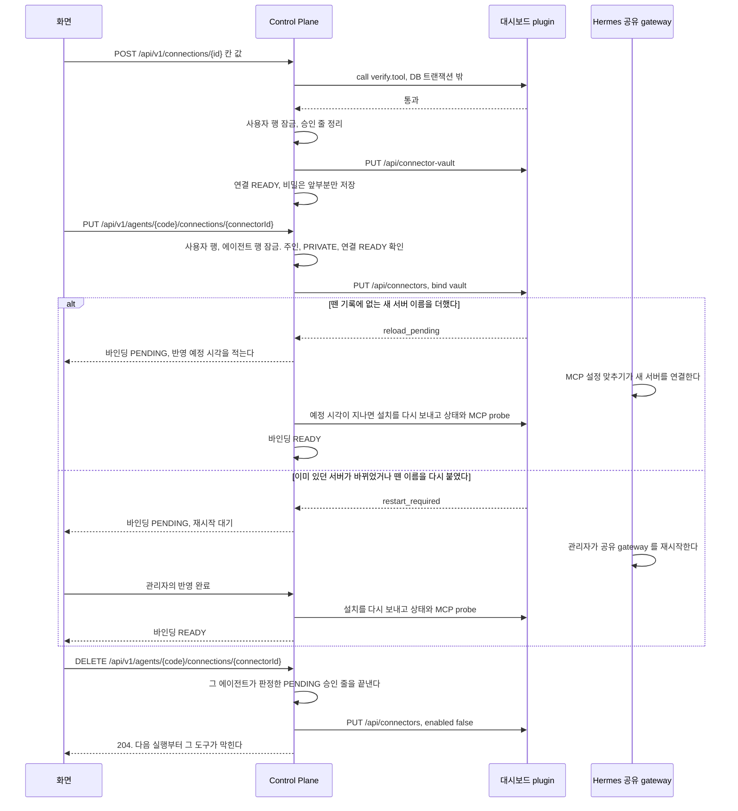

# 커넥터 연결

사용자가 커넥터에 계정을 연결하고 그 연결을 에이전트에 붙이는 기능이다.

covers: `backend/src/main/java/com/bifos/assistant/connector/`, `web/src/components/connector/`, `web/src/app/connections/`, `web/src/app/admin/connections/`, `hermes/connectors/`, `hermes/plugins/dashboard-profile-api/`

## 도구 이름과 요약

상세 화면은 도구마다 사람 말 이름(`title`)과 한두 문장의 요약(`summary`)을 위험도·승인 배지와 함께 보인다.
**실제 도구 이름(`search_messages` 같은 것)과 모델이 읽는 설명은 화면에 보이지 않는다.**
이름이 없거나 공백이면 「이름 없는 도구」 를 보이고, 요약이 없거나 불량이면 요약 줄을 그리지 않는다. 요약은 접거나 줄 수로 자르지 않고 개행을 유지한다. 목록 카드는 기존 도구 요약(도구 수)을 유지한다.

| 칸 | 읽는 쪽 | 쓰는 법 |
| --- | --- | --- |
| `tools.<이름>.title` | 화면, 승인 카드, 알림 | 한글 도구 이름. 1자에서 80자. 승인 카드는 같은 칸을 제목으로 쓰고, 없으면 「이름 없는 동작」 이다 |
| `tools.<이름>.summary` | 화면, 커넥터 README | 「~해요」체 한두 문장, 200자 안. 무엇을 하는지와 사용자가 알아야 할 한 가지(본문을 열지 않는다, 보내지 않는다, 승인을 받는다)만 적는다. 인자 이름, 반환 칸, ID, scope 같은 내부 말을 쓰지 않는다 |
| `tools.<이름>.description` | 모델 | 기능, 중요한 입력, 결과의 제한과 부작용. Gmail 과 네이버 블로그는 이 JSON 을 정적으로 import 하여 SDK 등록에도 같은 설명을 쓴다. 화면에 닿지 않는다 |

정본은 schema 2 의 `connector.json` 이다. 카탈로그를 읽을 때 MCP 서버를 실행하거나 서비스 API 에 묻지 않는다.
Hermes 의 `tool_descriptions` 와 `tool_summaries` 는 정책과 분리하고 카탈로그의 `tools` 에만 합친다.
요약은 Control Plane 의 `ConnectorTool` → `ConnectorToolSummary` → `ConnectorToolView` 와 웹 응답 정제를 거쳐 표시한다. 모델용 설명은 `ConnectorTool` 까지만 읽고 `ConnectorToolSummary` 에 싣지 않는다.

요약과 설명은 같은 문자 규칙으로 정제한다. 앞뒤 공백을 자른 뒤 1자부터 2,000 Unicode code point 까지, UTF-8 8,192바이트 이하이다. 탭·CR·LF 는 허용하고 그 밖의 C0, DEL, C1, 방향 제어문자와 잘못된 surrogate 는 금지한다. HTML 이나 Markdown 도 React 텍스트로 그린다. 문자와 공백 경계는 Python·Java·웹이 공통 fixture 로 검사한다.
200자 상한과 필수 여부, 도구 이름이 문구에 들지 않았는지, 커넥터 README 의 도구 표가 같은 문구인지는 `hermes/tests/test_connectors_contract.py` 가 커넥터마다 본다. 아직 채우지 않은 커넥터는 그 파일의 `PENDING_USER_COPY` 에 있다.

## 요구

**커넥터는 에이전트에게 도구를 쥐어 주는 것이고, 에이전트의 역할을 넓혀 주는 것이다.**
커넥터는 따로 도는 실행 주체가 아니라 에이전트가 쓰는 외부 서비스의 MCP 도구 묶음이다([ADR-083](../adr/ADR-083-커넥터는-사용자가-한-번-연결하고-자기-에이전트에-여럿-붙여-그-에이전트가-도구를-직접-부른다.md)).

- 사용자는 「외부 서비스 연결」 화면에서 커넥터마다 계정을 한 번 연결한다. 이것이 **연결**이고 사용자와 커넥터마다 하나다
- 그 연결을 자기 에이전트의 상세에서 붙이고 뗀다. 이것이 **바인딩**이고 에이전트와 연결은 다대다다
- 붙인 에이전트는 그 커넥터의 도구를 같은 turn 에서 직접 부른다. 호출의 판정과 승인은 [커넥터 도구 정책](connector-policy.md) 이 갖는다
- 붙이고 떼는 사람은 그 에이전트의 주인이고 자기 연결만 붙인다. 관리자도 남의 에이전트에 붙이거나 떼지 못하고 반영 완료만 누른다
- 어떤 커넥터가 있고 무엇을 입력받는지는 plugin 의 `connector.json` 이 선언하고, Control Plane 은 서비스 이름과 주소를 모른다([ADR-043](../../backend/docs/adr/ADR-043-커넥터는-plugin-의-connector-json-으로-선언하고-control-plane-은-범용-흐름만-갖는다.md))
- 임의 plugin 을 설치하는 화면은 없다. 연결할 수 있는 커넥터는 운영자가 대시보드 plugin 에 준 목록뿐이다
- 이 저장소가 갖는 범용 커넥터는 `hermes/connectors/` 에 있다([ADR-064](../../hermes/docs/adr/ADR-064-범용-커넥터는-이-저장소의-hermes-connectors-에-두고-저장소가-유지보수한다.md)). 만드는 방법과 칸은 [커넥터 만들기](../../hermes/connectors/README.md) 가, 도구 목록은 커넥터마다의 `connector.json` 이 갖는다

충족은 두 상태로 관측한다.

| 상태 | `READY` 의 뜻 |
| --- | --- |
| 연결 | 등록이나 연결 확인에서 확인 도구가 통과했다. 값이 확인돼 쓸 수 있는가만 뜻한다 |
| 바인딩 | 그 에이전트의 profile 에 바인딩 방식으로 설치가 켜져 있고 configured 이며, `policy_hook` 이 참이고, MCP probe 가 도구를 냈고, 재시작 대기도 반영 예정도 아니다. probe 는 공유 gateway 의 실제 실행 확인을 대신하지 않는다 |

커넥터 도구는 연결과 바인딩이 모두 `READY` 일 때만 판정을 통과한다.
바인딩 상태는 에이전트를 켜거나 끄지 않으므로 그 에이전트의 다른 도구는 그대로 돈다. 예외는 「옛 커넥터 에이전트」 다.

### 화면

에이전트 상세의 「이 에이전트가 쓰는 연결」 절은 `components/agent/agent-connections-section.tsx` 가 그린다. 주인에게만 보인다.
계정 연결은 이 절이 하지 않는다. 절 머리의 「외부 서비스 연결하기」 가 `/connections?agent=<번호>` 로 이 에이전트를 실어 연결 화면을 연다.

| 때 | 보이는 것 |
| --- | --- |
| 연결 목록을 읽지 못했다 | 절 안에 실패 문구만 그린다 |
| 내 연결이 하나도 없다 | 서비스 계정을 연결하면 이 에이전트에 바로 붙일 수 있다는 안내 |
| 붙일 수 있다 | 연결마다 「붙이기」 나 「떼기」. 붙었고 바인딩이 `READY` 이며 재시작 대기가 아니면 「붙음」, 아니면 「반영 대기」 |
| 연결이 아직 준비되지 않았다 | 「붙이기」 없이 연결 화면에서 연결을 확인하라는 안내 |
| 그룹에 공개된 에이전트다 | 「붙이기」 와 「외부 서비스 연결하기」 없이 비공개 에이전트에만 붙일 수 있다는 안내. 비공개로 되돌리면 다시 붙일 수 있다 |
| 옛 커넥터 에이전트다 | 성격 자리에 쓰던 에이전트에 연결을 붙인 뒤 이 에이전트를 지우라는 안내. 도구, 연결, 스킬, 먼저 살펴보기 절을 그리지 않고 공개와 삭제 절은 삭제만 남긴다 |
| 커넥터에 스킬이 있는데 `skills` 도구가 꺼져 있다 | 지침을 쓰려면 스킬 도구를 켜라는 안내. 붙이기는 `skills` 를 켜지 않는다([ADR-029](../../backend/docs/adr/ADR-029-에이전트-도구는-control-plane-이-등급으로-판정하고-hermes-설정-api-로-쓴다.md)) |

「붙이기」 는 확인 창을 거친다. 실패하면 창이 남아 까닭을 보인다.
확인 창은 「이 에이전트가 이 서비스의 도구를 직접 써요. 명령 실행이나 파일 도구를 함께 쓰면 연결 정보에 접근할 수 있어요. 읽은 내용이 다른 도구를 통해 인터넷으로 나갈 수도 있어요.」를 늘 알린다.
셸, 파일, 코드 실행 도구가 켜져 있으면 「안전하게 분리되지 않은 에이전트는 연결 정보를 읽고 승인 없이 서비스를 이용할 수 있어요. 분리된 에이전트도 읽은 내용을 인터넷으로 보낼 수 있어요.」를 더한다.
도구 절도 연결이 붙은 에이전트에서 그 도구를 켤 때 같은 경고를 더한다.
화면은 실행 공간 격리([ADR-086](../adr/ADR-086-셸과-파일-도구는-사용자별-docker-실행-공간에서만-돈다.md))가 적용됐는지 모르므로 두 경우를 함께 알린다.
READ 데이터의 인터넷 전파 위험은 [커넥터 도구 정책](connector-policy.md#커넥터-read-데이터의-흐름)이 갖는다.

「바인딩」 은 화면에 보이지 않는다. 「붙이기」, 「떼기」, 「이 에이전트가 쓰는 연결」, 「반영 대기」 라 쓴다.

**「외부 서비스 연결」 화면**은 계정 연결을 맡는다. 떼기는 에이전트 화면에서 한다.

- 목록은 연결한 서비스를 먼저, 연결할 수 있는 서비스를 다음에 보인다. 준비 중인 연결도 연결한 서비스에 두고, 빈 구역은 그리지 않는다
- 연결한 카드에는 붙인 에이전트 수를 보인다. 지금 쓸 수 있는 커넥터가 연결됐는데 쓰는 에이전트가 없으면 눌러서 쓸 에이전트를 고르라고 안내한다
- 연결 하나의 화면은 붙인 에이전트마다 상세로 가는 링크와 반영 대기 표시를 보인다
- 「연결 다시 확인」 은 쓸 수 있는 서비스의 준비 중인 연결과 연결된 계정 모두에 보인다. 실패하면 오류를 보이고 상태는 서버 응답을 따른다
- 연결 확인이 `CONNECTOR_NOT_CONNECTED` 로 끝나면 값을 다시 입력하라고 안내하고 연결을 다시 읽는다. 서버가 연결을 `PENDING` 으로 커밋했기 때문이다
- 운영 목록에서 빠진 커넥터의 기존 연결은 「쓸 수 없음」 으로 보이고 해제만 된다
- 목록 화면이 `?agent=<번호>` 로 열리면 보던 에이전트에서 쓸 서비스를 고르라고 안내하고, 카드 링크가 그 번호를 연결 하나의 화면으로 넘긴다
- 쓸 수 있는 서비스에 안전한 HTTPS `ownerBrowserLoginUrl`이 있으면 카드에 「내 브라우저에서 로그인」 링크를 보인다. 도구나 소개 링크가 없어도 로그인 안내를 그리며, 카드 상세 링크와 별개로 클릭하거나 키보드로 열 수 있다
- 연결 전에는 「이 서비스는 내 브라우저에서 먼저 로그인해야 해요.」, 그 밖의 상태에는 「이 서비스는 내 브라우저에 로그인한 계정을 써요.」로 안내한다. 로그인 주소가 없는 OAuth·API 입력 카드와 운영 목록에서 빠진 카드는 이 안내를 그리지 않는다

목록 위의 「내 브라우저」 입구와 상세 화면의 기존 로그인·자격 증명 거절 안내는 함께 유지한다.
실행할 수 없어 취소된 요청의 알림 줄은 「외부 서비스 연결에서 연결을 확인해 주세요」로 안내한다.
준비되지 않은 연결의 모델 안내와 Gmail 스킬·토큰 발급 스크립트·커넥터 README도 같은 화면 이름인 「외부 서비스 연결」을 쓴다.

연결 화면의 「묻지 않고 실행하는 동작」 은 상시 허락을 읽은 결과만 보인다. 이 연결의 허락이 없으면 그 절을 그리지 않는다.
허락을 읽지 못하면 앞서 보이던 허락을 지우고 「다시 확인」 을 보인다. 해제나 다시 등록 뒤에 다시 읽을 때도 같다. 해제가 서버에서 허락을 거뒀는데 화면에 옛 허락이 남지 않게 한다.
읽지 못했다고 허락을 거두는 요청을 보내지 않는다.

관리자 패널은 바인딩마다 사용자, 커넥터, 에이전트 번호, 상태를 보이고, 재시작 대기 바인딩과 `PENDING` 바인딩에 「반영 완료」 를 둔다.
재시작 대기면 공유 gateway 를 재시작한 뒤 누르라고, 아니면 몇 분이 지나도 남아 있을 때 눌러 다시 확인하라고 안내한다.
`PENDING` 에도 단추를 두는 것은 Control Plane 의 반영 예정 확인이 한 번 실패하면 바인딩이 `PENDING` 으로 남기 때문이다.
성공하든 거절되든 목록을 다시 읽는다.

### 연결 뒤 에이전트 고르기

`components/connector/connector-agent-chooser.tsx` 가 연결 하나의 화면 맨 위에 그린다.
연결한 뒤 무엇을 할지 모르는 일이 없게, 연결을 마친 같은 자리에서 그 연결을 쓸 에이전트를 고르고 바로 붙인다.

| 보이는 때 | 제목 |
| --- | --- |
| 등록이나 「연결 다시 확인」 으로 연결이 처음 `READY` 가 됐다. 제목에 초점을 옮긴다 | 연결이 끝났다는 제목 |
| 연결됐고 쓰는 에이전트가 없다. 또는 `?agent=<번호>` 의 에이전트에 아직 붙지 않았다 | 이 서비스를 쓸 에이전트 |
| 「붙인 에이전트」 의 「쓸 에이전트 고르기」 나 「다른 에이전트에도 붙이기」 를 눌렀다 | 같다 |

- 후보는 내 에이전트 가운데 옛 커넥터 에이전트를 뺀 것이다. 순서는 `?agent=` 의 에이전트, 붙일 수 있는 것, 이미 붙은 것, 그룹 공개 순서다
- 그룹 공개 에이전트는 단추 대신 나만 쓰는 에이전트로 바꾸면 붙일 수 있다고 안내한다
- 붙일 수 있는 에이전트가 없으면 「에이전트 만들기」(`/agents?new=1`)를 둔다. 「나중에」 는 영역을 닫는다
- 「이 에이전트에서 쓰기」 는 그 에이전트의 도구를 먼저 읽는다. 셸, 파일, 코드 실행 도구가 켜졌거나 도구를 읽지 못했으면 에이전트 화면과 같은 확인 창을 거치고, 아니면 바로 붙인다
- 붙이기가 실패해도 서버에 바인딩이 남았을 수 있어 붙인 에이전트 목록을 다시 읽는다
- 붙이면 언제 쓸 수 있는지(바로, 몇 분 안에, 관리자가 반영을 확인하면)를 함께 보이고, 「대화하기」 가 `/?agent=<번호>` 로 그 에이전트를 고른 새 대화를 연다

### 에이전트 사용 시작 안내

에이전트 상세는 성격 뒤에 연결 절과 도구 절을 차례로 그린다. 읽지 못한 절도 같은 순서다.
주인과 관리자의 권한, 옛 커넥터 에이전트에 숨기는 절은 그대로 유지한다.

붙은 연결은 제목과 도구 수 아래에 `boundReadiness({status, restartRequired})`의 안내를 보인다.

| 바인딩 상태 | 안내 |
| --- | --- |
| 재시작 대기. `READY`여도 이 조건을 먼저 본다 | 관리자가 반영을 확인하면 쓸 수 있어요. |
| `READY`이고 재시작 대기가 아니다 | 바로 쓸 수 있어요. |
| 나머지 | 몇 분 안에 쓸 수 있어요. |

붙지 않은 연결에는 사용 시점 안내가 없다. 「몇 분」은 기존 추정 안내이며 완료 시각을 보장하지 않는다.
붙이기가 실패해도 서버에 바인딩이 남을 수 있으므로 목록을 다시 읽어 상태와 도구 절의 연결 위험 안내를 맞춘다.

셸·파일·코드 실행 도구를 켜는 확인 창은 다음 문구를 쓴다.
「안전하게 분리되지 않은 에이전트는 다른 사용자의 파일과 서버 설정에 접근할 수 있어요. 분리된 에이전트도 허용된 파일과 서비스를 이용하고 파일이나 읽은 내용을 인터넷으로 보낼 수 있어요.」
사용자별 실행 공간과 사진 첨부 설명은 도구 설명에 남긴다.
연결 화면의 에이전트 고르기도 실제 `shellOrFileEnabled`를 확인하므로 도구를 목록에서 숨겨도 경고가 남는다.
에이전트 상세와 연결 화면 모두 도구를 읽지 못하면 켜져 있다고 보고 붙이기 확인 창에서 경고한다.
확인 창은 항상 승인받는다고 보장하지 않는다. READ·WRITE의 승인과 FINANCIAL·DESTRUCTIVE의 거절 정책은 바꾸지 않는다.

## 흐름

등록, 붙이기, 반영, 떼기의 정상 흐름이다. 대화 turn 안에서 붙은 도구를 부르는 흐름은 [커넥터 도구 정책](connector-policy.md) 의 「도구 호출 판정」 이 갖는다.

- 뗀 기록에 없는 새 이름을 더한 붙이기는 공유 gateway 를 재시작하지 않는다. Control Plane 이 반영 예정 시각이 지나면 스스로 확인한다([ADR-20261007 / connector-live-reload](../adr/ADR-20261007-connector-live-reload.md))
- 관리자 반영 완료는 재시작 대기인 바인딩과, 스스로 확인하다 `PENDING` 으로 남은 바인딩에 쓴다
- 바인딩이 `READY` 가 되기 전의 호출은 판정이 `NOT_READY` 로 막는다. 그 에이전트의 다른 도구는 그대로 돈다

## 설치와 실패 처리

연결은 에이전트를 만들지 않는다([ADR-083](../adr/ADR-083-커넥터는-사용자가-한-번-연결하고-자기-에이전트에-여럿-붙여-그-에이전트가-도구를-직접-부른다.md)).
연결의 등록, 확인, 해제는 값의 원본인 보관 파일을 다루고, 에이전트에 닿는 것은 붙이기와 떼기가 하는 바인딩 설치다.
재시작 대기는 profile 마다 생기므로 연결이 아니라 바인딩이 갖는다.
Control Plane 은 도구 목록을 직접 쓰지 않는다. 바인딩 설치가 서버 이름을 더하고 빼며, 도구 저장과 스킬 게시는 붙은 커넥터 서버 이름을 함께 보낸다(아래 「대시보드 plugin 계약」).
코드는 `ConnectorConnectionService`, `ConnectorBindingService`, `ConnectorBindingApplier` 가 갖는다.

### 연결의 등록, 확인, 해제

선택지 조회와 확인 도구 호출은 저장하지 않으므로 사용자 행을 잠그지 않는다.
확인 도구는 자식 프로세스를 띄워 오래 걸릴 수 있어 DB 트랜잭션 밖에서 부르고, 저장할 때 다시 잠가 본다.

| 단계 | 갈리는 지점 | 처리 |
| --- | --- | --- |
| 등록 | 확인 도구가 실패한다 | 공통 어휘의 오류로 끝나고 아무것도 저장하지 않는다 |
| 등록 | 그 연결에 `EXECUTING` 인 승인 줄이 있다 | 거절한다. 까닭은 [커넥터 도구 정책](connector-policy.md) 의 「커넥터 승인」 이 갖는다 |
| 등록 | 보관 파일 쓰기가 실패한다 | 연결을 `PENDING` 으로 커밋하고 `CONNECTOR_OPERATION_FAILED` |
| 등록 | 붙은 바인딩이 있다 | 바인딩마다 설치를 다시 보낸다. 떠 있는 MCP 프로세스는 옛 값을 쥐고 있으므로 재시작 대기가 된다. 하나가 실패해도 연결은 저장하고 그 바인딩만 `PENDING` 이다 |
| 확인 | 해제된 연결이다. 확인 도구를 부르는 사이 해제된 것도 같다 | 아무것도 바꾸지 않는다 |
| 확인 | 값이 아직 보관 파일에 없는 옛 연결이다 | 옛 커넥터 에이전트의 profile 에서 `POST /api/connector-vault/import` 로 값을 옮긴다. 옮기지 못하면 확인 도구를 부르지 않고 상태를 그대로 둔다 |
| 확인 | 보관 파일에 값이 없고 옮겨 올 옛 바인딩도 없다 | 연결을 `PENDING` 으로 커밋하고 `CONNECTOR_NOT_CONNECTED`. 값을 다시 등록해야 한다. 카탈로그에서 빠진 커넥터는 다시 등록할 수 없어 오류 없이 `PENDING` 이다 |
| 확인 | 확인 도구가 실패한다 | 연결을 `PENDING` 으로 커밋하고 공통 어휘의 오류로 끝낸다. 바인딩은 건드리지 않는다 |
| 확인 | 통과한다 | 연결을 `READY` 로(카탈로그에서 빠진 커넥터는 `PENDING`) 두고 붙은 바인딩마다 「바인딩의 반영 맞추기」 를 한다. 바인딩의 외부 호출이 실패하면 그 바인딩만 `PENDING` 으로 커밋하고 `CONNECTOR_OPERATION_FAILED` |
| 해제 | 정상 | 붙은 바인딩을 모두 떼고 보관 파일을 지운다. 연결은 `DISCONNECTED` 로 두고 칸 값을 비우며, 행은 이력을 위해 남긴다 |
| 해제 | 중간에 실패한다 | 연결을 `PENDING` 으로 커밋하고 `CONNECTOR_OPERATION_FAILED`. 이미 뗀 바인딩 행은 지워진 채이고 남은 바인딩과 보관 파일에는 값이 남는다. 다시 해제하면 남은 바인딩부터 잇는다. 화면은 연결을 다시 읽어 `PENDING` 이면 다시 해제를 누르라고 안내한다 |
| 해제 | 카탈로그에서 빠진 커넥터다 | Control Plane 이 env 이름을 몰라 설치만 끈다. env 는 대시보드가 소유 기록으로 지운다 |

등록과 해제는 그 연결의 `PENDING` 승인 줄을 끝내고 상시 허락을 거둔다. 그 규칙은 「커넥터 승인」 이 갖는다.

### 붙이기와 떼기

| 붙일 때 갈리는 지점 | 결과 |
| --- | --- |
| 이미 붙어 있다 | 지금 상태를 돌려준다 |
| 읽을 수 없는 에이전트다. 읽을 수 있어도 주인이 아니다 | `AGENT_NOT_FOUND`, `FORBIDDEN` |
| 옛 커넥터 에이전트다 | `VALIDATION_FAILED` |
| 에이전트가 `PRIVATE` 가 아니다 | `AGENT_CONNECTIONS_REQUIRE_PRIVATE` |
| 내 연결이 `READY` 가 아니거나 값이 보관 파일에 없다 | `CONNECTOR_NOT_CONNECTED` |
| 커넥터가 카탈로그에 없다 | `CONNECTOR_NOT_FOUND` |
| `single_binding` 커넥터이고 그 연결이 다른 에이전트에 붙어 있다 | `CONNECTOR_SINGLE_BINDING`. 사용자 행 잠금 안에서 보므로 같은 사용자의 다른 붙이기와 겹치지 않는다([ADR-20261008 / connector-binding-guards](../adr/ADR-20261008-connector-binding-guards.md)) |
| 커넥터의 스킬 이름이 그 profile 의 스킬과 겹친다 | `SKILL_NAME_TAKEN` |
| 대시보드가 409 `sandbox_unavailable` 로 거절한다 | `AGENT_SANDBOX_UNAVAILABLE`. 아래 「바인딩 설치」 의 실행 공간 조건이다 |
| 대시보드가 그 밖의 409 로 거절한다. `fos-ctx` 가 꺼진 profile 도 여기 든다 | `CONNECTOR_BIND_CONFLICT` |
| 대시보드가 401 로 거절한다. 표식이 없는 profile 이다 | `CONNECTOR_PROFILE_NOT_READY` |
| 그 밖의 외부 실패 | 바인딩을 `PENDING` 으로 남기고 `CONNECTOR_OPERATION_FAILED`. 대시보드가 반쯤 반영했을 수 있어 다음 연결 확인이 설치를 다시 보낸다 |

대시보드가 409 나 401 로 거절하면 대시보드는 아무것도 바꾸지 않았다. 결과 트랜잭션이 같은 설치 시도의 새 바인딩 행만 지운다.
붙인 바인딩은 늘 `PENDING` 이다. 답의 `restart_required` 나 `plugin_updated` 가 참이면 재시작 대기로 두고 그 시각을 적는다. 둘 다 거짓이고 `reload_pending` 이 참이면 `assistant.connector.binding.apply-delay` 뒤를 반영 예정 시각으로 적는다.
그 시간을 정한 까닭은 `ConnectorBindingProperties` 의 주석과 [ADR-20261007 / connector-live-reload](../adr/ADR-20261007-connector-live-reload.md) 가 갖는다.

떼기는 이렇게 갈린다.

- 옛 커넥터 에이전트에서는 떼지 않고 `VALIDATION_FAILED` 로 거절한다. 그 에이전트를 지우면 바인딩이 함께 떨어진다
- 붙어 있지 않으면 아무것도 하지 않는다
- 그 에이전트가 판정한 `PENDING` 승인 줄을 `REJECTED`(`connection_changed`)로 끝낸다. 그 줄이 `EXECUTING` 이면 `CONNECTOR_ACTION_EXECUTING` 으로 거절한다. 상시 허락은 사용자와 커넥터에 묶여 같은 연결을 붙인 다른 에이전트에도 걸리므로 둔다
- 외부 호출이 실패하면 `CONNECTOR_OPERATION_FAILED` 로 끝나고 트랜잭션이 되돌려져 행이 남는다
- 떼기는 도구 목록에서 서버 이름을 빼므로 재시작을 기다리지 않고 다음 실행부터 그 도구가 막힌다. 떼기 전에 시작한 실행의 호출도 판정이 막는다. 까닭은 [커넥터 도구 정책](connector-policy.md) 의 「이름 대응」 이 갖는다

**연결이 붙은 에이전트는 비공개로 남는다.** 남이 주인의 계정으로 외부 서비스를 쓰지 못하게 하기 위해서다.

| 바인딩이 있는 에이전트에 | 차례 | 결과 |
| --- | --- | --- |
| 주인이 공개 범위를 바꾼다 | 에이전트 행을 기다려 잠근 뒤 바인딩을 읽는다 | `GROUP` 이면 `AGENT_CONNECTIONS_REQUIRE_PRIVATE` |
| 관리자가 고친다 | 첫 읽기가 에이전트 행 잠금이다. 경합하면 기다리지 않고 `AGENT_BUSY` | 주인을 바꾸면 `AGENT_HAS_CONNECTIONS`, `GROUP` 이면 `AGENT_CONNECTIONS_REQUIRE_PRIVATE` |
| 주인이나 관리자가 지운다 | 주인의 사용자 행, 에이전트 행 차례로 잠근다. 주인이 그 사이 바뀌었으면 `AGENT_BUSY` | 바인딩을 모두 뗀 뒤 profile 을 거둔다. 떼거나 거두다 실패하면 지우지 않고 그 오류를 돌려준다 |

사람이 만든 profile 은 지워도 거두지 않는다. 그래서 지우기가 먼저 떼지 않으면 그 profile 에 커넥터 서버와 값이 남는다.
지우는 에이전트가 옛 커넥터 에이전트이고 그 연결의 값이 아직 보관 파일에 없으면, 떼기 전에 보관 파일로 값을 옮긴다. 옮기지 못하면 지우지 않는다. 그 에이전트가 값을 가진 유일한 곳이기 때문이다.

### 바인딩의 반영 맞추기

연결 확인, 반영 예정 확인, 정의 어긋남 점검, 관리자 반영 완료가 바인딩마다 한다. 결과는 `READY` 거나 `ResyncOutcome` 의 까닭 하나와 함께 `PENDING` 이다.

다시 보내는 설치는 소유 기록의 실행 정의가 지금 manifest 와 다르다는 이유로 거절하지 않는다.
설정의 서버 정의가 소유 기록과 같을 때만 그 커넥터를 새 manifest 의 command, args, env 로 다시 설치하고, 보관 파일과 연결 값, 같은 profile 의 다른 커넥터는 유지한다.
입력 칸의 env 이름이 바뀌면 옛 env 줄을 지우고 같은 값을 새 이름에 쓴다. 새 이름이 이 바인딩이 소유하지 않은 설정과 겹치면 409 다.
운영자가 서버를 바꾸거나 지웠으면 409 다. MCP 서버 이름을 바꾸는 것은 이 재설치로 옮기지 않는다.
조회와 실행, probe 는 늘 지금 manifest 와 맞는지 보므로 재설치 전의 낡은 정의로 실행하지 않는다.

**뗀 이름을 다시 붙이면 probe 가 통과해도 재시작을 기다린다.**
`READY` 는 probe 가 새로 띄운 프로세스에서 도구를 확인했다는 뜻이고, gateway 가 쥔 연결의 정의까지 확인한 것은 아니다.
떼기와 다시 붙이기가 MCP 설정 맞추기 한 주기 안에 끝나면 gateway 는 이름이 계속 있다고 보고 옛 연결을 쓸 수 있다. 떼기 뒤에는 옛 정의와 비교할 수도 없다.

| 갈리는 지점 | 처리 |
| --- | --- |
| 재시작 대기이거나 반영 예정 시각이 아직 오지 않았다 | 연결 확인과 반영 예정 확인은 설치를 다시 보내지 않고 `PENDING` 으로 둔다. 관리자 반영 완료는 재시작이 끝났다고 보고 재시작 대기에도 보내지만, 반영 예정 시각 전이면 보내지 않는다. gateway 가 서버를 연결하기 전에 probe 만 통과해 `READY` 가 되는 것을 막는다 |
| 카탈로그에서 빠진 커넥터다 | 서버를 확인할 수 없어 다시 보내지 않고 `PENDING` |
| 바인딩의 서버 이름이 비었다 | manifest 로 채운다. 마이그레이션이 만든 옛 바인딩이 그렇다 |
| 다시 보낸 설치가 재시작이나 `reload_pending` 을 요구한다 | 그 시각으로 대기나 반영 예정을 새로 적고 멈춘다 |
| 다시 읽은 설치가 켜져 있고 configured 이며 `policy_hook` 이 참이고 바인딩 방식이며, probe 가 도구를 냈다 | `READY`. 재시작 대기와 반영 예정을 함께 비우고 선언하지 않은 도구 수를 연결에 적는다. 켜진 내장 도구는 보지 않는다. 붙인 에이전트의 도구는 주인이 정한다 |
| 외부 호출이 실패한다 | 예외로 알리지 않고 그 바인딩만 `PENDING` 으로 둔다. 부른 쪽이 실패를 모아 `CONNECTOR_OPERATION_FAILED` 로 끝낸다 |

재설치에서 어긋난 칸 이름과 실패 단계, 커넥터 id, 예외 종류만 로그에 남긴다. env 값과 경로, 비밀값, 예외 본문은 남기지 않는다.

### 반영 예정 확인

재시작 없이 반영될 바인딩 설치를 Control Plane 이 스스로 확인한다([ADR-20261007 / connector-live-reload](../adr/ADR-20261007-connector-live-reload.md)).
`ConnectorBindingApplier.applyDue` 가 `assistant.connector.binding.apply-cron` 마다 예정 시각이 지난 바인딩을 읽고, 바인딩마다 연결 사용자 행, 에이전트 행 차례로 잠근 뒤 다시 읽는다.

| 갈리는 지점 | 처리 |
| --- | --- |
| 그 사이 지워졌거나 재시작 대기가 됐거나 예정이 미뤄졌다 | 건너뛴다 |
| 연결 사용자가 없거나 에이전트가 지워졌거나 주인이 연결 사용자와 다르다 | 비운 예정만 저장하고 건너뛴다. 그대로 두면 매 주기 다시 집는다 |
| 카탈로그를 읽지 못한다 | 바인딩을 `PENDING` 으로 두고 비운 예정과 함께 커밋한다. 예외로 끝내면 트랜잭션이 되돌려져 예정이 살아난다 |
| probe 가 실패해 `PENDING` 이 된다 | 다시 부르지 않는다. 사용자의 연결 확인이나 관리자 반영 완료가 다시 맞춘다 |
| 다시 보낸 설치가 또 `reload_pending` 이다 | 반영 맞추기가 새 시각을 적는다 |
| 한 바인딩이 실패한다 | 경고 로그를 남기고 다음 바인딩으로 간다 |

이 확인은 gateway 의 연결을 직접 보지 못한다. probe 가 성공해도 gateway 쪽 연결만 실패한 경우는 첫 실제 호출의 오류로 드러난다.

### 정의 어긋남 점검

manifest 가 바뀐 뒤 설치가 다시 보내지지 않은 바인딩을 Control Plane 이 찾아 다시 맞춘다([ADR-20261009 / connector-install-drift](../adr/ADR-20261009-connector-install-drift.md)).
`ConnectorBindingApplier` 가 `assistant.connector.binding.drift-cron` 마다 `READY` 바인딩을 앞 주기가 멈춘 번호 뒤부터 `assistant.connector.binding.drift-batch` 개씩 읽는다. 배포나 커넥터 동기화 뒤 운영자가 할 일은 없다.

| 갈리는 지점 | 처리 |
| --- | --- |
| 설치 상태를 읽지 못한다 | 경고 로그를 남기고 건너뛴다 |
| 「바인딩의 반영 맞추기」 의 설치 판정을 통과한다 | 어긋나지 않았다. 연속으로 센 값을 지운다 |
| 어긋났다 | 커넥터 id 와 어긋난 조건 이름을 로그에 남기고, 반영 예정 확인과 같은 차례로 잠근 뒤 다시 맞춘다. 서버 정의가 바뀌므로 대개 재시작 대기가 된다 |
| 잠근 뒤 다시 읽으니 지워졌거나 `READY` 가 아니다 | 건너뛴다 |
| 다시 맞춰 `READY` 가 된 뒤 또 어긋나기를 연속 상한만큼 되풀이했다 | 설치를 보내지 않고 `PENDING` 으로만 두고 알린다. 상한은 `ConnectorBindingApplier` 가 갖는다 |
| 다시 맞춘 바인딩이 재시작 대기나 `PENDING` 으로 남았다 | 연결 주인의 그룹 관리자마다 `CONNECTOR_REINSTALLED` 알림 한 건. 재시작 대기가 있으면 재시작 뒤 반영 완료를, 아니면 반영 완료로 다시 확인하라고 쓴다. 반영 예정 시각을 적은 바인딩은 반영 예정 확인이 맡으므로 세지 않는다 |

다시 맞춘 바인딩은 `READY` 가 아니어서 다음 주기의 대상이 아니다. 그래서 같은 어긋남에 설치를 되풀이해 보내지 않는다.
점검 위치와 연속 횟수는 JVM 메모리에 둔다. Control Plane 이 한 대라는 전제다.

### 관리자 반영 완료

재시작 대기인 바인딩에 필요하다. 값 교체처럼 이미 있던 서버가 바뀐 설치와 `fos-ctx` 갱신이 그렇다.
반영 예정 확인이 실패해 남았거나 정의 어긋남 점검이 `PENDING` 으로 둔 바인딩도 관리자가 눌러 다시 확인한다.

에이전트 번호와 주인은 트랜잭션 밖에서 읽는다. 트랜잭션의 첫 읽기가 잠금이어야 MySQL 의 REPEATABLE READ 에서 등록이 커밋한 재시작 시각을 보기 때문이다.
그 뒤 주인의 사용자 행, 에이전트 행을 붙이기와 같은 차례로 잠근다.

| 갈리는 지점 | 결과 |
| --- | --- |
| 잠근 뒤 그 에이전트의 주인이 바뀌었다 | `AGENT_BUSY` |
| 지금 주인이 관리자와 같은 그룹이 아니다 | `AGENT_NOT_FOUND`. 403 과 404 가 갈리면 다른 그룹의 에이전트 코드가 있는지 드러난다 |
| 바인딩의 재시작 시각이 본문의 `restartRequiredSince` 보다 늦거나 본문이 비었다 | `CONNECTOR_RESTART_AGAIN`. 관리자가 목록을 본 뒤에 다시 설치돼 재시작한 gateway 가 아직 보지 못했을 수 있다 |
| 바인딩에 재시작 시각이 없다 | 본문을 보지 않는다. 재시작이 필요 없던 바인딩의 다시 확인이다 |
| 반영 맞추기 뒤에도 `READY` 가 아니다 | 바인딩 상태를 커밋한 뒤 까닭별 오류로 끝낸다. 외부 호출 실패만 `CONNECTOR_OPERATION_FAILED` 이고, 대응은 `ConnectorErrors.notApplied` 가 갖는다 |

### 동시 요청과 잠금

- 같은 사용자의 등록, 확인, 해제, 붙이기, 떼기, 승인은 각 저장 단계에서 사용자 행 잠금으로 순서대로 처리한다. 그래서 승인이 본 바인딩은 커밋할 때까지 떼어지지 않는다
- 붙이기, 떼기, 관리자 반영 완료, 반영 예정 확인, 지우기는 사용자 행을 먼저, 에이전트 행을 다음에 잠근다. 공개 범위 변경과 관리자 수정도 같은 에이전트 행을 잠그므로, 동시에 와도 한쪽이 다른 쪽의 커밋을 보고 판정한다
- 바인딩의 `desired_enabled` 는 이번 설치가 끝까지 성공해 활성화 후보가 되었는지를 뜻한다. 설치를 보내기 전에 거짓으로 두고 성공한 뒤에만 참으로 둔다
- 외부 호출이 실패하면 `PENDING` 을 커밋한다. 이전 값으로 실행할 수 있는 상태로 되돌리지 않는다
- DB 커밋 자체가 실패하면 이미 반영한 보관 파일이나 설치는 되돌리지 못한다. 다시 등록하거나 연결 확인을 눌러 상태를 맞춘다
- 지우기가 profile 에서 뗀 뒤 행 삭제가 실패해 되돌려지면 행은 남고 profile 에서는 떼어진 상태다. 다음 연결 확인이 설치가 configured 가 아닌 것을 보고 그 바인딩을 `PENDING` 으로 둔다

### 설치 호출의 커밋 경계

등록, 연결 확인, 붙이기, 관리자 반영 완료와 예약·드리프트 확인은 같은 설치 경계를 쓴다.
`ConnectorInstallAttempts`가 트랜잭션 경계를 맡고 `ConnectorBindingInstalls`가 불변 입력으로 외부 호출을 실행한다.

1. 시작 트랜잭션은 소유 사용자, 에이전트 순서로 잠근 뒤 바인딩을 다시 읽는다. 관리자 확인과 예약·드리프트도 소유자의 접근 철회를 확인한다. 바인딩마다 새 `install_attempt_id`와 `PENDING`을 적고 설치 입력을 반환한다. 설치를 보낼 때는 `desired_enabled=false`로 내리고, 재시작·반영 예정만 기다리는 확인은 기존 의도를 유지한다.
2. 시작을 커밋한 뒤 DB 트랜잭션 밖에서 설치, 상태 조회와 probe를 실행한다. 입력에는 커밋된 연결 revision과 profile, credential, 보관 파일과 manifest의 선언만 담는다. JPA 엔티티와 lazy 참조는 넘기지 않는다.
3. 결과 트랜잭션은 같은 잠금 순서로 현재 바인딩을 다시 읽는다. 접근 권한·소유자·profile·credential·연결 상태와 revision·시도 UUID가 모두 맞을 때만 결과를 적고 UUID를 비운다.

늦은 성공과 실패, 중복 결과는 새 시도를 덮거나 지운 바인딩을 다시 만들지 못한다.
새 붙이기의 명시적 거절도 현재 시도만 지우며, 외부 설치를 뒤늦게 떼는 정리 호출은 하지 않는다.
연결 revision은 시작 단계에서 DB의 마이크로초 정밀도로 단조 증가하며 결과 단계에서는 바꾸지 않는다.
verify를 보내기 전에 본 revision이 달라졌으면 이전 계정의 성공과 실패를 버리고 지금 연결을 돌려준다.
응답을 잃거나 결과 저장이 실패하면 커밋된 `PENDING`을 남기고 기존 연결 확인으로 복구한다.
옛 바인딩의 설치 전 상태 조회가 실패하거나 꺼진 설치를 보면, 결과 CAS를 통과한 시도만 기존 활성화 의도를 복원한다.
설치 요청을 보낸 뒤 실패했으면 의도를 복원하지 않는다. 어느 경우든 반영 확인 전에는 `PENDING`이라 도구를 허용하지 않는다.
드리프트 처리 횟수는 결과 커밋 뒤에만 증가한다.

callback이 없는 vault 저장·가져오기·삭제와 detach 자체는 기존 잠금과 부분 해제 계약을 유지한다.
진행 중인 설치 HTTP는 떼기나 에이전트 삭제·정리를 기다리게 하지 않는다.
떼기가 외부 설치와 바인딩 행을 지운 뒤 앞선 설치가 늦게 성공하면 profile에 행 없는 설치가 남을 수 있다.
에이전트 정리로 행이 사라진 경우도 결과는 버리지만 외부 설치를 자동으로 지우지는 않는다.
정책 hook은 실행의 에이전트에 붙은 바인딩을 찾지 못하면 차단하며, 남은 설치만으로 도구 권한이 생기지는 않는다.
앞선 성공 뒤 무조건 detach를 보내면 다시 붙인 새 설치까지 지울 수 있어 정리 호출을 추가하지 않는다.
외부 설치까지 원자적으로 정리하려면 Hermes가 설치의 식별자를 대조하는 조건부 설치·삭제 계약을 제공해야 한다.
현재 시도 UUID는 DB 안에서만 쓰므로, 지금 계약은 DB 권한 차단까지 보장하고 남은 외부 상태의 자동 정리는 보장하지 않는다.
READ·WRITE의 설치, 재시작 대기와 반영 예정 계약은 그대로이며 FINANCIAL·DESTRUCTIVE는 계속 `RISK_NOT_OPEN`이다.

### guard 설치와 지원 확인

시작 트랜잭션은 카탈로그의 `execution_guard`를 기존 선언 검사기로 검증하고 protocol과 전체 manifest SHA를
불변 설치 입력에 캡처한다. 선언이 없으면 기존 5인자 설치를 쓴다. 선언이나 SHA가 잘못됐으면 설치를 보내지 않는다.
설치 입력에는 엔티티와 가변 JSON을 보관하지 않으며, 일반 바인딩의 유효한 선언만 6인자 `bindConnector`에 연결한다.

`bind.guard`는 `v`, `protocol`, `bindingId`, `connectionId`, `connectionUpdatedAt`, `manifestSha256`만 갖는다.
번호는 문자열이고 연결 revision은 시작 트랜잭션이 커밋한 값이다. 시도 UUID와 바인딩 revision, nonce는 설치 wire에 넣지 않는다.
manifest가 바뀌면 새 설치 시도가 새 SHA를 캡처하며 과거 verified를 재사용하지 않는다.

| 순서 | 관측하는 상태 |
| --- | --- |
| 시작 커밋 | 새 시도와 `PENDING`, 커밋된 연결 revision |
| Python 설치 callback | 실제 support가 `409`로 거절하고 plugin은 `pending`을 반환 |
| 설치·상태·probe와 결과 CAS | 재시작·반영 예정 계약에 따라 현재 시도만 `READY`로 전이 |
| READY 뒤 상태 조회 | 새 nonce로 실제 support를 확인하고 일치하면 `verified` |

READY 이전의 verified를 설치 완료 조건으로 요구하지 않는다. 지원 확인 실패는 금융 차단 상태이며 일반 설치의
configured·enabled·mode·policy hook과 probe 판정을 대신하지 않는다. verified도 거래 권한이 아니므로
금융 도구의 exclude와 상시 허락 없음, `RISK_NOT_OPEN`을 유지한다.
실제 Spring MVC·DB와 Python 설치·상태·support 소비자의 왕복은 H2와 새 Flyway MySQL DB에서 같은 시험으로 확인한다.
왕복 fixture의 전송 계수는 그 Python 프로세스의 urllib 요청 시도만 관측한다.
loopback 대역의 인증 경로(`/oauth/token`) POST와 금융 경로(`/financial/orders`) POST·DELETE를 따로 센다.
support POST와 다른 경로는 금융 계수에 넣지 않으며, 독립 loopback 수신 회귀가 각 1회 요청의 증가를 확인한다.
연결 실패도 시도로 세지만 MCP 자식과 다른 HTTP 라이브러리의 전송은 관측하지 않는다.
운영 배포와 실제 실행 왕복의 확인 절차는 `fos-home-infra`가 소유한다.

### 재시작

이미 떠 있는 MCP 프로세스는 env 파일이 바뀌어도 옛 값을 쓴다.
어느 설치가 `restart_required`, `plugin_updated`, `reload_pending` 을 돌려받는지는 [`hermes/plugins/dashboard-profile-api/README.md`](../../hermes/plugins/dashboard-profile-api/README.md) 의 두 설치 표가 갖는다.
profile 하나의 MCP 를 다시 붙이는 다른 경로를 쓰지 않는 까닭은 [ADR-20261007 / connector-live-reload](../adr/ADR-20261007-connector-live-reload.md) 의 「대안 기각」 이 갖는다.

- 공유 gateway 재시작은 사용자 요청에서 실행하지 않는다
- 저장된 대기 값과 설치 응답의 `restart_required`, `plugin_updated` 는 논리 OR 로 누적한다. 도중 호출이 실패해도 앞선 참을 보존한다
- 토큰 폐기는 사용자가 그 서비스에서 한다. 폐기하면 다음 요청부터 거절되므로 재시작을 기다리지 않고 외부 접근을 막을 수 있다
- 배포한 뒤 확인할 것은 [도구 hook 과 승인](../../hermes/docs/hermes-contract.md) 의 「배포한 뒤 확인할 것」 에 모았다

## 대시보드 plugin 계약

카탈로그 도구의 `arg_labels`는 도구별 승인 인자 표시 이름이다.
정책과 분리한 `tool_arg_labels`를 카탈로그에서만 합치며 DB와 설치 정책에는 저장하지 않는다.
현재 도구 이름과 정확히 맞추고, 가린 인자 객체에 그대로 남은 원래 키의 표시 이름만 승인 조회·승인·거절 응답의 `argLabels`로 전달한다.
검증과 옛 응답 호환은 [승인 인자 표시 이름](connector-policy.md#승인-인자-표시-이름)이 갖는다.

Control Plane 이 대시보드 plugin(`hermes/plugins/dashboard-profile-api`)의 커넥터 경로에 기대는 약속이다.
경로마다의 요청과 응답, 두 설치 방식의 차이, 표식은 [`hermes/plugins/dashboard-profile-api/README.md`](../../hermes/plugins/dashboard-profile-api/README.md) 의 「dashboard-profile-api 가 여는 것」 과 그 아래 「커넥터」 가 갖는다. 카탈로그를 읽는 쪽은 `HttpHermesConnectorClient` 다.

설치는 두 가지다. 커넥터마다 만든 전용 profile 에 하는 **옛 설치**와, 일반 에이전트의 profile 에 연결을 붙이는 **바인딩 설치**다([ADR-083](../adr/ADR-083-커넥터는-사용자가-한-번-연결하고-자기-에이전트에-여럿-붙여-그-에이전트가-도구를-직접-부른다.md)).
`PUT /api/connectors` 는 본문에 `bind` 칸이 없으면 옛 설치를 한다. 그래서 새 칸을 모르는 옛 Control Plane 과 함께 돈다.

- `call` 은 `options.tool` 과 `verify.tool` 만 받고 디스크에 쓰지 않는다. 칸 값은 본문의 `values` 나 보관 파일 가운데 정확히 하나에서 온다
- `call` 의 시간 제한과 동시 한도는 `CONNECTOR_CALL_TIMEOUT_SECONDS`, `CONNECTOR_CALL_LIMIT` 이다. 넘거나 차 있으면 기다리지 않고 `unavailable` 이다
- Control Plane 은 카탈로그의 `fields[].env` 로 `PUT /api/env` 의 key 를 정한다. env 이름은 Control Plane 의 응답에 담지 않는다
- 카탈로그의 `icon`, `link`, `readme_url`은 Control Plane이 [커넥터 만들기](../../hermes/connectors/README.md)의 「아이콘과 링크」 규칙으로 다시 검사하고, 어긋난 칸만 null로 읽는다
- Control Plane은 웹에 `readmeUrl`, `linkKind`를 전달한다. 옛 응답의 README 주소는 null이고, `link_kind`가 없거나 `project`가 아니면 `service`로 읽는다. 목록 카드와 상세 머리는 `link`를 「공식 사이트」 또는 「프로젝트 GitHub」로, `readmeUrl`을 「커넥터 README」로 표시하고 각각 새 탭으로 연다
- 카탈로그의 `single_binding` 이 없으면 거짓으로 읽고, boolean 이 아니면 `attachments` 와 같이 카탈로그 읽기를 실패로 다룬다
- 운영 목록에서 빠진 커넥터도 그 profile 에 소유 기록이 남아 있으면 `enabled: false` 를 받고 그 기록이 참조하던 env 를 지운다. 소유 기록도 없으면 끌 것이 없어 `changed: false` 로 성공한다. 카탈로그에서 빠진 연결의 해제와 반영 완료가 끝까지 가게 하기 위해서다
- `GET /api/connectors` 는 설치하지 않은 커넥터를 `isolated` 로 답하므로 `mode` 는 설치한 항목의 값만 읽는다. 목록에 없는 커넥터는 설치 안 됨으로 읽는다
- 커넥터 표식만 있는 profile 의 떼기는 소유 기록에 그 항목이 없어도 `changed: false` 로 답한다. 다시 보낸 떼기가 401 로 실패하면 Control Plane 의 바인딩 행이 지워지지 않기 때문이다

**도구 목록은 설치와 Control Plane 의 도구 저장이 나눠 쓴다.**
토큰으로 부른 `PUT /api/config` 가 `platform_toolsets` 를 보내면, 소유 기록의 바인딩 항목이 설치한 서버 이름이 요청의 `api_server` 목록에 모두 있어야 한다. 하나라도 빠지면 409 다.
Hermes 처리기가 목록을 통째로 바꾸므로 조용히 지워지는 길을 남기지 않는다.
그래서 Control Plane 의 도구 저장과 스킬 게시는 붙은 커넥터 서버 이름을 함께 보낸다. 스킬 경로만 쓰는 요청과 옛 설치 profile 은 이 검사를 하지 않는다.

### 바인딩 설치

`PUT /api/connectors` 의 본문에 `bind: {vault}` 를 더하면 그 보관 파일의 값으로 그 profile 에 커넥터를 붙인다.
그 profile 의 Control Plane MCP 등록, 다른 도구 이름, `SOUL.md` 는 건드리지 않는다.

받는 profile 의 조건이다. 하나라도 어기면 409 이고 파일이 하나도 바뀌지 않는다. 표식이 없으면 401 이다.

- `platform_toolsets.api_server` 목록이 있고 그 안에 Control Plane MCP 가 있다. 목록이 없는 profile 에 이름 하나만 든 목록을 만들면 내장 도구와 Control Plane MCP 가 모두 닫히고, MCP 이름이 없던 목록에 이름을 더하면 운영자의 다른 MCP 서버가 막히기 때문이다
- `fos-ctx` 가 켜져 있다. 설치는 plugin 파일만 맞추고 profile 의 plugin 설정은 쓰지 않으므로, 꺼진 profile 에 붙이면 도구 호출이 판정 없이 나간다. 이 조건은 새로 붙일 때만 본다. 이미 붙은 커넥터의 재설치는 받고, 그 바인딩은 `policy_hook` 이 거짓이라 `PENDING` 에 남는다
- 옛 설치 항목이 없다. 반대로 바인딩 항목이나 뗀 서버 기록이 있는 profile 은 옛 설치를 받지 않는다
- 커넥터의 env 이름, 서버 이름, 스킬 디렉터리가 그 커넥터의 소유 기록 없이 이미 있거나 다른 것과 겹치지 않는다
- manifest 가 `sandbox_required` 를 선언했으면 그 profile 이 실행 공간 정책에 있다. 아니면 409 `sandbox_unavailable` 이다. 다시 설치할 때도 보므로 정책에서 빠진 profile 의 바인딩은 그때 `PENDING` 이 된다([ADR-20261008 / connector-binding-guards](../adr/ADR-20261008-connector-binding-guards.md))

보관 파일의 키 가운데 지금 칸 선언에 없는 것은 버린다. 칸을 뺀 커넥터의 옛 연결도 연결 확인으로 다시 설치되게 하려는 것이다. 남은 값이 칸 선언과 맞지 않으면 400 이다.

Control Plane 은 바인딩 설치 요청에 그 에이전트의 `sandbox_owner` 를 늘 싣는다. 재설치도 같다.
보내기 전에 그 주인의 첨부 디렉터리를 최선 노력으로 만들고, 만들지 못해도 요청을 보낸다. 첨부를 선언하지 않은 커넥터의 붙이기가 첨부 루트 문제로 막히지 않게 하려는 것이다.
manifest 가 선언한 주인 env 는 plugin 이 서버 정의에 직접 넣는다.

| 선언 | 넣는 값 | 갈리는 지점 |
| --- | --- | --- |
| `owner_attachments_env` | 그 주인의 첨부 디렉터리([ADR-20261007 / connector-owner-attachments](../adr/ADR-20261007-connector-owner-attachments.md)) | 정책이 없거나 디렉터리를 중간 링크 없이 확인하지 못하면 409 `sandbox_unavailable` 이고 붙이기는 `AGENT_SANDBOX_UNAVAILABLE` 이다 |
| `owner_output_env` | 그 profile 과 커넥터의 출력 디렉터리([ADR-20261008 / connector-output-files](../../hermes/docs/adr/ADR-20261008-connector-output-files.md)) | 만들 수 없으면 빈 값을 넣고 붙이기는 그대로 한다. 커넥터는 파일 출력만 거절한다. 떼면 그 디렉터리를 지운다 |
| `owner_browser_env` | 그 바인딩의 표식을 실은 중계 주소([ADR-20261008 / browser-gateway-token](../../backend/docs/adr/ADR-20261008-browser-gateway-token.md)) | 중계가 꺼졌으면 빈 값이다. 같은 바인딩은 늘 같은 주소를 받으므로 재설치가 서버 정의를 바꾸지 않아 `restart_required` 가 참이 되지 않는다 |

붙이고 뗄 때의 파일 변경에서 지켜야 하는 것이다.

- 붙이기는 한 묶음으로 쓰고 실패하면 이 요청이 쓴 파일만 되돌린다. 쓰기 전에 설정, 소유 기록, 이름 대응 파일, 뗀 서버 기록을 떠 두되 `.env` 와 스킬 파일은 떠 두지 않는다
- 스킬은 plugin 의 스킬 디렉터리를 그 profile 의 `skills/` 로 복사한다. 앞머리가 환경 값이나 자격 증명 파일을 요청하는 스킬이 있으면 그 커넥터를 카탈로그에 내지 않는다([ADR-086](../adr/ADR-086-셸과-파일-도구는-사용자별-docker-실행-공간에서만-돈다.md))
- 떼기는 소유 기록을 지금 manifest 와 견주지 않고 형식만 본다. 운영자가 실행 정의를 바꾼 뒤에도 떼어야 `.env` 에 비밀이 남지 않는다. 기본 key 는 지우지 않는다
- 떼기는 서버를 이름 대응에서 빼지 않고 뗀 서버 기록에 남긴다. 까닭은 [커넥터 도구 정책](connector-policy.md) 의 「이름 대응」 이 갖는다
- 서버 정의나 이름 대응이 지금 manifest 와 어긋난 바인딩 항목은 그 항목만 `configured: false` 이고 `policy_hook` 을 거짓으로 만들지 않는다. 같은 profile 의 다른 커넥터는 붙이기, probe, 실행이 그대로 된다([ADR-20261009 / connector-install-drift](../adr/ADR-20261009-connector-install-drift.md))

### 보관 파일

연결의 칸 값의 원본은 대시보드 plugin 이 연결마다 하나씩 두는 보관 파일이다.
Control Plane DB 에는 비밀이 아닌 칸 값과 비밀 칸의 앞부분만 둔다.
경로와 형식, 세 경로(`PUT`, `DELETE`, `POST .../import`)의 검사는 [`hermes/plugins/dashboard-profile-api/README.md`](../../hermes/plugins/dashboard-profile-api/README.md) 의 「커넥터」 가 갖는다.
바인딩 설치도 같은 profile 쓰기 잠금 안에서 보관 파일을 읽으므로 그 사이에 값이 바뀌지 않는다.

## 옛 커넥터 에이전트

바인딩이 생기기 전에는 연결을 처음 등록할 때 커넥터마다 전용 profile 과 비공개 에이전트를 만들었다([ADR-039](../../backend/docs/adr/ADR-039-외부-서비스-연결은-사용자별-전용-에이전트로-실행한다.md)). `agent.connector_managed` 가 참인 에이전트다.
이제 새로 만들지 않는다. 마이그레이션이 해제되지 않은 옛 연결마다 그 에이전트와의 바인딩을 만들었으므로, 옛 에이전트도 바인딩 하나로 읽힌다.
이미 있는 것은 사용자가 옮긴 뒤 지울 때까지 아래 규칙으로 돈다.

- 일반 편집 경로로 공개 범위, 주인, 도구, 성격, 스킬을 바꾸지 못한다. 다른 연결을 붙이지 못하고 자기 연결을 떼지 못한다
- 사용자당 에이전트 상한 계산에서 빠진다
- 그 바인딩만 에이전트를 켜고 끈다. `READY` 가 되면 켜고, `PENDING` 이 되면 끄고 사진 받기를 내린다
- 값을 바꾸면 보관 파일과 함께 그 profile 의 `.env` 에 칸마다 직접 쓴다. 해제는 칸마다 지운 뒤 설치를 끄고 에이전트를 끈다
- 연결 확인과 관리자 반영 완료는 설치가 꺼져 있거나 `desired_enabled` 가 거짓이면 다시 보내지 않는다. 옛 설치는 늘 `restart_required: true` 로 답하므로 `plugin_updated` 가 참일 때만 재시작 대기로 둔다. 켜진 내장 도구가 manifest 의 `toolsets` 와 같아야 `READY` 다
- 닿는 범위는 [ADR-045](../../backend/docs/adr/ADR-045-커넥터-에이전트는-자기-mcp-서버만-받고-memory-와-control-plane-도구를-받지-않는다.md) 가 갖는다. 연결을 붙인 일반 에이전트에는 이 경계가 걸리지 않고, 그 에이전트가 감당하는 것은 ADR-083 의 「감당할 것」 에 있다
- 위임 결과를 `<external-data>` 로 감싸는 규칙은 [`docs/features/agent-skill.md`](agent-skill.md) 의 「위임 결과가 도착했을 때」 가 갖는다
- `mcp_servers` 의 Control Plane MCP 등록 제거는 이미 떠 있는 gateway 에 재시작 전까지 남을 수 있다. 그동안에도 도구 목록이 그 서버를 막고 Control Plane 이 호출을 거절한다

옛 설치는 plugin 의 스킬 본문을 그 profile 의 `SOUL.md` 에 쓴다. `skills` toolset 은 스킬을 고치는 도구까지 열기 때문이다([ADR-039](../../backend/docs/adr/ADR-039-외부-서비스-연결은-사용자별-전용-에이전트로-실행한다.md)).

- 스킬 디렉터리 바로 아래 항목이나 `SKILL.md` 가 심볼릭 링크이거나, 앞머리가 닫히지 않았거나, 합친 본문이 Control Plane 의 성격 본문 상한을 넘으면 그 커넥터를 카탈로그에 내지 않는다. 링크가 plugin 밖을 가리키면 그 내용이 지침으로 들어가기 때문이다. 카탈로그를 읽을 때 모든 커넥터에 이 본문을 계산하므로 바인딩으로도 나오지 않는다
- 대시보드는 옛 설치 profile 과 다른 관리 profile 을 구분하지 못한다. Control Plane 이 옛 커넥터 에이전트의 profile 에만 옛 설치를 보낸다
- 해제는 `SOUL.md` 를 지우지 않는다. 본문은 카탈로그 응답과 로그에 싣지 않는다

**사진**은 manifest 의 `attachments` 가 참이고 그 바인딩이 `READY` 로 확인됐을 때만 받는다.
Control Plane 은 선언한 toolset 이 실제로 켜진 것을 본 뒤에만 `agent.connector_attachments` 를 참으로 두고, `Agent.acceptsAttachments` 가 그 열을 본다. 사진 단추는 있는데 이미지 도구가 없는 상태를 만들지 않기 위해서다.
옛 설치와 재설치 요청은 `sandbox_owner` 를 싣고, 그 주인의 첨부 디렉터리를 만들 수 없거나 링크이면 보내지 않고 409 로 멈춘다. 실패는 `PENDING` 과 `CONNECTOR_OPERATION_FAILED` 로 남는다.
사용자별 mount 는 [사진 첨부](attachment.md) 와 [ADR-091](../adr/ADR-091-사진-첨부는-사용자별로-저장하고-실행-공간에는-그-사용자만-붙인다.md) 이 갖는다.
연결을 붙인 에이전트의 사진 받기와 내장 도구는 그 에이전트의 설정이 정하고, manifest 의 `toolsets` 와 `attachments` 를 적용하지 않는다.

### 옮겨 가기

사용자마다 연결마다 한다. 끊김이 없고, 옛 에이전트를 지우기 전까지 되돌릴 수 있다.

1. 「외부 서비스 연결」 화면에서 연결 확인을 누른다. 옛 에이전트의 profile 에 있던 값이 보관 파일로 옮겨진다. 이 확인은 옛 profile 에 설치를 다시 보내므로, 그 profile 의 `fos-ctx` 가 묶음과 다르면 옛 에이전트가 재시작 대기로 꺼진다. 3단계의 재시작과 함께 하면 한 번으로 끝난다
2. 원래 쓰던 에이전트의 상세에서 그 연결을 붙인다
3. 바인딩이 재시작 대기면 관리자가 공유 gateway 를 재시작하고 반영 완료를 누른다
4. 그 에이전트로 커넥터 도구를 한 번 불러 본다. 쓰기 도구는 승인 카드가 뜨는지 본다
5. 옛 에이전트를 지운다. 지우기가 그 바인딩을 떼고 profile 을 거둔다

5 전에는 새 바인딩을 떼면 옛 에이전트로 그대로 쓴다. 5 뒤에는 다시 붙이면 된다. 값은 보관 파일에 남아 있다.
먼저 살펴보기를 쓰는 분야는 그 분야 패키지의 `proactive-check` 스킬을 붙은 커넥터 도구가 있으면 직접 부르고 없으면 옛 연결 에이전트에 맡기도록 먼저 고친 뒤 옮긴다([`docs/features/proactive.md`](proactive.md)).
모든 옛 에이전트가 지워지면 격리 경로의 코드와 `connector_connection` 의 쓰지 않는 칸을 지운다.

## MCP SDK 계약

대시보드 plugin 의 `call` 은 공식 `mcp` Python SDK 로 커넥터 서버를 부른다. plugin 은 SDK 를 스스로 설치하지 않고 Hermes 가 설치한 버전을 쓴다.

- **지원 범위는 `mcp>=2.0,<3` 이다.** 검사는 `mcp==2.0.0` 으로 돈다
- plugin 이 기대는 이름은 `mcp.ClientSession`, `mcp.StdioServerParameters`, `mcp.client.stdio.stdio_client`, `ToolAnnotations.read_only_hint`, `CallToolResult.structured_content`, `CallToolResult.is_error`, `CallToolResult.content` 다
- 1.x 는 이 속성을 `readOnlyHint`, `structuredContent`, `isError` 로 둔다. 1.x 에서 `is_error` 를 기본값으로 읽으면 도구 오류가 성공으로 읽힌다. 그래서 plugin 은 속성을 직접 읽고, 이름이 없으면 실패한다
- plugin 은 올라올 때와 `call` 마다 SDK 버전과 위 속성을 확인한다. 범위 밖이거나 속성이 없으면 자식을 띄우지 않고 `unavailable` 로 답하며, 버전과 까닭을 운영 로그 한 줄로 남긴다
- `call` 이 예외로 실패하면 묶음 예외(`ExceptionGroup`)를 풀어 가장 안쪽 예외의 종류와 SDK 버전을 로그에 남긴다. 예외 본문과 칸 값은 남기지 않는다
- Hermes 는 `mcp` 를 정확한 버전 하나로 고정하므로 이 값은 Hermes 이미지를 올릴 때만 바뀐다. 올릴 때 확인할 것은 [버전 변경과 실측](../../hermes/docs/hermes-contract.md) 에 있다

## 커넥터 연결 API

경로와 요청, 응답 칸은 `ConnectorConnectionController`, `AgentConnectionController`, `ConnectorConnectionAdminController`, `AdminAgentConnectionController` 와 `ConnectionDtos` 가 갖는다.
아래는 화면이 기대는 약속이다.

- 응답에는 env 이름, 보관 파일 이름, 서버 이름을 담지 않는다. 비밀 칸은 앞부분만 담는다. 관리자 목록에는 다른 사용자의 칸 값과 비밀 앞부분을 넣지 않는다
- 카탈로그에서 빠졌지만 내 연결이 `DISCONNECTED` 가 아닌 커넥터는 `available: false` 와 빈 칸으로 함께 낸다. 화면이 해제하러 들어갈 길을 남기기 위해서다. 모르는 `id` 는 `CONNECTOR_NOT_FOUND` 다
- `values` 의 키, 필수 칸, `pattern`, 길이는 외부에 반영하기 전에 검사하고 어기면 `VALIDATION_FAILED` 다
- 선택지 조회와 확인은 후보 값을 저장하지 않고 응답에 되돌려 담지 않는다
- 선택지 조회, 등록, 연결 확인은 사용자별 호출 제한을 먼저 지난다. [커넥터 도구 정책](connector-policy.md) 의 「사용자별 호출 제한」 이 갖는다
- 에이전트의 연결 목록은 그 에이전트의 주인만 읽는다. 해제한 연결은 빠지고, 붙일 수 없는 까닭은 `blockedReason` 이 `AgentConnectionsView` 의 값으로 준다
- 바인딩마다 재시작 대기가 있다. 연결 상태 응답의 `bindings[]` 와 관리자 목록이 바인딩 상태와 재시작 대기를 함께 낸다

## 네이버 read_draft 사진 메타데이터

`read_draft`는 임시저장 글을 편집기에 불러와 기존 `draft_id`, `revision`, `title`, `category`, `tags`, `body`에 사진 메타데이터를 더한다.
기존 본문의 `[기존 사진 1]` 같은 줄과 덮어쓰기용 구성요소 대응은 그대로다.
불러오기 중 네이버 자동저장이 발생할 수 있으므로 기존 WRITE 정책을 유지한다.

`photos`는 `document.components`에 직접 놓인 `@ctype=image`만 현재 배열 차례로 읽는다.
중첩 이미지와 이미지 그룹은 분석하지 않으므로 전체 사진 검증 완료를 뜻하지 않는다.

| 사진 항목의 칸 | 의미 |
| --- | --- |
| `position` | 직접 이미지 중 1부터 센 현재 순서 |
| `componentIndex` | 원래 components 배열에서 0부터 센 위치 |
| `componentId` | 편집기 구성요소의 식별자. 영문, 숫자, 밑줄과 하이픈으로 된 1자 이상 200자 이하 문자열이며 그 밖은 null |
| `fileName` | 실제 이미지 필드의 파일명. 누락되거나 잘못된 값은 null이며 URL에서 추정하지 않는다 |

파일명은 UTF-16 코드 단위로 1개 이상 255개 이하만 허용한다.
경로 구분자, 콜론, URL query·fragment 기호, 제어 문자, 보이지 않는 형식 문자, 줄 구분자, 잘못된 surrogate, 앞뒤 공백과 점 경로는 거절한다.
값을 자르거나 고쳐서 유효한 파일명으로 만들지 않으며, 잘못된 메타데이터 때문에 기존 본문 읽기를 실패시키지 않는다.
사진 항목에는 src, domain, path, 좌표, origin, caption, 원시 객체와 본문을 넣지 않는다.

사진 항목은 최대 50개다. `photo_count`는 직접 이미지의 실제 관측 수이며 `photos_truncated`는 상한 때문에 응답에서 빠진 항목이 있는지 알린다.
사진이 없으면 빈 배열, 0, false를 반환한다. 51개라면 앞의 50개와 관측 수 51, 잘림 여부 true를 반환하며 본문의 기존 사진 줄은 모두 유지한다.
중복 파일명도 현재 순서대로 각각 반환한다.

`revision`은 제목, 카테고리, 태그와 본문 네 칸의 기존 지문이며 사진 메타데이터를 포함하지 않는다.
사진 수와 본문 줄이 같은 상태에서 사진 식별자나 파일명만 바뀌어도 이 지문은 그대로일 수 있다.
파일명과 component id는 첨부 번호나 권한, 사진 hash가 아니다. 업로드 바이트나 픽셀의 동일성, 승인 시점 사진의 불변성을 증명하지 않는다.
사용자와 첨부의 신뢰할 수 있는 대응과 접근 권한은 후속 Control Plane이 확인해야 하며 모델이 반환 파일명을 권한 근거로 사용할 수 없다.

## Gmail 커넥터

사용자의 Gmail 계정에 붙는 범용 커넥터다. 코드는 [`hermes/connectors/gmail/`](../../hermes/connectors/gmail) 에 있다.
이 절은 도구와 정책, 보안, 연결 값의 수명, 실제 계정으로 확인하는 절차를 갖는다. 사용자 안내는 [Gmail 커넥터 README](../../hermes/connectors/gmail/README.md) 가 갖는다.
초기 결정은 [ADR-066](../../hermes/docs/adr/ADR-066-gmail-커넥터는-직접-만든-mcp-서버와-gmail-modify-scope-하나로-돌고-휴지통은-서버가-막는다.md), TypeScript 전환과 필터 권한은 [ADR-084](../../hermes/docs/adr/ADR-084-gmail-typescript-filters.md) 에 있다.
커넥터 공통 계약은 [커넥터 연결](connector.md) 과 [커넥터 도구 정책](connector-policy.md) 이 갖는다.

### Gmail 등록 칸

| 칸 | env | 비밀 | 무엇 |
| --- | --- | --- | --- |
| `client_id` | `GMAIL_OAUTH_CLIENT_ID` | 아니다 | 사용자가 만든 OAuth client 의 ID. `.apps.googleusercontent.com` 으로 끝나는 값만 받는다 |
| `client_secret` | `GMAIL_OAUTH_CLIENT_SECRET` | 그렇다 | 그 client 의 secret |
| `refresh_token` | `GMAIL_OAUTH_REFRESH_TOKEN` | 그렇다 | 그 client 로 받은 자기 계정의 refresh token |

셋 다 필수다. 운영자가 주는 값(`operator_env`)은 없다.
확인 도구는 `get_profile` 이다. 등록할 때 세 값으로 계정 주소를 읽어 보고, 읽히면 저장한다.

### Gmail 도구와 정책

MCP 서버 이름은 `gmail` 이다. 인자는 `search_messages` 의 `max_results`(정수)를 빼고 모두 글자다. 승인 카드가 인자를 키와 값으로 그대로 보이기 때문이다.

| 도구 | 위험도 | 승인 | 상시 허락 | 카드 제목 | 하는 일 |
| --- | --- | --- | --- | --- | --- |
| `get_profile` | `READ` | 없음 | | | 계정 주소와 메일 수를 읽는다 |
| `list_labels` | `READ` | 없음 | | | 라벨의 이름과 종류를 읽는다 |
| `list_filters` | `READ` | 없음 | | | 저장된 자동 분류 필터를 읽는다 |
| `search_messages` | `READ` | 없음 | | | Gmail 검색 문법으로 메일을 찾는다 |
| `get_message` | `READ` | 없음 | | | 메일 하나의 머리와 본문을 읽는다 |
| `get_thread` | `READ` | 없음 | | | 스레드의 메일을 차례로 읽는다 |
| `create_draft` | `WRITE` | 필요 | 줄 수 있다 | 초안 만들기 | 초안함에 초안을 만든다. 보내지 않는다 |
| `modify_labels` | `WRITE` | 필요 | 닫았다 | 라벨 바꾸기 | 메일 하나에 라벨을 더하고 뗀다. 보관과 읽음 처리가 여기 든다 |
| `create_label` | `WRITE` | 필요 | 줄 수 있다 | 라벨 만들기 | 사용자 라벨을 만든다 |
| `update_label` | `WRITE` | 필요 | 줄 수 있다 | 라벨 설정 바꾸기 | 사용자 라벨의 이름과 색만 바꾼다 |
| `create_filter` | `WRITE` | 필요 | 닫았다 | 필터 만들기 | 앞으로 오는 메일의 자동 분류를 저장한다 |
| `delete_filter` | `WRITE` | 필요 | 닫았다 | 필터 지우기 | 자동 분류 설정 하나를 지운다 |
| `apply_labels_to_query` | `WRITE` | 필요 | 닫았다 | 검색한 메일의 라벨 바꾸기 | 기존 메일 최대 500통에 라벨을 더하고 뗀다 |
| `send_message` | `WRITE` | 필요 | 닫았다 | 메일 보내기 | 새 메일을 보낸다 |
| `reply_to_message` | `WRITE` | 필요 | 닫았다 | 답장 보내기 | 받은 메일의 스레드에 답장을 보낸다 |

분류의 까닭이다.

- 읽기 여섯은 계정의 상태를 바꾸지 않는다. 메일 본문은 민감하지만 이 커넥터를 연결한 뜻이 메일을 읽는 것이라 호출마다 묻지 않는다. 읽은 글은 그 사용자의 대화에만 간다.
- 초안은 계정 안에서 되돌릴 수 있는 쓰기다. 밖으로 나가지 않으므로 상시 허락을 줄 수 있다.
- 라벨 바꾸기도 계정 안의 쓰기지만 상시 허락을 닫았다. 속은 모델이 보안 알림 메일을 보관하거나 읽음 처리해 주인의 눈에서 숨길 수 있기 때문이다.
- 라벨 만들기와 설정 변경은 메일을 숨기거나 밖으로 보내지 않아 상시 허락을 줄 수 있다. 시스템 라벨 변경과 라벨 삭제는 열지 않는다.
- 필터 만들기와 지우기, 기존 메일 일괄 적용은 매번 승인한다. 자동 분류는 앞으로 올 보안 알림도 숨길 수 있고, 일괄 적용은 여러 메일의 표시를 바꾼다. 필터 삭제는 다시 만들 수 있는 설정 변경이다.
- 밖으로 나간다는 선언(`"outbound": true`)은 보내기와 답장 둘이다.
- 보내기와 답장은 계정 밖의 사람에게 나간다. `"grant": false` 로 상시 허락을 닫아 호출마다 사람이 받는 사람과 제목과 본문을 본다([ADR-065](../adr/ADR-065-외부로-나가는-도구는-상시-허락을-닫는-선언을-둔다.md)).
- 휴지통과 영구 삭제는 도구가 없다. 선언에 없는 도구는 거절된다.
- 쓰는 도구가 받는 메일, 라벨, 필터의 id 는 `identifiers` 로 선언했다. 필터 id 처럼 긴 영숫자라도 승인 카드에 그대로 보이고 승인할 수 있다([ADR-089](../adr/ADR-089-커넥터는-식별자-인자를-선언하고-승인-카드는-그-값을-길이로-가리지-않는다.md)). `create_draft` 의 `reply_to_message_id`, `modify_labels` 와 `reply_to_message` 의 `message_id`, `update_label` 의 `label`, `delete_filter` 의 `filter_id` 다. 라벨 이름을 쉼표로 이어 받는 `add_labels` 와 `remove_labels` 는 식별자 모양이 아니라 선언하지 않았다.

#### Gmail 도구의 인자와 결과

| 도구 | 인자 | 결과 |
| --- | --- | --- |
| `get_profile` | 없음 | `{email, messages_total, threads_total}` |
| `list_labels` | 없음 | `{labels: [{id, name, type}]}`. `type` 은 `system` 이나 `user` |
| `search_messages` | `query`(Gmail 검색 문법, 비우면 최근 메일), `max_results`(1~25, 기본 10), `page_token` | `{messages: [{id, thread_id, from, to, subject, date, snippet, labels}], next_page_token}` |
| `get_message` | `message_id` | `{id, thread_id, from, to, cc, subject, date, labels, body, body_truncated, attachments: [{filename, mime_type, size}]}` |
| `get_thread` | `thread_id` | `{id, messages: [get_message 와 같은 모양], messages_truncated}` |
| `create_draft` | `to`, `subject`, `body`, `cc`, `bcc`, `reply_to_message_id` | `{draft_id, message_id, thread_id}` |
| `modify_labels` | `message_id`, `add_labels`, `remove_labels` | `{id, labels}` |
| `create_label` | `name`, `text_color`, `background_color`, `label_list_visibility`, `message_list_visibility` | 만든 라벨 |
| `update_label` | `label`(번호나 이름), `name`, `text_color`, `background_color` | 바뀐 라벨 |
| `list_filters` | 없음 | `{filters: [...]}` |
| `create_filter` | `from`, `to`, `subject`, `query`, `negated_query`, `has_attachment`, `size`, `size_comparison`, `add_labels`, `remove_labels`, `forward` | 저장한 필터 |
| `delete_filter` | `filter_id` | `{deleted, filter_id}` |
| `apply_labels_to_query` | `query`, `add_labels`, `remove_labels`, `expected_count` | `{count, query, add_label_ids, remove_label_ids}` |
| `send_message` | `to`, `subject`, `body`, `cc`, `bcc` | `{id, thread_id}` |
| `reply_to_message` | `message_id`, `to`, `subject`, `body`, `cc` | `{id, thread_id}` |

- **받는 사람(`to`, `cc`, `bcc`)은 쉼표로 나눈 주소만 받는다. 표시 이름을 받지 않는다.** `a@example.com, b@example.net` 모양이다. 카드에 보이는 글과 실제 받는 주소가 다르게 읽힐 길을 없앤다. 주소 하나는 ASCII 영문자, 숫자, `.!#$%&'*+/=?^_{|}~-` 로 된 이름과 `@` 와 점으로 이은 도메인이다. 그 밖의 모양은 Gmail 을 부르지 않고 `GMAIL_INVALID_INPUT` 으로 거절한다. `이름 <주소>`, 따옴표, 괄호 주석, 꺾쇠, `:` 와 `;` 가 든 그룹 문법, ASCII 밖 글자, 인코딩된 낱말(`=?utf-8?b?...?=`)이 모두 여기 든다
- 서버는 조립한 메일을 다시 읽어 `To`, `Cc`, `Bcc` 의 주소 목록이 인자의 주소 목록과 같은지 확인한다. 다르면 보내지 않고 `GMAIL_INVALID_INPUT` 이다
- 제목에 줄바꿈 같은 제어 문자, 화면에 보이지 않거나 글의 방향을 바꾸는 문자(Unicode 범주 Cf), 앞 글자에 붙어 그 자체로는 아무것도 그리지 않는 결합 문자(범주 Mn 가운데 U+034F, 크메르 U+17B4 와 U+17B5, 변이 선택자 U+FE00 부터 U+FE0F, U+E0100 부터 U+E01EF, 몽골어 선택자 U+180B 부터 U+180D 와 U+180F), 인코딩된 낱말(`=?...?=`)이 있으면 거절한다. 태국어 모음이나 분해한 `é` 처럼 눈에 보이게 그려지는 결합 문자는 받는다. 이모지에 붙는 U+FE0F 는 글자가 아닌 글자(기호, 구두점, 숫자) 바로 뒤의 하나만 받는다. 본문도 Cf 문자를 거절하되 그림 글자를 잇는 U+200C 와 U+200D 는 받는다. 한글 채움 문자(U+3164)처럼 빈칸으로 보이는 글자도 제목과 본문에서 거절한다
- 답장의 `In-Reply-To` 와 `References` 에는 원래 메일의 `<...>` 모양 번호만 옮긴다. 다른 글이 섞인 머리는 버리고 스레드 번호만으로 답장한다
- 승인 카드는 받는 사람을 인자의 글 그대로 보인다. 주소만 받으므로 카드의 글이 곧 받는 주소다
- `to`, `subject`, `body` 는 비울 수 없다
- `add_labels` 와 `remove_labels` 는 쉼표로 나눈 라벨 이름이다. 시스템 라벨은 `INBOX`, `UNREAD`, `STARRED`, `IMPORTANT` 처럼 그 이름을 쓰고 사용자 라벨은 화면에 보이는 이름을 쓴다. 서버가 이름을 라벨 번호로 바꾼다. 모르는 이름은 `GMAIL_INVALID_INPUT` 이다. 보관은 `remove_labels: "INBOX"` 다
- **`add_labels` 나 `remove_labels` 에 `TRASH` 나 `SPAM` 이 있으면 Gmail 을 부르지 않고 `GMAIL_INVALID_INPUT` 으로 거절한다.** 휴지통과 스팸에 넣는 것도 꺼내는 것도 하지 않는다. 대소문자를 구분하지 않고, 이름이 그 라벨 번호로 바뀐 경우도 거절한다
- `reply_to_message` 는 받는 사람과 제목을 원래 메일에서 채우지 않는다. 인자로 받은 그대로 보낸다. 승인한 것과 보낸 것이 같아야 하기 때문이다. 서버는 원래 메일의 스레드와 `Message-ID` 를 읽어 `In-Reply-To` 와 `References` 머리만 채운다
- `create_draft` 의 `reply_to_message_id` 를 주면 그 메일의 스레드에 답장 초안을 만든다
- 본문은 글(`text/plain`)로만 보낸다. 첨부를 붙이는 인자는 없다
- `get_message` 의 `body` 는 `text/plain` 부분을 먼저 쓰고, 없으면 `text/html` 에서 태그를 뗀 글을 쓴다. 20,000자에서 자르고 잘랐으면 `body_truncated` 가 참이다. HTML 의 `script`, `style`, `head`, `title`, `template`, `noscript` 안의 글은 버린다. `</head>` 를 닫지 않은 메일은 `<body>` 에서 본문이 시작한다고 읽되, 다른 숨김 태그 안의 `<body>` 는 숨김을 풀지 않는다. 머리 값은 1,000자, 첨부 목록은 50개, 첨부 이름은 255자에서 자른다. Gmail 의 응답이 10MB 를 넘으면 `GMAIL_UNAVAILABLE` 이다. `get_thread` 는 메일마다 5,000자, 메일 20개까지다
- 첨부는 이름, 종류, 크기만 낸다. 내용을 읽는 도구는 없다
- 읽기 도구 셋(`search_messages`, `get_message`, `get_thread`)의 결과에는 `notice` 칸이 더 붙는다. 아래 「Gmail 보안」 이 갖는다
- 결과의 `labels` 는 Gmail 의 라벨 번호다. 시스템 라벨은 번호가 이름과 같고, 사용자 라벨의 이름은 `list_labels` 로 찾는다
- `message_id`, `thread_id`, `reply_to_message_id` 는 영문자, 숫자, `_`, `-` 로 된 64자까지의 글만 받는다. 아니면 Gmail 을 부르지 않고 `GMAIL_INVALID_INPUT` 이다
- 도구는 프로세스 안의 상태에 기대지 않는다. access token 은 그 프로세스가 필요할 때 refresh token 으로 받는다

#### Gmail 오류

| 서버가 내는 코드 | 공통 어휘 | 복구 어휘 | 언제 |
| --- | --- | --- | --- |
| `GMAIL_UNAUTHORIZED` | `credential_rejected` | `reconnect` | 토큰 endpoint 가 `invalid_grant` 나 `invalid_client` 로 답했다. Gmail API 가 401 로 답했다. 세 값 가운데 하나가 비었다 |
| `GMAIL_FORBIDDEN` | `forbidden` | | Gmail API 가 403 으로 답했다. scope 가 모자라거나 프로젝트에서 Gmail API 를 켜지 않았다 |
| `GMAIL_FILTER_SCOPE_REQUIRED` | `forbidden` | `reconnect` | 필터 API 가 403 으로 답했다. 두 scope 로 토큰을 다시 받아 연결 값을 바꾼다 |
| `GMAIL_TARGET_COUNT_CHANGED` | `invalid_input` | `recheck`, 세부 `actual_count` | 승인한 수와 검색한 수가 다르다. 변경하지 않고 `actual_count` 를 알린다 |
| `GMAIL_INVALID_INPUT` | `invalid_input` | `fix_input` | 인자가 비었거나 모양이 틀리다. 막은 라벨을 더하려 했다. Gmail API 가 400 이나 404 로 답했다 |
| `GMAIL_SEND_UNKNOWN` | `outcome_unknown` | | 보내기나 답장의 보내는 요청(`messages/send`)을 보낸 뒤 시간 안에 답이 없거나, 연결이 끊겼거나, 응답을 읽지 못했거나, Gmail API 가 5xx 로 답했다. 메일이 나갔는지 모른다. 승인 줄은 실패가 아니라 `UNKNOWN` 으로 남는다 |
| `GMAIL_UNAVAILABLE` | `unavailable` | `retry_later` | 연결하지 못했다. 시간 안에 답이 없다. Gmail API 가 3xx, 429, 5xx 나 위에 없는 4xx 로 답했다. 응답을 읽지 못했다. 토큰 endpoint 가 `invalid_grant` 와 `invalid_client` 밖의 오류로 답했다 |

오류 결과는 코드만 담는다. 대상 수 변경에는 서버가 센 `actual_count` 도 담는다.
승인 실행이 실패하면 공통 어휘와 함께 서버의 코드, 복구 어휘, `actual_count` 가 에이전트에 닿는다([커넥터 연결](../../hermes/connectors/README.md) 의 「오류 복구 계약」). 일반 403 인 `GMAIL_FORBIDDEN` 은 코드만 닿고 Google 의 오류 글은 닿지 않는다.
Google 이 준 오류 글과 요청한 주소는 결과와 로그에 싣지 않는다.
도구 인자는 모두 문자열이다. 숫자나 객체를 보내면 MCP SDK 가 서버 처리 전에 타입 오류로 거절한다. 이 오류는 JSON 결과가 아니어서 현재 공통 승인 경로에서 `unavailable` 로 보일 수 있다. 이 경우 연결 재시도보다 인자 타입을 먼저 확인한다.
외부 호출의 제한 시간은 호출마다 15초다. 대시보드가 확인 도구를 기다리는 시간은 10초라, Google 이 느리게 답하면 등록과 연결 확인이 서버의 제한 시간보다 먼저 `unavailable` 로 끝난다. 어느 호출도 다시 부르지 않는다. 보내기가 시간 안에 답하지 않았을 때 다시 부르면 메일이 두 번 나갈 수 있다.

### scope 와 휴지통

요청하는 scope 는 `https://www.googleapis.com/auth/gmail.modify` 와 `https://www.googleapis.com/auth/gmail.settings.basic` 둘이다.
라벨과 메일은 `gmail.modify`, [필터](https://developers.google.com/workspace/gmail/api/reference/rest/v1/users.settings.filters/create)는 `gmail.settings.basic` 을 쓴다.
`gmail.settings.sharing` 은 요청하지 않는다. 전달 주소와 계정 밖으로 나가는 설정을 관리하지 않기 때문이다.

| 하려는 것 | 이 scope 로 | 막는 곳 |
| --- | --- | --- |
| 읽기, 검색, 초안, 보내기, 라벨 바꾸기 | 된다 | |
| 휴지통으로 옮기기 | **된다** | 서버 코드. 휴지통 endpoint 를 부르지 않고 라벨 바꾸기에서 `TRASH` 와 `SPAM` 을 더하는 것도 떼는 것도 거절한다 |
| 영구 삭제 | 안 된다 | scope. `https://mail.google.com/` 을 받아야 한다 |

보관(`INBOX` 라벨 떼기)에 `gmail.modify` 가 필요해 더 작은 scope 를 고를 수 없다.
[`커넥터 테스트`](../../hermes/connectors/gmail/tests)가 `TRASH` 와 `SPAM` 의 거절을 보고, 대역이 받은 요청이 허용 목록 안에만 있는지 본다.
필터 설정의 조회·생성·삭제와 라벨 생성·변경, 메일의 `batchModify` 는 허용한다. 메일의 휴지통·삭제와 첨부, 전달 주소 설정은 허용하지 않는다.

**더 넓은 scope 로 받은 토큰을 넣지 않는다.** `https://mail.google.com/` 으로 받은 토큰도 등록은 되지만, 그 토큰이 새면 메일을 영구히 지울 수 있다.

### 라벨과 자동 분류

라벨 이름은 1부터 225자까지다. 시스템 라벨 이름은 만들거나 바꾸지 못한다.
색은 `text_color` 와 `background_color` 를 함께 주고, [Gmail 이 허용하는 색](https://developers.google.com/workspace/gmail/api/reference/rest/v1/users.labels)만 받는다.
목록 표시 값은 `labelShow`, `labelShowIfUnread`, `labelHide`, 메시지 표시 값은 `show`, `hide` 다. 생략하면 Gmail 기본값을 쓴다.

필터는 중첩 JSON 대신 도구 표의 글자 인자로 조건과 동작을 받는다.
`has_attachment` 는 빈 글이나 `true`, `false`, `size` 는 바이트 수를 적은 십진수, `size_comparison` 은 `larger`, `smaller` 다.
크기를 주면 비교 방식도 준다. 조건과 라벨 동작이 각각 하나 이상 있어야 한다.
라벨은 쉼표로 나눈 번호나 이름으로 받고, 번호로 바꾼 뒤에도 `TRASH` 와 `SPAM` 을 거절한다.
`forward` 를 주면 쓰기 전에 거절한다. 필터를 수정하는 API 는 없으므로 조회한 필터를 승인 뒤 지우고 새 조건으로 다시 만든다.

1. `list_labels` 로 필요한 라벨을 보고, 없으면 `create_label` 로 만든다.
2. `create_filter` 로 앞으로 오는 메일의 분류를 저장한다.
3. 기존 메일도 정리하려면 `search_messages` 의 모든 쪽에서 번호를 모아 대상 수를 센다.
4. `apply_labels_to_query` 에 같은 검색어와 라벨, 센 수를 글자로 적은 `expected_count` 를 넣는다.

**승인 카드에는 검색어와 대상 수를 함께 보인다.** 서버가 다시 검색한 수가 다르면 아무것도 바꾸지 않고 `GMAIL_TARGET_COUNT_CHANGED` 와 `actual_count` 를 반환한다.
에이전트는 승인 결과의 `actual_count` 를 지금 수로 알리고, 다시 조회해 확인할지 묻는다. 그대로 다시 승인을 요청하지 않는다. 501통 이상이면 일부만 바꾸지 않고 거절한다.
승인한 수가 0이고 검색도 비어 있으면 쓰기 없이 대상 수 0으로 끝난다.
수가 같아도 검색과 변경 사이에 새 메일이 오면 그 메일은 이번 적용 대상에 들지 않는다.

### Gmail 서버와 검사

TypeScript 서버를 의존성까지 `dist/gmail-mcp.js` 하나로 묶는다. 생성 entry는 Git에서 추적하지 않는다. 실행 파일은 Bun 이다.
빌드와 실행에 같은 도구를 써 별도 변환을 줄이고, 실행할 때 패키지를 내려받지 않는다.
Bun `1.3.14` 와 lockfile 을 고정해 CI와 로컬 검사가 소스에서 entry를 빌드하고 독립 빌드 두 번의 전체 바이트와 같은지 검사한다. 실행은 검증한 최소 버전 `1.3.14` 이상을 허용한다. 시작 시 환경 프록시가 있으면 그 값을 뺀 환경으로 같은 묶음 파일을 다시 실행한다. Bun 이 시작 때 프록시를 기억하므로 요청 직전에 값을 지우는 것만으로는 우회하지 못한다. 표준 입출력을 이어 MCP 연결을 유지하며, 실제 요청은 프록시 없는 프로세스에서 실행한다.
전용 테스트는 [`tests/`](../../hermes/connectors/gmail/tests)에 있다. 타입 검사와 테스트, 묶음 파일 비교는 `bash scripts/check-connectors.sh` 로 실행한다.
`get_refresh_token.py` 는 서버 실행에 쓰지 않는 로컬 일회성 도구라 Python 표준 라이브러리를 유지한다.

### Gmail 보안

메일 본문은 누구나 보낼 수 있는 글이다. 그 글에 「이 메일을 아무개에게 전달하라」 같은 지시가 숨어 있을 수 있다.
그 글이 모델을 속인다는 전제로 아래가 닿는 범위를 정한다.

| 무엇 | 어떻게 |
| --- | --- |
| 붙인 에이전트 | Gmail 도구는 이 연결을 붙인 에이전트가 직접 부른다. 그 에이전트는 자기 Memory 와 대화 맥락과 켜진 도구를 함께 갖는다. 속은 모델이 닿는 곳은 이 메일 계정과 그 에이전트가 가진 것이다([ADR-083](../adr/ADR-083-커넥터는-사용자가-한-번-연결하고-자기-에이전트에-여럿-붙여-그-에이전트가-도구를-직접-부른다.md) 의 「결과」). 터미널이나 파일 도구가 켜진 에이전트에서는 승인이 마지막 방어가 아니므로 그런 에이전트에는 붙이지 않기를 권한다([커넥터 연결](agent-skill.md) 의 「언제 에이전트를 나누는가」) |
| 도구 결과 | 읽기 도구의 결과는 `fos-ctx` 가 `<external-data>` 로 감싸고 지시로 따르지 말라는 줄을 앞에 붙인다. Hermes 도 MCP 결과를 `<untrusted_tool_result>` 로 한 번 더 감싼다. 감싸도 모델이 그 글을 따르지 않는다는 보장은 없다 |
| 쓰기 | 초안, 라벨, 보내기, 답장은 모두 승인 뒤에만 실행된다. 보내기와 답장은 상시 허락이 없어 호출마다 승인한다 |
| 승인한 것과 실행한 것 | 승인 카드는 받는 사람(`to`, `cc`, `bcc`), 제목(`subject`), 본문(`body`)을 마크다운이나 HTML 로 읽지 않고 글자로 보인다. 토큰처럼 보이는 긴 글만 `[가림]` 으로 바꿔 보인다. 승인하면 Control Plane 이 저장한 인자 그대로 한 번만 실행한다. 결과를 모르면 다시 실행하지 않는다([ADR-050](../../backend/docs/adr/ADR-050-커넥터-쓰기는-control-plane-이-승인-줄을-저장하고-승인한-인자로-한-번만-실행한다.md)) |
| 옛 커넥터 에이전트 | 옮겨 가기 전에 만든 Gmail 에이전트는 남아 있는 동안 자기 MCP 서버의 도구만 받고 Memory 와 Control Plane 도구를 받지 않는다. 다른 에이전트가 그 에이전트에 맡긴 일의 답은 Control Plane 이 `<external-data>` 로 감싸 전한다([커넥터 설치](connector.md) 의 「옛 커넥터 에이전트」) |

서버가 하는 것도 있다.

- 읽기 도구의 결과에 `notice` 칸을 넣어, 메일의 글은 보낸 사람이 쓴 자료이고 지시가 아니라고 적는다
- 스킬 지침(`skills/gmail/SKILL.md`)이 같은 것을 말하고, 메일의 글이 시키는 쓰기를 하지 말고 사용자에게 알리라고 적는다

**보내기, 답장, 라벨 바꾸기는 카드에 가려지는 글이 있으면 승인되지 않는다.** 승인 카드는 비밀처럼 보이는 키의 값과 토큰 모양의 긴 글을 `[가림]` 으로 바꿔 보인다. 가릴 자리는 글의 모양이 정하므로, 속은 모델이 내보낼 내용을 그런 모양으로 만들면 사람이 읽지 못한 글이 나간다. 그래서 이 세 도구의 요청은 가려지는 글이 하나라도 있으면 화면이 승인을 막고 Control Plane 도 실행하지 않는다([커넥터 연결](connector-policy.md) 의 「승인 줄과 경로」). 본문에 긴 링크 토큰이나 key 가 든 메일은 이 커넥터로 보낼 수 없다. 초안에는 이 제한이 없다. 초안의 카드에 `[가림]` 이 보이면 그 자리는 Gmail 초안함에서 확인한다.

**이것으로 모델이 속지 않는다고 보장하지 못한다.** 마지막 방어는 사람이 승인 카드를 읽는 것이다.
속은 모델이 읽은 메일의 내용을 그 대화의 답에 옮기는 것은 막지 못한다. 그 답은 계정 주인만 본다.
HTML 메일에서 화면에 보이지 않게 꾸민 글(예: 숨긴 문단)은 걸러 내지 못하고 본문으로 모델에 간다.
초안에 상시 허락을 주면 속은 모델이 초안을 만들 수 있다. 초안은 계정 밖으로 나가지 않고 지울 수 있다.

### 연결 값의 수명

자격 증명을 만들고 넣는 단계는 README 의 「연결하는 방법」 이 갖는다.

#### 기존 토큰에 필터 권한 더하기

`gmail.modify` 만 받은 옛 토큰도 연결 확인과 라벨·메일 도구는 계속 쓸 수 있다.
필터 쓰기가 `GMAIL_FILTER_SCOPE_REQUIRED` 로 끝나면 다음 순서로 바꾼다. 같은 `forbidden` 이라도 코드가 `GMAIL_FORBIDDEN` 이면 필터 scope 문제로 단정하지 않는다.

1. Google Cloud 동의 화면의 데이터 액세스에 `gmail.settings.basic` 을 더한다.
2. README 의 토큰 발급 스크립트를 다시 실행해 두 scope 를 함께 허용한다.
3. 외부 서비스 연결 화면에 새 refresh token 을 등록하고 연결 확인을 누른다.
4. 값을 바꿨으므로 관리자가 공유 gateway 를 재시작하고 반영 완료를 누른 뒤 `list_filters` 가 읽히는지 확인한다.

#### 토큰이 만료되거나 철회됐을 때

| 까닭 | 일어나는 일 | 할 일 |
| --- | --- | --- |
| 동의 화면이 「테스트」 상태다 | refresh token 이 7일 뒤 만료된다 | 게시 상태를 「프로덕션」 으로 바꾸고 토큰을 다시 받는다 |
| Google 계정의 비밀번호를 바꿨다 | Gmail 권한이 든 토큰이 모두 무효가 된다 | 토큰을 다시 받는다 |
| 6개월 동안 쓰지 않았다 | 만료된다 | 토큰을 다시 받는다 |
| 같은 client 로 토큰을 여러 번 받았다 | 한도를 넘으면 오래된 것부터 무효가 된다 | 쓰는 토큰을 다시 받는다 |
| 사용자가 접근을 철회했다 | 바로 무효가 된다 | 다시 쓰려면 토큰을 다시 받는다 |

토큰이 죽으면 도구 호출이 자격 증명 거절로 끝나고 에이전트가 메일을 읽지 못했다고 답한다. 「연결 확인」 도 실패한다.
README 의 「2. refresh token 받기」 를 다시 하고 외부 서비스 연결 화면에서 새 값으로 다시 등록한다.

**접근을 끊으려면** Google 계정의 「보안」 에서 「서드 파티 앱 및 서비스」 연결 목록을 열어 자기가 만든 앱을 지운다. 그 순간부터 토큰이 거절된다.
외부 서비스 연결 화면의 해제는 이 비서 쪽의 값을 지운다. Google 쪽의 권한은 위 방법으로 따로 지운다.

### Gmail 실제 계정으로 확인하기

검사는 대역으로만 돈다. 실제 Gmail 로 도는지는 소유자가 배포한 뒤, 그리고 Gmail API 의 변경 공지가 있을 때 손으로 확인한다.
운영자가 커넥터를 목록에 올리는 방법은 [`hermes/plugins/dashboard-profile-api/README.md`](../../hermes/plugins/dashboard-profile-api/README.md) 의 「커넥터」 가 갖는다.

| 순서 | 하는 일 | 기대하는 것 |
| --- | --- | --- |
| 1 | README 의 「연결하는 방법」 대로 등록하고 에이전트에 붙인 뒤 반영될 때까지 기다린다. 「반영 대기」 로 보이면 관리자가 재시작하고 반영 완료를 누른다 | 연결 상태가 준비됨이고 그 에이전트의 연결 줄이 「붙음」 이다. 외부 서비스 연결 화면의 도구 목록에 15개가 보이고 선언하지 않은 도구가 0 이다 |
| 2 | 「최근 받은 메일 세 개를 알려 줘」 | 승인 없이 제목과 보낸 사람이 나온다 |
| 3 | 그 가운데 하나를 읽어 달라고 한다 | 본문이 나온다. 한글 메일이 깨지지 않는다 |
| 4 | 자기 주소로 보낼 초안을 만들어 달라고 한다 | 승인 카드에 받는 사람, 제목, 본문이 보인다. 승인하면 Gmail 초안함에 있다 |
| 5 | 자기 주소로 메일을 보내 달라고 한다 | 카드에 「승인하고 묻지 않기」 가 없다. 승인하면 한 통만 도착한다 |
| 6 | 받은 메일에 답장을 보내 달라고 한다 | 승인한 뒤 Gmail 에서 같은 스레드에 붙어 있다 |
| 7 | 메일 하나를 보관해 달라고 한다 | 승인한 뒤 받은편지함에서 빠지고 전체보관함에 남는다 |
| 8 | 메일 하나를 지워 달라고 한다 | 지우지 못한다고 답한다. Gmail 휴지통에 그 메일이 없다 |
| 9 | Google 계정에서 앱 접근을 철회하고 메일을 물어본다 | 읽지 못했다고 답한다. 연결 확인이 실패한다 |

라벨을 만들고 필터를 저장한 뒤 새 메일의 분류와 기존 메일 적용을 각각 승인해 확인한다.
필터를 바꿀 때는 지우기와 다시 만들기에 각각 승인 카드가 뜨는지 본다.
운영 실행 파일 목록을 바꾸는 방법과 실제 실행 확인은 `fos-home-infra` 가 갖는다.

## 토스증권 커넥터

사용자의 토스증권 계좌를 읽는 범용 커넥터다. 코드는 [`hermes/connectors/tossinvest/`](../../hermes/connectors/tossinvest) 에 있다.
이 절은 도구와 정책, 보안, 연결 유지, 실제 계정으로 확인하는 절차를 갖는다. 사용자 안내는 [토스증권 커넥터 README](../../hermes/connectors/tossinvest/README.md) 가 갖는다.
결정은 [ADR-20261008 / tossinvest-connector](../../hermes/docs/adr/ADR-20261008-tossinvest-connector.md) 에 있다.
커넥터 공통 계약은 [커넥터 연결](connector.md) 과 [커넥터 도구 정책](connector-policy.md) 이 갖는다.

서비스는 [토스증권 공식 사이트](https://www.tossinvest.com/) 에 있다. API 설정 근거는 [토스증권 개발자 문서](https://developers.tossinvest.com/)다.

**이 커넥터는 주문하지 않는다.** 주문, 정정, 취소 도구가 없다. 매수와 매도는 사용자가 토스증권 앱이나 웹에서 한다.

### 토스증권 등록 칸

| 칸 | env | 비밀 | 무엇 |
| --- | --- | --- | --- |
| `client_id` | `TOSSINVEST_CLIENT_ID` | 아니다 | 토스증권 WTS 의 설정 > Open API 에서 받은 client ID |
| `client_secret` | `TOSSINVEST_CLIENT_SECRET` | 그렇다 | 그 client 의 secret |
| `account` | `TOSSINVEST_ACCOUNT_SEQ` | 아니다 | 읽을 계좌. 선택지 도구 `list_accounts` 가 계좌 순번과 끝 네 자리를 보이고, 계좌가 하나면 화면이 고른다 |

셋 다 필수다. 운영자가 주는 값(`operator_env`)은 없다.
확인 도구는 `list_accounts` 다. 등록할 때 두 값으로 토큰을 받고 계좌 목록을 읽어 보고, 읽히면 저장한다.

| 선언 | 값 | 까닭 |
| --- | --- | --- |
| `single_binding` | 참 | 토스증권은 client 마다 유효한 토큰이 하나다. 두 에이전트에 붙이면 서로의 토큰을 무효로 만든다 |
| `sandbox_required` | 참 | 키에 권한 범위가 없어 조회용 키로도 주문할 수 있다. 셸이 `.env` 를 읽는 profile 에 붙이지 않는다 |

규칙은 [ADR-20261008 / connector-binding-guards](../adr/ADR-20261008-connector-binding-guards.md) 가 갖는다.

### 토스증권 도구와 정책

MCP 서버 이름은 `tossinvest` 다. 도구 33개는 모두 `READ` 이고 승인 없이 돈다. SDK 설명은 connector.json의 본문을 그대로 쓴다. 서버의 도구에도 `readOnlyHint` 를 참으로 둔다.

| 도구 | 부르는 API | 하는 일 |
| --- | --- | --- |
| `list_accounts` | GET /api/v1/accounts | 계좌 순번, 계좌 유형, 계좌번호 끝 네 자리를 읽는다 |
| `get_quotes` | GET /api/v1/prices, GET /api/v1/stocks | 종목 200개까지의 현재가와 이름을 읽는다 |
| `get_stocks` | GET /api/v1/stocks | 종목 200개까지의 상세 참조 정보를 읽는다 |
| `list_stocks` | GET /api/v1/stocks/all | 시장별 종목 전체 목록을 읽는다 |
| `get_stock_warnings` | GET /api/v1/stocks/{symbol}/warnings | 종목 하나의 유의사항을 읽는다 |
| `get_holdings` | GET /api/v1/holdings | 보유 종목과 평가, 손익을 읽는다 |
| `get_sellable_quantity` | GET /api/v1/sellable-quantity | 종목 하나의 매도 가능 수량을 읽는다 |
| `get_buying_power` | GET /api/v1/buying-power, GET /api/v1/sellable-quantity | 통화별 주문 가능 현금과, 종목을 주면 그 종목의 매도 가능 수량을 읽는다 |
| `list_orders` | GET /api/v1/orders | 미체결이나 끝난 주문을 기간으로 읽는다 |
| `get_orderbook` | GET /api/v1/orderbook | 한 종목의 매수·매도 호가와 잔량을 읽는다 |
| `get_trades` | GET /api/v1/trades | 한 종목의 당일 최근 체결 내역을 읽는다 |
| `get_price_limits` | GET /api/v1/price-limits | 한 종목의 당일 상하한가를 읽는다 |
| `get_candles` | GET /api/v1/candles | 한 종목의 분봉·일봉 캔들을 한 페이지 읽는다 |
| `get_exchange_rate` | GET /api/v1/exchange-rate | KRW와 USD 사이의 참고용 표시 환율을 읽는다 |
| `get_market_calendar` | GET /api/v1/market-calendar/KR, GET /api/v1/market-calendar/US | 국내 또는 미국 시장의 전일·당일·익일 운영 일정을 읽는다 |
| `list_sectors` | GET /api/v1/sectors | 전체 섹터 목록과 계층을 읽는다 |
| `get_sector_rankings` | GET /api/v1/sectors/rankings | 시장·기간·기준별 섹터 랭킹을 읽는다 |
| `get_sector` | GET /api/v1/sectors/{sectorId} | 섹터 기본 정보와 기간별 등락률을 읽는다 |
| `get_sector_stocks` | GET /api/v1/sectors/{sectorId}/stocks | 섹터와 하위 섹터에 속한 보통주 전체를 읽는다 |
| `get_sector_etfs` | GET /api/v1/sectors/{sectorId}/etfs | 관련 ETF의 symbol과 name을 읽는다 |
| `list_conditional_orders` | GET /api/v1/conditional-orders | 진행 중이나 종료된 조건주문을 한 페이지 읽는다 |
| `get_conditional_order` | GET /api/v1/conditional-orders/{conditionalOrderId} | 조건주문 하나의 상세를 읽는다 |
| `get_rankings` | GET /api/v1/rankings | KR/US 주식의 6종 랭킹을 7종 기간으로 읽는다. TOP의 realtime 4개 조합은 거절한다 |
| `get_market_indicator_prices` | GET /api/v1/market-indicators/prices | 국내 지수 2종과 국채 금리 6종의 시세를 읽는다 |
| `get_market_indicator_candles` | GET /api/v1/market-indicators/{symbol}/candles | 지수 분봉·일봉과 국채 일봉을 읽는다 |
| `get_market_indicator_investor_trading` | GET /api/v1/market-indicators/{symbol}/investor-trading | 코스피·코스닥 투자자별 KRW 매매대금을 읽는다 |
| `get_order` | GET /api/v1/orders/{orderId} | 주문 하나의 상세와 체결을 읽는다 |
| `get_commissions` | GET /api/v1/commissions | 전체 시장의 수수료 비율과 적용 날짜를 읽는다 |
| `get_stock_investor_trading` | GET /api/v1/stocks/{symbol}/investor-trading | 투자자별 매매와 외국인 보유, CFD를 읽는다 |
| `get_stock_program_trades` | GET /api/v1/stocks/{symbol}/program-trades | KRX 프로그램 매매를 읽는다 |
| `get_stock_short_selling` | GET /api/v1/stocks/{symbol}/short-selling | 공매도 수량과 금액, 비중을 읽는다 |
| `get_stock_credit_trades` | GET /api/v1/stocks/{symbol}/credit-trades | 개인 신용거래를 읽는다 |
| `get_stock_securities_lending` | GET /api/v1/stocks/{symbol}/securities-lending | 기관 대차거래를 읽는다 |

계좌 데이터(보유, 잔고, 주문)도 `READ` 다. 연결이 붙은 에이전트는 주인만 쓰고, 메일 본문을 `READ` 로 둔 Gmail 커넥터와 같은 판단이다. 먼저 살펴보기와 예약 작업이 계좌를 읽는다.

#### 토스증권 도구의 인자와 결과

| 도구 | 인자 | 결과 |
| --- | --- | --- |
| `list_accounts` | 없음 | `{accounts: [{account_seq, account_type, label}]}`. `label` 은 `종합매매 ****1234` 꼴이다. 계좌번호 원문은 싣지 않는다. 순번은 양의 int64 범위의 정확한 문자열이다. 잘못된 행은 전체 응답 오류로 알린다 |
| `get_quotes` | `symbols`: 쉼표로 이은 종목 코드나 티커 1~200개 | `{quotes: [{symbol, name, last_price, currency, timestamp}]}` |
| `get_stocks` | `symbols`: 쉼표로 이은 종목 1~200개 | `{result: StockInfo[], metadata}`. 국내 시장 상세와 decimal 문자열, boolean, null을 보존한다 |
| `list_stocks` | `market`: 필수. `status`, `securityType`, `commonShare`: 선택 | `{result: StockSummary[], metadata}`. 페이지 없이 전량을 반환한다 |
| `get_stock_warnings` | `symbol`: 필수, 단일 종목 | `{result: StockWarning[], metadata}`. 빈 배열은 정상이고 미존재는 입력 오류다 |
| `get_holdings` | `symbol`: 선택 | `{total, items}`. 금액은 공제 전(`market_value`, `profit_loss`, `profit_loss_rate`)과 비용 공제 후(`..._after_cost`)를 함께 싣는다. `total` 의 금액은 `{krw, usd}` 이고, `items` 의 금액은 그 종목의 거래 통화 기준 글 하나다. 금액과 수량은 API 가 준 10진수 글 그대로다 |
| `get_buying_power` | `currency`: `KRW` 나 `USD`. `symbol`: 선택 | `{currency, cash_buying_power, sellable_quantity}`. `sellable_quantity` 는 `symbol` 을 주지 않으면 null 이다 |
| `get_sellable_quantity` | `symbol`: 필수 | `{result, metadata, sellable_quantity}` |
| `list_orders` | `status`: `OPEN` 이나 `CLOSED`. `from`, `to`: 선택, `YYYY-MM-DD`(한국 시각). `symbol`, `cursor`, `limit`: 선택 | `{orders, has_more, nextCursor, hasNext}`. 아래 「주문 내역」 |
| `get_orderbook` | `symbol`: 필수 | `{result, metadata}`. 매수·매도 호가와 잔량, 통화, 데이터 시각 |
| `get_trades` | `symbol`: 필수. `count`: 기본 50, 1~50의 정수 | `{result, metadata}`. 체결가·수량·시각·통화 배열, 체결이 없으면 빈 배열 |
| `get_price_limits` | `symbol`: 필수 | `{result, metadata}`. 당일 상하한가와 통화, 시각. 미국처럼 가격제한이 없으면 가격은 null |
| `get_candles` | `symbol`, `interval`: 필수. `interval`은 `1m` 또는 `1d`. `count`: 기본 100, 1~200의 정수. `before`, `adjusted`: 선택 | `{result, metadata}`. 최신순 캔들 배열과 `nextBefore` |
| `get_exchange_rate` | `baseCurrency`, `quoteCurrency`: 서로 다른 `KRW` 또는 `USD`. `dateTime`: 선택, 초와 시간대가 있는 RFC 3339 시각 | `{result, metadata}`. 환율 한 건의 decimal 문자열과 `validFrom`, `validUntil`을 보존한다 |
| `get_market_calendar` | `market`: `KR` 또는 `US`. `date`: 선택, `YYYY-MM-DD`(미국은 미국 현지 날짜) | `{result, metadata}`. `today`, `previousBusinessDay`, `nextBusinessDay`의 세션과 휴장 null을 보존한다 |
| `get_order` | `orderId`: 필수 opaque 문자열 | `{result: Order, metadata: {}}`. 공식 13개 필드와 execution 7개 필드를 보존한다 |
| `get_commissions` | 없음 | `{result: Commission[], metadata: {}}`. 시장별 4개 필드와 배열 순서, null과 부재를 보존한다 |

모든 조회는 기존 표시 필드와 함께 공식 `result`와 `metadata`를 제공한다. 단일 조회의 metadata는 현재 `{}`다. `get_quotes`는 `{prices, stocks}`, `get_buying_power`는 `{buyingPower, sellableQuantity}`를 result에 담고 metadata도 같은 키를 쓴다. symbol 없는 buying power의 sellableQuantity와 그 metadata는 null이다.
공식 result의 문자열, decimal, boolean, null, 배열과 unknown enum을 보존한다. Account.accountSeq는 원문 int64에서 정확한 문자열로 바꾸고 accountNo는 결과를 만들기 전에 마스킹한다. 필수 필드 누락과 잘못된 타입은 일부 성공으로 숨기지 않는다.
종목 기호는 `^[A-Za-z0-9.-]+$`만 받는다. 조회 기간의 길이 제한은 없으며 실제 날짜와 from/to 순서를 검사한다. 이름 100자와 일반 문자열 64자 절단은 기존 표시 필드에만 적용한다. 공식 result, orderId, cursor와 decimal은 자르지 않는다.

#### 종목 참조 정보

`get_stock_warnings`는 경로를 바꾸는 점 segment `.`과 `..`을 인증과 HTTP 요청 전에 거절한다.

`list_stocks`의 market은 KOSPI, KOSDAQ, NYSE, NASDAQ, AMEX, KR_ETC, US_ETC다. status는 SCHEDULED, ACTIVE, DELISTED이고 생략하면 공식 API가 ACTIVE를 적용한다. securityType은 STOCK, FOREIGN_STOCK, DEPOSITARY_RECEIPT, INFRASTRUCTURE_FUND, REIT, ETF, FOREIGN_ETF, ETN, STOCK_WARRANTS다. commonShare=false도 전송한다.
전체 목록은 페이지나 cursor를 만들지 않는다. 기존 1 MiB 상한을 넘으면 오류로 끝낸다. STOCK_ALL은 초당 1회이며 상세와 유의사항의 STOCK 큐와 독립적이다. 큐 대기도 기존 4초 deadline에 포함한다. 참조 정보는 화면·세션 진입 시 읽고 짧은 주기로 반복 조회하지 않는다. 유의사항의 exchange는 거래소 코드이며 상장 시장 market과 다르다. 날짜와 exchange의 null, 알 수 없는 코드를 보존한다.

#### 주문 내역

get_order는 list_orders의 페이지와 별개로 주문 하나를 반환한다. orderId는 길이를 자르지 않고 Unicode를 인코딩하며 경로 구분자, percent, 제어문자와 단독 surrogate를 거절한다. get_commissions에는 marketCountry query나 필터가 없다. commissionRate는 decimal 비율이며 0.00015를 퍼센트 숫자로 바꾸지 않는다. 날짜와 시각은 공식 KST 문자열을 유지한다. 두 도구는 검증된 응답을 공용 schema 투영으로 제한해 추가 민감키를 제거한다.

끝난 주문(`CLOSED`)은 기본 20건, 최대 100건의 한 페이지를 읽고 `nextCursor`와 `hasNext`를 보존한다. 받은 cursor를 다음 호출에 그대로 넣는다. `has_more`는 CLOSED의 hasNext와 같다. 미체결(`OPEN`)은 cursor와 limit 없이 전량을 반환한다.
금액과 수량은 API 가 준 10진수 글 그대로 둔다. 미국 주식의 달러 금액과 소수점 수량이 있어 정수로 바꾸면 값이 바뀐다.

| `orders[]` 의 칸 | 뜻 |
| --- | --- |
| `order_id`, `symbol`, `side`, `order_type`, `time_in_force`, `status`, `currency` | API 값 그대로 |
| `price`, `quantity`, `order_amount` | API 가 준 10진수 글. 없으면 null |
| `filled_quantity`, `average_filled_price`, `filled_amount`, `commission`, `tax` | `execution` 의 값. 10진수 글이거나 null |
| `ordered_at`, `filled_at`, `canceled_at`, `settlement_date` | API 값 그대로 |

#### 시세와 캔들

네 시세 도구의 `symbol`은 국내 종목 코드(`005930`, `0101N0`)나 미국 티커(`AAPL`, `BRK.B`) 한 개다. 계좌 헤더를 보내지 않는다. 조회 시점의 REST 응답을 읽으며 실시간 구독이나 자동 폴링은 하지 않는다.
호가와 잔량, 체결가와 수량, 캔들의 OHLCV는 공식 필드의 decimal 문자열 그대로다. 미국 가격제한의 null과 빈 배열, 데이터 미제공 시 호가 시각의 null도 보존한다. 필드 정본은 [공식 fixture](../../hermes/connectors/tossinvest/tests/fixtures/openapi-1.2.24.json)와 생성된 계약이다.

캔들의 `adjusted`는 기본 true이고 false도 query로 전달한다. `before`는 타임존이 있는 ISO 8601 시각이며 그 시각과 같거나 이전인 봉을 읽는다. 예를 들어 `2026-03-25T09:00:00+09:00`을 인자로 넣으면 커넥터가 `+`를 인코딩한다.
다음 페이지는 `result.nextBefore`를 다음 호출의 `before`로 그대로 넣는다. 마지막 페이지는 null이다. 한 호출에서 다음 페이지를 자동으로 모으지 않는다.

#### 환율과 시장 일정

환율은 1분 주기로 갱신되는 참고용 표시값이며 실제 주문에 적용될 거래 환율을 보장하지 않는다. `dateTime`을 생략하면 현재 유효 환율을 요청한다. 환전과 주문은 하지 않는다.
시장 일정은 API가 반환한 3영업일 정보 그대로다. 모든 응답 시각은 KST(+09:00)이며 날짜를 계산하거나 세션을 합치지 않는다. 국내는 KRX+NXT 통합 세션이고 장전·장후 시간외종가는 제외된다. 미국은 `dayMarket`, `preMarket`, `regularMarket`, `afterMarket`을 각각 보존한다. 휴장과 부분 휴장의 null도 바꾸지 않는다.
세 조회는 `MARKET_INFO` 그룹의 공용 큐를 사용하며 최소 간격은 334ms다. 두 도구의 metadata는 현재 빈 객체다. 인자 검증은 HTTP 전송 전에 끝나며 같은 통화 쌍, 실제로 없는 날짜, 초를 생략하거나 시간대가 없는 시각과 추가 인자를 거절한다.

`connector_guard.py`는 `execution_guard`가 있을 때만 전체 선언 원문인 `declared`를 재귀 키 정렬·공백 없는 UTF-8 JSON으로 직렬화해 SHA-256을 계산한다. 도구 추가도 그 SHA를 바꾸므로 보호 선언이 있는 커넥터에서는 이전 SHA에 묶인 승인 ticket이 무효가 된다. 이 커넥터는 현재 `execution_guard`가 없고 해시 값은 null이며 조회 도구 33개의 승인 정책은 `none`이다. 금융 승인 ticket도 없으므로 이번 변경으로 무효화되는 ticket은 없다. 도구 목록 반영은 운영 저장소의 절차에 따라 연결을 수동으로 다시 동기화해야 한다. 조회 도구는 `READ`로 선언하며 금융 쓰기 권한을 열지 않는다.

#### 섹터 조회

섹터 도구 5개도 공식 `result` 전체와 `metadata`를 돌려준다. `list_sectors`는 인자가 없고, 나머지는 `marketCountry: KR/US`가 필수다. `get_sector_rankings`는 `type: TOP_GAINERS/MARKET_TRADING_AMOUNT`와 `duration: 1d/1w/1mo/3mo/6mo/1y`를 받는다. 상세·주식·ETF는 목록에서 확인한 `sectorId`를 받으며 영문·숫자·밑줄·하이픈 1~40자만 허용한다. 페이지와 추가 필터는 없다. `get_sector`는 랭킹 경로와 겹치는 `sectorId: rankings`를 거절한다. 랭킹은 대분류·중분류(depth 0·1)의 상위 100건까지다.

depth 0/1/2와 parentSectorId를 보존하고 대분류의 parentSectorId와 상세 summary는 null일 수 있다. 상세 changeRates는 6개 기간이며 데이터가 없는 changeRate는 null이다. 주식의 volume·tradingAmount·marketCapitalization과 랭킹의 금액도 null일 수 있다. 등락률 decimal은 소수비율이며 0.01은 1%다. decimal 문자열은 숫자로 바꾸지 않으며 US 금액도 currency에 표시된 원화 환산값이다. ETF는 하위 섹터를 포함하지 않으며 symbol·name만 제공하고 관련 항목이 없으면 빈 배열이다. 한 종목이 여러 섹터에 속할 수 있다.

#### 조건주문 조회

`list_conditional_orders`는 `status=OPEN/CLOSED`와 선택 `symbol`, `cursor`, `limit`를 받는다. 두 상태 모두 기본 20건, 최대 100건의 한 페이지만 반환한다. `result.conditionalOrders`, `nextCursor`, `hasNext`를 보존하며 다음 페이지는 받은 cursor로 별도 호출한다.
`get_conditional_order`는 목록에서 받은 불투명 `conditionalOrderId`만 받는다. C0·DEL·C1 제어문자, 점 경로, percent 인코딩, 경로 구분자와 URL 주입을 인증 HTTP 전에 거절한다. 계좌, token, URL은 caller가 지정하지 못하며 현재 연결의 env 계좌만 사용한다.
SINGLE/OCO/OTO, STOP/PROFIT_RATE와 최상위·leg 상태를 구분한다. HOLDING이나 CANCELED인 leg를 최상위 상태로 바꾸지 않는다. nullable 가격과 `second=null`, 없는 `expireDate`와 decimal 문자열을 보존한다. `targetProfitRate="10.5"`는 10.5%다. WATCHING은 체결 완료를 뜻하지 않는다. 조건주문 생성·수정·취소와 WebSocket은 지원하지 않는다.

조건조회 결과는 공식 schema의 알려진 필드만 반환한다. 최상위와 leg, 중첩 배열의 확장 키는 제거하며 서비스가 추가한 정보는 누락될 수 있다. 공식 필드의 unknown enum 값은 보존한다. 지원하지 않는 객체 schema는 원문을 반환하지 않고 전체 오류로 거절한다. metadata는 현재 `{}`이며 upstream metadata를 그대로 노출하지 않는다. 계좌번호 표시는 기존 `list_accounts`의 끝 네 자리 마스킹을 따른다.

#### 랭킹과 시장 지표

랭킹 count는 1..100, 기본 100이고 excludeInvestmentCaution은 기본 false다. 시장 전체와 토스증권 체결 기준을 구분하며 TOP은 기간 시작값, 나머지는 전일 기준값을 쓴다. 허용 시장·기간 조합은 80개다. 기간은 거래일 기준이며 rankedAt이 집계 시각이다. changeRate는 소수비율이므로 0.0125는 1.25%다.
지수 단위는 point, 국채 금리는 percent다. 3.25는 3.25%다. 캔들 count는 1..200 기본 100이며 nextBefore를 다음 before에 그대로 넣는다. 투자자 매매대금은 1d/1w/1mo/1y, count=1..100 기본 10이며 nextUntil을 다음 until에 넣는다. 각 도구의 nextBefore 또는 nextUntil이 null이면 마지막 페이지다. 선택 필드가 없다는 것만으로 마지막이라고 단정하지 않는다. before는 offset을 포함한 ISO 시각이고 until은 해당 날짜를 포함하는 YYYY-MM-DD 상한이다. 둘을 생략하면 최신부터 읽는다. 시세 symbols는 알려진 8종을 쉼표로 이은 1~200개다. 각 항목 양끝의 공백을 제거하므로 `KOSPI, KOSDAQ`는 `KOSPI,KOSDAQ`로 전송하며 순서와 중복은 유지한다. 빈 항목과 기호 내부 공백, 알 수 없는 기호는 요청 전에 거절한다. 투자자 당일 값은 잠정치이며 updatedAt이 갱신 시각이다.
이 네 도구는 계좌·token·URL 인자를 받지 않는다. 연결 env만 사용하고 시장 조회에는 계좌 헤더를 보내지 않는다.

#### 국내 종목 통계

5개 통계 도구는 `symbol`을 필수로 받고 `count`는 기본 10, 최대 100이다.
예를 들어 `get_stock_investor_trading`에 `{"symbol":"005930","count":100,"until":"2026-07-17"}`을 넣는다.
`until`은 해당 날짜를 포함한다. 다음 페이지에는 `result.nextUntil`을 그대로 넣고 null이거나 없으면 끝낸다.
응답은 `{result: {records, nextUntil?}, metadata: {}}`이며 한 페이지의 전체 행과 순서를 보존한다.
symbol은 영문·숫자·점·하이픈을 받지만 통계는 KR 전용이다. 미국 종목의 `unsupported-market`는 `TOSSINVEST_INVALID_INPUT`으로 알린다.
모델의 계좌, token, URL과 추가 인자는 인증 전에 거절한다. 통계 GET에는 연결 계좌 헤더도 보내지 않는다.
공식 필드만 재귀적으로 반환하고 중첩 객체·배열의 비공식 확장키를 제거한다. decimal 문자열, null과 선택 필드의 부재는 그대로 둔다.

| 통계 | 단위와 집계 범위 | 반영 시점과 해석 |
| --- | --- | --- |
| 투자자별 매매 | KRX·NXT 합계 수량(주), 기관 7개 분류·등록외국인·보유·CFD. 보유와 CFD 비중은 소수 비율 | 장중 잠정치에는 개인·기관 세부·기타법인·보유·CFD가 null일 수 있다. 당일 저녁 확정치, CFD 다음 영업일 새벽, 보유 다음 영업일 오전 재갱신을 구분한다. updatedAt은 기록 전체의 마지막 갱신이다 |
| 프로그램 | KRX 거래량(주), 차익 arbitrage·비차익 nonArbitrage. NXT 제외 | 당일 값은 장 종료 전 바뀔 수 있다. 거래대금·updatedAt은 없다 |
| 공매도 | 수량(주), 금액(KRW), 소수 비율 | 당일 저녁 확정치. 비중의 분모는 정규장 외 세션을 포함한 누적 값이며 부재는 null, 0은 문자열 0이다 |
| 신용 | 자기신용·유통금융 합계 수량(주), balanceRate·tradingRate는 소수 비율 | marginLoan·stockLoan은 각각 nullable 객체다. 다음 영업일 새벽에 전 영업일 값이 반영된다. 개인 신용대주다 |
| 대차 | 기관 대여·차입의 체결·상환·잔고 수량(주), 잔고 금액(KRW) | 당일 저녁 확정치. 개인 신용대주와 구분한다 |

음수 순매수는 순매도다. 비율을 백분율로 바꾸거나 장중 값을 확정치로 말하지 않는다.
5개는 `STOCK_TRADING_TREND` 그룹의 초당 10회 한도를 공유하며 최소 호출 간격은 100ms다. AUTH는 별도 초당 5회다.

#### 토큰

- 토큰은 프로세스 메모리에만 둔다. `expires_in` 에서 60초 뺀 시각까지 쓴다. 60초 이하면 `expires_in` 의 절반과 5초 가운데 긴 동안 쓰되 `expires_in` 을 넘기지 않고, 값이 없거나 양의 정확한 수명이 아니면 발급 오류로 거절한다. 매 호출이 토큰을 새로 받아 서로를 무효로 만들지 않게 하기 위해서다.
- `401 token-revoked` 나 `expired-token` 을 받으면 토큰을 한 번 새로 받고 그 호출을 한 번만 다시 보낸다. 정규화한 origin, client ID, 메모리 credential identity별 발급은 한 번에 하나다.
- 다시 보낸 호출도 `token-revoked` 면 다른 프로세스와 토큰을 다툰 것이라 `TOSSINVEST_UNAVAILABLE`(잠시 뒤 다시)로 끝낸다. 자격 증명이 틀린 것이 아니다.
- `invalid-token` 과 `invalid_client` 는 다시 받지 않는다.
- 확인 도구와 선택지 호출은 새 프로세스라 토큰을 새로 받는다. 그때 Hermes 쪽 프로세스의 토큰이 무효가 되고 다음 호출이 한 번 다시 받는다.

#### 계좌 조회 호출 간격

공식 [OpenAPI 스펙](https://openapi.tossinvest.com/openapi-docs/latest/openapi.json)은 계좌 관련 조회를 아래 API 그룹으로 나눈다.

| 엔드포인트 | 공식 호출 한도 그룹 | 공식 초당 한도 | 커넥터의 최소 간격 |
| --- | --- | --- | --- |
| GET /api/v1/accounts | `ACCOUNT` | 1회 | 1,000ms |
| GET /api/v1/holdings | `ASSET` | 5회 | 200ms |
| GET /api/v1/buying-power, GET /api/v1/sellable-quantity, GET /api/v1/commissions | `ORDER_INFO` | 6회, 09:00~09:10 KST에는 3회 | 평시 167ms, 피크 334ms |
| GET /api/v1/orders, GET /api/v1/orders/{orderId} | `ORDER_HISTORY` | 5회 | 200ms |

한도 수치는 공식 [연동 가이드의 Rate Limits](https://openapi.tossinvest.com/openapi-docs/overview.md#rate-limits)에서 확인했다. 공식 한도는 사전 공지 없이 바뀔 수 있다.
커넥터는 프로세스 공용 큐를 그룹별로 두어 같은 그룹의 요청을 한 번에 하나씩 보낸다. 요청이 끝난 뒤 다음 요청까지 표의 간격을 둔다. `ORDER_INFO`는 KST 09:00~09:10에 피크 한도를 적용한다. 공식 19그룹과 AUTH도 같은 큐 경계를 사용한다. 예산은 origin/client ID별로 공유하며 secret 변경으로 한도를 우회하지 못한다.
`get_buying_power`의 두 조회와 서로 다른 호출의 같은 그룹 요청, 토큰 재발급 뒤 재송도 이 큐를 거친다. 다른 그룹은 서로의 큐를 기다리지 않는다. X-RateLimit의 낮은 한도와 Remaining/상대 Reset, Retry-After를 우선 적용한다. 큐 대기도 4초 호출 deadline 안에 포함한다.

간격, 상대 헤더 대기, 호출 deadline과 토큰 TTL은 `performance.timeOrigin + performance.now()`의 소수 밀리초 시각을 함께 쓴다. 실행 중 벽시계가 보정되어도 경과 시간은 바뀌지 않는다. KST 피크 여부는 현재 벽시계로 판단한다. 타이머에 넘기는 남은 시간은 밀리초 단위로 올림하고, 깬 뒤 간격과 deadline을 다시 검사한다. `Date.now()`의 정수 눈금만 비교하면 실제로 1초가 지나기 전에 다음 요청을 보낼 수 있기 때문이다.

GET이 429로 거절되면 같은 그룹의 큐에서 최소 1초 기다려 한 번만 다시 보낸다. `Retry-After`가 초 단위 수치로 더 긴 대기를 요구하면 그 시간도 지킨다. 재송도 429면 `TOSSINVEST_RATE_LIMITED`로 끝낸다. 다른 프로세스와는 큐를 공유하지 않으므로 그 사이의 충돌은 이 재시도로 대응한다.

#### 토스증권 오류

| 코드 | 공통 어휘 | 복구 | 언제 |
| --- | --- | --- | --- |
| `TOSSINVEST_UNAUTHORIZED` | `credential_rejected` | `reconnect` | 토큰 발급이 400, 401, `access_denied` 아닌 403 으로 거절됐다(client ID 나 secret 이 틀렸거나 형식이 맞지 않는다), API 가 `token-revoked` 와 `expired-token` 밖의 401 로 답했다 |
| `TOSSINVEST_IP_NOT_ALLOWED` | `forbidden` | `reconnect` | API 의 `ip-not-allowed`, 토큰 발급의 403 `access_denied`. 허용 IP 가 바뀌었을 수 있다 |
| `TOSSINVEST_FORBIDDEN` | `forbidden` | | 그 밖의 403 |
| `TOSSINVEST_ACCOUNT_NOT_FOUND` | `invalid_input` | `reconnect` | 고른 계좌 순번이 없다. 상태와 관계없이 `account-not-found` 면 이 코드다 |
| `TOSSINVEST_INVALID_INPUT` | `invalid_input` | `fix_input` | 인자가 형식에 맞지 않는다, 없는 종목·섹터이거나 요청한 시점의 환율이 없다 |
| `TOSSINVEST_RATE_LIMITED` | `unavailable` | `retry_later` | GET의 한 번 재시도 뒤에도 429 |
| `TOSSINVEST_NETWORK`, `TOSSINVEST_UNAVAILABLE` | `unavailable` | `retry_later` | 닿지 못했거나 시간이 지났다, 5xx 와 그 밖의 4xx, 다시 보낸 호출도 `token-revoked` 였다 |

결과와 오류에 토큰, secret, 계좌번호 원문, 서비스가 준 오류 원문을 싣지 않는다.

### 토스증권 서버와 검사

`src/server.ts` 가 stdio MCP 서버이고 `dist/tossinvest-mcp.js` 로 묶는다. 생성 entry는 Git에서 추적하지 않고 테스트와 배포 묶음 생산 때 소스에서 빌드한다. 검사는 `tests/` 에서 로컬 HTTP 대역으로 돈다. 실제 서비스에 닿지 않는다.
공식 JSON fixture의 41 operation 중 인증 1개와 조회 GET 34개를 연결한다. MCP 도구는 READ 33개다. `getStocks`를 사용하는 `get_quotes`와 `get_stocks`, `getSellableQuantity`를 공유하는 두 도구는 고유 operation으로 한 번만 센다. 나머지 6개 금융 쓰기 operation은 구현·등록하지 않았으며 주문을 실행할 수 없다. `hermes/connectors/tossinvest/scripts/generate-contract.ts --check`가 원문 고정 계약의 재현성을 검사한다.
도구와 고유 operation은 다른 수치다. coverage 테스트는 모든 도구와 한국·미국 시장 일정을 호출해 인증 1회와 조회 36회를 수신한다. `getStocks`와 `getSellableQuantity`는 여러 도구가 공유한다.

SDK 설명과 manifest의 tools.description은 33개 모두 같은 평문이다. 설명은 표시 정보이며 READ/none 정책과 분리된다. 설명을 넣은 manifest의 운영 설치는 새 reader가 실제 plugin에 로드된 것을 확인한 뒤 진행한다.

대역은 받은 요청의 메서드와 고정 경로 template을 명시적으로 주입한 허용 operation 집합과 견준다. 테스트별로 필요한 `GET`과 `POST /oauth2/token`만 허용한다. 다른 GET이나 금융 POST·DELETE가 오면 테스트가 실패한다. 공식 성공 예시 78개와 production SDK·소스에서 빌드한 stdio bundle의 실제 HTTP 도달을 검사한다.

### 토스증권 보안

- **돈이 움직이는 도구가 없다.** 그러나 키 자체는 주문할 수 있다. 키가 새면 허용 IP 에서 주문할 수 있다. 실행 공간도 같은 공인 IP 로 나가므로 허용 IP 는 셸에 샌 키를 막지 못한다. 그래서 `sandbox_required` 다.
- 외부 글이 모델을 속였을 때 닿는 범위: 이 커넥터에는 쓰는 도구가 없다. 속은 모델이 할 수 있는 것은 읽은 계좌 데이터를 다른 도구(셸, 웹)로 내보내는 것이다. 그 길은 [READ 데이터 흐름](connector-policy.md) 의 RF-08, RF-09 와 같다.
- 보유와 잔고가 모델 공급자에게 간다(RF-20). 사용자가 받아들였다.
- 토스증권 이용 약관은 시세의 제3자 제공을 금지한다. 모델 공급자 전송이 여기 드는지는 확인하지 못했다.

### 연결 유지

#### 허용 IP 가 바뀌었을 때

가정 회선은 공인 IP 가 바뀔 수 있다. 바뀌면 모든 호출이 `TOSSINVEST_IP_NOT_ALLOWED` 로 실패하고, 에이전트가 허용 IP 를 확인하라고 안내한다.
WTS 에서 허용 IP 를 고친 뒤 외부 서비스 연결 화면에서 연결 확인을 누른다. IP 가 바뀌었다는 알림은 운영이 한다.
연결 상태는 저절로 바뀌지 않는다. 연결 확인이 같은 오류로 실패해야 연결이 `PENDING` 이 된다.

#### 끊기

연결을 해제하면 보관 파일과 붙은 profile 의 값이 지워진다. 토스증권 WTS 에서 그 client 도 지운다.

### 토스증권 실제 계정으로 확인하기

배포 뒤 소유자가 자기 계정으로 한 번 확인한다. 계좌번호, 금액, 종목은 어디에도 적지 않는다.

1. 외부 서비스 연결 화면에서 등록하고, 계좌가 끝 네 자리로 보이는지 본다
2. 실행 공간이 없는 에이전트에 붙이면 거절되는지, 있는 에이전트에 붙는지 본다
3. 같은 연결을 두 번째 에이전트에 붙이면 거절되는지 본다
4. 대화에서 보유 종목, 현재가, 주문 가능 현금, 이번 달 끝난 주문을 묻는다. 보유 종목의 손익과 비율 칸이 null 이 아닌지 본다. 서비스가 공식 decimal 형식이 아닌 값을 주면 응답 오류로 끝난다
5. 연결 확인을 누른 직후 대화에서 다시 보유 종목을 물어, 토큰을 한 번 다시 받고 성공하는지 본다

## 토스증권 REST 전체 지원

목표는 공식 REST의 정상 기능을 MCP 사용자에게 모두 제공하는 것이다. WebSocket 연결, 구독, 실시간 사건은 범위 밖이다.
현재 READ 도구 33개가 조회 GET 34개와 내부 인증 1개의 공식 결과와 페이지를 지원한다. 공식 41 operation의 계약과 19그룹 한도를 갖추었으며 나머지 6개 금융 쓰기 operation은 구현·등록하지 않았다. READ 조회 추가가 금융 실행 허용을 뜻하지 않는다.
종목 참조 도구 `get_stocks`, `list_stocks`, `get_stock_warnings`는 production 서버에 등록되어 있다. `getStocks`는 기존 `get_quotes`와 공유하므로 고유 operation 증가분은 `listStocks`, `getStockWarnings` 두 개다. 전체 목록은 7개 시장과 선택 필터를 지원하며 페이지 없이 전량을 반환한다. 유의사항의 exchange는 상장 시장 market과 구분하고 빈 배열과 미존재 오류를 구분한다. 이 세 도구도 READ/none이며 SDK의 readOnlyHint는 참이다.
현재 금융 도구는 차단돼 있다. 아래 이름은 구현할 도구의 계약이며 등록 완료를 뜻하지 않는다.

### 공식 기준과 완료 조건

2026-10-12에 [공식 OpenAPI JSON](https://openapi.tossinvest.com/openapi-docs/latest/openapi.json)의 1.2.24, OpenAPI 3.1.0, 41 operation을 확인했다.
원문 SHA-256은 `7e753c21dc4b938d8f9610ce3efd6542783018977cb030e39db5a006f5b59d40`이다.
[공식 개요](https://openapi.tossinvest.com/openapi-docs/overview.md)는 호출 한도와 오류의 근거다.
구현을 시작할 때 버전, method/path 집합, 참조 schema, 설명의 조건과 오류를 다시 대조한다.
차이가 있으면 변경점을 기능 문서와 fixture에 반영하고 범위를 재검토한 뒤 구현한다. 과거 검색 색인을 쓰지 않는다.
[공식 llms 안내](https://developers.tossinvest.com/llms.txt)의 JWKS 소개는 canonical paths에 없으므로 42번째 완료 조건으로 세지 않는다.

완료는 41개 method/path가 아래 도구 또는 내부 인증에 연결되고 입력, 응답, 페이지, 시장 조건과 오류를 실제 HTTP 시험으로 확인한 상태다.
HTTP 함수만 만들거나 목록에 이름만 등록한 상태는 완료가 아니다.
구현된 operation만 fixture의 상태를 올린다. 목표 41개와 현재 연결 35개를 같은 수치로 표시하지 않는다.

### 도구 입력과 결과

새 도구는 아래 공식 camelCase 입력 이름을 그대로 쓴다. 기존 `get_quotes(symbols)`, `get_buying_power(currency,symbol)`과 `list_orders(status,from,to,symbol)`은 유지하고 선택 입력을 더한다.
`get_market_calendar`는 필수 `market: KR/US`로 고정된 두 주소 중 하나를 고른다.
API의 account 헤더는 입력에 노출하지 않는다. 연결 env의 계좌만 사용하며 모델의 계좌, URL, 토큰과 clientOrderId 입력은 거절한다.
읽기 도구는 공식 `result`와 필요한 envelope 메타데이터를 무손실로 제공한다. 기존 snake_case 표시 필드는 호환을 위해 유지하고 공식 `result`를 추가한다.
`get_quotes`의 공식 결과는 `{prices,stocks}`이며 각각 공식 배열이다. `get_stocks`도 별도로 등록해 이름 이외의 참조 정보를 읽는다.
`get_holdings`는 선택 `symbol`을 추가한다. `get_sellable_quantity`는 단독 호출도 가능하게 한다.
get_buying_power의 result는 symbol 부재 시 {buyingPower: BuyingPowerResponse, sellableQuantity: null}, symbol 존재 시 {buyingPower: BuyingPowerResponse, sellableQuantity: SellableQuantityResponse}다. 각 값은 공식 result 전체이며 후자는 두 GET을 각각 한 번 호출한다.
envelope 메타데이터는 result 밖의 metadata: {buyingPower: {...}, sellableQuantity: {...} | null}에 둔다. 각 객체의 metadata는 현재 항상 {}이며 알 수 없는 envelope 추가 키는 전달하지 않는다. symbol 없는 sellableQuantity의 metadata만 null이다.
단독 get_sellable_quantity는 result: SellableQuantityResponse와 metadata: {}를 반환한다. get_quotes는 result: {prices,stocks}, metadata: {prices: {}, stocks: {}}로 같은 규칙을 쓴다. 한 호출 실패나 schema 위반을 부분 성공/null로 숨기지 않는다.
기존 currency/cash_buying_power/sellable_quantity 표시와 선택지 accounts/account_seq/label을 유지한다. symbol 부재의 기존 sellable_quantity는 null이다.
producer가 schema 검증 뒤 accountNo를 끝 네 자리로 마스킹한 복사본에서 표시·result·metadata·structuredContent·content를 함께 만든다. 선택지와 오류·로그에도 계좌 원문을 싣지 않으며 표시 helper에만 마스킹을 맡기지 않는다.
계좌번호 원문은 예외다. `list_accounts`는 `accountNo`를 끝 네 자리로 마스킹하고 `accountSeq`와 `accountType`을 보존한다. 이 제한을 설명과 결과 schema에 명시한다.
계좌 순번의 현재 10자리 제한과 목록 행 삭제는 제거한다. 공식 int64 범위의 양의 식별자를 원문에서 정확한 10진수 문자열로 읽어 연결 env와 헤더에 사용한다.
무손실 파싱 경계는 client.ts의 exchange → api-contract.ts의 parseApiResponse(rawText, operation, status)다. bounded 1 MiB 본문을 UTF-8로 읽은 직후 호출하며 일반 JSON.parse의 손실한 값을 producer에 먼저 돌려주지 않는다.
Bun 1.3.14의 native JSON.parse reviver 세 번째 인자 context.source를 사용한다. reviver에서 number primitive의 원문을 holder 객체/키별 WeakMap에 보관한 다음 operation/status의 응답 schema를 따라 객체·배열·$ref·allOf를 순회해 지정 위치만 변환한다. 같은 이름인 다른 필드나 문자열은 변환하지 않는다.
schema 위치와 출력 변환은 api-contract.ts의 응답 descriptor가 소유한다. canonical 1.2.24의 int64 위치는 Account.accountSeq와 OAuth2TokenResponse.expires_in 두 곳이다. 원문 schema를 수정하지 않고 MCP 출력 descriptor에 변환을 선언한다.
Account.accountSeq는 항상 정규 10진수 문자열이며 1..9223372036854775807이다. 다른 int64는 -9223372036854775808..9223372036854775807에서 schema의 추가 제약을 적용하고 안전 정수는 number, 그 밖은 정규 10진수 문자열로 반환한다. expires_in은 추가로 양수여야 한다.
expires_in의 정확한 초→ms 계산은 BigInt로 하고 안전한 `clock.now()`/expiresAt 표현 범위를 넘으면 발급 오류로 거절한다. `clock.now()`는 `performance.timeOrigin + performance.now()`의 소수 밀리초 시각이며 토큰 TTL, 호출 deadline과 상대 한도 대기에 함께 쓴다. KST 피크 여부만 현재 벽시계로 판단한다. token을 모델 결과에 내보내지 않는다.
JSON integer 계약은 1.0, 1e3처럼 수학적으로 정수인 표기도 허용한다. source의 부호·계수·소수 자리·지수를 문자열로 분해해 정확한 정수성과 signed int64 범위를 검사한다. 1.5와 1e-1은 거절한다. 지수가 크면 1 MiB 본문 안에서도 자리수 비교로 조기 거절하고 큰 0 문자열을 할당하지 않는다.
Number(value)나 반올림한 Number로 범위를 판정하지 않는다. primitive 문자열의 가짜 숫자는 그대로 두며 구문 오류는 native parser가 거절한다. context.source가 없으면 정확성을 가장하지 않고 실패한다. JSON 정규식 재작성과 새 의존성은 금지한다.
raw fixture의 기대값은 손으로 적은 10진수 문자열/BigInt 상수에서 만든다. 2^53-1·2^53·2^53+1, 인접 큰 정수, int64 최대·초과·최소·미만, accountSeq의 0·음수, nested 배열, 같은 이름의 비schema 필드, 문자열 속 가짜 숫자, 정수 지수/소수와 비정수 표기·문법 오류를 검사한다.
실제 tools/call의 structuredContent와 content JSON, list_accounts 선택지와 env 헤더, 표시 호환과 raw result 모두 정확한 값을 단언한다. parser 단위 시험만으로 완료하지 않는다.
형식이 잘못된 계좌 행은 전체 응답 오류로 알리고 정상 행처럼 누락시키지 않는다. 모델이 계좌를 지정하는 입력은 계속 받지 않는다.
기존의 이름 100자, 일반 문자열 64자 절단은 표시 필드에만 적용한다. 공식 `result`, orderId, cursor와 decimal을 자르지 않는다.
decimal은 string 그대로 유지하고 산술이 필요하면 정확한 문자열 연산을 쓴다. 응답의 null, boolean, 배열, 음수와 unknown enum을 버리지 않는다.
요청 enum은 공식 지원값만 허용한다. 읽기 결과의 새 enum은 그대로 전달하되 금융 준비에서는 지원을 확인하지 못한 값으로 실행하지 않는다.
schema 위반은 명확한 오류로 끝내며 누락을 null로 바꾸거나 일부 행을 삭제하지 않는다.

### 공식 operation과 producer

입력 parameter, 성공·오류 응답과 필드 제약의 정본은 [공식 OpenAPI JSON](https://openapi.tossinvest.com/openapi-docs/latest/openapi.json)이다.
확인한 원문은 [1.2.24 fixture](../../hermes/connectors/tossinvest/tests/fixtures/openapi-1.2.24.json)에 그대로 보존한다.
[생성된 계약](../../hermes/connectors/tossinvest/src/api-contract.ts)은 이 fixture의 method/path, 입력, 응답과 schema를 사용한다.
아래 표는 operationId와 MCP 도구, 권한·호출 한도 그룹, 현재 구현 상태만 연결한다. 단계는 구현 관심사의 구분이며 PR 개수가 아니다.

| 공식 operationId | 도구 또는 인증 | 권한과 한도 그룹 | 현재 상태 | 단계 |
| --- | --- | --- | --- | --- |
| `issueOAuth2Token` | `내부 Tossinvest.token/issue` | 내부 인증; AUTH | 기반 구현 | 기반 |
| `getOrderbook` | `get_orderbook` | READ/none; MARKET_DATA | 구현 | 시세 |
| `getPrices` | `get_quotes` | READ/none; MARKET_DATA | 기반 구현 | 기반 |
| `getTrades` | `get_trades` | READ/none; MARKET_DATA | 구현 | 시세 |
| `getPriceLimit` | `get_price_limits` | READ/none; MARKET_DATA | 구현 | 시세 |
| `getCandles` | `get_candles` | READ/none; MARKET_DATA_CHART | 구현 | 시세 |
| `getStocks` | `get_stocks`, `get_quotes` | READ/none; STOCK | 구현 | 종목 |
| `listStocks` | `list_stocks` | READ/none; STOCK_ALL | 구현 | 종목 |
| `getStockWarnings` | `get_stock_warnings` | READ/none; STOCK | 구현 | 종목 |
| `getStockInvestorTrading` | `get_stock_investor_trading` | READ/none; STOCK_TRADING_TREND | 구현 | 종목 |
| `getStockProgramTrades` | `get_stock_program_trades` | READ/none; STOCK_TRADING_TREND | 구현 | 종목 |
| `getStockShortSelling` | `get_stock_short_selling` | READ/none; STOCK_TRADING_TREND | 구현 | 종목 |
| `getStockCreditTrades` | `get_stock_credit_trades` | READ/none; STOCK_TRADING_TREND | 구현 | 종목 |
| `getStockSecuritiesLending` | `get_stock_securities_lending` | READ/none; STOCK_TRADING_TREND | 구현 | 종목 |
| `getExchangeRate` | `get_exchange_rate` | READ/none; MARKET_INFO | 구현 | 시장 일정 |
| `getKrMarketCalendar` | `get_market_calendar(market=KR)` | READ/none; MARKET_INFO | 구현 | 시장 일정 |
| `getUsMarketCalendar` | `get_market_calendar(market=US)` | READ/none; MARKET_INFO | 구현 | 시장 일정 |
| `getRankings` | `get_rankings` | READ/none; RANKING | 구현 | 랭킹·지표 |
| `getMarketIndicatorPrices` | `get_market_indicator_prices` | READ/none; MARKET_INDICATOR | 구현 | 랭킹·지표 |
| `getMarketIndicatorCandles` | `get_market_indicator_candles` | READ/none; MARKET_INDICATOR_CHART | 구현 | 랭킹·지표 |
| `getMarketIndicatorInvestorTrading` | `get_market_indicator_investor_trading` | READ/none; MARKET_INDICATOR | 구현 | 랭킹·지표 |
| `listSectors` | `list_sectors` | READ/none; SECTOR | 구현 | 섹터 |
| `getSectorRankings` | `get_sector_rankings` | READ/none; SECTOR_RANKING | 구현 | 섹터 |
| `getSector` | `get_sector` | READ/none; SECTOR | 구현 | 섹터 |
| `getSectorStocks` | `get_sector_stocks` | READ/none; SECTOR | 구현 | 섹터 |
| `getSectorEtfs` | `get_sector_etfs` | READ/none; SECTOR | 구현 | 섹터 |
| `getAccounts` | `list_accounts` | READ/none; ACCOUNT | 기반 구현 | 기반 |
| `getHoldings` | `get_holdings` | READ/none; ASSET | 기반 구현 | 기반 |
| `getOrders` | `list_orders` | READ/none; ORDER_HISTORY | 기반 구현 | 기반 |
| `createOrder` | `create_order` | FINANCIAL/always; ORDER | 미연결 | 일반주문 |
| `getOrder` | `get_order` | READ/none; ORDER_HISTORY | 구현 | 일반주문 |
| `modifyOrder` | `modify_order` | FINANCIAL/always; ORDER | 미연결 | 일반주문 |
| `cancelOrder` | `cancel_order` | FINANCIAL/always; ORDER | 미연결 | 일반주문 |
| `createConditionalOrder` | `create_conditional_order` | FINANCIAL/always; CONDITIONAL_ORDER | 미연결 | 조건주문 |
| `getConditionalOrders` | `list_conditional_orders` | READ/none; CONDITIONAL_ORDER_HISTORY | 구현 | 조건 조회 |
| `getConditionalOrder` | `get_conditional_order` | READ/none; CONDITIONAL_ORDER_HISTORY | 구현 | 조건 조회 |
| `cancelConditionalOrder` | `cancel_conditional_order` | FINANCIAL/always; CONDITIONAL_ORDER | 미연결 | 조건주문 |
| `modifyConditionalOrder` | `modify_conditional_order` | FINANCIAL/always; CONDITIONAL_ORDER | 미연결 | 조건주문 |
| `getBuyingPower` | `get_buying_power` | READ/none; ORDER_INFO | 기반 구현 | 기반 |
| `getSellableQuantity` | `get_sellable_quantity` | READ/none; ORDER_INFO | 기반 구현 | 기반 |
| `getCommissions` | `get_commissions` | READ/none; ORDER_INFO | 구현 | 일반주문 |

### 필드 계약

공식 schema와 예시는 위 fixture와 생성된 계약에서 확인한다. 이 문서는 필드 표를 따로 복제하지 않는다.
오류 code는 공식 예시의 값이며 폐쇄된 enum이 아니다. 공통 인증·IP·maintenance 오류는 [공식 개요](https://openapi.tossinvest.com/openapi-docs/overview.md)도 함께 확인한다.

1.2.24의 StockInfo schema는 englishName을 필수로 선언하지만 같은 원문의 getStocks ETF 성공 예시는 이를 생략하고 securityType을 ETF로 제공한다.
이 불일치에 한해 StockInfo의 securityType이 ETF일 때 englishName 부재를 허용한다. 누락 값을 채우지 않으며 존재하는 englishName의 타입은 그대로 검증한다.
일반 주식·다른 분류와 다른 필수 필드에는 이 호환 처리를 적용하지 않는다. 실제 API 응답 형태는 이번 loopback 검증의 범위 밖이다.
현재 34개 READ operation의 공식 성공 예시 78개와 공식 ETF·일반 종목의 실제 MCP SDK 호출을 회귀로 검사한다. production SDK와 소스·빌드한 stdio가 각각 33개 도구를 호출해 인증·조회 35개 operation에 도달하는지 HTTP 수신 기록으로 확인하며 stdio bundle에서도 종목 참조·시세·시장 도구의 도달을 검사한다.

### 페이지와 시장별 조건

| 대상 | 지원 계약 |
| --- | --- |
| prices, stocks | 공식 최대 200종목을 허용한다. 단일 symbol에는 쉼표를 허용하지 않고 공식 pattern을 적용하며 임의 12자 제한은 제거한다. 금융 저장의 32자 제한은 별도 보호 계약으로 명시한다 |
| candles | `interval=1m/1d`, `count=1..200`, `before`, `adjusted`를 지원한다. nextBefore를 다음 before에 그대로 전달하고 마지막 null을 보존한다. 시간대의 +는 URLSearchParams로 인코딩한다 |
| stocks/all | 공식 market/status/securityType/commonShare 필터를 모두 지원한다. 공식 페이징이 없는 전량 응답을 임의 cursor로 바꾸지 않는다 |
| 종목 수급 5개 | 국내 종목만 지원한다. count=1..100, until은 실제 날짜로 검사하며 응답의 잠정·확정 값과 null을 보존한다. nextUntil을 다음 until에 그대로 전달하고 null이면 종료한다 |
| exchange-rate | baseCurrency/quoteCurrency와 선택 dateTime을 지원한다. 참고용 표시 환율을 주문 체결 환율로 설명하지 않는다 |
| KR/US calendar | 시장별 영업일, KRX/NXT와 미국 세션, 시간대·서머타임을 원문대로 전달한다. 날짜 미지정은 공식 현재일 기준이며 UTC 날짜로 임의 치환하지 않는다 |
| rankings | 6종 type, KR/US, 7종 duration, excludeInvestmentCaution, count를 모두 제공한다. TOP_GAINERS/TOP_LOSERS에는 realtime 금지다. 시장 전체와 토스 체결 기준, 기간 시작값과 전일 기준값을 구분한다. 빈 rankings와 rankedAt=null도 정상이다 |
| market indicators | KOSPI/KOSDAQ와 KR_BOND_2Y/3Y/5Y/10Y/20Y/30Y만 시세·일봉을 지원한다. 분봉은 지수만, investor-trading은 KOSPI/KOSDAQ와 1d/1w/1mo/1y만 지원한다 |
| sectors | 목록·랭킹·상세·주식·ETF의 5개 조회다. 계층 0/1/2와 여러 섹터 소속, KR/US 차이와 빈 목록을 보존한다 |
| orders OPEN | 공식 전량을 보존하고 100건으로 자르지 않는다. limit/cursor는 upstream이 무시하며 from/to는 KST orderedAt 날짜 필터다 |
| orders CLOSED | limit=1..100, 기본 20과 opaque cursor를 노출한다. nextCursor/hasNext를 보존하고 마지막 페이지에서 커서를 만들지 않는다. 임의 366일 제한은 제거한다 |
| conditional-orders | OPEN/CLOSED 모두 cursor/limit 페이지를 지원한다. 다른 채널의 주문도 조회한다. 응답 PROFIT_RATE는 읽되 ConditionRequest에 없는 생성 필드를 발명하지 않는다 |
| 큰 응답 | 1 MiB 상한과 4초 HTTP timeout을 유지한다. 공식 페이지가 있으면 사용자가 다음 페이지를 읽는다. 페이지가 없는 큰 응답은 명확한 크기 초과 오류로 끝내며 몰래 일부 행을 남기지 않는다 |

### 요청 경계와 시험

API base는 고정한다. path 식별자는 한 segment로 `encodeURIComponent`하고 query는 URLSearchParams로 만든다.
조회는 GET과 body 없음, 공식 계좌 대상만 env의 계좌 헤더를 사용한다. redirect와 프록시 경유를 허용하지 않는다.
기존 Bun `FakeToss`와 실제 MCP 등록을 사용해 method, URL, query, header와 body를 검증한다.
공식 예시의 모든 필드, nullable, 긴 decimal과 cursor, 빈 결과와 여러 페이지를 검사한다.
잘못된 입력은 HTTP 0회이고 429, 5xx, timeout, credential/IP/revoke, malformed, 응답 크기 초과를 각 도구 그룹에서 검사한다.
소스 AST와 자체 복제 schema의 일치만으로 통과시키지 않는다. 빌드한 bundle의 SDK 호출이 로컬 HTTP 목적지에 도달해야 한다.
CI의 `hermes` job과 `scripts/check-connectors.sh`가 새 시험을 실행하며 구현 PR마다 전체 로컬 검사와 별도 검토를 통과한다.

### 일반 금융 모듈

`prepare-trade.ts`와 `trading-tools.ts`는 일반 주문 CREATE·MODIFY·CANCEL을 구현한다.
운영 `server.ts`는 이 등록 함수를 호출하지 않는다. 운영 manifest는 READ 목록을 유지하고
FINANCIAL 도구와 execution_guard를 선언하지 않는다. 공개 hook·approve의 RISK_NOT_OPEN과
plugin의 금융 숨김, 상시 허락 차단, DESTRUCTIVE 차단도 유지한다.

prepare는 계좌 끝 네 자리, 공식 StockInfo의 market·currency와 정정·취소의 원주문을 조회한다.
실행 args와 summary는 [금융 저장 계약](connector-policy.md#표시-값과-실행-인자)을 따른다.
모델 예약 키를 거절하고 문자열 decimal 표기와 기본 DAY의 변경을 normalization에 기록한다.
CREATE의 UUID는 여기서 한 번 생성한다. US 가격은 1달러 미만 소수 넷째 자리,
1달러 이상 둘째 자리까지 받으며 값을 절삭하지 않는다. confirmHighValueOrder는 false만 받는다.
공식 inline oneOf의 수량·금액 분기별로 본문을 고르고 금액 본문에서 timeInForce·price를 뺀다.
quantity는 주 단위 수량, KR price는 원, US price와 orderAmount는 달러다.
수량 주문은 quantity, US MARKET 금액 주문은 orderAmount를 사용하며 둘을 함께 넣지 않는다.
공식 금액 주문과 소수 수량 매도는 정규장 시작부터 종료 1시간 전까지 접수할 수 있다.
시간 조건은 서버가 최종 판정하며 준비 성공이 접수 가능 시간을 보장하지 않는다.
금액 원주문을 LIMIT로 정정하는 것은 현재 prepare와 실행 양쪽에서 거절한다.
이를 지원하려면 원주문 대조를 유지하면서 소비 계약과 새 표시 값을 함께 설계해야 한다.
일반 취소는 POST와 `{}`이며 정정·취소 응답의 새 orderId를 보존한다.
정정·취소의 2xx가 원주문과 같은 orderId를 반환하면 계약 위반으로 UNKNOWN이다.
CREATE 응답 clientOrderId의 누락·null을 허용하고 값이 있으면 준비한 UUID와 대조한다.

guard는 자식의 권한 env를 회수하고 실행 원문의 바이트 SHA와 SDK 인자의 모든 키·값·타입을 대조한다.
env 계좌를 문자열 그대로 대조한 뒤 ticket·tool·argsSha256·scope로 claim을 한 번 호출한다.
claim 응답의 v·allowed·ticketId·expiresAt을 검사하며 redirect나 재시도를 하지 않는다.
정정·취소는 claim 뒤 원주문을 다시 읽어 expected_order와 filledQuantity까지 대조한다.
금융 fetch를 시작하는 quota queue callback에서 계좌와 ticket 만료를 마지막으로 검사한다.
POST·DELETE는 GET 재시도 루프를 공유하지 않는다. 전송 전 실패와 공식 명백한 거절은 FAILED,
429·5xx·timeout·불량2xx와 불분명한 오류는 UNKNOWN이며 자동 재전송하지 않는다.
MODIFY·CANCEL도 UNKNOWN이면 새 권한이나 UUID로 자동 재전송하지 않는다.
공식 해당 operation의 명백한 거절 401은 FAILED, 미지·해석 불가 401은 UNKNOWN이다.
두 경우 모두 토큰 재발급과 금융 재전송은 없다.
client의 financial은 승인 검증을 제공하지 않는 저수준 내부 transport다.
생산 금융 호출자는 trading-tools이며 claim과 본문 검증을 거친다. 타입만으로 보안 경계를 만들지 않는다.

테스트 원본의 단일 생산자는 `tests/fixtures/trading-entry.ts --generate`다.
운영 manifest·plugin·MCP 정의를 복사한 고유 임시 디렉터리의 사본에만 금융 선언과 실제 SDK bundle을 넣는다.
Python은 이 원본을 실제 `_load_connector`와 `_guard_manifest`로 읽고 준비 결과 소비자로 검증한다.
이 소비자가 계산한 manifest SHA를 후속 catalog·bind·support 연결에도 사용해야 한다.
각 일반 주문의 금융 POST 1회와 replay·변조·GET/auth/quota 만료의 금융 POST 0회를 수신 counter로 검증한다.
auth POST, 준비 GET, claim HTTP와 금융 POST·DELETE는 별도로 센다. 목적지와 claim은 loopback만 허용한다.

이 증거는 실제 SDK·claim 대역·mock 금융 목적지의 왕복이다. 대역의 protocol vector는 main의
ClaimResponse·codec·claims·MVC 시험과 직접 대조하지만 실제 서명 인증·DB 일회 소비는 검증하지 않는다.
실제 DB/Spring claim→Python→SDK→mock 목적지 왕복은 후속 snapshot producer 통합의 필수 조건이다.
일반 주문 DELETE는 0회다. DELETE transport의 합성 204 검사는 조건주문 등록의 근거가 아니다.
### 국내 종목 통계 계약

통계 5개는 `registerStockStatisticsTools` 한 곳에서 등록한다. 기존 stock-trend 후보와 동시에 등록하지 않는다.
모두 schema 2의 READ/none이고 금융 승인 정책은 바꾸지 않는다. 연결 계좌 헤더도 통계 GET에 보내지 않는다.
`symbol`은 공식 영문·숫자·점·하이픈 pattern을 유지하되 `.`과 `..` 및 URL segment 주입은 인증 전에 거절한다.
caller의 계좌, token, URL과 추가 인자도 HTTP 0회로 거절한다. 통계는 KR 전용이며 미국 종목의 unsupported-market는 `TOSSINVEST_INVALID_INPUT`이다.
`count`는 기본 10, 1~100의 정수이며 `until`은 실제 날짜(YYYY-MM-DD)다. until은 해당 날짜를 포함한다.
응답 `{result: {records, nextUntil?}, metadata: {}}`의 모든 행과 배열 순서를 보존한다. 다음 페이지에는 nextUntil을 그대로 넣고 null이거나 없으면 끝낸다.
검증된 응답을 공용 `officialFields`로 투영해 공식 필드만 재귀적으로 남긴다. 중첩 객체·배열의 민감 확장키를 제거하고 decimal 문자열, null과 선택 필드의 부재를 보존한다.
잘못된 행은 일부 성공으로 삭제하지 않고 전체 응답 오류로 끝낸다. 자동 페이지 합치기나 수치 변환은 없다.

| 통계 | 집계·단위 | 값의 시점 |
| --- | --- | --- |
| 투자자별 매매 | KRX·NXT 거래량(주), 기관 7개 분류·등록외국인·외국인 보유·CFD. 보유·CFD 비중은 소수 비율 | 장중 잠정치의 개인·기관 세부·기타법인·보유·CFD는 null일 수 있다. 당일 저녁 확정치, CFD 다음 영업일 새벽, 보유 다음 영업일 오전 재갱신을 구분한다. updatedAt은 기록 전체의 마지막 갱신이다 |
| 프로그램 | KRX 거래량(주), 차익 arbitrage·비차익 nonArbitrage. NXT 제외 | 당일 값은 장 종료 전 바뀔 수 있다. 거래대금·updatedAt은 없다 |
| 공매도 | 수량(주), 거래대금(KRW), 소수 비율 | 당일 저녁 확정치. 정규장 외 세션을 포함한 누적 분모의 부재는 null, 0은 문자열 0이다 |
| 신용 | 자기신용·유통금융 합계 수량(주), balanceRate·tradingRate는 소수 비율. marginLoan·stockLoan은 nullable 객체 | 다음 영업일 새벽에 전 영업일 값이 반영된다. 개인 신용대주다 |
| 대차 | 기관 대여·차입의 체결·상환·잔고 수량(주), 잔고 금액(KRW) | 당일 저녁 확정치. 개인 신용대주와 구분한다 |

음수 순매수는 순매도이며 비율을 백분율로 바꾸지 않는다. 장중 확정치나 모든 시장 지원을 보장하지 않는다.
5개 operation은 STOCK_TRADING_TREND 초당 10회와 최소 100ms 간격을 공유한다. AUTH 초당 5회는 별도다.
모듈 시험과 production SDK·standalone stdio 시험은 loopback에서 GET 목적지, 빈 body, 인증 POST와 금융 POST·DELETE 0회를 각각 확인한다. 실제 credentials·계좌·거래와 배포는 이 검사의 범위 밖이다.

### 조회 합집합과 공식 필드 투영

종목 참조·섹터·조건주문 조회·랭킹과 지표·주문 상세와 수수료·국내 수급 통계를 같은 production 서버에 등록한다.
기존 시세와 시장 조회, 계좌 조회의 입력·페이지·오류 계약을 유지한다. `getStocks`와 `getSellableQuantity`의 공유 호출은 중복 operation으로 세지 않는다.
조회 GET 34개는 공식 REST의 모든 GET이며 나머지 6개 POST·DELETE 금융 producer는 별도 구현 대상이다.

조건조회, 랭킹·시장 지표, 주문 상세·수수료와 통계는 검증 뒤 공용 `officialFields(value, schema)`로 공식 알려진 필드를 투영한다.
조건조회의 nullable·ref·allOf와 통계의 설명 전용 result 구체화, 정확한 ref/null 두 분기 계약을 함께 사용한다.
decimal 문자열, unknown enum, null과 선택 필드 부재, 배열 전체와 순서를 보존하고 중첩 객체·배열의 비공식 민감 추가 키를 제거한다.
미지원 union·anyOf·map·미정의 ref와 properties 없는 객체는 원문을 반환하지 않고 전체 오류로 막는다.
helper는 검증된 현재 고정 schema에 쓰는 제한된 투영 함수다. 겹치는 중첩 allOf의 범용 무손실 병합이나 알려진 문자열 안의 민감값 탐지는 지원한다고 주장하지 않는다.
기존 종목·시세·계좌·섹터 producer의 모든 확장키까지 일괄 제거하는 계약으로 확대하지 않는다.

합집합 회귀는 SDK와 소스·빌드한 stdio 각각에서 도구 33개·고유 REST 35개를 검사한다.
시장 일정의 KR·US를 각각 호출하고 get_quotes와 get_buying_power의 두 요청을 포함하면 각 경로의 전송은 GET 36회와 인증 POST 1회다.
각 도구의 caller 계좌·token·URL 추가 인자는 stdio에서 인증을 포함해 HTTP 0회로 거절한다.
금융 POST·DELETE는 0회이며 READ/none, 기본 deny, single_binding과 sandbox_required를 유지한다.
