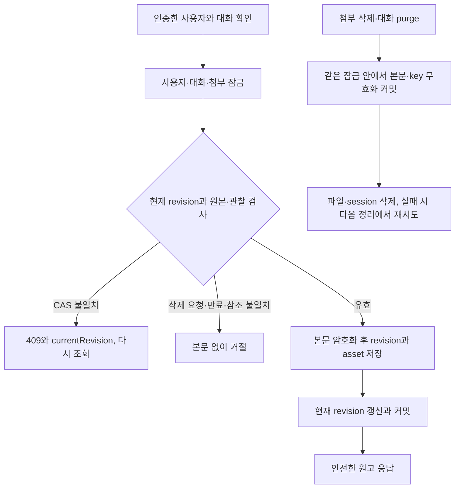

# 사진 참조를 고정한 원고와 단계별 검증

covers: `backend/src/main/java/com/bifos/assistant/chat/**/ContentDraft*`, `hermes/connectors/naver-blog/src/content-draft.ts`, `hermes/connectors/naver-blog/src/content-compiler.ts`, `test/support/media-pipeline-evidence.ts`, `test/unit/media-pipeline-evidence.test.ts`

typed 원고와 호출자가 검증한 원본 참조를 기존 `DraftInput`으로 변환한다.
compiler는 파일이나 외부 서비스를 읽지 않으며 기존 `render_draft/save_draft`의 자유 형식 입력을 바꾸지 않는다.
관찰 저장과 REST·MCP 연결은 [사진 첨부 계약](attachment.md#관찰-api와-mcp-연결)에 따라 구현되었다.
순수 compiler와 합성 판정, Control Plane의 원고 revision 저장 REST가 구현되어 있다. MCP 도구·실행 사건 가림·fos-ctx 서명 필수 목록은 후속 구현이다.
미리보기 API·승인·job·화면 연동은 원고 저장 이후의 범위다.

## 정적 canonical 계약

필드와 타입, 문자열 형식, 길이와 개수의 상한은 [`content-draft.ts`](../../hermes/connectors/naver-blog/src/content-draft.ts)의 schema 정의를 따른다.
문자열 길이는 Unicode code point로 센다.

| 대상 | 정의 위치 |
| --- | --- |
| canonical 원고 `CanonicalDraftV1` | `canonicalDraftV1Schema` |
| 원고 블록 `CanonicalBlock` | `canonicalBlockSchema`와 그 정의가 참조하는 문자열 검증 함수 |
| 호출자가 검증한 원본 참조 `ResolvedAsset` | `resolvedAssetSchema` |
| 컴파일 결과 `CompiledSnapshotV1` | `compiledSnapshotV1Schema`와 `canonicalBlockTupleSchema` |

trim과 소문자로 비교했을 때 중복 태그를 거절한다.
태그 값 자체는 자동 정규화하지 않는다.
알 수 없는 필드와 block 종류는 거절한다.
원본 사진의 중복 참조는 허용하고 블록 position으로 구별한다.
누락은 허용하되 호출자가 preview에 포함 ID와 빠진 ID의 subset을 표시하며 모두 사용했다고 말하지 않는다.
같은 사진이 두 번 나오면 업로드 자리 수는 2, 고유 asset 수는 1이다.
caption은 이미지 바로 뒤의 실제 문단으로 컴파일한다.
photo_notes는 관찰 설명이며 미리보기에만 보이는 안내로 표시한다.
photo_notes는 canonical caption을 대체하지 않는다.
paragraph 또는 caption이 기존 사진·스티커·지도·기존 구성요소 예약 줄과 정확히 같으면 `CONTENT_DRAFT_RESERVED_LINE`로 거절한다.
임의 escape나 눈에 안 보이는 문자로 문장을 바꾸지 않는다.
기존 DSL의 parseBody와 validateDraft는 그 뜻을 유지한다.

### 순수 compiler와 포트

[`content-compiler.ts`](../../hermes/connectors/naver-blog/src/content-compiler.ts)의 `compileContentDraft`는 순수 함수다.
FS, DB, HTTP, 날짜, random, Java 타입을 import하지 않는다.
권한과 원본 지문, observationRef가 같은 asset의 관찰인지 검증하는 일은 호출자가 끝낸다.
컴파일러는 missing asset, 상이한 photoDir, 중복 asset 정의와 `.small.jpg` 이름을 거절한다.
원본 이름과 경로의 허용 형식은 `resolvedAssetSchema`가 참조하는 `fileName`과 `photoDir` 정의를 따른다.
이미지 DSL 순번은 문서 이미지 자리의 1부터 시작하며 기존 화면 순번은 호출자가 preview 안내에 따로 표시한다.
fileName과 photoDir은 서버가 `ChatAttachment.storedName`과 설정에서 정한 원본 경로다.
모델 원고 스키마에는 두 칸이 없다.

payload는 기존 `DraftInput`으로 전달하며 photo_dir는 사진이 없으면 null 대신 생략한다.
photoNotes는 관찰 설명을 이미지 DSL 순번에 대응시킨다.
assetManifest는 이미지 블록 순서대로 원본 참조를 담는다.
position은 canonicalBlocks의 0부터 시작하는 배열 인덱스다. 이미지 DSL의 1부터 시작하는 사진 순번과 구분한다.
title/category/tags/body와 원본 manifest, caption, 미리보기 설명, compiler/schema 버전이 해시에 들어간다.
입력 객체를 바꿔도 snapshot이 바뀌지 않으며 반환된 JSON의 모든 객체와 배열을 고정한다.
모델과 사용자 API 응답에는 내부 photoDir와 fileName을 내보내지 않는 것이 호출자의 계약이다.

해시는 SHA-256 소문자 64자리다.
UTF-8 compact JSON 배열을 쓰고 문자열을 trim하거나 Unicode normalize하지 않는다.
payloadFingerprint 입력은 `[title,category,tags,body,photo_dir??null]`이다.
snapshotHash 입력은 `[1,"content-compiler-v1",draftId,revision,canonicalBlocks,assetTuples,payloadFingerprint,noteTuples]`이다.
canonicalBlocks는 paragraph `["paragraph",text]`, image `["image",assetId,caption??null,observationRef?[id,revision]:null]`, sticker `["sticker",code]`, map `["map",name,address]` 순서의 배열이다.
assetTuples는 `[position,assetId,sourceFingerprint,fileName]` 배열이고 noteTuples는 자리 번호 오름차순 `[number,note]` 배열이다.
JSON은 non-ASCII를 UTF-8로 쓰며 `/`를 escape하지 않는다.
canonicalBlocks는 위 tuple 배열 자체를 불변 snapshot에 보관한다.
후속 worker는 전달된 canonicalBlocks, assetManifest, photoNotes, schemaVersion, compilerVersion과 재계산한 payloadFingerprint로 snapshotHash 전체를 다시 계산한다.
후속 Control Plane도 응답의 draftId/revision/canonicalBlocks와 요청 원고, assetManifest의 position/assetId/sourceFingerprint/fileName과 보낸 resolvedAssets, photoNotes와 보낸 observationNote의 대응을 검사한다.
응답 자체의 hash 일치만으로 수용하지 않는다.
Java 재계산과 TypeScript 계산은 같은 golden vector의 UTF-8 입력 바이트, compact JSON 문자열, 두 SHA-256 결과를 정확히 비교한다.
schema/compiler version, manifest 지문·asset ID·notes·canonicalBlocks만 변조한 입력도 후속 외부 호출 전에 거절해야 한다.
mount 경로가 달라졌으면 payloadFingerprint도 달라져 새 preview가 필요하다.

compiler 회귀와 공유 golden vector는 `hermes/connectors/naver-blog/tests/content-compiler.test.ts`와 `hermes/connectors/naver-blog/tests/fixtures/content-snapshot-v1.json`이 갖는다.
테스트는 고정 ResolvedAsset mock과 임시 디렉터리의 합성 사진만 사용한다.
다른 구현의 신규 파일이나 실제 provider 호출에 의존하지 않는다.

## 단계별 합성 판정

사진 전달과 내용 판독은 별도 증거로 판정한다.
합성 검사는 자체 manifest와 사건만 사용하며 실제 원고 저장이나 외부 서비스를 호출하지 않는다.

### 단계별 증거

`PipelineEvidenceV1`의 사건 정의와 입력 검사는 [판정기](../../test/support/media-pipeline-evidence.ts)가 갖는다.
전달된 ID, 실제 픽셀에서 회수한 ID, 원고에 포함한 ID를 따로 집계한다.
중복 사건과 다른 사진의 표식, 허용하지 않은 ID는 거절한다.
일부 사진만 포함한 원고는 포함·빠진 ID를 표시하며 전체 사진을 사용했다고 판정하지 않는다.

합성 픽셀 회수는 한국어 OCR 의미 판독을 증명하지 않는다.
작은 한국어 글씨는 사람이 확인해야 하는 상태로 남긴다.
실제 provider와 브라우저, 비용은 측정하지 않았으면 `UNMEASURED`와 null을 유지한다.
전달 사건이나 저장 사건만으로 내용 판독 성공을 만들지 않는다.

## 원고 revision 저장 계약

첫 작동 단위는 Control Plane 안의 생성·조회·수정과 참조 무효화다.
외부 서비스와 compiler를 호출하지 않으며 원고 수정만으로 사진을 다시 분석하지 않는다.
관찰 저장/API/MCP와 canonical schema가 선행 구현이다. 지문 cache는 성능 개선이므로 착수 조건으로 삼지 않는다.
원고의 저장 성공은 사진 내용을 정확히 이해했다는 증거가 아니다.

### 입력과 응답

생성과 수정의 원고 입력은 `{title,category,tags,blocks}`다.
서버가 schemaVersion 1과 draftId UUID, revision, conversationId UUID를 채워 `CanonicalDraftV1`을 만든다.
입력은 `canonicalDraftV1Schema`에서 서버 필드만 뺀 모양이며 앞 절의 문자열·배열·예약 줄 검사를 그대로 적용한다.
UTF-8 compact JSON 본문은 기존 합의인 64KiB 이하다.
블록별 허용 필드를 검사하며 알 수 없는 필드와 명시적 null을 거절한다. 생략 가능한 caption과 observationRef는 생략으로 표현한다.
원본 지문은 서버가 계산하고 고정한다. 요청에 fileName, photoDir, sourceFingerprint나 서버 식별자를 추가하지 않는다.

REST 기본 경로는 `/api/v1/chat/conversations/{conversationId}/content-drafts`다.
conversationId와 draftId는 소문자 정규형 공개 UUID다. revision은 1부터 JavaScript safe integer 상한 9,007,199,254,740,991까지의 정수다.
JSON 중복 키·unknown·명시적 null과 문자열·실수 expectedRevision coercion은 거절한다.
모든 문자열 입력에서 짝 없는 UTF-16 high/low surrogate는 `VALIDATION_FAILED`로 거절한다.
유효한 surrogate pair와 비BMP 문자는 자동 치환 없이 보존하고 길이는 Unicode code point로 센다.

| 경로 | 요청 | 성공 응답 |
| --- | --- | --- |
| POST 기본 경로 | 원고 입력 | 201, `{draft:CanonicalDraftV1,status:"DRAFTING",expiresAt}` |
| GET 기본 경로 | 없음 | 200, `{items:[{draftId,revision,title,status,expiresAt}]}`, 생성 역순으로 최대 100개 |
| GET `/{draftId}` | 없음 | 200, `{draft:CanonicalDraftV1,status:"DRAFTING",expiresAt}` |
| PUT `/{draftId}` | `{expectedRevision,draft:원고 입력}` | 200, 새 revision의 같은 응답 |
| GET `/{draftId}/revisions/{revision}` | 없음 | 200, 지정 revision의 같은 응답 |

외부 status는 DRAFTING·STALE·EXPIRED이고 저장 VALID는 DRAFTING으로 옮긴다.
목록이 비면 items는 빈 배열이다. 목록의 revision은 현재 revision이며 title은 복호화한 본문에서만 얻는다.
STALE·EXPIRED 항목은 목록에 남기되 title은 null, status는 해당 값이고 본문을 내주지 않는다.
유효한 행의 복호화 실패는 목록에서도 안전한 503으로 처리한다.
이전 유효 revision은 읽기 전용이며 되돌리기는 그 본문을 현재 expectedRevision과 함께 PUT하여 새 revision을 만든다.
PUT에는 멱등 requestId를 새로 도입하지 않는다. 응답을 잃으면 다시 조회하며 같은 expectedRevision의 재전송은 충돌한다.
POST 재전송은 별도 원고 생성이므로 MCP 설명도 자동 재시도를 권하지 않는다.

| 경우 | 응답 |
| --- | --- |
| 없음·다른 사용자·다른 대화·삭제한 대화 | 404 `CONVERSATION_NOT_FOUND` |
| 입력 형식·예약 줄·상한 위반 | 400 `VALIDATION_FAILED` |
| 기대 revision 불일치 | 409 `CONTENT_DRAFT_CONFLICT`, 공개 응답에 currentRevision 정수 |
| 살아 있는 첨부지만 지문 또는 observationRef 대응이 다름 | 409 `CONTENT_DRAFT_STALE`, 권한 확인 뒤 본문 없이 currentRevision |
| 새 쓰기에 없는·타대화·미전송·삭제 요청·삭제·만료한 첨부를 사용 | 410 `ATTACHMENT_GONE` |
| 이미 저장한 revision의 참조가 삭제·변경·만료됨 | 409 `CONTENT_DRAFT_STALE`, 본문 없이 currentRevision |
| 원고 자체 expiresAt 도달 | 410 `CONTENT_DRAFT_GONE`, 본문 없음 |
| 암호화 비활성·key 실패·복호화 실패 | 503 `CONTENT_DRAFT_UNAVAILABLE`, 본문 없음 |

살펴보기 대화와 메시지가 없는 자동 작업 대화에는 쓸 수 없다. 기존 대화 권한 오류를 재사용하여 대화 존재·권한을 누설하지 않는다.
권한 확인이 다른 판정보다 앞선다. 권한 있는 원고는 자체 만료를 먼저 보고 참조 상태를 검사한다.
CAS 불일치는 원본 읽기와 새 암호화를 시작하기 전에 판정한다.
오류는 원고·파일 경로·JSON 원문·예외 cause를 응답과 로그에 싣지 않는다.

MCP 연결은 후속 구현에서 제공한다. 현재 구현은 REST 저장·조회다.

### 원고 서비스 배치

신규 엔티티는 `chat.domain.entity`의 ContentDraft, ContentDraftRevision, ContentDraftAsset에 둔다.
기존 엔티티를 옮기거나 최상위 기능 패키지를 늘리지 않는다. `domain..`의 기존 층 규칙이 이 하위 패키지도 검사한다.
상태 enum은 `chat.domain.type`, 공개 서비스 반환 타입은 `chat.application.model`, 저장소와 암호화는 `chat.infra`에 둔다.
REST는 `chat.presentation.contentdraft.ContentDraftController`와 그 패키지의 유일한 `ContentDraftDtos`가 맡는다.
기존 chat.presentation의 DTO 파일을 더 늘리지 않는다.

### 권한·원본·관찰 검사

저장과 읽기는 현재 대화 주인, 저장 주인, 첨부 업로더가 모두 요청자와 같은지 확인한다.
첨부는 같은 대화의 보낸 첨부(messageId 비null)여야 하며 deletionRequestedAt·deletedAt이 없어야 한다.
expiresAt은 현재 시각보다 커야 한다. 첨부·관찰 ID는 `^[1-9][0-9]*$` 정규형과 양수 Long 범위를 모두 만족해야 한다. 기존 TS schema는 변경하지 않는다.
서버가 `AttachmentStore.open`으로 원본 바이트를 읽고 byteSize 일치와 SHA-256을 확인한다.
중복 이미지 블록은 한 번 원본을 검증하되 각각의 position과 같은 지문을 저장한다.
지문은 생성·CAS 수정에서 고유 첨부별로 한 번 계산한다. 읽기와 목록은 파일 IO 없이 현재 ACL·DB 삭제 요청·삭제·만료·첨부와 관찰의 대응·저장 지문·revision을 검사한다.
IO·key 조회·복호화의 일시 실패는 상태와 body/key를 보존하고 503 CONTENT_DRAFT_UNAVAILABLE로 끝낸다. 확정된 삭제·만료·대응 불일치만 무효화한다.

observationRef가 있으면 지정 관찰 ID와 revision을 찾아 첨부·대화·주인·지문과 만료를 확인한다.
ID는 첨부 ID가 아닌 관찰 행 ID다. SUCCEEDED·PARTIAL·NEEDS_REVIEW 중 본문이 있고 대응이 맞는 관찰만 받는다. PROCESSING·FAILED는 거절한다. 관찰의 불확실성은 그대로 두며 사실로 승격하지 않는다.
없는 관찰·타첨부·타대화·지문·상태·본문 없음은 409 CONTENT_DRAFT_STALE이고, key·복호화 장애는 본문을 보존한 503이다.
지정한 유효 관찰은 최신 관찰로 자동 교체하지 않는다. 새 관찰 revision만 생겼다는 이유로 기존 원고를 무효화하지 않는다.
참조 원고의 모든 블록을 검증하고 일부 사진이 빠졌다는 이유만으로 전체 사용을 주장하지 않는다.

### 트랜잭션과 삭제

`ContentDraftService.create/read/revise/list`는 외부 트랜잭션 없이 `ChatContentMutationCoordinator.run`에 들어간다.
현재 coordinator의 사용자→대화→첨부 ID 오름차순 잠금으로 같은 사용자의 수정과 삭제를 직렬화한다.
읽기도 이 경계 안에서 검사·복호화하며 REPEATABLE_READ의 오래된 스냅샷으로 삭제 상태를 놓치지 않는다.
읽기 결과 반환 직전에 현재 권한·삭제 상태·Clock 만료를 다시 확인한다. 목록은 최대 100개만 처리한다.
원고 CAS는 잠금 안에서 확인한 currentRevision과 조건부 갱신 결과 1을 함께 검사한다.
revision·asset·현재 번호·만료 단축은 한 트랜잭션으로 커밋하며 실패하면 모두 되돌린다.

`ContentDraftCleaner.invalidateForAttachment`와 `invalidateForConversation`은 MANDATORY로 참가한다.
첨부 삭제는 기존 `AttachmentCleaner.delete`의 requestDeletion 사전 트랜잭션에 참조 원고 무효화를 넣고, 커밋 뒤 파일을 지운다.
`AttachmentService.deleteByUser`는 이미 cleaner로 들어가므로 별도 삭제 경로를 만들지 않는다.
파일 삭제가 실패하거나 프로세스가 재시작해도 요청 상태와 지운 본문은 복구하지 않는다.
대화 purge는 `ConversationPurger`의 사전 callback에서 모든 revision을 무효화한 뒤 session·파일을 지운다.
최종 `ConversationPurgeWriter.purge`에서는 원고와 자식을 먼저 물리 삭제하고 첨부를 지운다.

본문 무효화는 status 변경과 body/bodyKeyId를 함께 null로 만드는 DB 갱신 하나다. flushAutomatically=true로 deletionRequestedAt 사전 커밋을 보존한다. 참조 무효화는 VALID만 STALE로 바꾸고, 자체 만료는 STALE을 포함하여 EXPIRED가 아닌 모든 revision을 EXPIRED로 바꾼다.
무효화 전에 읽었던 이전 revision도 새 요청에서는 본문을 받지 못한다.
원고 자체 만료는 EXPIRED이고 참조 불일치는 STALE이다. EXPIRED를 STALE로 되돌리지 않는다.
기동과 기존 `assistant.attachment.cleanup-cron` 주기에 후보별 새 coordinator 트랜잭션으로 재확인·정리한다.
별도 매시간 cron이나 설정은 추가하지 않는다. 요청의 Clock 검사로 정리 사이에도 만료를 차단한다.
삭제한 대화·소유 불일치·사라진 관찰의 참조도 정리 후보에 넣는다.
확정된 DB 참조 불일치는 읽기·목록·정리에서 발견하면 같은 경계에서 STALE을 커밋한 뒤 경계 밖에서 오류를 반환한다.
오류를 무효화 트랜잭션 안에서 던져 지운 본문을 rollback하지 않는다.

### 후속 경계와 완료 판정

preview, snapshot의 Java 재계산, 승인, 영속 job, 웹 편집은 이 저장 기능의 후속이다.
승인 표·무효화 포트·빈 구현·preview 파일을 미리 만들지 않는다.
승인을 구현할 때 PENDING 취소와 EXECUTING 판정, 사용자 다음 action 잠금 순서를 별도 검토한다.
현재 일반 커넥터 승인을 원고 승인으로 취급하지 않는다.
Alpine 위험 수용, 원본 파일 순서 실증의 미완료 상태, 실제 거래·발행 금지와 신규 네이버 테스트만 실행하는 기존 경계를 유지한다.

| 검증 | 관측할 결과 |
| --- | --- |
| 생성·조회·3회 수정·이전 유효 revision 조회 | 번호 1부터 증가, 이전 본문 불변, 추가 분석·외부 호출 0회 |
| 같은 expectedRevision의 두 요청 | 성공 1회, 충돌 1회, currentRevision 일치 |
| 다른 사용자·대화·미전송 첨부·교차 관찰 | 본문 없이 거절, 신규 revision 0개 |
| 삭제 사전 커밋 뒤 파일 삭제 장벽·실패·재시작 | 생성·CAS·현재/이전 본문 차단, body/key 모두 null |
| 만료·purge·암호화 실패 | 만료 즉시 차단, purge 자식 0개, 실패 시 쓰기 전체 rollback |
| 실제 REST | 내부 경로·storedName·원문 오류 미노출, typed currentRevision |
| 후속 MCP·실행 사건 | origin 실행 재검사, 도구 사건 본문 없음 |
| H2·Flyway MySQL 8.4 | CHECK와 FK 유효, CAS 경쟁·삭제 실제 갱신·새 저장소 SQL 실행 |

운영 계정의 새 표 권한과 배포 뒤 실제 MCP 왕복은 `fos-home-infra`에서 확인한다.
운영 값이나 실행 명령은 이 문서에 두지 않는다.
