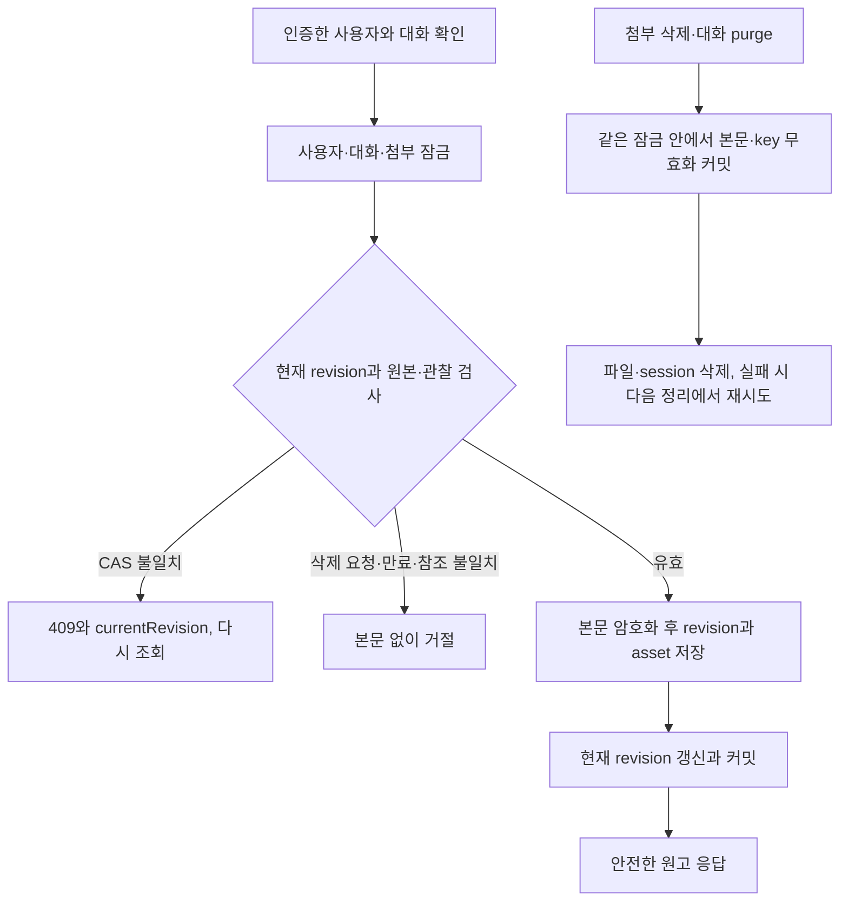

# 사진 참조를 고정한 원고와 단계별 검증

covers: `backend/src/main/java/com/bifos/assistant/chat/**/ContentDraft*`, `backend/src/main/java/com/bifos/assistant/connector/**/ContentDraft*`, `hermes/connectors/naver-blog/src/content-draft.ts`, `hermes/connectors/naver-blog/src/content-compiler.ts`, `hermes/connectors/naver-blog/src/content-snapshot*.ts`, `test/support/media-pipeline-evidence.ts`, `test/unit/media-pipeline-evidence.test.ts`

typed 원고와 호출자가 검증한 원본 참조를 기존 `DraftInput`으로 변환한다.
compiler는 파일이나 외부 서비스를 읽지 않으며 기존 `render_draft/save_draft`의 자유 형식 입력을 바꾸지 않는다.
관찰 저장과 REST·MCP 연결은 [사진 첨부 계약](attachment.md#관찰-api와-mcp-연결)에 따라 구현되었다.
순수 compiler와 합성 판정, Control Plane의 원고 revision 저장 REST가 구현되어 있다. MCP 도구·실행 사건 가림·fos-ctx 서명 필수 목록도 구현되어 있다.
원고 revision의 불변 preview snapshot 서비스와 최소 참조 표, 승인 요청·jobId 예약·worker 허가·시작 전송·private 상태 조회가 구현되어 있다. preview·저장 요청 MCP 도구와 조회 REST, 승인 카드 화면도 구현되어 있다.

## 정적 canonical 계약

필드와 타입, 문자열 형식, 길이와 개수의 상한은 [`content-draft.ts`](../../hermes/connectors/naver-blog/src/content-draft.ts)의 schema 정의를 따른다.
문자열 길이는 Unicode code point로 센다.

| 대상 | 정의 위치 |
| --- | --- |
| canonical 원고 `CanonicalDraftV1` | `canonicalDraftV1Schema` |
| 원고 블록 `CanonicalBlock` | `canonicalBlockSchema`와 그 정의가 참조하는 문자열 검증 함수 |
| 호출자가 검증한 원본 참조 `ResolvedAsset` | `resolvedAssetSchema` |
| 컴파일 결과 `CompiledSnapshotV1` | `compiledSnapshotV1Schema`와 `canonicalBlockTupleSchema` |

trim과 소문자로 비교했을 때 중복 태그를 거절한다.
태그 값 자체는 자동 정규화하지 않는다.
알 수 없는 필드와 block 종류는 거절한다.
같은 원본 사진(assetId)은 원고 전체에서 이미지 블록 하나에만 둔다.
기존 DSL의 사진 자리는 파일 이름만 담아, 같은 사진을 두 자리에 두면 저장 worker가 두 자리를 구별하지 못하고 업로드 전에 멈춘다.
Control Plane은 새 생성과 수정에서, compiler는 compile에서 같은 뜻의 `CONTENT_DRAFT_DUPLICATE_PHOTO`로 거절한다.
저장한 판을 다시 읽는 경로는 이 규칙을 검사하지 않는다. 규칙 전에 저장한 판도 읽고 고쳐 저장할 수 있다.
MCP 첫 생성은 저장된 생성 요청을 찾기 전에 이 규칙을 검사하므로, 규칙 전에 보낸 반복 사진 요청을 같은 requestId로 다시 보내면 원래 원고 대신 이 코드를 받는다.
사진 자리 형식을 바꾸는 일은 실제로 필요해질 때 정한다.
누락은 허용하되 호출자가 preview에 포함 ID와 빠진 ID의 subset을 표시하며 모두 사용했다고 말하지 않는다.
caption은 이미지 바로 뒤의 실제 문단으로 컴파일한다.
photo_notes는 관찰 설명이며 미리보기에만 보이는 안내로 표시한다.
photo_notes는 canonical caption을 대체하지 않는다.
paragraph 또는 caption이 기존 사진·스티커·지도·기존 구성요소 예약 줄과 정확히 같으면 `CONTENT_DRAFT_RESERVED_LINE`로 거절한다.
임의 escape나 눈에 안 보이는 문자로 문장을 바꾸지 않는다.
기존 DSL의 parseBody와 validateDraft는 그 뜻을 유지한다.

### 순수 compiler와 포트

[`content-compiler.ts`](../../hermes/connectors/naver-blog/src/content-compiler.ts)의 `compileContentDraft`는 순수 함수다.
FS, DB, HTTP, 날짜, random, Java 타입을 import하지 않는다.
권한과 원본 지문, observationRef가 같은 asset의 관찰인지 검증하는 일은 호출자가 끝낸다.
컴파일러는 missing asset, 상이한 photoDir, 중복 asset 정의와 `.small.jpg` 이름을 거절한다.
같은 asset을 두 이미지 블록에 둔 원고는 `CONTENT_DRAFT_DUPLICATE_PHOTO`로 거절한다. compile transport는 다른 compile 오류처럼 `invalid_input`만 돌려준다.
원본 이름과 경로의 허용 형식은 `resolvedAssetSchema`가 참조하는 `fileName`과 `photoDir` 정의를 따른다.
이미지 DSL 순번은 문서 이미지 자리의 1부터 시작하며 기존 화면 순번은 호출자가 preview 안내에 따로 표시한다.
fileName과 photoDir은 서버가 `ChatAttachment.storedName`과 설정에서 정한 원본 경로다.
모델 원고 스키마에는 두 칸이 없다.

payload는 기존 `DraftInput`으로 전달하며 photo_dir는 사진이 없으면 null 대신 생략한다.
photoNotes는 관찰 설명을 이미지 DSL 순번에 대응시킨다.
assetManifest는 이미지 블록 순서대로 원본 참조를 담는다.
position은 canonicalBlocks의 0부터 시작하는 배열 인덱스다. 이미지 DSL의 1부터 시작하는 사진 순번과 구분한다.
title/category/tags/body와 원본 manifest, caption, 미리보기 설명, compiler/schema 버전이 해시에 들어간다.
입력 객체를 바꿔도 snapshot이 바뀌지 않으며 반환된 JSON의 모든 객체와 배열을 고정한다.
모델과 사용자 API 응답에는 내부 photoDir와 fileName을 내보내지 않는 것이 호출자의 계약이다.

해시는 SHA-256 소문자 64자리다.
UTF-8 compact JSON 배열을 쓰고 문자열을 trim하거나 Unicode normalize하지 않는다.
payloadFingerprint 입력은 `[title,category,tags,body,photo_dir??null]`이다.
snapshotHash 입력은 `[1,"content-compiler-v1",draftId,revision,canonicalBlocks,assetTuples,payloadFingerprint,noteTuples]`이다.
canonicalBlocks는 paragraph `["paragraph",text]`, image `["image",assetId,caption??null,observationRef?[id,revision]:null]`, sticker `["sticker",code]`, map `["map",name,address]` 순서의 배열이다.
assetTuples는 `[position,assetId,sourceFingerprint,fileName]` 배열이고 noteTuples는 자리 번호 오름차순 `[number,note]` 배열이다.
JSON은 non-ASCII를 UTF-8로 쓰며 `/`를 escape하지 않는다.
canonicalBlocks는 위 tuple 배열 자체를 불변 snapshot에 보관한다.
후속 worker는 전달된 canonicalBlocks, assetManifest, photoNotes, schemaVersion, compilerVersion과 재계산한 payloadFingerprint로 snapshotHash 전체를 다시 계산한다.
후속 Control Plane도 응답의 draftId/revision/canonicalBlocks와 요청 원고, assetManifest의 position/assetId/sourceFingerprint/fileName과 보낸 resolvedAssets, photoNotes와 보낸 observationNote의 대응을 검사한다.
응답 자체의 hash 일치만으로 수용하지 않는다.
Java 재계산과 TypeScript 계산은 같은 golden vector의 UTF-8 입력 바이트, compact JSON 문자열, 두 SHA-256 결과를 정확히 비교한다.
schema/compiler version, manifest 지문·asset ID·notes·canonicalBlocks만 변조한 입력도 후속 외부 호출 전에 거절해야 한다.
mount 경로가 달라졌으면 payloadFingerprint도 달라져 새 preview가 필요하다.

compiler 회귀와 공유 golden vector는 `hermes/connectors/naver-blog/tests/content-compiler.test.ts`와 `hermes/connectors/naver-blog/tests/fixtures/content-snapshot-v1.json`이 갖는다.
테스트는 고정 ResolvedAsset mock과 임시 디렉터리의 합성 사진만 사용한다.
다른 구현의 신규 파일이나 실제 provider 호출에 의존하지 않는다.

### private snapshot 내부 transport

`POST /api/connectors/{id}/snapshot`은 Control Plane 서비스 Bearer로만 호출한다. <!-- ref-ignore: plugin이 middleware에서 처리하는 서비스 경로다 -->
대시보드 쿠키만 있는 요청은 거절한다. 요청의 정확한 키는 `profile`, `operation`, `args`이며 operation은 `compile`, `start`, `status`다.
compile args는 서버가 검증한 `canonicalDraft`와 `resolvedAssets`다. start·status args는 아래 private worker 계약을 따른다. 모델 공개 도구에는 내부 경로와 private 도구를 등록하지 않는다.

connector.json의 snapshot은 `protocol`, `compile_tool`, `start_tool`, `status_tool`, `capabilities`의 다섯 키만 받는다.
protocol은 `content-snapshot-v1`, 도구 이름은 서로 다르고 공개 도구와 겹치지 않는다.
capabilities는 `compile`, `start`, `status` 세 boolean이다. compile은 true이고 start와 status는 함께 켜거나 끈다. 운영 선언은 `{compile:true,start:true,status:true}`다.
카탈로그의 별도 snapshot 칸과 성공 HTTP 응답은 같은 검증된 선언을 사용한다.
Java catalog decoder도 같은 키와 capability 계약을 따른다. transport 구현이 있어도 운영 선언이 켜지지 않으면 시작하지 않는다.

dashboard는 기존 설치 소유 기록과 profile 표식, 주인 첨부·브라우저 환경 선택 규칙을 확인한 뒤 별도 stdio 자식을 띄운다.
실행 UID는 기존 dashboard 자식과 같고 권한을 올리지 않는다.
private process는 dashboard가 붙인 `--content-snapshot-operation compile|start|status` 인자로만 열린다.
공개 설치 args의 private flag와 manifest·profile의 `FOS_CONTENT_SNAPSHOT_OPERATION`, `FOS_CONTENT_SAVE_TICKET`, `FOS_CONTENT_SAVE_AUTHORIZE_URL` 선언은 거절한다.
부모 env 전체를 복사하지 않으며 별도 private env를 일반 MCP 설치에 남기지 않는다.
Naver 실행 선언의 `--no-env-file`로 Bun이 dashboard의 작업 디렉터리에서 `.env`를 자동으로 읽는 것도 차단한다.
실제 private 도구 목록이 선언한 해당 operation 하나와 다르면 호출하지 않는다. compile·status의 readOnlyHint는 true, start는 false여야 한다.
꺼진 capability와 미지원 operation은 자식 실행 전 409로 끝나며 일반 execute로 우회하지 않는다.

성공 응답은 `{ok:true,result,capabilities}`이고 compile result는 기존 `CompiledSnapshotV1`이다. start·status 결과는 job projection의 정확한 키·stamp·타입만 받는다.
오류는 본문·경로·cause·stderr 없는 `{ok:false,error}`이며 compile timeout은 504다.
compile·status MCP 왕복은 5초, start는 세션 확인과 spawn 대기를 포함해 60초다. 기존 call·execute와 동시 호출 4개 한도를 공유한다. 자동 재전송은 없다.
adapter 자체는 원고와 인자·결과를 파일이나 로그에 남기지 않으며 자식 stderr를 버린다. HTTP 오류 응답에도 본문을 넣지 않는다.
Python MCP SDK의 compile·start·status 진단은 `connector_diagnostics.py`가 호출별 ContextVar로 가린다. 본문과 ticket에 같은 정책을 적용한다.
실제 emission logger 세 곳에 영구 Filter를 설치하고 stdio와 session 정리가 끝난 뒤 scope를 해제한다.
scope 안에서는 msg, args, 예외, stack과 formatter의 cached message를 제거해 고정 문자열만 남긴다.
logger 이름, ERROR/WARNING 등급과 record 수, 정상 RPC 결과는 유지하며 scope 밖 로그는 바꾸지 않는다.
지원 source와 필터 상태를 확인하지 못하면 자식 생성 전 고정 unavailable 503으로 끝난다.
정확한 SDK source 계약과 갱신 절차는 [Hermes 계약](../../hermes/docs/hermes-contract.md#private-snapshot-sdk-진단)이 갖는다.
framework, 기존 gateway task, trajectory와 session 저장, 공개 A1 request_dump writer는 이 보호의 범위 밖이다.
renderer는 기존 첨부 검사에 사용하며 생성한 HTML은 저장하거나 반환하지 않는다.

| UTF-8 compact JSON 상한 | 검사 경계 |
| --- | --- |
| canonical 원고 65,536 bytes | Python 요청과 private compiler |
| 요청·응답 envelope 각각 524,288 bytes | 요청 스트림은 JSON 변환 전, MCP 결과와 HTTP 응답은 전달 전 |
| compiled JSON 262,144 bytes | payload·tuple·notes·manifest를 포함한 전체 직렬화 |
| 이미지 자리·manifest·resolvedAssets 각각 50개 | 같은 asset의 반복 자리와 asset 정의 중복은 모두 거절 |
| photoDir 4,096 bytes·fileName 255 bytes | 내부 원본 참조 스키마와 Python 입력 |
| asset ID 양수 Long, 최대 19자리 | 정규형 십진 문자열이며 앞자리 0은 거절 |

기존 본문 20,000 code point 상한과 golden의 두 해시, caption·notes·반복 사진·미사용 asset 허용은 보존한다.
사진의 권한과 지문 대응은 호출자가 검증한다. compile의 파일 검사만으로 실제 provider의 사진 identity를 증명하지 않는다.
합성 stdio·HTTP 검사는 Python mcp 2.0.0과 TypeScript SDK 1.28.0으로 수행한다.

로컬 합성 테스트는 잘못된 stdout과 JSONRPC·notification validation, callback 예외의 전후 본문 노출을 검사한다.
요청이 실패하면 고정 Hermes가 원고 본문과 사진을 진단 파일에 남길 수 있다. 본문 없는 writer의 운영 연결은 하지 않기로 했고(2026-10-13) 이 위험을 감수한다. upstream 추적은 [#518](https://github.com/jon890/fos-assistant/issues/518)이 갖는다.
private transport와 preview snapshot 서비스는 합성 원고로 검증한다. 원고 최초 MCP 생성과 승인, 공개 preview API도 구현되어 있으며 실제 네이버 저장은 운영 capability를 켠 뒤의 범위다.

### 커넥터의 예약 job 시작과 조회

커넥터에는 승인한 snapshot을 기존 worker로 한 번 저장하는 private start와 같은 job만 읽는 private status가 있다.
운영 선언은 `{compile:true,start:true,status:true}`다. 묶음의 connector.json이 capability를 끄면 `--content-snapshot-operation start|status` 자식도 열리지 않는다.
아래는 plugin 전달과 Control Plane 호출이 따르는 커넥터 쪽 계약이다.

| 칸 | 계약 |
| --- | --- |
| stamp | `protocol, snapshotId, jobId, snapshotHash, bindingId, connectionId, bindingUpdatedAt, connectionUpdatedAt, profileHash`의 strict 객체. ID는 소문자 UUID, 두 binding ID는 정규형 십진 문자열, 두 시각은 UTC 소수 여섯 자리, hash는 소문자 64자리 16진수 |
| start 입력 | `{snapshot, jobId, ticket, stamp}`. snapshot은 CompiledSnapshotV1, `stamp.jobId`와 `stamp.snapshotHash`는 jobId·snapshot과 같아야 한다. ticket은 공백 없는 ASCII 1~4,096자 |
| start 결과 | `{job_id, status, stamp, error_code}`. 시작 확인 전에 끝났으면 그 종료 상태다. 시작 전 거절 code를 같은 응답으로 읽으며 status와 같은 허용 규칙을 쓴다 |
| status 입력 | `{stamp}`만 받는다 |
| status 결과 | `{job_id, stamp, status, stage, save_clicked, finished_at, saved_before, saved_after, error_code}`에 실패 사유가 있으면 `error_reason`이 더해진다. 허용 밖의 stage·code와 succeeded 밖의 저장 수는 null이다. `error_reason`은 `error_code`와 같은 모양(`[a-z][a-z_]{0,63}`)의 고정 코드이고, 허용 밖이거나 없으면 칸을 싣지 않는다. Control Plane의 decoder와 Hermes 플러그인의 `connector_snapshot_job.py`가 둘 다 같은 규칙으로 이 칸을 선택으로 받는다. 둘 중 하나라도 모르면 키 집합이 다르다며 응답 전체를 거절하므로 Control Plane과 플러그인을 먼저 배포하고 커넥터를 나중에 배포한다 |
| 오류 | 결과 없는 `{"error": invalid_input / not_found / start_unknown / unavailable}`. 커넥터는 isError 결과의 text 하나로 보내고, plugin은 이 모양만 `ok:true` 결과로 넘기며 다른 isError는 503이다 |

private 서버는 profile을 모르므로 profileHash를 다시 계산하지 않는다. 상태 파일의 stamp와 모든 칸이 같은지만 본다.
요청 profile의 SHA-256과 stamp.profileHash는 plugin이 자식 실행 전에 대조한다. authorize 주소는 dashboard의 기존 `FOS_CONNECTOR_EXECUTIONS_BASE_URL` 접두사에 고정 내부 경로를 붙인다. 요청·manifest·profile이 다른 주소를 지정하지 못한다.
authorize 주소는 private 자식 env `FOS_CONTENT_SAVE_AUTHORIZE_URL`에서만 받고 고정 경로 `/internal/content-draft-jobs/authorize`로 끝나는 http(s) 주소만 쓴다. <!-- ref-ignore: 구현할 Control Plane 내부 경로다 -->

start는 같은 jobId의 상태 파일을 `O_EXCL`로 먼저 만들어 예약 ID를 고정한다. 이미 있으면 stamp가 모두 같을 때 그 상태만 돌려주고 worker를 띄우지 않는다.
그 뒤의 세션 확인·잠금·입력 쓰기·spawn 실패는 상태를 지우지 않고 failed로 끝낸다. 잠금이 바쁘면 code는 `busy`다.
worker가 시작 확인 시간 안에 pid를 적지 않으면 `start_unknown`이고 예약 ID는 그대로 남는다. 다시 보내도 새 worker는 없다.
상태 파일은 끝난 뒤 24시간에 지워지므로 그 뒤의 재전송은 커넥터가 막지 못한다. 같은 job의 두 번째 실행은 Control Plane의 authorize(start) 단일 claim이 거절해야 한다.
ticket은 입력 파일과 상태 파일에 쓰지 않는다. 기존 env whitelist에 ticket과 authorize 주소만 더해 그 worker에 넘긴다. worker는 무엇을 하기 전에 런타임 env에서 지워 이후 코드와 자식 프로세스에 넘기지 않는다. 커널이 보여 주는 최초 environ까지 지우지는 못한다.

worker는 snapshot의 canonical tuple·manifest·notes로 원고를 다시 compile해 결과 전체와 두 지문이 같은지 본다. 상태 파일 stamp의 jobId·snapshotHash와도 맞춘다.
어긋나면 브라우저를 열지 않고 `snapshot_invalid`로 끝난다. 통과하면 authorize(start) 뒤 기존 runDraft를 부른다.
사진 i번째(0부터)는 manifest i번째와 대조한다. 읽은 바이트의 SHA-256이 sourceFingerprint와 같고 그 canonical position의 authorize(photo)를 통과해야 바로 그 바이트를 넣는다.
검사하지 않은 기존 사진이 편집기에 있거나 manifest의 수·파일 이름이 다르면 `photo_mismatch`로 업로드 전에 멈춘다.
save_clicking에서는 authorize(save)를 먼저 받고 기존 save_clicked 기록·재읽기·finishClaimed 검사를 그대로 한다. 거절이면 클릭 0회와 `authorize_denied`다. save 허가 뒤 save_clicked 기록이 실패해도 클릭 0회의 failed이므로, Control Plane은 save 허가를 저장 완료로 다루지 않는다.
authorize는 HTTP 200의 정확한 `{"allowed":true}`만 허가로 보고 10초 뒤 끊으며 다시 보내지 않는다.
clicked=false 실패, clicked=true 뒤 unknown, 600초 timeout과 30초 heartbeat·11분 stale 규칙은 기존 DSL job과 같다.

공개 `draft_job`은 상태 파일에 `snapshot_stamp` 키가 있으면 값이 null이거나 깨졌어도 `NAVER_BLOG_JOB_NOT_FOUND`다. 묵은 작업 정리 전에 막아 공개 조회가 private 상태를 바꾸지 못한다.
private status만 stamp를 strict decode해 대조하고, 묵은 job은 공개 조회와 같은 규칙으로 끝낸다. 상태 파일이 없거나 정리됐으면 `not_found`이며 worker를 새로 띄우지 않는다.
pid가 없는 queued 예약은 세션 확인 상한 45초와 spawn 여유 10초를 합친 55초까지 기다린다. 세션 확인 중 status가 예약을 먼저 timeout으로 끝내지 않는다.
Control Plane과 compiler가 중복 사진을 미리 `CONTENT_DRAFT_DUPLICATE_PHOTO`로 거절한다. compiler를 거치지 않은 반복 snapshot도 worker가 재compile할 때 `snapshot_invalid`로 막아 authorize 호출과 브라우저 실행을 하지 않는다.

검증은 실제 TS MCP Client와 InMemoryTransport, 분리한 worker 프로세스, loopback 대역 authorize 서버로 한다. 업로드와 저장 클릭은 대역 runDraft가 남긴 독립 기록으로 센다.
30장 서로 다른 합성 바이트의 순서와 업로드 바이트는 대역 편집기로 확인한다. 실제 네이버 편집기·provider 사진 대응·운영 Hermes 왕복은 확인하지 않았다.

## 불변 preview snapshot

`ContentDraftSnapshots.preview`는 기존 REST 원고의 ID·revision·binding ID와 인증 내부 맥락의 origin 실행 ID를 받는다.
최초 MCP 생성 idempotency와 독립적이며 MCP 생성 타입이나 handler를 재사용하지 않는다.
사용자 입력에서 owner·profile·origin 실행·파일명·경로를 받지 않는다. 현재 profile과 connector ID는 요청자의 실제 바인딩에서 정한다.
chat은 `ContentDraftBindingAccess`의 불변 stamp만 사용하고 connector 엔티티와 `McpCaller`를 import하지 않는다.

1. 트랜잭션 밖에서 현재 origin·사용자 권한과 binding을 확인하고 compile 전용 선언·정책을 준비한다.
2. coordinator에 한 번 진입하여 사용자 → 대화 → 첨부 ID 오름차순으로 잠근다. 현재 revision·기한·원본 byte·관찰 참조·binding 판을 고정한다.
3. 잠금을 풀고 compiler HTTP를 호출한다. 서버의 원본 파일명·실행 관점 첨부 루트·사용자 디렉터리 키·내부 대화 ID로 `ResolvedAsset`을 계산한다. prompt를 파싱하지 않는다.
4. 응답의 전체 canonical tuple·manifest·관찰 설명·payload와 두 지문을 요청에서 재계산한 값에 대조한다. 다시 잠금 밖에서 선언과 stamp를 준비한다.
5. 같은 순서로 잠가 현재 권한·기한·revision·원본 byte·관찰 대응·binding 판이 그대로일 때만 참조와 지문을 저장한다.

원본은 `AttachmentFingerprint`로 실제 크기와 SHA-256을 다시 읽는다. DB 참조 유효성만으로 원본 일치를 주장하지 않는다.
observationRef는 고정한 attachment·owner·conversation·revision·지문과 일치하고 읽을 수 있는 관찰이어야 한다.
설명은 그 관찰 summary의 앞 300 code point이며 새 분석을 하지 않는다. 반복 사진의 설명이 서로 다르면 거절한다.
resolvedAssets에는 asset마다 한 번만 전달한다. 새로 쓴 판에는 반복 자리가 없다.
규칙 전에 저장한 판에 반복 자리가 있으면 preview는 커넥터를 부르기 전에 400 `CONTENT_DRAFT_DUPLICATE_PHOTO`로 멈춘다. 그 판은 고쳐 저장한 뒤에 preview를 만든다.
미리보기에는 canonical 원고와 포함·빠진 첨부 ID를 돌려주고 파일명·내부 경로·compiled payload는 내보내지 않는다.

`readCurrentSnapshot`은 외부 트랜잭션 없이 coordinator에 한 번 들어가는 독립 조회다.
`requireCurrentSnapshotParticipant`는 MANDATORY와 coordinator 참가 여부를 모두 확인하는 내부 API다.
참가 함수는 저장소·본문 복호화·입력 reader·원본 검사를 직접 사용하고 기존 원고 서비스의 read나 private helper를 재호출하지 않는다.
참가 경로의 호출자는 선언과 정책 포함 stamp를 잠금 밖에서 준비하고 반환 입력의 binding과 명시적으로 대조한 뒤 사용해야 한다.
참가 함수는 저장된 정책 지문을 반환하며 현재 catalog까지 검증하지 않는다. 참가 함수에서 catalog나 compiler HTTP를 기다리지 않는다.
원격 catalog와 DB commit의 원자성을 보장하지 않으며 준비한 선언의 판과 현재 DB binding 판을 각각 검사한다.

같은 owner·대화·revision·binding·compiler hash와 권한 지문의 반복·동시 preview는 같은 공개 snapshot ID를 반환한다.
서버는 `[1,"content-draft-preview-authorization",ownerUserId,conversationId,revisionId,originExecutionId,agentId,connectionId,bindingId,connectionUpdatedAt,bindingUpdatedAt,profileHash,connectorId,policyFingerprint]`를 고정 순서 UTF-8 JSON tuple로 직렬화해 SHA-256 권한 지문을 계산한다.
두 시각은 DB와 같은 MICRO 정밀도로 절삭하고 UTC 소수 여섯 자리로 적는다. profileHash는 profile 원문의 UTF-8 SHA-256이다.
이 지문은 암호학적 서명이 아니며 현재 권한·캡처 값·기한·원본 검사를 대신하지 않는다. 모델이나 DTO에서 지문을 받지 않는다.
유효한 binding·connection 판이나 정책이 바뀌거나 새 유효 origin으로 실행하면 같은 원고 revision에도 새 공개 ID를 만든다.
옛 행과 job·승인의 identity 및 캡처 값은 바꾸거나 지우지 않으며 옛 권한은 계속 거절한다. CANCELLED origin은 새 지문을 만들어도 허용하지 않는다.
현재 운영 API에는 agent profile 변경 기능이 없다. profile hash는 실행·설치 맥락을 구별하기 위한 캡처 값이다.
UNIQUE 실패 뒤에는 새 owner 범위 읽기로 기존 행을 찾고, 기존 origin과 기한도 계속 검사한다.
허용 목록 철회·binding 해제·원고 수정·첨부 교체·삭제 요청·만료는 새 snapshot을 수락하지 않는다.
기존 snapshot과 job 이력은 자동 정리하지 않는다. 본문은 기존 암호화 revision에만 남는다.

Java HTTP client는 POST·서비스 Bearer·profile/operation/args tuple만 전달한다.
512KiB 응답은 chunked여도 tree 전에 차단하고 전체 응답은 5초로 제한한다. canonical 64KiB·compiled 256KiB·원본 50개 상한을 유지한다.
Java의 네 compile slot과 dashboard의 기존 공유 네 호출 slot을 모두 적용하며 중단·실패 시 반환한다.
성공 envelope의 capabilities는 catalog와 같은 strict boolean 계약을 따르며 요청 operation이 true여야 한다. 오류 body·raw 인자·exception cause를 로그나 응답에 싣지 않는다.
스키마·설치·HTTP 장애는 원고의 기존 안전한 오류로 끝낸다.

검증은 공유 golden의 Java UTF-8 바이트·두 지문, 실제 HTTP 대역, Spring 동시 revision·권한 철회·원본 교체, H2 마이그레이션과 fresh MySQL을 사용한다.
이 절의 compile 검증은 운영 Hermes 왕복·실제 provider·실제 30장 canary를 실행하지 않는다. 승인·worker 시작·복구·공개 handler는 아래 절과 「후속 경계와 완료 판정」이 갖는다.

## 승인 snapshot과 저장 job

#396·#398의 새 글 임시저장을 기존 승인 줄과 서버가 예약한 worker jobId로 잇는다. 결정 근거는 [ADR-20261011 / content-snapshot-job](../adr/ADR-20261011-content-snapshot-job.md)이다.
토스 주문, Gmail 보내기와 견준 준비, 승인, 실행, 확인의 요약과 실사용 Go/No-Go 는 [커넥터별 준비, 승인, 실행, 확인](connector-policy.md#커넥터별-준비-승인-실행-확인)이 갖는다.
승인 요청·jobId 예약·worker 허가·보관 상태 조회는 Control Plane에 구현되어 있다.
worker 시작 전송과 private 상태 조회, MCP 도구와 REST·화면 연결이 구현되어 있다. catalog가 시작을 선언하지 않는 동안 승인은 실행 없이 거절한다.

### 승인 요청과 조회 port

`TopLevelPackageOrder.ORDER`에서 chat은 connector보다 아래다. port는 chat에 두고 `connector.contentdraft.application.ContentDraftJobs`가 구현한다.
반환 record는 `chat.contentdraft.application.dto`에 둔다. connector 엔티티·enum·catalog·ticket은 반환하지 않는다.

| 계약 | 시그니처와 반환 |
| --- | --- |
| `ContentDraftSaveRequests` | `ContentDraftSaveRequestView requestSave(CurrentUser user, Long originExecutionId, UUID snapshotId)` |
| `ContentDraftJobQueries` | `ContentDraftJobView refresh(CurrentUser user, Long conversationId, UUID draftId, UUID snapshotId)`, `ContentDraftJobPage list(CurrentUser user, Long conversationId, UUID beforeSnapshotId, int limit)` |
| `ContentDraftSaveRequestView` | `UUID snapshotId, UUID actionId, UUID jobId, ContentDraftJobStatus status`, jobId는 승인 전 null |
| `ContentDraftJobView` | `UUID snapshotId, UUID draftId, long revision, UUID actionId, UUID jobId, ContentDraftJobStatus status, String stage, boolean saveClicked, Instant lastCheckedAt, String errorCode, String errorReason` |
| `ContentDraftJobPage` | `List<ContentDraftJobView> items, UUID nextBeforeSnapshotId`, 페이지 끝이면 cursor null |

requestSave는 호출한 origin이 같은 사용자·대화의 취소되지 않은 실행이고 snapshot의 에이전트와 같은지 먼저 본다.
잠금 밖에서 바인딩 stamp와 catalog를 준비하고, coordinator 안에서 `requireCurrentSnapshotParticipant`의 입력 binding과 준비한 stamp가 같을 때만 승인 줄과 job을 한 트랜잭션에 만든다.
승인 줄은 기존 `save_draft` 선언의 위험도로 판정하되 승인 방식은 `always`로 저장한다. 상시 허락을 보지 않고 승인 카드에 허락 선택을 내지 않는다.
인자는 `{"snapshotId":"<UUID>"}` 하나이고 dedupe key는 `v1-content-save`와 owner·snapshotId의 SHA-256이다. 최초 MCP 생성의 중복 방지 키와 섞지 않는다.
같은 snapshot의 두 번째 요청은 상태와 상관없이 앞의 승인 줄과 job을 돌려준다. 동시 요청은 사용자 잠금과 snapshot 유일 색인으로 하나가 된다.

refresh와 list는 원래 대화 주인에게 Control Plane이 보관한 상태만 돌려주고 외부를 부르지 않는다. 남의 것과 없는 것은 같은 404다.
list는 1~20개를 job 내부 번호 역순으로 읽고 21번째 행으로 다음 페이지를 판정한다. cursor는 snapshot 공개 UUID이며 같은 owner·대화 밖이면 404다.
승인 전에 거절·만료된 줄의 job은 STALE로 보인다.

### 승인과 jobId 예약

기존 승인 경로 `POST /api/v1/connector-actions/{actionId}/approve`의 controller가 트랜잭션 밖에서 `ContentDraftSaveApproval.select`로 job 링크를 찾는다. 인자 글이나 도구 이름으로 고르지 않는다.
링크가 있으면 `ContentDraftSaveApproval.approve`가 상시 허락 요청을 `VALIDATION_FAILED`로 거절하고 `prepare`와 `approvePrepared`로 넘긴다. 링크가 없는 일반 줄은 `ConnectorActionService`의 기존 경로 그대로다.
원고 승인 줄의 등록 이름 `fos_content_draft_save`는 MCP 서버 도구가 아니다. 이 줄이 일반 승인 경로로 들어와도 선언 없는 도구로 판정되어 실행 없이 거절된다.
prepare는 잠글 실행 번호, 지금 catalog로 계산한 바인딩 stamp, catalog 선언을 잠금 밖에서 읽는다.
시작은 catalog의 snapshot 선언이 start·status를 모두 참으로 선언하고 `ContentDraftJobStarter` 구현 빈이 있을 때만 지원한다.
운영 선언이 start·status를 켜고 있어 승인한 snapshot의 예약 job만 시작한다. 선언을 끄면 실행 없이 거절한다.

approvePrepared는 coordinator 한 번 안에서 아래 「잠금 순서」로 잠그고 승인 줄 PENDING, job PREVIEW_READY, 기한, 시작 지원, 현재 `save_draft` 정책, 현재 원고·원본·바인딩 판, 준비한 정책 지문을 확인한다.
모두 맞으면 소문자 정규 UUID jobId를 예약하고 승인 줄 EXECUTING, job DISPATCHED와 승인자·승인 시각을 함께 커밋한다.
하나라도 맞지 않으면 그 트랜잭션을 되돌리고 새 트랜잭션에서 승인 줄을 `not_executable`로 거절하거나 만료로 끝낸다. job은 STALE과 `CONTENT_DRAFT_STALE` 또는 `not_executable`이며 외부 호출은 0회다.
커밋 뒤 ticket을 발급하고 Java로 재계산한 compiled snapshot과 함께 시작을 최대 한 번 보낸다. 전송 구현은 예약 jobId와 snapshot·바인딩 판을 받아 start 입력의 stamp를 만든다.
시작 전송 port는 `ContentDraftJobStarter.start(String profile, String connectorId, JsonNode snapshot, ContentDraftSaveTicketPayload job, String ticket)`이다.
`HttpContentDraftJobStarter`가 예약 payload를 `ContentDraftWorkerStamp`로 옮긴 뒤 HTTP client에 넘긴다. HTTP client의 start 인자는 `profile, connectorId, snapshot, stamp, ticket`이다. hermes가 상위 connector의 ticket 타입에 의존하지 않도록 이 변환은 connector가 맡는다.
전송은 `{snapshot, jobId, ticket, stamp}`이며 stamp에 snapshot·job 식별자와 해시, 바인딩·연결 버전, profile의 SHA-256인 profileHash를 담는다. Python plugin이 profileHash를 대조한다.
private 상태 도구 이름은 manifest의 `content_snapshot_status`다.

| 시작 결과 | 승인 줄 | job |
| --- | --- | --- |
| 접수 | EXECUTING 유지 | SAVING |
| 시작 전 거절 code, ticket 발급 실패 | FAILED, `unavailable` | FAILED와 그 code |
| 예외·timeout·응답 유실 | UNKNOWN | DISPATCHED였으면 UNKNOWN |

같은 snapshot의 재승인·재전송·outbox는 없다. 기존 ConnectorAction의 SUCCEEDED는 원고 경로에서 쓰지 않는다.
원고 승인 줄은 job이 수명을 소유한다. `ConnectorActionExpirer`의 5분 정리와 `ConnectorActionSweeper`의 기동 정리는 job 링크가 있는 줄을 UNKNOWN으로 바꾸지 않는다.
`ContentDraftJobExpirer`가 승인 뒤 15분이 지나도록 DISPATCHED·SAVING인 job을 한 번 조회한다. 끝난 결과를 읽으면 그대로 기록하고, 아니면 start claim이 없으면 FAILED, 있으면 UNKNOWN과 `CONTENT_DRAFT_JOB_EXPIRED`로 닫는다. EXECUTING 승인 줄도 같은 결과로 끝낸다.
15분은 ticket 최대 수명 660초와 worker 실행 상한 600초보다 길다. 그 뒤에는 worker가 claim을 받지 못해 저장 클릭이 새로 생기지 않는다. 예약을 커밋한 뒤 시작을 보내기 전에 CP가 내려가 DISPATCHED로 남은 job도 이 정리가 닫는다.
정리 전까지 그 연결의 해제와 재등록은 기존처럼 `CONNECTOR_ACTION_EXECUTING`으로 거절된다.

### 저장 ticket과 authorize

ticket은 `base64url(payload).base64url(signature)`이고 padding이 없으며 4,096자 이하다.
payload는 아래 순서의 키만 가진 compact JSON UTF-8이다. 숫자 ID는 정규 십진 문자열, 시각은 마이크로초까지의 `Instant.toString` 형식이다.

`v`(정수 1), `purpose`(`content-snapshot-save`), `jobId`, `snapshotId`, `snapshotHash`, `actionId`, `ownerUserId`, `conversationId`, `bindingId`, `connectionId`, `bindingUpdatedAt`, `connectionUpdatedAt`, `issuedAt`, `expiresAt`

서명 key는 대시보드 서비스 token에서 `HMAC-SHA256(token, "fos-content-save-signing-key-v1")`로 유도한다.
서명은 `HMAC-SHA256(key, "fos-content-save-v1." + payload의 base64url 문자열)`이다. 금융 ticket의 key와 domain, 사용자 JWT는 받지 않는다.
기한은 발급 뒤 최대 660초와 snapshot 기한 가운데 이른 쪽이다. ticket과 key는 DB·로그·MCP 결과에 남기지 않는다.
worker는 ticket을 해석할 필요가 없다. 받은 문자열을 그대로 authorize에 싣는다.

`POST /internal/content-draft-jobs/authorize`는 사용자 JWT 필터를 건너뛰고 controller가 ticket을 직접 인증한다. <!-- ref-ignore: worker가 부르는 내부 경로다 -->
요청은 `{"ticket":..,"stage":"start"|"save"}` 또는 `{"ticket":..,"stage":"photo","position":<0~499>}`이고 다른 키·타입·중복 키·8,192바이트 초과는 400이다.
position은 canonical block 위치이며 그 위치가 image block이어야 한다. 사진 DSL의 1부터 시작하는 번호가 아니다.
허가는 200 `{"allowed":true}`다. 서명·형식·기한 실패는 401, 그 밖의 거절은 403이며 본문에는 고정 문구만 있다. DB 일시 장애와 잠금 경합에서 되돌린 claim도 403이다. 응답 누락·timeout·다른 모양을 허가로 읽지 않는다.
worker는 authorize 요청을 10초 timeout으로 한 번만 보내고 재시도하지 않는다. save 허가는 저장 클릭의 허가이며 저장 완료를 뜻하지 않는다.

매 호출은 ticket의 job·snapshot·hash·승인 줄·owner·대화·바인딩 판이 DB와 같은지 보고, 잠금 안에서 승인 사실, 사용자 허용, 에이전트, origin·루트 실행, 현재 원고·원본·바인딩을 다시 확인한다.
start는 `start_claimed_at`, save는 `save_claimed_at`을 NULL에서 시각으로 바꾸는 조건부 갱신 결과 1일 때만 허가하고 그 트랜잭션을 커밋한 뒤 응답한다.
start 전의 photo·save, 두 번째 start, 두 번째 save, save 뒤의 photo는 403이다. 응답을 잃어도 같은 claim을 다시 주거나 ticket을 다시 발급하지 않는다.
시작 응답을 잃어 UNKNOWN인 job도 claim 한 번은 쓸 수 있다. 승인 줄은 EXECUTING이거나 시작 응답을 잃은 UNKNOWN이어야 한다.

### 잠금 순서와 철회의 선형화

coordinator가 사용자 → 대화 → 첨부를 잠그고, 그 안에서 허용 목록 행 → 에이전트 → origin·루트 실행 오름차순 → 승인 줄 → snapshot → job을 잠근다.
승인과 authorize가 같은 순서를 쓴다. 잠글 실행 번호는 잠금 밖에서 읽고, 실행·에이전트·허용 목록 행은 그 트랜잭션에서 처음 읽는 잠금 쿼리로 최신 값을 얻는다.
`UserAccessPolicy.allowedForUpdate`는 MANDATORY 참가 함수이며 잠긴 사용자의 메일로 허용 목록 행을 쓰기 잠금으로 읽는다.

| 실제 writer | claim과의 경계 |
| --- | --- |
| `ExecutionRecorder.cancel` | CANCELLED UPDATE가 같은 실행 행을 잠근다. 먼저 커밋하면 claim 거절, 잠금을 쥐는 동안 claim이 기다렸다가 커밋이면 거절, rollback이면 허가 |
| `PersonAccessService.setEnabled` | 사용자 행을 번호 오름차순으로 잠근 뒤 허용 목록 행을 잠근다. 끄기가 먼저 커밋하면 claim 거절 |
| `AgentAdminService.update`·`AgentLifecycleService` | 에이전트 행 잠금을 공유한다. 비활성이 먼저 커밋하면 claim 거절 |
| `RecoveredRunRecorder.finishOnce`의 완료·취소 기록 | 실행 행을 먼저 잠그고 대화 행을 잠가 순서가 반대다. 취소 결과도 `ExecutionRecorder.cancel` 뒤 `ConversationWriter.touchSession`을 같은 트랜잭션에서 부른다. 겹치면 InnoDB 가 한쪽을 되돌린다. 허가가 지면 403 으로 끝나 클릭은 0회이고, 승인이 지면 승인 줄은 PENDING 으로 남는다. 순서 정렬은 후속 과제다 |
| `ConnectorBindingService.unbind`·`ConnectorConnectionService.apply/disconnect` | 사용자 행을 먼저 잠그고 원고 승인 줄이 EXECUTING이면 기존처럼 `CONNECTOR_ACTION_EXECUTING`으로 실패하며 바인딩 판을 바꾸지 않는다 |

claim이 먼저 커밋하면 뒤의 writer는 그 행을 기다렸다가 바뀐다. 이미 허가한 원격 클릭을 되돌리지 못하며 저장을 멈췄다고 보고하지 않는다.
CP 검사와 브라우저 클릭을 하나의 원격 트랜잭션이라고 주장하지 않는다. snapshot 전용 해제 API는 만들지 않는다.

### job 상태와 재접속

| 상황 | job 상태 | 다음 행동 |
| --- | --- | --- |
| 요청 뒤 미승인 | PREVIEW_READY | 기존 승인 카드에서 승인 또는 거절 |
| 승인 전 거절·만료·현재 검사 실패 | STALE | 같은 snapshot은 다시 저장하지 않음. 원고 변경·만료는 새 preview 필요, 시작 지원이 없는 거절(`not_executable`)은 새 preview로도 저장할 수 없음, 사용자 거절은 거절로 끝남 |
| 예약 커밋 뒤 시작 전 | DISPATCHED | 시작 재전송 없음 |
| 시작 전송 뒤 결과 기록 실패 | DISPATCHED 또는 이미 claim한 SAVING | 결과를 모르는 상태로 취급하고 같은 job만 조회하며 시작을 재전송하지 않음 |
| 시작 접수·start claim | SAVING | 같은 job만 조회 |
| 시작 전 거절 | FAILED | 같은 snapshot 재시도 없음 |
| 시작 결과 모름 | UNKNOWN | 예약 jobId로만 조회, 재승인으로 재실행하지 않음 |
| 바인딩 버전이 바뀜 | start claim 없으면 FAILED, 있으면 UNKNOWN | 옛 stamp로 조회하지 않고 refresh가 그 자리에서 닫음 |
| 승인 뒤 15분 동안 끝나지 않음 | start claim 없으면 FAILED, 있으면 UNKNOWN | 기한 정리가 마지막으로 한 번 조회한 뒤 닫음 |

`ContentDraftJobs.refresh`는 주인·원래 대화·원고 ID를 먼저 확인한다. 현재 binding·connection 버전과 정책이 snapshot과 같고 status capability가 켜져 있을 때만 같은 예약 ID를 조회한다. 연결을 지금 쓸 수 없으면 마지막 CP 상태만 읽는다.
바인딩 버전이 다르면 옛 stamp로 조회하지 않는다. 연결 확인과 재반영이 `updatedAt`을 올리고 그 값은 앞으로만 가므로 기다려도 같은 stamp로 돌아오지 않는다. 끝나지 않은 job은 그 자리에서 start claim이 없으면 FAILED, 있으면 UNKNOWN과 `CONTENT_DRAFT_BINDING_CHANGED`로 닫고 EXECUTING 승인 줄도 같은 결과로 끝낸다. 연결이 바뀌어 결과를 확인하지 못했다는 뜻이다.
authorize도 바인딩 버전을 대조하므로 닫은 뒤의 worker는 claim을 받지 못한다.
원격 호출 동안 DB 잠금을 유지하지 않는다. 응답 뒤 coordinator에서 현재 ACL·binding을 다시 확인하고 승인 줄 → snapshot → job 순서로 잠근다. stamp와 jobId가 정확한 결과만 기록한다.
`ContentDraftWorkerStatusDecoder`는 소문자 worker 상태를 CP enum으로 명시적으로 옮기며 단계·boolean·수치·종료 시각의 타입을 검사한다. 조회 오류는 `CONTENT_DRAFT_JOB_UNAVAILABLE`이고 기존 상태를 FAILED로 바꾸지 않는다.
status 응답의 `error_reason`은 선택 칸이다. 있으면 `[a-z][a-z_]{0,63}` 모양만 받고 아니면 응답 전체를 거절하며, 옛 worker처럼 없으면 `errorReason`이 null이다. job은 `error_reason` 컬럼에 보관하고 job 상태와 승인 줄 요약으로 내보낸다. 화면은 알려진 코드를 FAILED 안내 뒤에 사용자 문구로 덧붙이고 모르는 코드는 그리지 않는다. 배포는 Control Plane이 먼저다.
worker의 `not_found`는 timeout·전송 실패와 다르다. HTTP client가 `ContentDraftJobNotFound`로 따로 알리고, refresh는 start claim이 없으면 FAILED, 있으면 UNKNOWN과 `CONTENT_DRAFT_JOB_NOT_FOUND`로 닫는다. worker는 브라우저를 열기 전에 반드시 start claim을 받으므로 claim이 없으면 저장 클릭도 없고, 늦게 온 worker는 FAILED에서 claim을 받지 못한다.
시작 전송이 아직 worker에 닿지 않았을 수 있는 승인 뒤 2분 동안의 DISPATCHED job은 `not_found`를 일시 장애로 본다. CP가 닫은 UNKNOWN은 다시 조회하지 않는다.
늦은 terminal은 UNKNOWN job을 해소할 수 있다. 확정한 SUCCEEDED·FAILED는 덮지 않고 UNKNOWN을 running 응답으로 되돌리지 않는다. save claim 또는 save_clicked 뒤의 실패는 UNKNOWN이다. ConnectorAction은 EXECUTING일 때만 terminal로 바꾸고 기존 UNKNOWN 승인 줄은 유지한다. 일반 실행 정리가 원고 승인 줄을 바꾸지 않으므로 UNKNOWN 승인 줄은 시작 응답을 잃었을 때만 생긴다.
FAILED는 명시적 저장 클릭 전 실패를 뜻하며 편집기 자동저장이 없었다는 증거가 아니다. save claim 뒤의 실패는 UNKNOWN으로 둔다.

### MCP 도구와 화면 연결

모델은 REST나 `content_draft_write`로 만든 원고의 snapshot을 제시하고, 사용자는 기존 승인 카드에서 저장한다.

| 도구 | 인자 | 결과 |
| --- | --- | --- |
| `content_draft_preview` | `{draftId, revision, bindingId?}` | `ContentDraftSnapshotView`. canonical preview와 포함·빠진 사진 ID이며 파일명·경로·compiled payload는 없다 |
| `content_draft_save` | `{snapshotId}` | `ContentDraftSaveRequestView`. 같은 snapshot의 재호출은 앞의 승인 줄과 job을 그대로 돌려준다 |

정의와 처리는 `mcp.application.McpContentDraftSnapshots`가 맡고 등록 순서는 `content_draft_read` 뒤, `memory_remember` 앞이다.
인자 검사와 오류 변환, 실행 전후 별도 읽기 트랜잭션의 현재 caller 검사는 「MCP와 배치」의 원고 도구와 같다. 사후 검사 실패는 이미 만든 snapshot·승인 줄을 되돌리지 않고 결과만 차단한다.
bindingId는 선택 정수이고 소유자·profile·실행·파일 경로 인자는 받지 않는다. 실행할 profile과 커넥터는 그 바인딩에서 정한다.
모델은 바인딩 번호를 알 경로가 없으므로 bindingId를 생략할 수 있다. 생략하면 서명된 origin의 에이전트에 붙은 요청자 연결 가운데 catalog가 snapshot을 선언한 커넥터의 바인딩이 정확히 하나일 때만 그것을 쓴다.
0개나 2개 이상이면 `VALIDATION_FAILED`와 고정 까닭 `message`를 isError 결과로 돌려주며 snapshot을 만들지 않는다. 지정한 bindingId도 같은 에이전트·요청자 범위인지 preview가 검사한다.
살펴보기 허용 집합은 넓히지 않는다. fos-ctx 서명 필수 목록과 실행 사건 가림에도 두 도구를 넣는다.

| REST GET (`/api/v1/chat/conversations/{conversationId}` 아래) | 응답 |
| --- | --- |
| `/content-drafts/{draftId}/snapshots/{snapshotId}` | `readCurrentSnapshot`의 preview. 현재 원고·원본·바인딩이 다르면 본문 없는 409 `CONTENT_DRAFT_STALE` |
| `/content-drafts/{draftId}/snapshots/{snapshotId}/job` | `ContentDraftJobQueries.refresh`의 job 상태 |
| `/content-draft-jobs?beforeSnapshotId=` | `list`의 20개와 `nextBeforeSnapshotId` |

남의 것, 다른 원고 ID, job이 없는 snapshot은 같은 404다. 오류 본문은 code만 싣는다.
대화의 승인 줄 목록과 그 줄의 승인·거절 응답은 job 링크가 있는 줄에 `contentDraft` 요약(snapshotId, draftId, revision, 원래 conversationId, 상태·단계·저장 클릭·오류 code)을 붙이고 일반 줄은 null이다. 승인자·바인딩 판·경로는 싣지 않는다.

화면은 `contentDraft`가 있는 승인 줄을 원고 카드로 그린다.

- 승인 전에는 snapshot GET의 canonical preview와 포함·빠진 사진 ID를 보이고 사진은 기존 주인 첨부 경로로 연다. 승인·거절 단추만 있고 상시 허락·대화 허락과 「모두 승인」에 들어가지 않는다.
- terminal 원고 카드도 목록에 남긴다. 일반 승인 줄의 최근 20개 제한은 그대로 두고, 원고 job 목록과 다음 페이지로 오래된 원고 카드를 다시 찾는다. actionId로 중복을 없앤다.
- 화면을 열 때 이미 끝나 있던 원고 카드는 「끝난 저장 N건 보기」 뒤에 접어 두고, 그 화면에서 진행을 지켜본 카드만 끝난 뒤에도 펼쳐 둔다. 대화를 열 때마다 지난 저장 카드가 쌓이지 않게 하기 위해서다.
- job GET은 화면이 열린 동안만 짧게 폴링하고 terminal 뒤 멈춘다. 재접속·대화 이동·같은 사건의 중복 수신에서는 GET만 보낸다.
- STALE·404에는 본문과 승인 단추를 지운다. 안내는 오류 code를 그리지 않고 고른다. `not_executable`은 지금은 저장할 수 없다는 안내, 사용자 거절은 거절했다는 안내, 원고 변경·만료·404는 새 preview가 필요하다는 안내다. UNKNOWN과 FAILED에는 다시 저장 단추가 없다.
- 승인이 실행 없이 거절되면 저장할 수 없다는 안내로 끝내고 기존 `save_draft`를 자동으로 부르지 않는다.

### 승인과 허가 검증

`ContentDraftJobsTest`는 승인·요청 경합, 재전송 금지, 실제 HTTP의 ticket 인증과 start·save 단일 claim을 검사한다.
`ContentDraftClaimMysqlTest`는 실제 MySQL에서 실행 취소와 사용자 끄기의 행 잠금, 커밋과 rollback에 따른 허가를 검사한다.
`ContentDraftSaveTicketTest`와 `ContentDraftSnapshotArchitectureTest`는 ticket 분리·가림과 모듈 경계를 검사한다. 실제 provider 저장과 운영 Hermes 왕복은 이 검사에 포함하지 않는다.

`ContentDraftJobLoopbackTest`는 RANDOM_PORT의 실제 CP HTTP와 Bun 자식 worker·fake CDP를 잇는다. 파일 업로드의 실제 CDP 바이트와 저장 단추의 마우스 처리 횟수를 manifest·예정 응답과 따로 센다. 시작 응답 유실, 사진 교체, 철회, 클릭 직전·직후 중단을 검사한다.
CP 재기동 검사는 같은 합성 DB를 유지하며 JVM 안에서 운영 ApplicationContext·HTTP server·DB 연결을 종료하고 재생성한다. 별도 JVM 종료와 운영 DB 장애 복구를 검증한 것은 아니다.
macOS와 Linux CI 모두 기존 합성 Chrome image에 고정 의존성을 더한 Docker runner를 쓴다. 합성 CP와 worker가 서로 다른 첨부 경로를 쓰는 기존 fixture 계약을 유지하고 Linux에서는 host-gateway로 CP에 닿는다. 실제 계정 env는 복사하지 않는다. Bun·Docker 부재를 skip하지 않으며 자식·컨테이너·합성 사진을 finally에서 정리한다.

## 단계별 합성 판정

사진 전달과 내용 판독은 별도 증거로 판정한다.
합성 검사는 자체 manifest와 사건만 사용하며 실제 원고 저장이나 외부 서비스를 호출하지 않는다.

### 단계별 증거

`PipelineEvidenceV1`의 사건 정의와 입력 검사는 [판정기](../../test/support/media-pipeline-evidence.ts)가 갖는다.
전달된 ID, 실제 픽셀에서 회수한 ID, 원고에 포함한 ID를 따로 집계한다.
중복 사건과 다른 사진의 표식, 허용하지 않은 ID는 거절한다.
일부 사진만 포함한 원고는 포함·빠진 ID를 표시하며 전체 사진을 사용했다고 판정하지 않는다.

합성 픽셀 회수는 한국어 OCR 의미 판독을 증명하지 않는다.
작은 한국어 글씨는 사람이 확인해야 하는 상태로 남긴다.
실제 provider와 브라우저, 비용은 측정하지 않았으면 `UNMEASURED`와 null을 유지한다.
전달 사건이나 저장 사건만으로 내용 판독 성공을 만들지 않는다.

## 원고 revision 저장 계약

첫 작동 단위는 Control Plane 안의 생성·조회·수정과 참조 무효화다.
외부 서비스와 compiler를 호출하지 않으며 원고 수정만으로 사진을 다시 분석하지 않는다.
관찰 저장/API/MCP와 canonical schema가 선행 구현이다. 지문 cache는 성능 개선이므로 착수 조건으로 삼지 않는다.
원고의 저장 성공은 사진 내용을 정확히 이해했다는 증거가 아니다.

### 입력과 응답

생성과 수정의 원고 입력은 `{title,category,tags,blocks}`다.
서버가 schemaVersion 1과 draftId UUID, revision, conversationId UUID를 채워 `CanonicalDraftV1`을 만든다.
입력은 `canonicalDraftV1Schema`에서 서버 필드만 뺀 모양이며 앞 절의 문자열·배열·예약 줄 검사를 그대로 적용한다.
UTF-8 compact JSON 본문은 기존 합의인 64KiB 이하다.
블록별 허용 필드를 검사하며 알 수 없는 필드와 명시적 null을 거절한다. 생략 가능한 caption과 observationRef는 생략으로 표현한다.
원본 지문은 서버가 계산하고 고정한다. 요청에 fileName, photoDir, sourceFingerprint나 서버 식별자를 추가하지 않는다.

REST 기본 경로는 `/api/v1/chat/conversations/{conversationId}/content-drafts`다.
conversationId와 draftId는 소문자 정규형 공개 UUID다. revision은 1부터 JavaScript safe integer 상한 9,007,199,254,740,991까지의 정수다.
REST는 STRICT_DUPLICATE_DETECTION으로 JSON 중복 키를 거절한다.
unknown·명시적 null과 문자열·실수 expectedRevision coercion도 거절한다.
MCP는 기존 JsonNode 파싱 뒤의 값을 검증하므로 중복 키 거절을 보장하지 않는다. 전역 MCP parser는 이 기능에서 바꾸지 않는다.
모든 문자열 입력에서 짝 없는 UTF-16 high/low surrogate는 `VALIDATION_FAILED`로 거절한다.
유효한 surrogate pair와 비BMP 문자는 자동 치환 없이 보존하고 길이는 Unicode code point로 센다.

| 경로 | 요청 | 성공 응답 |
| --- | --- | --- |
| POST 기본 경로 | 원고 입력 | 201, `{draft:CanonicalDraftV1,status:"DRAFTING",expiresAt}` |
| GET 기본 경로 | 없음 | 200, `{items:[{draftId,revision,title,status,expiresAt}]}`, 생성 역순으로 최대 100개 |
| GET `/{draftId}` | 없음 | 200, `{draft:CanonicalDraftV1,status:"DRAFTING",expiresAt}` |
| PUT `/{draftId}` | `{expectedRevision,draft:원고 입력}` | 200, 새 revision의 같은 응답 |
| GET `/{draftId}/revisions/{revision}` | 없음 | 200, 지정 revision의 같은 응답 |

외부 status는 DRAFTING·STALE·EXPIRED이고 저장 VALID는 DRAFTING으로 옮긴다.
목록이 비면 items는 빈 배열이다. 목록의 revision은 현재 revision이며 title은 복호화한 본문에서만 얻는다.
STALE·EXPIRED 항목은 목록에 남기되 title은 null, status는 해당 값이고 본문을 내주지 않는다.
유효한 행의 복호화 실패는 목록에서도 안전한 503으로 처리한다.
이전 유효 revision은 읽기 전용이며 되돌리기는 그 본문을 현재 expectedRevision과 함께 PUT하여 새 revision을 만든다.
PUT에는 멱등 requestId를 새로 도입하지 않는다. 응답을 잃으면 다시 조회하며 같은 expectedRevision의 재전송은 충돌한다.
REST POST 재전송은 별도 원고 생성이다. 첫 MCP 생성은 아래 영속 중복 생성 방지를 적용한다.

| 경우 | 응답 |
| --- | --- |
| 없음·다른 사용자·다른 대화·삭제한 대화 | 404 `CONVERSATION_NOT_FOUND` |
| 입력 형식·예약 줄·상한 위반 | 400 `VALIDATION_FAILED` |
| 같은 사진을 두 이미지 블록에 둠 | 400 `CONTENT_DRAFT_DUPLICATE_PHOTO`, 한 번만 넣고 중복 블록을 지우라는 고정 문구 |
| 기대 revision 불일치 | 409 `CONTENT_DRAFT_CONFLICT`, 공개 응답에 currentRevision 정수 |
| 살아 있는 첨부지만 지문 또는 observationRef 대응이 다름 | 409 `CONTENT_DRAFT_STALE`, 권한 확인 뒤 본문 없이 currentRevision |
| 새 쓰기에 없는·타대화·미전송·삭제 요청·삭제·만료한 첨부를 사용 | 410 `ATTACHMENT_GONE` |
| 이미 저장한 revision의 참조가 삭제·변경·만료됨 | 409 `CONTENT_DRAFT_STALE`, 본문 없이 currentRevision |
| 원고 자체 expiresAt 도달 | 410 `CONTENT_DRAFT_GONE`, 본문 없음 |
| 암호화 비활성·key 실패·복호화 실패 | 503 `CONTENT_DRAFT_UNAVAILABLE`, 본문 없음 |

살펴보기 대화와 메시지가 없는 자동 작업 대화에는 쓸 수 없다. 기존 대화 권한 오류를 재사용하여 대화 존재·권한을 누설하지 않는다.
권한 확인이 다른 판정보다 앞선다. 권한 있는 원고는 자체 만료를 먼저 보고 참조 상태를 검사한다.
CAS 불일치는 원본 읽기와 새 암호화를 시작하기 전에 판정한다.
오류는 원고·파일 경로·JSON 원문·예외 cause를 응답과 로그에 싣지 않는다.

### MCP와 배치

| 도구 | 인자 | 실행 범위 |
| --- | --- | --- |
| `content_draft_write` | `{requestId?,draftId?,expectedRevision?,draft}` | 생성 때 requestId 필수, 나머지 두 옵션 생략. 수정 때 requestId 금지, 나머지 둘 필수 |
| `content_draft_read` | `{draftId,revision?}` | 생략하면 현재 revision, 있으면 지정 revision |

두 도구는 기존 Control Plane MCP 서버에 등록되어 있다.

새 두 도구는 최상위 선택 필드도 명시적 null을 거절한다. 기존 도구의 null 처리는 유지한다.
write는 draftId와 expectedRevision 중 하나만 지정하면 거절한다.
생성 requestId는 소문자 정규형 공개 UUID이며 누락·명시적 null을 거절한다. 수정에는 requestId를 받지 않는다.
read revision은 1부터 9,007,199,254,740,991까지이고 수정 expectedRevision은 다음 번호를 만들 수 있는 1부터 9,007,199,254,740,990까지다.
모르는 키, 사용자·conversationId·profile·실행 식별자는 받지 않으며 `_fos_ctx`는 기존 handler 진입 전에 뗀다.
draft의 필드·상한은 ContentDraftInputReader와 일치시킨다.
제목 100자, 분류 50자, 태그 30개와 각 30자, 블록 500개, 사진 50개, 스티커·지도 각각 30개가 상한이다.
문단과 caption은 각각 0부터 20,000자까지와 0부터 300자까지다.
지도 name·address는 각각 1부터 200자까지이고 sticker code는 1부터 64자까지다.
문자열은 Unicode code point로 세며 UTF-8 compact JSON 64KiB, 예약 줄, 짝 없는 surrogate 검사도 재사용한다.
같은 assetId의 이미지 블록은 하나만 받는다. 도구 설명도 모델에게 이 규칙을 알린다.
REST strict 파싱과 MCP JsonNode의 중복 키 경계는 「입력과 응답」의 구분을 따른다.

`McpCallerResolver`가 서명을 확인한 origin의 사용자와 대화만 사용한다.
raw HMAC은 v1, 도구 이름, root_session_id, session_id, tool_call_id를 서명한다.
args, time과 nonce는 서명하지 않으며 현재 tool_call_id 중복 검사도 없다.
등록된 child는 origin이 SUCCEEDED·FAILED여도 같은 origin을 사용하고 origin·루트 CANCELLED는 차단하는 기존 계약을 유지한다.
살펴보기 허용 집합은 확대하지 않는다. 쓰기 허용 살펴보기에서도 두 도구를 차단한다.

기존 관찰 도구의 requireCurrent와 invalidContext만 최소 공용 guard로 옮긴다.
관찰 오류 변환과 conflict 문자열 파싱은 이동 대상이 아니다.
실행 전후 별도 REQUIRES_NEW 읽기 트랜잭션에서 현재 origin·session 등록·사용자 권한·agent 활성·삭제·profile 일치를 재검사한다.
성공과 typed domain 오류 모두 사후 검사 뒤 응답한다. 오류의 currentRevision도 현재 권한을 잃었으면 차단한다. 기존 관찰 도구의 오류 변환은 바꾸지 않는다.
사전 검사 실패는 서비스 호출·신규 revision·외부 호출 0회다.
사후 검사 실패는 이미 커밋된 행을 되돌리지 않으며 응답의 본문과 revision만 차단한다.
저장과 취소·권한 철회를 원자적으로 처리한다고 설명하지 않는다.
첫 MCP 생성의 중복 방지는 확정한 사용자 정책이며 권한 확인을 통과한 같은 생성 요청은 커밋 뒤 응답이 끊겨도 같은 원고로 연결한다.
현재 사용자 답변 대기는 없다. 재시도의 응답과 보존 기간은 다음 절을 따른다.

| MCP 결과 | 응답 형태 |
| --- | --- |
| 성공 | 안전한 ContentDraftView JSON을 ExternalData.wrap으로 감싼 기존 도구 result, isError=false |
| 인자 모양·본문·예약 줄·크기의 VALIDATION_FAILED | HTTP 200의 JSON-RPC -32602와 기존 고정 INVALID_ARGUMENTS |
| CONTENT_DRAFT_CONFLICT·CONTENT_DRAFT_STALE | isError=true, text JSON의 code와 typed currentRevision 정수 |
| CONTENT_DRAFT_DUPLICATE_PHOTO | isError=true, text JSON의 code와 고정 안내 `message`. 안내는 예외 message가 아닌 상수다 |
| CONTENT_DRAFT_GONE·CONTENT_DRAFT_UNAVAILABLE와 다른 domain 오류 | isError=true, text JSON의 code만 전달 |
| 서명·현재 맥락 오류 | 기존 MCP_CALL_CONTEXT_INVALID 고정 결과, 본문·revision 없음 |

예외 message와 cause를 결과로 보내거나 파싱하지 않으며 본문·revision을 로그 message에 넣지 않는다.
catalog 등록 순서는 record_media_observation 뒤, memory_remember 앞에 write, read다.
McpController는 두 위임 항목과 최소 공용 인자 오류 helper로 500줄 상한을 지킨다.
인자 record와 파싱은 기존 McpDtos에 둔다.
정의와 처리는 mcp.application.McpContentDraftTools가 맡고 범용 McpToolService에 원고 저장 책임을 추가하지 않는다.
fos-ctx REQUIRED_TOOLS, README의 계약·필수 목록, __init__.py 설명과 서명 실패 차단 시험을 함께 반영한다.
catalog 생성자·순서, caller 불변 목록과 MCP 기능 문서의 전체 목록도 갱신한다.

Hermes 사건 가림은 state.classify와 interim 접두사 길이 계산 뒤, 기존 관찰 가림 옆에서 수행한다.
정확한 두 도구 이름 또는 `__content_draft_write`·`__content_draft_read` suffix만 대상이다.
표시용 이름 선택은 유지하되 가림은 root/data의 tool·tool_name·toolName·name 별칭을 모두 검사한다.
앞 별칭이 다른 도구를 가리켜도 뒤의 원고 이름을 놓치지 않는다.
가림은 tool. 사건 이름에만 의존하지 않는다. 실제 tool.started, tool.completed의 error=true/false와 비표준·이름 없는 도구 사건도 대상으로 한다.
preview·detail·result와 delta·text·output의 root/data 값을 통해 선택된 detail과 text를 null로 만들어 수집·실행 저장·대화 사건·화면 경로에 본문을 남기지 않는다.
합성 tool.failed는 경계 시험이며 실제 Hermes 실패 사건 계약으로 가정하지 않는다.
일반 USER와 final(message.delta), interim(message.interim)을 임의로 가리지 않으며 기존 분류·interim·reasoning 정책을 유지한다.
subagent goal의 본문 보호 확대는 이 작업의 범위 밖이다.

### 첫 MCP 생성의 재시도 식별

REST POST와 PUT, 원고 revision CAS는 기존 계약을 유지한다.
`McpCallContext`와 fos-ctx README의 「재시도와 tool_call_id」는 Hermes가 같은 전송을 재시도할 때 ID를 유지한다고 명시한다.
`pre_tool_call`은 이미 정해진 tool_call_id를 받는다. 모델이 다시 도구를 선택한 새 호출의 ID까지 같다는 계약은 없다.
실제 transport는 401 재연결 때 같은 인자를 한 번 더 보내며 session 만료 뒤 쓰기는 outcome_uncertain으로 끝낸다. 이 설계는 Hermes core의 자동 재시도 정책을 바꾸지 않고 같은 인자의 서버 재호출을 멱등하게 만든다.
JSON-RPC id, turn_id, api_request_id, task_id도 생성 의도를 영속 식별하는 값으로 쓰지 않는다.
`record_media_observation`의 기존 requestId 인자와 같은 방식으로 원고 생성에 requestId를 추가하되, 아래 범위와 본문 동일성은 원고가 별도로 정의한다.

모델은 새 원고 생성 의도를 처음 제출할 때 requestId 하나를 정하고 그 인자와 원고 입력을 유지한다.
응답 단절·일시 장애 뒤 새 도구 호출로 같은 생성을 재시도할 때도 requestId와 최초 원고 입력을 그대로 보낸다.
동일 내용의 별도 원고를 의도하여 만들 때만 새 requestId와 새 tool_call_id를 사용한다.
서버나 hook은 누락된 requestId를 매번 UUID로 채우지 않는다. 단순히 새 UUID를 보내거나 저장 뒤 목록을 조회하는 것은 같은 요청의 재시도가 아니다.
도구 설명에 이 규칙을 싣고 실제 인자 재사용을 E2E로 검증한다. 추가 LLM 호출이나 지침만으로 중복 방지를 완료했다고 판단하지 않는다.

#### 호출자와 키 범위

현재 `McpCallerResolver`는 profile 토큰과 HMAC 검증 뒤 `SessionOwnerResolver`가 반환한 origin 실행에서 사용자·대화를 읽는다.
native 자식 session 등록은 부모 등록의 origin을 잇는다. FOS 자식 실행은 그 실행 자체가 origin이다.
등록된 자식은 origin이 SUCCEEDED·FAILED여도 사용할 수 있고 origin·루트 CANCELLED는 거절한다. 등록이 없는 최상위 session은 정확히 하나의 RUNNING 실행만 사용한다.
`root_session_id`는 Hermes의 parent_session_id 사슬에서 얻는 값이다. FOS 실행 트리의 루트 실행 번호와 같은 값으로 간주하지 않는다.
루트 실행 번호는 origin의 rootExecutionId가 있으면 그 값, 없으면 origin.id다. 원고에서 별도의 최신 실행·native origin 추정 규칙을 만들지 않는다.

| 식별 | 고정하는 범위 |
| --- | --- |
| 생성 키 | `[1,ownerUserId,conversationId,profileName,originExecutionId,rootExecutionId,rootSessionId,"CONTENT_DRAFT_CREATE",requestId]` |
| 전송 키 | 생성 키에서 requestId를 빼고 `[sessionId,toolCallId]`를 붙인 배열 |
| 생성 식별 고정 키 | `[1,ownerUserId,conversationId,profileName,"CONTENT_DRAFT_CREATE",requestId]`. 같은 요청을 다른 origin·루트로 재해석하지 못하게 하는 UNIQUE |
| 전송 식별 고정 키 | `[1,ownerUserId,conversationId,profileName,rootSessionId,"CONTENT_DRAFT_CREATE",sessionId,toolCallId]`. 같은 전송을 다음 turn의 origin으로 옮기지 못하게 하는 UNIQUE |
| 본문 동일성 | 최초 검증한 원고 입력의 아래 requestHash. 생성 키와 전송 키는 본문을 포함하지 않음 |

각 키는 UTF-8 compact JSON 배열의 SHA-256을 BINARY(32)로 저장한다. 문자열은 원문 그대로이며 session ID를 잘라 저장하거나 대소문자 무시 정렬로 비교하지 않는다.
배열의 ID 번호는 십진 JSON 정수, UUID는 정규형 문자열이다. 키 해시가 같으면 저장한 범위도 Java 문자열·정수로 정확히 대조하며 범위 불일치는 본문 없는 맥락 오류다.
같은 origin·루트에 등록된 다른 session에서 requestId를 재사용하면 같은 원고다. session은 전송 키에만 들어가 자식의 같은 tool_call_id끼리 충돌하지 않는다.
다른 사용자·대화·profile의 같은 requestId는 독립된 범위이며 이전 원고를 반환하거나 그 존재를 알리지 않는다. 생성하려면 그 범위의 현재 권한과 모든 검사를 통과해야 한다.
같은 사용자·대화·profile에서 requestId를 다른 정식 origin·루트에 재사용하면 생성 식별 고정 키의 범위 대조가 실패하여 MCP_CALL_CONTEXT_INVALID다.
같은 서명 전송을 같은 session의 다음 turn에서 재생해도 전송 식별 고정 키의 origin 대조로 차단한다. 범위가 달라졌다는 이유로 없는 키로 보고 새 원고를 만들지 않는다.
새 turn이나 새 루트에서 새 원고를 의도할 때는 새 requestId와 새 tool_call_id가 필요하다.

HMAC은 도구 이름·root/session·tool_call_id의 권한 맥락 증명이다. args·requestId·본문은 서명하지 않으므로 동일성 검사가 별도로 필요하다.
현재 `_fos_ctx`에는 REQUEST nonce나 purpose 필드가 없다. 커넥터 지원 확인의 SupportRequest nonce는 요청과 응답 대응용이며 원고 키가 아니다.
REQUEST nonce/signature 같은 권한 증명을 후속 계약에서 만나도 생성 재시도 식별자로 대체하지 않는다. 일반 JSON-RPC와 서명 v1을 재설계하지 않는다.

#### 최초 본문 지문과 충돌

검증한 `ContentDraftInput`의 requestHash는 아래 배열을 UTF-8 compact JSON으로 직렬화한 SHA-256이다.
`[1,"CONTENT_DRAFT_CREATE",title,category,tags,blockTuples]`를 쓰며 draftId·revision·Clock·expiresAt·requestId·서명·nonce·원본 지문은 넣지 않는다.
blockTuples는 「정적 canonical 계약」의 paragraph·image·sticker·map 배열을 사용한다. observationRef의 ID는 정규 십진 문자열이며 revision은 정수다.
caption·observationRef 생략은 tuple의 null로 표현한다. 입력의 명시적 null은 그 전에 거절한다.
객체 키 순서와 JSON escape 표기 차이는 같은 입력이다. 배열 순서, 공백·줄바꿈, Unicode 조합, caption 생략과 빈 문자열은 서로 다른 입력이다.
trim·Unicode normalize·태그 정렬을 하지 않는다. 짝 없는 surrogate와 unknown 필드는 해시 전에 거절한다.
requestHash는 snapshotHash·payloadFingerprint와 다른 값이며 compiler나 snapshot을 호출하지 않는다.
같은 생성 키의 다른 requestHash 또는 같은 전송 키의 다른 requestId·requestHash는 `CONTENT_DRAFT_CONFLICT`다.
권한을 확인한 뒤 현재 원고가 유효하면 typed currentRevision을 주고, 본문·최초 hash·기존 요청 인자는 내보내지 않는다.
만료·STALE·purge 판정은 아래 재시도 응답 순서가 먼저이며, 사용할 수 없는 본문을 충돌 응답에 붙이지 않는다.

#### 영속 대응과 트랜잭션

새 `content_draft_creation_request`는 생성 키·생성 식별 고정 키 각각 UNIQUE, 검증된 범위·requestId·최초 requestHash·draft 공개 UUID·CREATED/GONE 상태·생성 시각을 저장한다.
새 `content_draft_creation_call`은 전송 키·전송 식별 고정 키 각각 UNIQUE와 검증된 session/tool_call_id의 정확한 대응, 생성 요청 행 참조를 저장한다.
본문·title·revision 본문·암호화 key·서명·토큰은 두 표에 복사하지 않는다. 세부 FK와 CHECK는 새 Flyway 파일로 추가하고 기존 적용 migration은 고치지 않는다.
생성 요청의 draft 참조는 삭제 cascade를 걸지 않는다. purge 뒤에도 tombstone을 남길 수 있도록 nullable 참조나 공개 UUID를 사용한다.
사용자·대화·실행 식별자는 대응 확인용이며 삭제 cascade로 tombstone을 지우지 않는다. 두 표는 원고 전용이고 일반 chat 표를 변경하지 않는다.

기존 `ContentDraftService.create`를 호출한 뒤 대응 행을 저장하면 원고 commit 뒤 장애로 중복이 생긴다.
MCP용 `createIdempotent`와 검증된 호출 범위 타입을 추가하고 기존 create의 저장 부분만 같은 서비스 안에서 재사용한다.
트랜잭션 밖의 guard·입력 검증 뒤 `ChatContentMutationCoordinator.run`으로 들어간다.
사용자→대화→첨부 ID 오름차순 잠금 뒤 생성 요청→전송 대응 순서로 조회·저장한다. 같은 사용자의 생성·CAS·삭제·expire·purge는 기존 잠금으로 직렬화한다.
잠금 안에서 requireWritable을 다시 확인하고 두 식별 고정 키와 생성·전송 키를 조회한다. 고정 키의 origin·루트 불일치는 본문 없이 먼저 거절한다.
권한과 범위가 맞는 대응의 본문 충돌을 판정하기 전에 현재 원고의 접근·만료·참조 상태도 확인한다.
대응이 없을 때만 서버 UUID·revision 1을 만들고 원본·관찰 검사와 암호화를 수행한다.
원고·revision·asset·생성 요청·전송 대응은 한 TX로 커밋한다. save 실패·unique 위반·암호화 실패는 모두 rollback하여 원고만 남거나 키만 소비되지 않는다.
DB UNIQUE는 여러 프로세스에서도 최종 장벽이다. unique 예외를 삼켜 rollback-only TX 안에서 성공 결과를 읽지 않는다.
경합 패자는 TX 종료 뒤 새 coordinator TX에서 현재 권한과 대응을 다시 검사한다. 최대 한 번 재조회하고 미확정이면 UNAVAILABLE로 응답하며 새 원고를 만들지 않는다.
대응이 있으면 원본 재분석·새 암호화·신규 revision 없이 그 draft의 현재 revision을 읽는다. 새 tool_call_id의 전송 대응도 같은 잠금·TX에서 추가한다.
응답 직전 read의 권한·참조·Clock 검사와 MCP 사후 guard를 수행한다. 응답 캐시로 최초 본문을 재전달하지 않는다.

#### 재시도 응답과 삭제 장벽

| 현재 상태 | 같은 생성 요청의 결과 |
| --- | --- |
| 현재 권한 있고 원고 유효 | 같은 draftId와 현재 revision의 ContentDraftView. revision 1 저장 뒤 CAS로 2가 됐으면 2 반환 |
| 같은 요청의 본문·전송 대응 충돌 | CONTENT_DRAFT_CONFLICT와 유효한 현재 currentRevision. 신규 원고·revision 0개 |
| 참조 삭제·변경·만료 | CONTENT_DRAFT_STALE와 currentRevision, 본문 없음. 대응을 유지하여 같은 요청으로 재생성 금지 |
| 원고 expiresAt 도달 또는 GONE tombstone | CONTENT_DRAFT_GONE, 본문·currentRevision 없음. UUID·만료 연장·재생성 없음 |
| 삭제 대화·purge·다른 주인 | 기존 CONVERSATION_NOT_FOUND. tombstone보다 권한 판정이 먼저이며 본문·revision 없음 |
| 취소·권한 철회·agent/profile 변경·session 불일치 | 기존 MCP_CALL_CONTEXT_INVALID 또는 토큰 인증의 401. 대응 행이 있어도 우회하지 않음 |
| 일시 key·복호화 장애 | CONTENT_DRAFT_UNAVAILABLE. 대응과 기존 본문 보존, 같은 키로 다시 조회 가능 |

사후 guard 실패는 커밋된 행과 대응을 되돌리지 않는다. 현재 권한이 다시 유효해져 같은 범위의 요청이 들어오면 같은 원고를 읽는다.
등록이 없는 끝난 최상위 실행을 대응 행만으로 복원하거나 다른 turn의 RUNNING 실행에 옮기지 않는다.
수정은 기존 expectedRevision CAS다. 생성 재시도의 최초 입력은 현재 수정 본문과 달라도 최초 requestHash와 비교하며 수정 내용을 덮어쓰지 않는다.
무효화·자체 만료·purge와 대응 정리는 같은 coordinator 잠금에 참가한다. expiresAt을 새로 늘리지 않는다.
자체 만료나 draft 물리 삭제는 GONE tombstone으로 바꾸고 requestHash·draft 참조를 지워도 생성 키·전송 대응은 남긴다. 대화 purge도 본문과 FK 자식보다 앞서 이 상태를 커밋한다.
STALE은 기존 원고 식별과 최초 requestHash를 유지한다. 기존 CAS로 유효한 새 revision을 만들면 같은 생성 요청은 그 현재 revision을 반환할 수 있다.
원고의 30일 보관 기간이나 임의 재시도 보관 기간으로 대응 행을 삭제하지 않는다. 완료된 origin의 등록된 child가 계속 호출할 수 있기 때문이다.
tombstone은 두 식별 고정 키와 정확한 범위 대응을 포함한 본문 없는 최소 식별 정보로 기한 없이 보존한다. 보존 기간 단축은 모든 관련 session·origin 권한의 영구 종료와 식별자 재사용 금지를 증명한 별도 변경에서 다룬다.
로그·사건·오류·진단에는 본문과 requestHash·키·session 식별자·서명을 싣지 않는다. 중복 원고 0개와 본문 없는 오류 종류·크기·파트 수만 관측한다.

### 원고 서비스 배치

신규 엔티티는 `chat.domain.entity`의 ContentDraft, ContentDraftRevision, ContentDraftAsset에 둔다.
기존 엔티티를 옮기거나 최상위 기능 패키지를 늘리지 않는다. `domain..`의 기존 층 규칙이 이 하위 패키지도 검사한다.
상태 enum은 `chat.contentdraft.domain.type`, 공개 서비스 반환 타입은 `chat.contentdraft.application.dto`, 저장소와 암호화는 `chat.contentdraft.infra`에 둔다.
REST는 `chat.contentdraft.presentation.ContentDraftController`와 그 패키지의 유일한 `ContentDraftDtos`가 맡는다.
기존 chat.presentation의 DTO 파일을 더 늘리지 않는다.

### 권한·원본·관찰 검사

저장과 읽기는 현재 대화 주인, 저장 주인, 첨부 업로더가 모두 요청자와 같은지 확인한다.
첨부는 같은 대화의 보낸 첨부(messageId 비null)여야 하며 deletionRequestedAt·deletedAt이 없어야 한다.
expiresAt은 현재 시각보다 커야 한다. 첨부·관찰 ID는 `^[1-9][0-9]*$` 정규형과 양수 Long 범위를 모두 만족해야 한다. 기존 TS schema는 변경하지 않는다.
서버가 `AttachmentStore.open`으로 원본 바이트를 읽고 byteSize 일치와 SHA-256을 확인한다.
중복 이미지 블록은 한 번 원본을 검증하되 각각의 position과 같은 지문을 저장한다.
지문은 생성·CAS 수정에서 고유 첨부별로 한 번 계산한다. 읽기와 목록은 파일 IO 없이 현재 ACL·DB 삭제 요청·삭제·만료·첨부와 관찰의 대응·저장 지문·revision을 검사한다.
IO·key 조회·복호화의 일시 실패는 상태와 body/key를 보존하고 503 CONTENT_DRAFT_UNAVAILABLE로 끝낸다. 확정된 삭제·만료·대응 불일치만 무효화한다.

observationRef가 있으면 지정 관찰 ID와 revision을 찾아 첨부·대화·주인·지문과 만료를 확인한다.
ID는 첨부 ID가 아닌 관찰 행 ID다. SUCCEEDED·PARTIAL·NEEDS_REVIEW 중 본문이 있고 대응이 맞는 관찰만 받는다. PROCESSING·FAILED는 거절한다. 관찰의 불확실성은 그대로 두며 사실로 승격하지 않는다.
없는 관찰·타첨부·타대화·지문·상태·본문 없음은 409 CONTENT_DRAFT_STALE이고, key·복호화 장애는 본문을 보존한 503이다.
지정한 유효 관찰은 최신 관찰로 자동 교체하지 않는다. 새 관찰 revision만 생겼다는 이유로 기존 원고를 무효화하지 않는다.
참조 원고의 모든 블록을 검증하고 일부 사진이 빠졌다는 이유만으로 전체 사용을 주장하지 않는다.

### 트랜잭션과 삭제

`ContentDraftService.create/read/revise/list`는 외부 트랜잭션 없이 `ChatContentMutationCoordinator.run`에 들어간다.
현재 coordinator의 사용자→대화→첨부 ID 오름차순 잠금으로 같은 사용자의 수정과 삭제를 직렬화한다.
읽기도 이 경계 안에서 검사·복호화하며 REPEATABLE_READ의 오래된 스냅샷으로 삭제 상태를 놓치지 않는다.
읽기 결과 반환 직전에 현재 권한·삭제 상태·Clock 만료를 다시 확인한다. 목록은 최대 100개만 처리한다.
원고 CAS는 잠금 안에서 확인한 currentRevision과 조건부 갱신 결과 1을 함께 검사한다.
revision·asset·현재 번호·만료 단축은 한 트랜잭션으로 커밋하며 실패하면 모두 되돌린다.

`ContentDraftCleaner.invalidateForAttachment`와 `invalidateForConversation`은 MANDATORY로 참가한다.
첨부 삭제는 기존 `AttachmentCleaner.delete`의 requestDeletion 사전 트랜잭션에 참조 원고 무효화를 넣고, 커밋 뒤 파일을 지운다.
`AttachmentService.deleteByUser`는 이미 cleaner로 들어가므로 별도 삭제 경로를 만들지 않는다.
파일 삭제가 실패하거나 프로세스가 재시작해도 요청 상태와 지운 본문은 복구하지 않는다.
대화 purge는 `ConversationPurger`의 사전 callback에서 모든 revision을 무효화한 뒤 session·파일을 지운다.
최종 `ConversationPurgeWriter.purge`에서는 원고와 자식을 먼저 물리 삭제하고 첨부를 지운다.

본문 무효화는 status 변경과 body/bodyKeyId를 함께 null로 만드는 DB 갱신 하나다. flushAutomatically=true로 deletionRequestedAt 사전 커밋을 보존한다. 참조 무효화는 VALID만 STALE로 바꾸고, 자체 만료는 STALE을 포함하여 EXPIRED가 아닌 모든 revision을 EXPIRED로 바꾼다.
무효화 전에 읽었던 이전 revision도 새 요청에서는 본문을 받지 못한다.
원고 자체 만료는 EXPIRED이고 참조 불일치는 STALE이다. EXPIRED를 STALE로 되돌리지 않는다.
기동과 기존 `assistant.attachment.cleanup-cron` 주기에 후보별 새 coordinator 트랜잭션으로 재확인·정리한다.
별도 매시간 cron이나 설정은 추가하지 않는다. 요청의 Clock 검사로 정리 사이에도 만료를 차단한다.
삭제한 대화·소유 불일치·사라진 관찰의 참조도 정리 후보에 넣는다.
확정된 DB 참조 불일치는 읽기·목록·정리에서 발견하면 같은 경계에서 STALE을 커밋한 뒤 경계 밖에서 오류를 반환한다.
오류를 무효화 트랜잭션 안에서 던져 지운 본문을 rollback하지 않는다.

### 후속 경계와 완료 판정

preview snapshot 서비스와 Java 재계산, 승인 요청과 jobId 예약, worker 허가·시작 전송·상태 조회, 공개 preview API와 승인 카드는 구현되어 있다. 웹 편집은 후속 범위다.
무효화 포트·빈 구현·preview 파일을 미리 만들지 않는다.
일반 커넥터 승인 줄은 job 링크가 없으므로 원고 승인으로 취급하지 않는다. 잠금 순서는 위 「잠금 순서와 철회의 선형화」가 갖는다.
Alpine 위험 수용, 원본 파일 순서 실증의 미완료 상태, 실제 거래·발행 금지와 신규 네이버 테스트만 실행하는 기존 경계를 유지한다.

| 검증 | 관측할 결과 |
| --- | --- |
| 생성·조회·3회 수정·이전 유효 revision 조회 | 번호 1부터 증가, 이전 본문 불변, 추가 분석·외부 호출 0회 |
| 같은 expectedRevision의 두 요청 | 성공 1회, 충돌 1회, currentRevision 일치 |
| 다른 사용자·대화·미전송 첨부·교차 관찰 | 본문 없이 거절, 신규 revision 0개 |
| 삭제 사전 커밋 뒤 파일 삭제 장벽·실패·재시작 | 생성·CAS·현재/이전 본문 차단, body/key 모두 null |
| 만료·purge·암호화 실패 | 만료 즉시 차단, purge 원고·revision·asset 0개와 생성 tombstone 유지, 실패 시 쓰기 전체 rollback |
| 실제 REST | 내부 경로·storedName·원문 오류 미노출, typed currentRevision |
| MCP·실행 사건 | origin 실행 재검사, 도구 사건 본문 없음 |
| H2·Flyway MySQL 8.4 | CHECK와 FK 유효, CAS 경쟁·삭제 실제 갱신·새 저장소 SQL 실행 |

운영 계정의 새 표 권한과 배포 뒤 실제 MCP 왕복은 `fos-home-infra`에서 확인한다.

### 배포 뒤 원격 확인

로컬 구현 검증에서는 운영 브라우저·실계정·승인·저장·글 조회를 실행하지 않는다.
모든 구현 단계와 capability 선언을 배포한 뒤, 새로 승인한 지정 테스트 글로만 확인한다. 기존 승인 영수증을 재사용하지 않는다.

| 선행 조건 | 확인 항목 | 기대값 |
| --- | --- | --- |
| 배포 | 실제 Hermes MCP·dashboard HTTP·CP·worker 왕복 | 승인 revision·hash·binding·jobId가 일치하고 start는 1회 |
| 같은 저장 작업을 시작한 뒤 | 대화 끊김·재접속·조회 timeout·gateway와 CP 재시작 | 같은 job만 조회하고 추가 저장·승인·start는 0회 |
| 새로 승인한 실패 주입 | 클릭 직전·직후 중단과 원고 수정·삭제·실제 사용자와 에이전트 철회·CANCELLED 커밋 | save claim 전은 클릭 차단, claim 뒤 불확실성은 UNKNOWN, 자동 재시도 없음 |
| 전체 연결 구현 완료 | 합성 표식 30장과 manifest·실제 전송 bytes·포함과 빠진 ID | 입력 대응을 위치·ID·지문으로 판정하고 내용 판독은 따로 판정 |
| 실제 component 형태 관측과 새 저장·읽기 승인 | 업로드 alias와 저장 뒤 다시 읽은 실제 component 대응 | 관측 근거가 있는 사진만 원본 대응 성공, 누락·중복·이름 변경은 미확인 |

EXECUTING 바인딩 해제·계정 변경은 실제 API의 기존 거절을 확인한다. 해제 성공으로 claim 차단을 증명하지 않으며 stop 응답만으로 취소 커밋을 대신하지 않는다.
실제 사진 component와 alias 보존은 아직 확인하지 않았다. projection 번호·CDN basename·사진 수로 성공을 대신하지 않는다.
운영 값과 실행 방법은 `fos-home-infra`가 갖고 이 문서에는 확인 결과만 남긴다.
운영 값이나 실행 명령은 이 문서에 두지 않는다.
