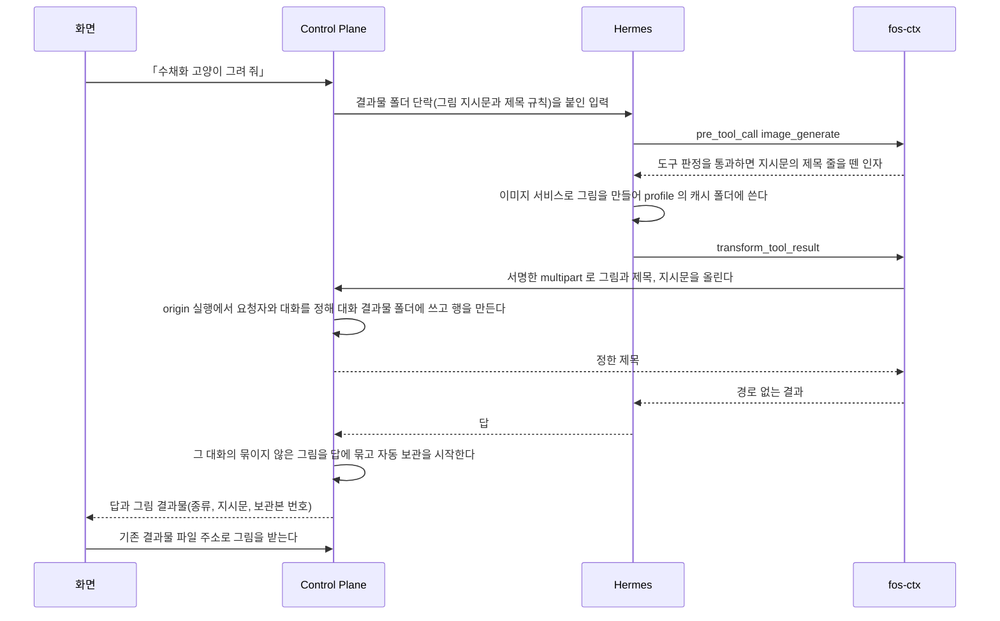
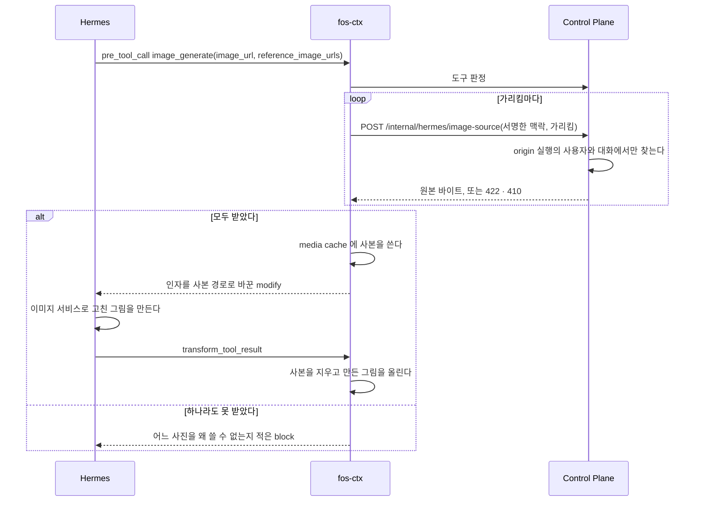

# 비서가 만든 이미지

사용자가 대화로 부탁한 그림을 비서가 만들어 답 안에 보이고 「내 파일」 에 남기는 기능이다.

covers: `backend/src/main/java/com/bifos/assistant/agent/**/AgentPendingToolsets*`, `backend/src/main/java/com/bifos/assistant/agent/**/PendingToolsetOutcome*`, `hermes/plugins/dashboard-profile-api/image_service.py`, `backend/src/main/java/com/bifos/assistant/chat/**/GeneratedImage*`, `backend/src/main/java/com/bifos/assistant/chat/**/MediaPathMask*`, `backend/src/main/java/com/bifos/assistant/mcp/**/GeneratedImage*`, `backend/src/main/java/com/bifos/assistant/mcp/**/ImageSource*`, `backend/src/main/java/com/bifos/assistant/chat/**/DraftImageCopies*`, `hermes/plugins/fos-ctx/generated_image.py`, `hermes/plugins/fos-ctx/image_source.py`, `web/src/components/chat/artifact/generated-images.tsx`, `web/src/lib/media-path.ts`

요구와 결정은 스펙 [`generated-image/spec.md`](generated-image/spec.md), 구조는 설계 [`generated-image/design.md`](generated-image/design.md), 결정의 근거는 [ADR-20261119 / generated-image](../adr/ADR-20261119-generated-image.md), [ADR-20261119 / image-gen-defaults](../adr/ADR-20261119-image-gen-defaults.md), [ADR-20261120 / image-source](../adr/ADR-20261120-image-source.md), [ADR-20261120 / generated-image-draft](../adr/ADR-20261120-generated-image-draft.md) 가 갖는다.

모든 사용자의 기본 비서에 「그림 만들기」 가 켜지고, 만든 그림이 답 안에 보이고 보관함에 남는다. 지금 대화의 사진과 그림을 바탕으로 고치고, 만든 그림을 블로그 원고의 사진 자리에 넣는다.

## 요구

- 비서가 만든 그림은 그 답 안에 그림으로 보인다. 답 글에 파일 경로나 `MEDIA:` 글자가 보이지 않는다.
- 그림을 누르면 화면 가득 크게 보이고 원본을 내려받는다. 그림 아래의 접힌 칸에서 비서가 이미지 도구에 넘긴 지시문을 본다.
- 그림은 요청자의 「내 파일」 에 원본 그대로 자동 보관된다. 대화 쪽 원본이 보관 기간 정리로 지워지면 대화에는 안내와 「내 파일에서 보기」 가 남는다.
- 그림과 지시문은 그 대화의 주인만 본다.
- 모든 사용자의 기본 비서에 「그림 만들기」 가 켜져 있다. 켜고 끄는 것은 관리자만 한다. 켜면 이미지 서비스 설정이 함께 들어간다.
- 예약 작업과 먼저 살펴보기처럼 사람이 없는 실행에서는 그림을 만들지 않는다.
- 지금 대화에 보낸 사진과 그 대화에서 만든 그림을 바탕으로 고친 새 그림을 만든다. 바탕 한 장에 참고 사진 여러 장을 쓴다. 다른 대화의 사진과 지운 사진은 쓰지 못하고, 하나라도 쓸 수 없으면 그림을 만들지 않고 비서가 어느 사진을 왜 쓸 수 없는지 알린다.
- 지금 대화에서 만든 그림을 블로그 원고의 사진 자리에 넣는다. 보관 기간이 지나 대화 쪽 원본이 없는 그림은 넣지 못하고, 이미 넣은 그림은 올린 사진과 같은 규칙으로 원고에 남는다.

## 흐름

fos-ctx 가 올리는 계약은 [`fos-ctx` README](../../hermes/plugins/fos-ctx/README.md) 의 「만든 그림을 올린다」, Hermes 의 그림 결과와 캐시 폴더는 [`hermes-contract.md`](../../hermes/docs/hermes-contract.md) 의 「`image_generate` 의 결과와 그림 파일」 이 갖는다.
저장 규칙(제목 정리와 번호, 되풀이 요청, 답에 묶기)과 실패 처리는 설계의 「인터페이스와 데이터」, 「실패와 일관성」 이 갖는다.
행의 칸은 [`backend/docs/data-schema.md`](../../backend/docs/data-schema.md) 의 「chat_artifact」 가 갖는다.

## 기본 비서에 켜기

「그림 만들기」(`image_gen`)는 관리자 등급 도구다. Control Plane 이 기본 비서에 스스로 켜고, 사용자가 따로 만든 비서는 관리자가 켠다.

| 때 | 어떻게 되나 |
| --- | --- |
| 새 사용자가 처음 로그인한다 | 기본 도구와 함께 켠다. 흐름은 [`users.md`](users.md) 의 「첫 에이전트의 기본 도구」 가 갖는다 |
| 이 기능을 배포한다 | 이미 있던 기본 비서를 한 번 켠다. 배포 뒤 5분 안에 켜진다 |
| 켜는 저장 | 대시보드 plugin 이 같은 쓰기에서 그 profile 에 이미지 서비스 설정을 넣는다. 이미 있는 설정은 그대로 둔다. 넣지 못하면 도구도 켜지지 않는다 |
| 그 사용자의 실행 공간이 준비되지 않았다 | 켜지 못한 채 기다리고 관리자에게 사용자와 까닭을 알린다. 운영이 실행 공간 정책에 등록하면 다음 차례(5분 간격)에 스스로 켜고 알림을 읽음으로 바꾼다. 그동안 대화는 그대로 된다 |
| 관리자가 끈다 | 꺼진 채 남는다. 배포와 재시작이 다시 켜지 않는다 |

기다리는 목록과 켜 보는 순서, 알림은 설계의 「PR2」 가, 도구 저장의 실패는 [`agent-skill.md`](agent-skill.md) 의 「에이전트 도구를 고를 때」 가 갖는다.

## 사람이 없는 실행

예약 작업 turn, 먼저 살펴보기 turn(단추로 연 것 포함), 그 실행이 맡긴 일의 결과를 전하는 turn 과 그 하위 실행에서는 `image_generate` 호출이 막힌다. 장수 상한이 없어 사람이 직접 부탁할 때만 만든다.
같은 예약 작업 대화나 점검 대화라도 사람이 보낸 메시지의 turn 에서는 만든다. 대화의 종류가 아니라 그 turn 을 누가 열었는지로 본다.
막는 자리는 fos-ctx 가 이미 묻는 도구 판정이다. 비서는 그림을 만들 수 없다는 글을 받고 결과에 그렇게 적는다.

## 사진을 바탕으로 고치기

비서는 바탕 한 장을 `image_url` 에, 참고를 `reference_image_urls` 에 넣는다. 값은 경로가 아니라 가리킴이다.
올린 사진은 `attachment:<첨부 번호>`(실행 입력의 사진 참조 목록이 주는 번호), 만든 그림은 `generated:<제목>` 이다. 실행 입력의 그림 규칙 끝에 그 대화에서 파일이 남은 그림의 제목이 새것부터 20장까지 적힌다.

| 가리킨 것 | 결과 |
| --- | --- |
| 요청자가 이 대화에 보낸 사진, 이 대화에서 만든 그림 | 원본 바이트 그대로 받는다. 원본은 바뀌지 않는다 |
| 다른 대화나 다른 사용자의 사진, 보내지 않은 사진, 없는 제목 | 이 대화의 것이 아니라고 막는다 |
| 지웠거나 보관 기간이 지난 사진, 파일이 지워진 그림 | 쓸 수 없다고 막는다 |
| 파일 경로, 인터넷 주소, data URL | 가리킴만 쓰라고 막는다. 넘길 수 없는 주소면 설명만으로 비슷하게 그려 넣지 않고 사진이나 링크를 보내 달라고 먼저 알리게 한다. 실행 공간에는 그 사용자의 모든 대화의 사진이 붙어 있어 경로를 받으면 다른 대화의 사진을 쓸 수 있다 |
| 합쳐 16장을 넘는다 | 막고 어느 사진을 뺄지 사용자에게 묻게 한다. 이미지 서비스가 받는 장수다 |

고친 그림은 새 그림이라 위 흐름대로 답에 보이고 보관된다. 받기 경로의 계약은 [`fos-ctx` README](../../hermes/plugins/fos-ctx/README.md) 의 「그림을 고칠 사진을 받는다」, Hermes 가 두 인자를 받는 모양은 [`hermes-contract.md`](../../hermes/docs/hermes-contract.md) 의 「`image_generate` 의 결과와 그림 파일」, 실패 처리는 설계의 「PR3」 이 갖는다.

## 블로그 원고에 넣기

사용자가 그림을 글에 넣어 달라고 하면 비서가 `content_draft_image` 에 그림 제목을 준다. Control Plane 이 그 그림의 사진 첨부 사본을 같은 대화에 만들고 첨부 번호와 파일 이름, 사진 폴더를 돌려준다.
비서는 그 값을 초안의 사진 줄과 원고의 사진 자리에 쓴다. 초안 미리보기, 승인 카드, 네이버 임시저장은 올린 사진과 같은 길로 사본을 쓴다.

| 상황 | 결과 |
| --- | --- |
| 처음 넣는다 | 사본을 만든다. 사본은 대화 화면과 사진 순번에 나오지 않는다 |
| 같은 그림을 다시 넣는다 | 그림 파일이 남아 있으면 같은 사본을 준다 |
| 보관 기간 정리로 그림 파일이 지워졌다 | 넣지 못하고 비서가 까닭을 알린다. 원고는 바뀌지 않는다 |
| 이미 넣은 그림의 파일이 지워졌다 | 원고는 사본을 보므로 그대로다. 사본은 올린 사진의 보관 기간을 따른다 |

도구의 계약은 [`content-draft.md`](content-draft.md) 의 「만든 그림을 원고에 넣기」, 사본을 두는 방법과 실패 처리는 설계의 「PR4」 가 갖는다.

## 그림 지시문 틀

비서가 이미지 도구에 넘기는 지시문은 한국어로 쓴다. 실행 입력의 그림 규칙이 아래 틀을 안내한다.

| 그리는 것 | 지시문과 인자 |
| --- | --- |
| 사람이 나오는 새 그림 | 「인물 N명」 으로 수를 적고 사람마다 생김새, 옷, 신발을 한 줄씩 적는다. 프로필처럼 얼굴 위주로 정한 때가 아니면 사람은 머리부터 발까지 들어오고 얼굴이 잘 보이게 그린다 |
| 같은 인물의 다음 장면 | 「이어서」 라는 말이 없어도 앞 그림을 참고(`reference_image_urls`)로 넣고 구도는 새로 잡는다. 앞 지시문의 인물 줄을 그대로 다시 적는다. 앞 그림이 링크 사진을 썼으면 그 링크도 다시 받는다. 그 링크만 쓸 수 없으면 앞 그림만 참고로 그리고 링크 사진을 쓰지 못했다고 알린다 |
| 앞 그림 파일이 보관 기간 정리로 지워졌거나 최근 20장 밖이라 쓸 수 없다 | 인물 줄만으로 그리고 앞 그림을 참고하지 못했다고 답에 적는다 |
| 올린 사진이나 만든 그림을 바탕으로 고친다 | 바꿀 곳과 지킬 곳만 적는다. 바탕에 없는 사람을 더할 때만 그 사람의 줄을 적는다 |

비율(`aspect_ratio`)은 늘 적는다. 빼면 Hermes 가 가로로 만든다.

| 상황 | 비율 |
| --- | --- |
| 사용자가 말했거나 쓰임새로 분명하다(프로필은 얼굴 위주, 블로그 대표 사진) | 그것을 따른다(프로필 `square`, 블로그 대표 사진 `landscape`) |
| 사람이나 동물 여럿, 풍경, 물건 여럿 | `landscape` |
| 한 사람이나 동물 하나, 물건 하나 | `square` |
| 올린 사진이나 만든 그림을 바탕으로 고친다 | 바탕에 가까운 비율 |

비서가 앞 그림의 링크를 알도록 실행 입력의 「이 대화에서 만든 그림」 줄에서 그림 제목 뒤에 참고한 링크를 붙인다. 예를 들면 `「공원의 가족」(참고 링크: https://…)` 이다. 다시 받을 때의 링크 확인은 처음과 같다. 규칙 글은 `ArtifactService.IMAGE_RULES` 가, 근거는 설계의 「PR6」 이 갖는다.

## 화면

답 글 아래에 그림이 만든 순서대로 나란히 보인다. HTML 결과물은 지금처럼 그 아래의 파일 줄이다.

| 상황 | 화면 |
| --- | --- |
| 그림이 있다 | 그림과 제목, 보관 상태(「보관 중」, 「보관 완료」, 「보관 실패」 와 「다시 보관」), 접힌 「그림 지시문 보기」 |
| 그림을 누른다 | 화면 가득 크게 보인다. 제목과 「내려받기」, 지시문이 있다. 내려받는 파일 이름은 제목이다 |
| 보관본이 없다 | 크게 보기에 「보관」 단추가 보인다. 자동 보관을 껐을 때, 중지한 답일 때, 보관이 실패했을 때, 보관본을 지웠을 때다 |
| 보관본이 있다 | 크게 보기에 「내 파일에서 보기」 가 보인다 |
| 대화 쪽 원본이 보관 기간 정리로 지워졌다 | 그림 대신 제목과 안내가 보인다. 보관본이 있으면 「내 파일에서 보기」 가 그 보관본을 펼친 채 「내 파일」 을 연다. 지시문은 남는다 |
| 이미지 도구가 실패했다 | 그림 자리가 없다. 비서가 답 글로 까닭을 알린다 |

「내 파일」 목록의 그림 줄은 [`workspace.md`](workspace.md) 의 「보관한 결과물」 이 갖는다.

## 답 글의 경로 가리기

Hermes 의 이미지 도구는 모델에게 그림의 호스트 경로를 돌려준다. fos-ctx 가 그 결과를 경로 없는 글로 바꾸므로 모델은 경로를 받지 않는다.
그 전에 저장된 답과 hook 이 건너뛰어진 답에는 `MEDIA:<경로>` 나 경로가 남을 수 있다.
Control Plane 은 메시지 응답에서, 화면은 흐르는 답을 그릴 때 `MEDIA:` 태그와 Hermes 이미지 캐시 폴더의 경로를 뺀다(사용자 결정 2026-11-19). 저장된 글은 고치지 않는다.
두 쪽의 규칙은 `MediaPathMask` 와 `web/src/lib/media-path.ts` 가 같은 정규식으로 갖는다. 잡는 모양과 잡지 않는 모양은 설계의 「답 글의 경로 가리기」 가 갖는다.

## 배포 뒤 확인

가짜 Hermes 는 올리기 본문을 fos-ctx 와 같은 모양으로 보내지만 실제 이미지 서비스와 실제 모델의 답은 흉내만 낸다.
대시보드 plugin 과 fos-ctx, Control Plane 을 배포한 뒤 가족의 기본 비서에서 그림 한 장을 만들어 아래를 본다. 절차는 운영 저장소가 갖는다.
대시보드 plugin 을 Control Plane 보다 먼저 배포한다. 옛 plugin 은 이미지 서비스를 넣으라는 칸을 거절한다.

- 관리자가 아닌 사용자의 기본 비서에 「그림 만들기」 가 켜져 있고 그림이 만들어진다. 그 profile 에 ChatGPT 구독 로그인이 없으면 설정이 있어도 도구가 보이지 않는다
- 답에 그림이 보이고 경로 글자가 없다
- 제목이 비서가 붙인 것이고 지시문이 사용자의 부탁보다 자세하다
- 「내 파일」 에 그림이 남는다. 가로나 세로가 긴 그림에서 「보관 실패」 가 나오는지 본다(설계의 「검증 전략」)
- 휴대폰에서 그림을 크게 보고 두 손가락으로 확대한다
- 사진 한 장을 올리고 일부만 바꿔 달라고 하면 고친 새 그림이 보이고 올린 사진은 그대로다. fos-ctx 를 Control Plane 보다 먼저 배포한다. 옛 fos-ctx 는 가리킴을 파일 경로로 읽다 실패한다
- 사람 여럿이 나오는 그림이 가로로 만들어지고 「그림 지시문 보기」 에 인물 수와 사람별 줄이 있다. 같은 인물의 다음 장면을 부탁하면 생김새와 옷이 이어진다
