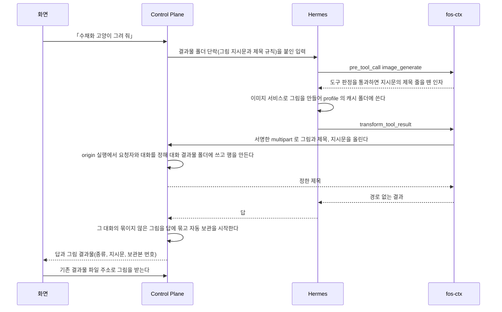

# 비서가 만든 이미지

사용자가 대화로 부탁한 그림을 비서가 만들어 답 안에 보이고 「보관한 결과물」 에 남기는 기능이다.

covers: `backend/src/main/java/com/bifos/assistant/chat/**/GeneratedImage*`, `backend/src/main/java/com/bifos/assistant/chat/**/MediaPathMask*`, `backend/src/main/java/com/bifos/assistant/mcp/**/GeneratedImage*`, `hermes/plugins/fos-ctx/generated_image.py`, `web/src/components/chat/artifact/generated-images.tsx`, `web/src/lib/media-path.ts`

요구와 결정은 스펙 [`generated-image/spec.md`](generated-image/spec.md), 구조는 설계 [`generated-image/design.md`](generated-image/design.md), 결정의 근거는 [ADR-20261119 / generated-image](../adr/ADR-20261119-generated-image.md) 가 갖는다.

**지금은 스펙의 PR1 까지다.** 이미지 서비스가 설정된 비서가 만든 그림이 답 안에 보이고 보관함에 남는다.
가족의 기본 비서에 켜기와 이미지 서비스 자동 설정, 사람이 없는 실행에서 막기, 사진을 바탕으로 고치기, 블로그 원고에 넣기는 스펙의 뒤 PR 이 더한다.

## 요구

- 비서가 만든 그림은 그 답 안에 그림으로 보인다. 답 글에 파일 경로나 `MEDIA:` 글자가 보이지 않는다.
- 그림을 누르면 화면 가득 크게 보이고 원본을 내려받는다. 그림 아래의 접힌 칸에서 비서가 이미지 도구에 넘긴 지시문을 본다.
- 그림은 요청자의 「보관한 결과물」 에 원본 그대로 자동 보관된다. 대화 쪽 원본이 보관 기간 정리로 지워지면 대화에는 안내와 「보관함에서 보기」 가 남는다.
- 그림과 지시문은 그 대화의 주인만 본다.

## 흐름

fos-ctx 가 올리는 계약은 [`fos-ctx` README](../../hermes/plugins/fos-ctx/README.md) 의 「만든 그림을 올린다」, Hermes 의 그림 결과와 캐시 폴더는 [`hermes-contract.md`](../../hermes/docs/hermes-contract.md) 의 「`image_generate` 의 결과와 그림 파일」 이 갖는다.
저장 규칙(제목 정리와 번호, 되풀이 요청, 답에 묶기)과 실패 처리는 설계의 「인터페이스와 데이터」, 「실패와 일관성」 이 갖는다.
행의 칸은 [`backend/docs/data-schema.md`](../../backend/docs/data-schema.md) 의 「chat_artifact」 가 갖는다.

## 화면

답 글 아래에 그림이 만든 순서대로 나란히 보인다. HTML 결과물은 지금처럼 그 아래의 파일 줄이다.

| 상황 | 화면 |
| --- | --- |
| 그림이 있다 | 그림과 제목, 보관 상태(「보관 중」, 「보관 완료」, 「보관 실패」 와 「다시 보관」), 접힌 「그림 지시문 보기」 |
| 그림을 누른다 | 화면 가득 크게 보인다. 제목과 「내려받기」, 지시문이 있다. 내려받는 파일 이름은 제목이다 |
| 보관본이 없다 | 크게 보기에 「보관」 단추가 보인다. 자동 보관을 껐을 때, 중지한 답일 때, 보관이 실패했을 때, 보관본을 지웠을 때다 |
| 보관본이 있다 | 크게 보기에 「보관함에서 보기」 가 보인다 |
| 대화 쪽 원본이 보관 기간 정리로 지워졌다 | 그림 대신 제목과 안내가 보인다. 보관본이 있으면 「보관함에서 보기」 가 그 보관본을 펼친 채 「보관한 결과물」 을 연다. 지시문은 남는다 |
| 이미지 도구가 실패했다 | 그림 자리가 없다. 비서가 답 글로 까닭을 알린다 |

「보관한 결과물」 목록의 그림 줄은 [`workspace.md`](workspace.md) 의 「보관한 결과물」 이 갖는다.

## 답 글의 경로 가리기

Hermes 의 이미지 도구는 모델에게 그림의 호스트 경로를 돌려준다. fos-ctx 가 그 결과를 경로 없는 글로 바꾸므로 모델은 경로를 받지 않는다.
그 전에 저장된 답과 hook 이 건너뛰어진 답에는 `MEDIA:<경로>` 나 경로가 남을 수 있다.
Control Plane 은 메시지 응답에서, 화면은 흐르는 답을 그릴 때 `MEDIA:` 태그와 Hermes 이미지 캐시 폴더의 경로를 뺀다(사용자 결정 2026-11-19). 저장된 글은 고치지 않는다.
두 쪽의 규칙은 `MediaPathMask` 와 `web/src/lib/media-path.ts` 가 같은 모양으로 갖는다.

## 배포 뒤 확인

가짜 Hermes 는 올리기 본문을 fos-ctx 와 같은 모양으로 보내지만 실제 이미지 서비스와 실제 모델의 답은 흉내만 낸다.
fos-ctx 와 Control Plane 을 배포한 뒤 이미지 서비스가 설정된 비서에서 그림 한 장을 만들어 아래를 본다. 절차는 운영 저장소가 갖는다.

- 답에 그림이 보이고 경로 글자가 없다
- 제목이 비서가 붙인 것이고 지시문이 사용자의 부탁보다 자세하다
- 「보관한 결과물」 에 그림이 남는다. 가로나 세로가 긴 그림에서 「보관 실패」 가 나오는지 본다(설계의 「검증 전략」)
- 휴대폰에서 그림을 크게 보고 두 손가락으로 확대한다
