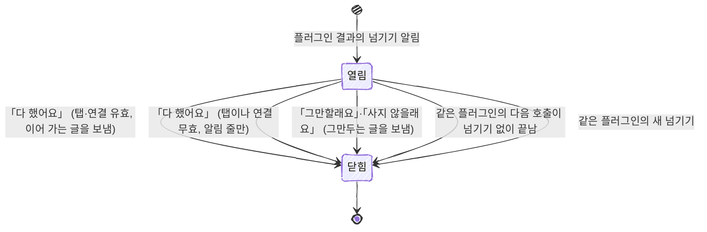

# 휴대폰 기본 대화 기술 설계

스펙은 [`spec.md`](spec.md)(확인 2026-11-28)다. PR1 은 이 문서대로 구현한다. PR2, PR3 은 그 PR 을 시작할 때 코드 경로를 다시 읽어 해당 절을 고친다.

## 요구사항 연결

| ID | 해결 방법 |
| --- | --- |
| REQ1 | (PR2) 지금 `/` 가 대화방을 연다. 대화방을 열 때 메시지 목록을 맨 아래로 두는 것만 확인하고, 고르는 화면이 없음을 360px 브라우저 테스트로 지킨다 |
| REQ2 | (PR1) 사람의 turn 이 넘기기를 닫는 `ConnectorHandoffs#onTurnStarted` 와, 듣는 쪽이 그것뿐인 turn 시작 사건(`ConversationTurnStarted`)을 지운다. 그 플러그인의 다음 호출이 넘기기 없이 끝나면 닫는다. 신호는 fos-ctx 가 이미 보내는 도구 기록(`post_tool_call`)이다. `RunTraceIntake` 가 서명을 확인한 호출의 네 값(profile, 루트 session, session, 호출 번호)으로 사건을 내고, `connector.handoff` 가 그 호출의 판정 줄을 찾아 같은 사용자, 같은 대화, 같은 플러그인의 앞선 열린 넘기기를 닫는다. 같은 플러그인이 새 넘기기를 적을 때도 앞선 것을 닫는다(spec DECISION23) |
| REQ3 | (PR1) 카드 단추가 새 닫기 API 를 부른다. 「다 했어요」 는 닫기 전에 남긴 탭과 연결을 확인하고, 탭이 없거나 연결이 끊겼으면 카드를 닫고 대화에 알림 줄을 남긴 뒤 이어 가라는 글을 보내지 않는다. 「그만할래요」 는 카드를 닫고 그만둔다는 글을 보낸다. 글은 지금처럼 웹이 다음 메시지로 보낸다 |
| REQ4 | (PR1) 닫기는 `handoff_closed_at is null` 조건부 갱신이다. 처음 닫은 요청만 「보낸다」 답을 받고, 이미 닫힌 카드는 「이미 닫혔다」 를 성공으로 받아 웹이 글을 보내지 않는다. 결제 카드의 두 단추도 같은 API 를 쓰고 결제 단추는 누르지 않는다 |
| REQ5 | (PR2) 맡긴 일 카드는 저장하지 않고 원래 기록에서 만든다(spec DECISION11). 아래 「맡긴 일 카드의 상태 모델」 |
| REQ6 | (PR2) 「할 일 N건」 의 수를 맡긴 일 카드 단위로 바꾸고, 어느 카드에도 딸리지 않은 묻는 카드와 승인만 한 건씩 센다 |
| REQ7 | (PR2) 대화방을 불러오거나 화면이 앞으로 돌아올 때(`visibilitychange`) 확인 필요 카드 수를 읽어 위쪽 안내를 보인다 |
| REQ8 | (PR3) 맡은 실행의 마지막 중간 안내 한 줄을 실행 줄에 저장하고, 없으면 마지막 도구 사건의 이름으로 정해 둔 문구를 쓴다 |

## 책임과 경계

| 모듈 | 이번에 갖는 것 |
| --- | --- |
| `connector.handoff` | 넘기기가 열리고 닫히는 규칙 전부. 단추 닫기 API, 이어 갈 수 있는지 확인, 플러그인 성공으로 닫기, 새 넘기기가 앞선 것을 닫기(PR1). 맡긴 일 카드가 읽을 넘기기 상태(PR2) |
| `orchestration` | 도구 기록을 받는 `RunTraceIntake` 가 서명을 확인한 호출의 네 값과 성공 여부를 Spring 사건으로 낸다. 판정 줄을 모른다(PR1) |
| `browser` | 그 사용자의 브라우저에 남긴 탭이 아직 있는지 답하고, 그 탭을 닫는다(`BrowserLeftTabs`, CDP `/json/close`, PR1) |
| `chat` | 알림 줄 저장(`ConversationNotices`, 지금 것). 맡긴 일 카드 조회 API 와 위쪽 안내 수(PR2) |
| `web` | 카드 단추가 닫기 API 를 부르고 답에 따라 글을 보낸다. 「그만할래요」 단추와 글(`HANDOFF_STOP`)을 `handoff.ts` 에 더한다. 「돌려주기」 는 카드를 감추지 않고 글만 보낸다(PR1). 맡긴 일 카드와 「맡긴 일 N건」(PR2), 갱신 문구(PR3) |
| `hermes` | 바뀌지 않는다. fos-ctx 의 도구 기록과 넘기기 알림을 그대로 쓴다 |

의존 방향은 지금 그대로다. `connector` 는 이미 `orchestration` 을 쓰므로(`SessionOwnerResolver`) 사건 값은 `orchestration.application.dto` 에 두고 `connector.handoff` 가 듣는다. `orchestration` 이 `connector` 를 부르면 순환이 생긴다(rule-2).

## 인터페이스와 데이터

### 넘기기의 상태

넘기기는 지금처럼 판정 줄(`connector_action`)의 `handoff_*` 컬럼이다([`backend/docs/data-schema.md`](../../../backend/docs/data-schema.md) 의 「connector_action」). 새 컬럼과 새 테이블은 없다.

사람이 보낸 turn, 시간, 다른 플러그인의 성공, 옆 패널의 「돌려주기」 는 닫지 않는다(spec DECISION3, DECISION13, DECISION23).

### 단추 닫기 API

`POST /api/v1/chat/conversations/{conversationId}/handoffs/{handoffId}/close`, 본문 `{"outcome": "DONE" | "STOP"}`.
웹은 같은 주소의 서버 라우트(`/api/chat/conversations/<id>/handoffs/<handoffId>/close`)를 거친다(rule-55).

| 답 `result` | 언제 | 웹이 하는 일 |
| --- | --- | --- |
| `CONTINUE` | `DONE` 이고 이 요청이 처음 닫았고 이어 갈 수 있다 | 단추의 글을 다음 메시지로 보낸다 |
| `STOPPED` | `STOP` 이고 이 요청이 처음 닫았다 | 그만두는 글을 다음 메시지로 보낸다 |
| `UNAVAILABLE` | `DONE` 이고 이 요청이 처음 닫았지만 탭이 없거나 연결이 끊겼다 | 보내지 않는다. 서버가 대화에 「화면이 닫혀 이어 갈 수 없어요. 다시 맡겨 주세요.」 알림 줄을 남겼다 |
| `ALREADY_CLOSED` | 다른 창, 두 번 누름, 플러그인 성공이 먼저 닫았다 | 보내지 않는다 |

대화가 요청자의 것이 아니거나, 넘기기가 그 대화의 것이 아니면 지금 다른 대화 경로와 같은 `CONVERSATION_NOT_FOUND` 다(rule-49).

이어 갈 수 있는지는 닫기 전에 본다.

| 확인 | 무효 | 판정할 수 없을 때 |
| --- | --- | --- |
| 남긴 탭 | 브라우저가 넘기기 뒤에 다시 켜졌거나 꺼졌다, 또는 CDP 탭 목록에 그 탭이 없다 | CDP 주소를 모르거나 읽지 못하면 있는 것으로 본다. 잘못 이어 가도 플러그인이 다시 넘기기를 낸다 |
| 연결 | 그 사용자의 그 플러그인 연결이 없거나 `DISCONNECTED` 다 | 없음 |
| 맡긴 일 | 대화가 지워졌다. 넘기기를 낸 실행은 이미 끝났으므로(spec DECISION14) 실행은 보지 않는다 | 없음 |

탭을 보지 않는 넘기기는 셋이다. 탭이 없는 넘기기(탭 전 `HUMAN_BROWSER`, 응답을 잃은 `TAB_CHECK`)는 볼 탭이 없다. 결제(`PAYMENT`)와 탭 확인(`TAB_CHECK`)은 사람이 그 탭에서 결제하거나 확인한 뒤 탭을 닫아도 주문 확인은 이어 가야 한다.

### 플러그인 성공으로 닫기

| 단계 | 하는 일 |
| --- | --- |
| fos-ctx `post_tool_call` | 지금처럼 도구 기록을 보낸다. 바뀌지 않는다 |
| `RunTraceIntake#receive` | 기록마다, 실행을 찾기 전에 `PluginCallEnded(profileName, rootSessionId, sessionId, toolCallId, failed)` 를 낸다. 호출 번호가 빈 기록은 내지 않는다. 등록된 하위 에이전트 session 의 기록도 낸다(spec DECISION23 의 「자식 실행 포함」). 사건을 내다 난 예외는 로그만 남겨 도구 기록 옮기기를 막지 않는다 |
| `ConnectorHandoffs#onPluginCallEnded` | 새 트랜잭션에서 돈다. 실패면 끝. 네 값으로 `ConnectorActionKey` 를 만들어 판정 줄을 찾고, 통과한 줄이고 대화가 있고 그 줄에 넘기기가 없으면 같은 사용자, 대화, 플러그인의 열린 넘기기 가운데 넘기기를 적은 시각이 그 호출의 판정 시각(`created_at`)보다 앞선 것을 닫는다. 같은 플러그인을 나란히 불렀을 때 늦게 판정된 성공이 방금 생긴 카드를 닫지 않게 하는 기준이다 |
| `ConnectorHandoffs#record` | 넘기기를 적은 뒤 같은 사용자, 대화, 플러그인의 다른 열린 넘기기를 닫는다 |

두 경로 모두 승인한 주문서 채우기가 사람 화면에서 기다리는 줄(`status = WAITING`)의 넘기기는 닫지 않는다. 그 넘기기가 닫혀야 같은 승인으로 이어 가므로(`ConnectorApprovalResume`), 같은 플러그인의 다른 검색이 닫으면 탭과 연결 확인 없이 이어 간다. 그 줄은 「다 했어요」 로만 닫는다. 주문서 채우기의 결과 판정이 적는 넘기기(`ConnectorCheckoutOutcome`)는 앞선 것을 닫지 않는다. 같은 플러그인의 카드가 둘 남을 수 있지만 그 경로는 승인 한 번에 한 번이다.

닫을 때마다 지금처럼 그 알림을 읽음으로 바꾸고 `ConnectorActionChanged` 를 내 열린 화면이 카드를 다시 읽는다.

**두 경로는 커밋한 뒤 남긴 탭도 닫는다.** 플러그인은 다음 호출을 시작할 때 앞서 남긴 탭을 닫으려 한다. 그런데 그때는 카드가 아직 열려 있어 중계가 그 탭 닫기를 409 로 거절하고(`ConnectorBrowserKeptTabs`), 플러그인은 그 탭을 잊는다. 그래서 카드를 닫은 Control Plane 이 대신 닫는다. 같은 탭을 다른 열린 넘기기나 기다리는 승인이 가리키면 닫지 않고, 브라우저가 넘기기 뒤에 다시 켜졌으면 부르지 않는다. 단추가 닫는 경로는 탭을 닫지 않는다. 카드가 닫힌 뒤 이어 가는 다음 호출이 지금처럼 닫는다.

### 맡긴 일 카드의 상태 모델(PR2)

카드는 저장하지 않는다. 대화의 실행 줄과 판정 줄을 읽어 조회할 때 만든다(spec DECISION11, ADR-074 의 지금 화면과 같은 방식). PR2 를 시작할 때 이 절을 코드와 다시 맞춘다.

| 항목 | 원본 |
| --- | --- |
| 카드 하나 | 맡긴 일 하나다. 기준은 처음 맡긴 실행이다. 비서가 맡긴 자식 실행(`agent_delegate`)이거나, 비서가 플러그인을 바로 불러 멈췄으면 그 turn 의 루트 실행이다(spec DECISION17) |
| 이어 간 실행 | 「다 했어요」 로 연 turn 은 닫기 API 가 준 넘기기 번호를 보내기 요청에 붙이고, Control Plane 이 그 turn 의 루트 실행 줄에 원래 카드의 기준 실행 번호를 적는다(컬럼 하나, 새 테이블 없음). 그 turn 이 다시 맡기거나 새 넘기기를 내도 같은 카드에 묶인다(spec DECISION21, DECISION23) |
| 자리 | 기준 실행을 연 답 메시지다. 이어 가도 옮기지 않는다 |
| 확인 필요 | 묶인 실행 트리 가운데 어디든 열린 넘기기, 기다리는 승인 줄, 답하지 않은 묻는 카드가 있다 |
| 진행 중 | 확인 필요가 없고 묶인 실행 가운데 하나가 돈다 |
| 끝남, 실패, 그만둠 | 묶인 실행 가운데 가장 늦은 것의 끝 상태다. 가장 늦은 실행이 닫은 넘기기가 `STOPPED` 면 그만둠, `UNAVAILABLE` 이면 실패다. `SUPERSEDED` 는 새 넘기기가 같은 카드에 보이므로 상태를 정하지 않는다 |
| 카드가 되는 조건 | 사람이 할 일이 한 번이라도 있었거나, 기준 실행을 맡긴 지 `assistant.delegation.card-after`(기본 30초, spec DECISION24)를 넘겼다. 그 전에 끝난 맡김은 카드가 없다 |

상태가 겹치면 확인 필요, 진행 중, 끝 상태 순으로 앞선다.
닫은 까닭을 읽으려고 PR2 가 `connector_action` 에 `handoff_outcome` 컬럼(`DONE`, `STOPPED`, `UNAVAILABLE`, `SUPERSEDED`, `PLUGIN_SUCCEEDED`)을 더한다. PR1 은 컬럼을 더하지 않는다. PR1 이 닫은 줄은 까닭이 비어 끝남으로 읽는다. PR2 배포 전에 그만두거나 이어 갈 수 없어 닫은 카드도 끝남으로 보이는 것을 받아들인다. 그 카드에는 대화의 알림 줄이나 사람이 보낸 그만두는 글이 남아 있다.

「맡긴 일 N건」 은 확인 필요와 진행 중 카드 수에, 어느 카드에도 딸리지 않은 묻는 카드와 승인 수를 더한다(spec DECISION19). 카드 목록 API 하나가 두 수와 카드를 함께 준다. 지금 대화 SSE 의 `approval`, 위임 사건, 넘기기가 바뀐 사건이 다시 읽게 한다. 30초가 되는 순간은 사건이 없으므로, 답이 도는 동안 웹이 맡김의 시작 시각에서 `card-after` 뒤에 한 번 다시 읽는다. 시작 시각과 `card-after` 는 카드 목록 응답이 준다.

### 갱신 문구(PR3)

맡긴 실행의 `message.interim` 마지막 한 줄을 그 실행 줄의 컬럼(예: `progress_line`, 200자)에 저장하고, 없으면 마지막 `TOOL_STARTED` 사건의 도구 이름으로 작업 과정 블록의 문구를 쓴다. 지금 중간 안내는 저장하지 않으므로(docs/features/chat.md 「실행 중 중간 안내」) PR3 가 컬럼과 저장을 더한다.

### PR1 이 함께 고치는 문서

스펙의 「함께 고칠 문서」 가운데 넘기기가 닫히는 때를 적은 곳과, 같은 규칙을 적은 ADR 과 스키마 문서다. [ADR-20261111 / connector-handoff](../../adr/ADR-20261111-connector-handoff.md) 는 결정 표의 닫기 행을 대체된 부분으로 적고, [`backend/docs/data-schema.md`](../../../backend/docs/data-schema.md) 의 `handoff_closed_at` 뜻을 고친다. 적용된 마이그레이션의 컬럼 주석은 고치지 않는다(AGENTS.md 「용어」). [네이버 쇼핑 스펙](../naver-shopping/spec.md) 의 DECISION24 와 [설계](../naver-shopping/design.md) 의 넘기기 흐름, [사용자 브라우저](../user-browser.md) 의 「대화 위 화면」 을 고친다. `chat.md` 와 `attention.md` 는 맡긴 일 카드가 생기는 PR2 가 고친다.

## 실패와 일관성

- **두 번 누름, 두 창.** 닫기는 `where handoff_closed_at is null` 갱신 한 번이다. 갱신한 줄 수가 1 인 요청만 `CONTINUE`, `STOPPED`, `UNAVAILABLE` 을 받는다(rule-68). 웹은 누르는 순간 카드를 감추고, 요청이 실패하면 다시 보인다.
- **닫은 뒤 글을 보내기 전에 화면이 꺼진다.** 카드는 닫혔고 글은 가지 않는다. 사람은 입력창으로 다시 말하면 된다. 서버가 turn 을 대신 여는 안은 대화 SSE 와 대기열을 서버 쪽에 하나 더 만들어야 해 고르지 않았다.
- **도구 기록과 넘기기 알림의 순서.** Hermes 는 `post_tool_call` 뒤에 `transform_tool_result` 를 부르고, 도구 기록은 0.5초 묶어 보낸다. 그래서 같은 호출의 기록이 넘기기보다 먼저 올 수도, 나중에 올 수도 있다. 먼저 오면 그 호출을 성공으로 보고 앞선 넘기기를 닫고, 뒤이어 온 넘기기가 새 카드를 연다. 나중에 오면 그 줄에 이미 넘기기가 있어 닫지 않는다. 두 순서 모두 결과가 같다(spec DECISION23). 닫는 대상은 그 줄보다 앞선 줄이라 자기 넘기기를 닫지 않는다.
- **기록을 잃는다.** 도구 기록은 관측용이라 버려질 수 있다. 그러면 카드가 남고 사람이 단추로 닫는다.
- **승인한 주문서 채우기의 이어 가기.** `ConnectorApprovalResume` 은 넘기기가 닫혀 있어야 이어 간다. 이 도구는 Control Plane 도구라 플러그인 성공 신호가 오지 않고, 기다리는 줄은 플러그인 성공으로 닫지 않는다. 그래서 이어 가기는 「다 했어요」 로만 열린다. 아직 닫히지 않았을 때의 안내 글(`NOT_YET`)과 사람이 브라우저를 쥐었을 때의 안내 글(`HELD`)을 「카드의 「다 했어요」 를 눌러 달라고 한다」 로 바꾼다.
- **기다리는 승인의 「다 했어요」 가 이어 갈 수 없을 때.** 카드는 닫히고 알림 줄이 남지만 승인 줄은 `WAITING` 으로 남는다. 모델이 뒤에 이어 가기를 부르면 남긴 탭 없이 같은 승인으로 실행을 보내고, 플러그인이 탭을 찾지 못해 결과 판정이 끝낸다. 브라우저가 다시 켜졌거나 연결이 바뀐 경우는 이어 가기가 지금처럼 먼저 끝낸다. 승인 줄의 끝내기를 `connector.handoff` 가 부르면 `approval` 의 잠금 규칙을 하나 더 갖게 되어 PR1 은 이 한계를 받아들인다.
- **넘기기 알림만 잃는다.** 도구 기록은 왔고 넘기기 알림이 실패하면 앞선 카드는 닫히고 새 카드는 생기지 않는다. 모델은 결과 글의 안내로 사람에게 「내 브라우저」 에서 풀어 달라고 한다(ADR-20261111 의 「감당할 것」 과 같다).
- **듣는 쪽의 실패.** `PluginCallEnded` 를 듣는 쪽은 새 트랜잭션에서 돌고, 사건을 내는 쪽이 예외를 잡아 로그만 남긴다. 카드를 닫지 못해도 도구 기록은 실행 줄에 옮겨진다.
- **오래 남는 카드와 브라우저.** 열린 넘기기는 브라우저 자동 중지를 미룬다(`ConnectorBrowserWaitDemand`). 카드가 오래 남아도 `wait-hold-timeout` 뒤에는 꺼진다. 꺼진 뒤의 「다 했어요」 는 `UNAVAILABLE` 이다.
- **배포 순서.** Control Plane 과 웹을 함께 배포한다. 웹만 먼저 가면 닫기 API 가 없어 단추가 실패하고 카드가 다시 보인다. Control Plane 만 먼저 가면 옛 웹의 「다 했어요」 가 글만 보내고 카드는 플러그인 성공이 닫는다. Hermes 는 바뀌지 않는다.

## 검증 전략

| ID | 경계와 환경 |
| --- | --- |
| REQ2 | Control Plane 통합 테스트(실제 HTTP): 같은 플러그인의 다음 호출 기록(성공)이 오면 그 카드만 닫히고 그 탭 닫기를 부르며, 다른 플러그인의 성공과 실패 기록, 넘기기가 있는 호출의 기록은 닫지 않는다. 기록이 넘기기보다 먼저 와도 결과가 같다. 같은 플러그인의 새 넘기기가 앞선 것을 닫는다. 기다리는 승인 줄의 넘기기는 닫지 않는다. 단위 테스트: CDP 탭 닫기 호출, 도구 기록이 하위 에이전트 session 이어도 사건을 낸다. 브라우저 테스트(넓은 화면, 360px): 카드가 있는 대화에서 다른 글을 보내고 새로 고쳐도 카드와 「내 브라우저 열기」 가 남는다 |
| REQ3 | 통합 테스트: 둘 중 한 카드의 `DONE` 이 그 카드만 닫고 `CONTINUE`. 탭이 없거나 연결이 없으면 `UNAVAILABLE` 과 알림 줄. `STOP` 은 `STOPPED`. 다른 대화의 넘기기는 없는 대화와 같은 오류. 단추 경로는 탭 닫기를 부르지 않는다. 브라우저 테스트: 「다 했어요」 는 닫기 API 뒤 글을 보내고, `UNAVAILABLE` 이면 보내지 않으며, 「그만할래요」 는 그만두는 글을 보낸다. 「돌려주기」 뒤에도 카드가 남는다. 노드 테스트: 닫기 라우트는 정한 단추 값만 넘기고 계약 밖의 답은 502 다 |
| REQ4 | 통합 테스트: 같은 카드의 `DONE` 두 번 가운데 하나만 `CONTINUE`. 브라우저 테스트: `ALREADY_CLOSED` 면 글을 보내지 않는다. 결제 카드는 「결제했어요」 와 「사지 않을래요」 둘뿐이다 |
| REQ5-REQ8 | PR2, PR3 의 계획이 정한다 |

쇼핑 플러그인이 모의 네이버 화면에서 로그인 넘기기를 내는 것은 지금 플러그인 테스트(`hermes/connectors/naver-shopping/tests/`)가 지킨다. 넘기기 알림과 도구 기록의 서명은 지금 fos-ctx 테스트가 지킨다. 실제 Hermes 와 휴대폰에서 로그인 대기 중 다른 질문을 보내 카드가 남는지는 배포 뒤 확인한다(AGENTS.md 「Hermes 연동을 바꿨으면 배포 뒤 왕복시켜 본다」).

## 결정

| ID | 결정 | 답 | 누가 | 근거 |
| --- | --- | --- | --- | --- |
| DECISION1 | 「플러그인의 다음 호출이 성공했다」 를 아는 신호 | fos-ctx 가 이미 보내는 도구 기록(`post_tool_call`)의 서명된 호출의 네 값과 그 기록의 `status`. 판정 줄과 dedupe key 로 정확히 맞춘다. 서명은 `status` 를 덮지 않지만 서명 key 는 profile 토큰을 가진 쪽만 알아 새로 생기는 위험이 없다 | 작성자 | Hermes 와 fos-ctx 를 바꾸지 않는다. 넘기기 없는 결과마다 새 알림을 보내는 안은 fos-ctx 와 서명 계약을 늘리고, 실행 사건(`tool.completed`)은 호출을 판정 줄과 맞출 수 없다(ADR-20261111 의 「대안 기각」) |
| DECISION2 | 「다 했어요」 뒤 이어 가는 글을 누가 보내나 | 지금처럼 웹이 다음 메시지로 보낸다. 서버는 닫기 답으로 보낼지만 정한다 | 작성자 | 대화 turn 과 대기열은 웹의 보내기 흐름이 갖는다. 서버가 turn 을 열면 같은 흐름을 서버에 하나 더 만든다 |
| DECISION3 | 이어 갈 수 없을 때의 안내 | 카드를 닫고 그 대화에 알림 줄(`SYSTEM` 메시지)을 남긴다 | 작성자 | 새 화면 없이 휴대폰과 PC 에 같은 자리로 보이고 새로 고쳐도 남는다. PR2 의 「실패했어요 · 다시 맡기기」 가 이 자리를 카드로 바꾼다 |
| DECISION4 | 닫은 까닭의 저장 | PR1 은 저장하지 않는다. PR2 가 `handoff_outcome` 컬럼을 더한다 | 작성자 | PR1 의 동작은 까닭을 읽지 않는다. 컬럼을 읽는 쪽과 같은 PR 에서 더해 쓰지 않는 컬럼을 두지 않는다 |
| DECISION5 | 탭 확인을 판정할 수 없을 때 | 있는 것으로 보고 이어 간다 | 작성자 | 잘못 이어 가도 플러그인이 같은 화면에서 새 넘기기를 낸다. 반대로 막으면 CDP 일시 장애 때 사람이 다시 맡겨야 한다 |
| DECISION6 | PR1 의 계획서 | `tasks/` 를 만들지 않고 이 설계와 지시서를 계획으로 쓴다 | 작성자 | 한 PR 로 끝나는 작업이고 계획서는 그 PR 에서 지운다(AGENTS.md 「tasks 는 구현 문서만 담는다」) |
| DECISION7 | 입력창 답이나 새 넘기기가 카드를 닫을 때의 남긴 탭 | Control Plane 이 커밋한 뒤 CDP 로 그 탭을 닫는다. 다른 열린 넘기기나 기다리는 승인이 가리키는 탭은 두고, 실패는 로그만 남긴다 | 작성자 | 플러그인이 다음 호출에서 닫으려 할 때는 카드가 열려 있어 중계가 거절하고 플러그인이 그 탭을 잊는다. 플러그인을 고쳐 다시 닫게 하는 안은 Hermes 쪽 배포와 전환 배포 규칙(rule-66)이 더 든다 |
| DECISION8 | 「돌려주기」 | 카드를 감추지 않고 정해 둔 글만 보낸다 | 작성자 | spec DECISION23 이 「돌려주기」 의 글은 카드를 닫지 않는다고 정했다. 감추면 서버에서 열린 카드가 화면에서만 사라져 「다 했어요」 를 누를 곳이 없다 |
