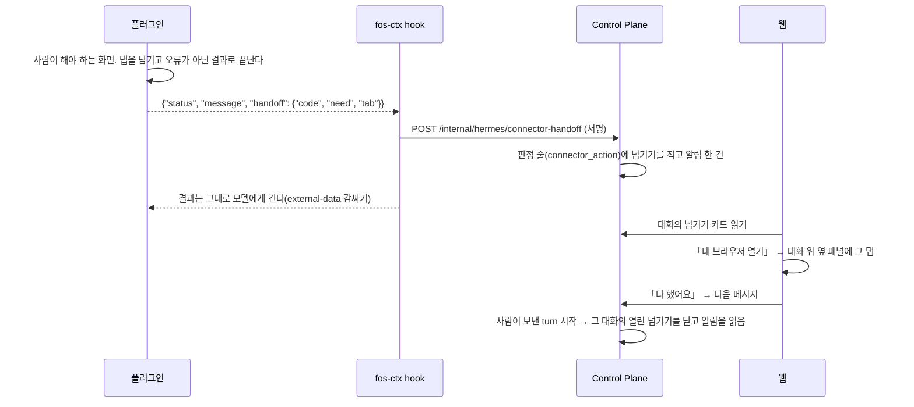

# 네이버 쇼핑 기술 설계

스펙: [`spec.md`](spec.md). 이 설계는 PR1(REQ1 부터 REQ6), PR2(REQ7, REQ8), PR3(REQ9 부터 REQ13)를 구현할 수 있는 깊이로 쓰고, PR4 는 경계와 방향만 정한다.
뒤 PR 은 착수할 때 그 PR 의 절을 이 파일에서 고치고 독립 검토를 다시 받는다.

## 요구사항 연결

| ID | PR | 해결 방법 |
| --- | --- | --- |
| REQ1 | PR1 | 새 플러그인 `hermes/connectors/naver-shopping/` 과 저장소 등록(아래 「저장소 등록」). 입력 칸 없이 `owner_browser_env` 하나를 선언하고, 확인 도구 `check_shopping_login` 이 네이버 로그인 쿠키만 본다 |
| REQ2 | PR1 | `search_products` 가 빈 탭을 열어 처리기를 건 뒤 검색 주소 하나로 이동하고, 페이지에 처음 실린 상태 JSON 을 고정 식으로 꺼내 플러그인 안의 순수 함수가 결과로 바꾼다 |
| REQ3 | PR1 | `get_product_detail` 이 주소를 「주소 분류」 표로 먼저 나누고(거절, 링크만, 열기), 스마트스토어·브랜드스토어와 가격비교 묶음만 탭을 열어 읽는다. 도구 층 테스트가 주소마다 탭 열기 횟수를 본다 |
| REQ4 | PR1 | 모든 탭 열기가 같은 「화면 분류」 를 거친다. 로그인·캡차·기기 인증이면 아무것도 누르지 않고 탭을 남긴 채 그 종류의 오류로 끝난다 |
| REQ5 | PR1 | `hermes/tests/test_connectors_contract.py` 에 도구 이름 모양, 설명 첫 문장의 영어 요지, 플러그인 사이 도구 이름 중복 검사를 더한다 |
| REQ6 | PR1 | 도구 선언에 범용 칸 `attended_only` 를 더한다. turn 을 열 때 실행 줄에 「사람이 없는 실행」 표식을 남기고, Control Plane 의 도구 판정이 그 트리의 호출을 거절한다 |
| REQ7 | PR2 | 플러그인 결과의 `handoff` 칸을 fos-ctx `transform_tool_result` hook 이 Control Plane 에 알리고, 판정 줄에 적은 넘기기로 웹이 카드를 그린다. 알림은 `HANDOFF_REQUESTED`. 아래 「PR2 화면 넘기기」 |
| REQ8 | PR2 | 「다 했어요」 가 정해 둔 글을 다음 메시지로 보내고, 사람이 보낸 turn 의 시작이 열린 넘기기를 닫는다. 플러그인은 다음 호출에서 남긴 탭을 닫는다 |
| REQ9 | PR3a | `app_user` 의 상한 컬럼 둘과 연결 화면. 아래 「PR3 구매 상한과 주문서」 |
| REQ10 | PR3b, PR3c | 금융 준비 틀에 주문서 종류(`CHECKOUT`)를 더한 서버 요약 카드와 상한 판정. 아래 「PR3 구매 상한과 주문서」 |
| REQ11 | PR3c | 승인 뒤 ticket 을 한 번 소비하고 주문서까지 가는 `fill_checkout`. 결제 단추 경로가 없다 |
| REQ12 | PR3b, PR3c | 주문서 최종 금액을 결과 판정이 예상 합계와 지금 상한에 견주고 `payment` 넘기기를 적는다 |
| REQ13 | PR3a | REQ6 의 표식 검사를 금융 준비 가로채기보다 앞에 두고, 주문서 준비 도구에 `attended_only` 를 둔다 |
| REQ14 | PR4 | 아래 「PR4 방향」 |

## 책임과 경계

| 자리 | 책임 | 바뀌는 PR |
| --- | --- | --- |
| `hermes/connectors/naver-shopping/` | 네이버 화면을 여는 법, 상태 JSON 을 결과로 바꾸는 법, 사람이 해야 하는 화면의 분류. 네이버 이름은 여기와 그 검사·문서에만 둔다(rule-65) | PR1~PR4 |
| 대시보드 plugin `connector_policy.py`, 카탈로그 | `attended_only` 칸의 검증과 카탈로그 전달. 서비스 이름을 모른다 | PR1 |
| Control Plane `chat` 모듈의 turn 열기 | 실행 줄을 만들 때 그 turn 이 사람이 없는 실행인지 표식을 남긴다 | PR1 |
| Control Plane `usage` 모듈의 실행 줄 | 표식 컬럼 하나(`agent_execution`)를 갖는다. 새 테이블은 없다 | PR1 |
| Control Plane `connector` 모듈의 도구 판정 | 트리 루트의 표식을 읽어 `attended_only` 도구를 거절한다. 판정 함수는 지금처럼 `ToolPolicyDecision.decide` 하나다. `task` 모듈을 읽지 않는다 | PR1 |
| 사용자 브라우저(`browser` 모듈)와 중계 | 플러그인은 기존 중계 주소로만 닿는다([사용자 브라우저](../user-browser.md)). 화면 세션이 확인 창을 보이고 사람이 고르게 한다 | PR2 |
| fos-ctx `transform_tool_result` | 플러그인 결과의 `handoff` 칸을 Control Plane 에 알린다. 서비스 이름을 모른다 | PR2 |
| Control Plane `connector.handoff` | 넘기기를 판정 줄에 적고 알림, 카드 목록, 사람이 보낸 turn 에서 닫기 | PR2 |

새 서비스, 새 테이블, 새 의존성은 없다. 데이터의 원본은 사용자의 네이버 계정과 「내 브라우저」 프로필이고, PR1 이 저장하는 것은 실행 줄의 표식 하나뿐이다.

connector 가 `task` 의 저장소를 읽지 않는 까닭은 `task` 가 이미 `connector` 를 import 해(사건 감지) 순환이 생기고, 얼려 둔 최상위 패키지 순환 검사(`TopLevelPackageCycles`)가 실패하기 때문이다.
`connector` 는 이미 실행 줄(`usage`)을 읽으므로 표식을 실행 줄에 두면 새 의존이 없다.

### 저장소 등록(PR1)

플러그인 하나를 더하면 아래를 함께 고친다. 빠지면 묶음 빌드나 계약 검사가 실패한다.

| 자리 | 더하는 것 |
| --- | --- |
| `hermes/connectors/Dockerfile` | 의존성 설치 층의 `COPY naver-shopping/package.json naver-shopping/bun.lock` 줄 |
| `.gitignore`, `hermes/connectors/.dockerignore` | 생성 entry `dist/naver-shopping-mcp.js` 와 블로그와 같은 무시 줄 |
| `.github/CODEOWNERS` | `/hermes/connectors/naver-shopping/` 와 `tests/` 줄 |
| `hermes/README.md` | 플러그인 표의 한 줄 |
| `docs/features/naver-shopping.md` | 플러그인 개발 문서. `covers:` 가 플러그인 디렉터리를 가리킨다 |
| `hermes/connectors/naver-shopping/README.md` | 사용자 안내와 「도구 목록」 표(계약 검사가 title, summary 줄을 대조한다) |

플러그인 코드는 네이버 블로그 플러그인과 나누지 않는다. CDP 연결 부분(`cdp.ts`)을 같은 모양으로 새로 둔다.
블로그의 `cdp.ts` 는 블로그 오류 코드에 묶여 있고, 플러그인은 각자 `package.json` 과 묶음 파일을 갖는 배포 단위라 서로 import 하면 한쪽의 변경이 다른 쪽 묶음을 바꾼다.
같은 코드 두 벌이 생기는 대신 플러그인 하나를 고칠 때 다른 플러그인의 검사를 다시 돌릴 일이 없다.

## 인터페이스와 데이터

### 플러그인 선언(PR1)

`assistant.json` 은 `schema: 2`, `id: naver-shopping`, `fields: []`, `verify.tool: check_shopping_login`, `default_tool_policy: deny` 다.
`owner_browser_env` 는 `NAVER_SHOPPING_BROWSER_URL`, `owner_browser_login_url` 은 네이버 로그인 화면이다.
`.mcp.json` 은 `bun` 과 `${CLAUDE_PLUGIN_ROOT}/dist/naver-shopping-mcp.js` 하나이고, 블로그처럼 `--no-env-file` 을 앞에 둔다(작업 디렉터리의 `.env` 를 읽지 않게 한다). 계약 검사의 `expected_args` 를 이 플러그인에도 넓힌다.

| 도구 | 위험도 | `attended_only` | 인자 | 결과 |
| --- | --- | --- | --- | --- |
| `check_shopping_login` | `READ` | 참 | 없음 | `{browser: "connected", logged_in: true}`. 쿠키가 없으면 `NAVER_SHOPPING_LOGIN_REQUIRED` |
| `search_products` | `READ` | 참 | `query`(1~100자, 한 줄) | `{query, count, products: [...]}` |
| `get_product_detail` | `READ` | 참 | `url`(검색 결과의 상품 주소, 2,048자까지) | 종류별 결과(아래) |

확인 도구도 `attended_only` 다. 에이전트에게도 MCP 도구로 보여 예약 작업이 부르면 꺼진 브라우저를 켠다. 연결 확인은 도구 판정을 거치지 않는 대시보드 직접 호출이라 칸이 있어도 막히지 않는다.

`products` 의 항목은 `{rank, title, price_krw, store, url, kind, naver_pay, ad}` 다.

- `kind` 는 아래 「주소 분류」 의 `store`, `catalog`, `external` 가운데 하나다. `external` 은 링크만 보인다(spec DECISION7)
- `naver_pay` 는 `yes` 나 `unknown` 이다(spec DECISION18)
- 40개까지, 광고 포함(spec DECISION19). 글은 200자, 판매처는 50자에서 자른다. 주소가 「주소 분류」 에서 거절이면 그 항목을 뺀다

`get_product_detail` 의 결과다.

| `kind` | 결과 |
| --- | --- |
| `store` | `{kind, url, title, store, price_krw, options: [{name, values: [{label, extra_krw, sold_out}]}], shipping: {fee_krw, free_over_krw, regional_extra}, naver_pay_buy}`. `price_krw` 는 즉시할인을 반영한 판매가다(spec DECISION21) |
| `catalog` | `{kind, url, title, sellers: [{store, price_krw, shipping_fee_krw, url}]}`. 네이버페이로 바로 사는 판매처만 싣고, 그 `url` 은 `store` 종류다(spec DECISION28). 판매처가 없으면 빈 목록이다 |
| `external` | `{kind, url, buyable: false}`. 탭을 열지 않는다 |

옵션은 20개 묶음, 묶음마다 값 100개까지 싣는다. 넘으면 자른 수를 `options_truncated` 로 알린다.
조합형 옵션처럼 값마다 재고가 따로인 경우는 첫 단계의 값과 품절만 싣는다. 주문서 준비(PR3)가 고른 조합을 다시 읽는다.

### 주소 분류(PR1)

| 갈래 | 판정 | 처리 |
| --- | --- | --- |
| 거절 | `https` 가 아니거나, 주소로 읽히지 않거나, 2,048자를 넘거나, 사용자 정보·포트가 있다 | `NAVER_SHOPPING_INVALID_INPUT`. 검색 결과에서는 그 항목을 뺀다 |
| `store` | 호스트가 `smartstore.naver.com`, `brand.naver.com`(앞에 `m.` 을 붙인 것 포함)이고 경로가 `/<스토어>/products/<숫자>` 다 | 탭을 열어 상품을 읽는다 |
| `catalog` | 호스트가 `search.shopping.naver.com`(앞에 `m.` 포함)이고 경로가 `/catalog/<숫자>` 다 | 탭을 열어 판매처 목록을 읽는다 |
| `external` | 그 밖의 `https` 주소. 네이버 쇼핑의 바깥 이동 주소도 여기다 | 탭을 열지 않고 `{kind: "external", buyable: false, url}` |

표는 `urls.ts` 의 상수다. 탭을 여는 것은 `store` 와 `catalog` 뿐이라, 모델이 준 주소로 아무 사이트나 「내 브라우저」 에서 열 수 없다.

### 화면을 읽는 방식(PR1)

1. 중계의 `/json/new?about:blank` 로 빈 탭을 연다. 기존 탭은 읽지도 바꾸지도 않는다
2. 그 탭에 붙어 `Page.enable` 과 `Page.javascriptDialogOpening` 처리기를 건 뒤 `Page.navigate` 로 주소를 연다. 처리기를 먼저 걸어 이동 중에 뜬 대화상자도 받는다. 우리 탭에 뜬 `alert`, `confirm` 은 닫기(`accept: false`)로 넘긴다. 읽기 탭은 사람이 쓰는 탭이 아니라서다
3. `document.readyState` 가 `complete` 가 될 때까지 고정 식으로 묻는다(블로그 `editor/open.ts` 와 같은 방식). 그다음 「화면 분류」 를 한다
4. 분류가 정상이면 고정 식 하나로 페이지의 상태 JSON(검색은 Next.js App Router 의 조각을 이은 글에서 꺼낸 상품 객체들, 묶음은 `__NEXT_DATA__`, 상품은 미리 실은 상태)을 꺼낸다. 식은 플러그인 소스의 상수이고 모델이나 인자가 식을 정하지 못한다
5. 꺼낸 JSON 을 순수 함수(`parse-search.ts`, `parse-product.ts`)가 결과로 바꾼다. 필요한 칸이 없으면 `NAVER_SHOPPING_PAGE_CHANGED` 다
6. 정상으로 끝나면 그 탭을 `/json/close/<id>` 로 닫는다(spec DECISION20)

상태 JSON 은 서버가 처음 그린 데이터라 아래로 내려 더 실리는 상품은 들어 있지 않다. 그래서 내리지 않고 처음 실린 상품만 40개까지 돌려준다(spec DECISION19 를 이렇게 고쳤다). 40개보다 적을 수 있다. 다음 페이지 주소로 가지 않는다.

탭에서 부르는 `Runtime.evaluate` 의 식은 `expressions.ts` 의 상수 집합(준비 상태 묻기, 화면 분류, 상태 JSON 꺼내기)뿐이다. 누르기, 입력, 이동하는 식은 이 집합에 없다.

**검색 화면과 상품 화면은 2026-11-13 실제 화면으로 쟀다**(상품 화면의 옵션 칸 제외). 가격비교 묶음 화면의 칸 위치는 아직 실제 네이버 화면으로 확인하지 않은 가설이다. PR1 은 실제 계정과 사용자 브라우저를 쓰지 못했다.
그래서 칸 위치를 파서의 표 하나(`fields.ts`)에 모으고, 표의 칸이 하나라도 비면 결과를 지어내지 않고 `PAGE_CHANGED` 로 끝낸다.
실패하면 표준 오류에 칸 이름과 단계만 남는 진단 줄을 쓴다(블로그의 진단 줄과 같은 제한: 주소, 검색어, 화면 글을 싣지 않는다).
사용자가 기능 파일의 「실제 계정으로 확인하기」 를 돌아 표를 맞춘다. 첫 확인에서 표가 틀릴 가능성이 높았고, 검색 화면은 실제로 틀려 아래대로 고쳤다.

#### 검색 화면 읽기(2026-11-13 실측)

검색 화면(`/ns/search`)은 Next.js App Router 라 `#__NEXT_DATA__` 가 없다. 상품은 `document.scripts` 가운데 `self.__next_f.push(` 로 시작하는 스크립트의 인자(`[1, "<조각>"]`)의 둘째 값에 있고, 한 화면에서 이은 글이 약 80만 자였다. `window.__next_f` 는 hydration 뒤 일부만 남아 쓰지 않는다.
고정 식(`SEARCH_STATE`)은 조각을 모두 이은 뒤 한 번 훑는다. 상품 객체가 조각 경계에서 나뉘어도 이은 글에서 완성되기 때문이다. 이은 글은 줄마다 JSON 한 값이라 줄이 바뀌면 문자열과 괄호 상태를 버린다. 줄바꿈 없이 길이(UTF-8 바이트)로 끝나는 텍스트 행(`<id>:T<16진 길이>,<글>`)은 행 첫머리에서 알아보고 그 길이만큼 건너뛰어, 글 안의 짝 없는 따옴표와 괄호가 바로 뒤 상품 행을 망가뜨리지 못하게 한다. `"productName"` 칸을 직접 가진 가장 안쪽 객체를 상품으로 본다.

| 칸 | 실측 | 쓰임 |
| --- | --- | --- |
| `productName` | 이름 | 제목 |
| `salePrice`, `discountedSalePrice` | 정가, 할인가(숫자) | 할인가가 있으면 할인가, 없으면 정가 |
| `mallName` | 판매처 | 판매처 |
| `productUrl.pcUrl` | `https://smartstore.naver.com/.../products/<번호>` 꼴 | 상품 주소(주소 분류 표로 갈래를 가른다) |
| `nvMid` | 상품 식별자. 한 화면에서 겹치는 것이 있다 | 같은 값은 한 번만 낸다 |
| `adId`, `cardType` | 광고 12개는 모두 `adId` 와 `clickUrl` 이 있고 `cardType` 이 `AD` 다. 그 밖의 `cardType` 은 `SUPER_POINT`, `SME_SLOT`, 없음이고 `adId` 가 없다 | `adId` 가 있거나 `cardType` 이 `AD` 면 광고 |

네이버페이 여부는 이 화면에서 확실한 칸을 찾지 못해 `unknown` 으로 둔다. 정상 화면에도 `window.__ncaptcha` 가 있어 캡차 판정은 보이는 요소만 본다.
옛 `__NEXT_DATA__` 의 `props.pageProps.initialState.products.list` 경로는 실측 전 가설이었고 실제 화면에는 없어 지웠다. 가격비교 묶음 화면은 아직 `__NEXT_DATA__` 를 읽는다.

#### 상품 화면 읽기(2026-11-13 실측)

상품은 `window.__PRELOADED_STATE__.simpleProductForDetailPage` 에 있다. 검색 결과의 `/main/products/<번호>` 주소는 열면 실제 스토어 주소(`/<스토어>/products/<번호>`)로 넘어가고, 로그인하지 않은 브라우저는 네이버 로그인 화면으로 간다(그 경우는 로그인 넘기기다). 같은 상태의 `product` 는 칸만 있고 값이 비어 있다(`name` 없음, `salePrice` 0). 옛 가설 `product.A` 는 그 빈 객체를 상품으로 오인할 수 있어 후보로 남기지 않았다.

| 칸 | 실측 | 쓰임 |
| --- | --- | --- |
| `name`, `dispName` | 이름(둘 다 실측, `name` 을 먼저 본다) | 제목 |
| `channel.channelName` | 판매처 | 판매처 |
| `salePrice`, `benefitsView.discountedSalePrice` | 정가, 할인가(숫자) | 할인가가 있으면 할인가, 없으면 정가 |
| `productStatusType` | `SALE` 이면 바로 살 수 있다 | `naver_pay_buy` |
| `optionUsable` | 불린. `false` 면 옵션 칸이 없다 | `false` 면 옵션 없음 |
| `productDeliveryInfo.deliveryFeeType` | `PAID` 또는 `FREE` | `FREE` 면 배송비 0 |
| `productDeliveryInfo.baseFee` | 기본 배송비(숫자) | 배송비 |
| `productDeliveryInfo.area2ExtraFee` | 제주 등 지역 추가 배송비. 있을 때만 | 0 보다 크면 지역 추가 배송비 있음 |

실측하지 못한 것은 후보 이름으로만 두고 없으면 지어내지 않는다. 옵션이 있는 상품(`optionUsable: true`)의 옵션 묶음과 조합 칸 이름(`options`, `optionCombinations` 등), 무료 배송 조건 금액(`freeConditionalAmount`), 그 밖의 지역 추가 배송비 이름(`area3ExtraFee`)이 그렇다. 지역 추가 배송비는 후보마다 보고 하나라도 0 보다 크면 있다고 본다. `optionUsable` 이 `true` 인데 옵션 칸을 못 찾으면 옵션은 빈 목록이다.

### 화면 분류(PR1, PR2 가 다시 씀)

| 분류 | 판정 | PR1 의 결과 |
| --- | --- | --- |
| `login` | 탭의 주소가 네이버 로그인 호스트로 넘어갔다 | `NAVER_SHOPPING_LOGIN_REQUIRED` |
| `captcha` | 페이지에 네이버 보안 확인(캡차) 요소가 있다 | `NAVER_SHOPPING_CAPTCHA` |
| `device_check` | 주소가 새 기기 확인 경로다 | `NAVER_SHOPPING_DEVICE_CHECK` |
| `ok` | 위가 아니다 | 읽기를 잇는다 |

판정은 주소와 요소의 있고 없음만 본다. 캡차 그림을 읽거나 답을 넣는 코드는 두지 않는다. 사람이 해야 하는 분류에서는 탭을 닫지 않는다.
판정에 쓰는 호스트, 경로, 선택자는 `classify.ts` 의 상수다.

### 오류(PR1)

| 서버 코드 | 공통 어휘 | 복구 | 언제 |
| --- | --- | --- | --- |
| `NAVER_SHOPPING_INVALID_INPUT` | `invalid_input` | | 인자 모양이 틀리거나 「주소 분류」 의 거절이다 |
| `NAVER_SHOPPING_BROWSER_UNREACHABLE` | `unavailable` | `retry_later` | 중계에 닿지 않거나 비어 있다 |
| `NAVER_SHOPPING_LOGIN_REQUIRED` | `credential_rejected` | `reconnect` | 로그인 쿠키가 없거나 로그인 화면으로 넘어갔다 |
| `NAVER_SHOPPING_CAPTCHA` | `unavailable` | | 보안 확인 화면이다 |
| `NAVER_SHOPPING_DEVICE_CHECK` | `unavailable` | | 새 기기 확인 화면이다 |
| `NAVER_SHOPPING_NOT_FOUND` | `invalid_input` | | 상품이 없거나 판매가 끝났다 |
| `NAVER_SHOPPING_PAGE_CHANGED` | `unavailable` | | 상태 JSON 이 기대한 모양이 아니다 |
| `NAVER_SHOPPING_UNAVAILABLE` | `unavailable` | `retry_later` | 그 밖의 실패 |

읽기 도구는 승인 없이 돌아 오류 글이 그대로 모델에게 간다. 사람이 해야 하는 종류를 코드로 나눈 것은, 같은 코드를 PR3 의 승인한 실행에서도 쓰고 그 경로는 선언된 코드와 정수 세부만 에이전트까지 전하기 때문이다(ADR-092). 스킬이 코드마다 할 일(「내 브라우저」 에서 풀어 달라고 안내)을 정한다.

**읽기 도구도 네이버 계정의 기록을 바꿀 수 있다.** 로그인한 브라우저로 검색하고 상품을 열면 네이버의 최근 검색어와 최근 본 상품에 남는다.
그래도 `READ` 로 두는 까닭은 사용자가 만든 내용(글, 장바구니, 주문)을 바꾸지 않고, 사람이 네이버에서 직접 검색할 때와 같은 기록이기 때문이다. 블로그의 `read_draft` 는 사용자가 쓴 글이 자동저장으로 바뀔 수 있어 `WRITE` 로 두었다. 이 감수는 ADR 이 갖는다.

### 도구 이름과 설명(PR1, REQ5)

Hermes v0.21.6 의 도구 검색은 등록 이름(`mcp__naver_shopping__search_products`)과 서버가 낸 설명을 `[A-Za-z0-9]+` 로 잘라 색인한다.
그래서 이름은 영어 동작과 대상 낱말로, 설명은 영어 요지 한 문장으로 시작하고 한국어 설명을 잇는다.
서버는 `assistant.json` 의 `description` 을 그대로 MCP 설명으로 낸다(블로그와 같은 방식, 묶음 검사가 같은지 본다).

| 검사 | 규칙 | 대상 |
| --- | --- | --- |
| 이름 모양 | `^[a-z][a-z0-9]*(_[a-z0-9]+)+$`. 낱말 둘 이상의 snake_case | 이 저장소의 모든 플러그인. 지금 도구는 모두 맞는다 |
| 설명 첫 문장 | 맨 앞이 영어 문장 하나다. 첫 `.` 까지가 ASCII 글자이고, 세 글자 이상의 영어 낱말이 셋 이상이며, 도구 이름의 낱말 하나 이상을 포함한다 | 새 플러그인. Gmail, 네이버 블로그, 토스증권은 예외 목록에 둔다 |
| 이름 중복 | 이 저장소의 플러그인 사이에 같은 도구 이름이 없다 | 모든 플러그인. 지금 중복이 없다. 플러그인 하나를 보는 `check_connector` 밖에 디렉터리 목록을 받는 교차 검사 함수를 따로 둔다 |

기존 세 플러그인을 예외로 두는 까닭은 플러그인마다 다르다.
토스증권은 `execution_guard` 가 있어 설명을 바꾸면 manifest SHA 가 바뀌고 열린 금융 ticket 과 승인이 무효가 된다([플러그인 도구 정책](../connector-policy.md)의 「표시 메타데이터와 보호 해시」).
Gmail 과 네이버 블로그는 SHA 문제는 없지만, 설명은 모델이 도구를 고르는 지시문이라 바꾸면 그 플러그인의 동작 확인(블로그의 모델 평가 등)을 다시 돌아야 한다. 이 PR 의 관심사가 아니다.
예외 목록은 늘리지 않는다는 주석과 함께 검사 파일에 두고, 기존 플러그인의 설명을 고치는 PR 에서 목록에서 뺀다.
이름 중복을 막는 까닭은 도구 검색이 서버 이름 없이 도구 낱말로 걸릴 때 두 플러그인의 같은 이름이 함께 나와 모델이 엉뚱한 서버를 고르기 때문이다. 확인 도구 이름을 블로그의 `session_status` 와 다르게 지은 것도 그래서다.

### `attended_only`(PR1, REQ6)

| 층 | 바뀌는 것 |
| --- | --- |
| `assistant.json` | 도구마다 선택 칸 `attended_only: true`. 참이 아니면 적지 않는다 |
| 대시보드 `connector_policy.py` | 허용 키에 더하고 boolean 이 아니면 거절한다. 정책 dict 에 `attended_only` 를 싣는다. 카탈로그가 그대로 낸다 |
| Control Plane `ConnectorCatalogTools`, `ConnectorTool`, `ToolPolicy` | 칸을 읽는다. 없으면 거짓, 있는데 boolean 이 아니면 참이다. 읽을 수 없는 선언을 닫히는 쪽으로 읽는 `outbound` 와 같은 원칙이다 |
| Control Plane 도구 판정 | 판정 입력에 「사람이 없는 실행」 을 더한다. 순서는 위험도가 열리지 않은 거절(`RISK_NOT_OPEN`) 바로 뒤, 살펴보기 읽기 경계(`READ_ONLY_RUN`) 앞이다. 선언이 있어야 칸을 알므로 선언 없음(`UNDECLARED`)과 연결 준비 안 됨(`NOT_READY`)보다 뒤다. 걸리면 `DENIED`(`ATTENDED_ONLY`)이고 승인 줄을 만들지 않는다. 모델에게는 「사람이 연 대화에서만 쓸 수 있는 도구입니다」 를 준다. `deny_reason` 컬럼 설명은 새 마이그레이션의 `MODIFY COLUMN ... COMMENT` 로 다시 적는다. 이미 적용된 DB 주석 파일(`db/comments/*.tsv`)은 Flyway 체크섬에 들어가 고치지 않는다 |

#### 사람이 없는 실행의 표식

`agent_execution` 에 컬럼 `unattended`(boolean, 기본 거짓)를 더한다. turn 을 열어 실행 줄을 만드는 `ChatTurnLifecycle.begin` 이 줄을 만든 직후, Hermes 에 보내기 전에 turn 의 의도로 정해 적는다(`ExecutionDeliveryWriter.markUnattended`). 엔티티 칸은 넣지도 고치지도 않게 두고 저장소의 쿼리로만 쓰고 읽어, 다른 흐름의 엔티티 저장이 값을 덮지 않게 한다. 그 뒤 바꾸지 않는다. 도구 호출은 Hermes 가 도는 동안에만 오므로 판정은 늘 적힌 값을 본다.

| turn 의도 | 표식 |
| --- | --- |
| `Scheduled`(예약 작업) | 참 |
| `ProactiveCheck`(먼저 살펴보기, 매일 깨우기, 사건 감지) | 참 |
| `DelegationResults`(맡긴 일의 결과를 전하는 자동 turn) | `ChatDeliveryTurns` 가 전할 위임 결과(`AgentExecution`)의 트리 루트를 읽어 하나라도 참이면 참(`TurnIntent.DelegationResults.fromUnattended`). 승인한 동작의 결과(`AutoTurnResult`)는 사람이 승인한 뒤라 세지 않는다. 사람이 누른 다시 전달(`retry`)은 사람이 그 자리에서 요청한 turn 이라 결과의 출처와 상관없이 거짓(spec DECISION32 의 「사람이 연 대화 안의 흐름」) |
| `Fresh`, `Regenerate` | 거짓 |

판정은 호출한 실행의 트리 루트 줄의 표식을 `SessionOwnerResolver.unattendedTree` 로 본다. 이 빈은 이미 실행 줄 저장소를 갖고 도구 판정이 origin 을 찾을 때 쓴다. 루트 줄을 찾지 못하면 사람이 없는 쪽(참)으로 본다. 위임 자식은 루트로 판정하므로 살펴보기나 예약 작업이 맡긴 자식도 막힌다.
기존 `CheckTrigger.unattended()` 는 단추로 연 살펴보기(`MANUAL`)를 거짓으로 두지만, 이 컬럼은 살펴보기 turn 을 모두 참으로 둔다. 쇼핑 도구는 살펴보기 전체에서 막기 때문이다(spec DECISION13). 두 이름의 뜻이 달라 `data-schema.md` 에 함께 적는다.
먼저 살펴보기는 지금의 `ProactiveCheckGuard.isCheckTree` 로도 가려지지만, `attended_only` 판정은 이 표식 하나만 본다. 살펴보기 읽기 경계(ADR-080)는 그대로 둔다.
승인 결과를 전하는 자동 turn 은 사람이 승인 카드를 누른 뒤 도는 것이라 표식이 거짓이다(spec DECISION32). 사람이 없는 실행에서는 `attended_only` 도구가 승인 줄을 만들지 않으므로 이 길로 열리지 않는다.

`task_run.execution_id` 는 turn 이 끝날 때만 채워져 도는 중의 판정에 쓸 수 없다. 그래서 그 칸을 쓰지 않는다.
이미 있는 실행 줄은 거짓으로 남는다. 배포 시점에 도는 예약 작업 turn 하나가 열린 채 지나갈 수 있지만, 이 플러그인은 그 전에 붙은 바인딩이 없다.

## 실패와 일관성

- PR1 의 도구는 모두 읽기라 다시 불러도 계정 상태가 바뀌지 않는다. 재시도와 중복 처리는 두지 않는다
- 같은 브라우저에서 읽기 둘이 겹치면 각자 새 탭을 쓴다. 잠그지 않는다. 사용자 브라우저의 한 화면 규칙은 화면 중계의 것이고 탭 수와 상관없다
- 사람이 해야 하는 화면에서 남긴 탭은 사람이 닫을 때까지 남는다. 프로필의 「이전 세션 이어서 열기」 때문에 브라우저를 껐다 켜도 돌아온다. PR1 은 사람이 해야 할 때만 남겨 쌓이는 수가 작다고 보고 감수한다. PR2 의 화면 넘기기가 사람이 마친 뒤 그 탭을 닫는다
- 제한 시간: 확인 도구 8초(대시보드 10초 안), 검색과 상세 45초. 꺼진 브라우저를 켜는 데 30초까지 걸린다
- 배포 순서: 운영은 Hermes 묶음을 먼저 올린다. 새 대시보드 plugin 은 `attended_only` 를 받고, 그사이 옛 Control Plane 은 이 칸을 몰라 막지 않는다. 이 플러그인은 새로 생겨 배포 전에는 바인딩이 없고, 두 배포 사이에 사용자가 연결을 붙이고 예약 작업이 쇼핑 도구를 부를 때만 열린다. 읽기뿐이라 감수한다
- 옛 대시보드 plugin 은 모르는 키를 거절해 이 플러그인을 카탈로그에 올리지 않는다. 닫히는 쪽이다

## 검증 전략

| ID | 경계 | 방법 |
| --- | --- | --- |
| REQ1 | 플러그인, 대시보드 | 가짜 CDP(블로그 `fake-cdp.ts` 와 같은 모양)로 쿠키 있음·없음·중계 비어 있음. 계약 검사가 선언과 서버 도구 목록, 읽기 표시, README 표, CODEOWNERS 를 대조하고, 카탈로그의 `owner_browser_login_url` 이 네이버 로그인 주소인지 본다. 연결 확인은 대시보드가 도구 판정 없이 부른다는 것을 기존 연결 확인 테스트의 경로로 확인한다. 실제 묶음은 CI 의 플러그인 묶음 검사가 본다 |
| REQ2, REQ3 | 플러그인 | 가짜 상태 JSON fixture 로 파서 단위 테스트(40개 자르기, 광고 표시, 묶음·외부·거절 분류, 옵션 자르기, 칸 없음 → `PAGE_CHANGED`). 주소 분류 표 테스트. 가짜 CDP 로 빈 탭 → 처리기 → 이동 순서, 우리 탭의 대화상자 닫기, 정상일 때만 탭 닫기. 로컬 Chrome 테스트(블로그의 `*.chrome.test.ts` 방식)으로 가짜 HTML 페이지에서 고정 식이 상태 JSON 을 꺼내는지 |
| REQ4 | 플러그인 | 화면 분류 단위 테스트. 사람이 해야 하는 분류마다 탭을 닫지 않는다. 가짜 CDP 의 명령 기록에 `Input.*` 가 없고, `Runtime.evaluate` 의 식이 모두 상수 집합 안에 있는지 단언한다 |
| REQ5 | 계약 검사 | 일부러 틀린 선언 사본(영어 요지 없음, 이름 한 낱말)이 실패하는지 `ContractCatchesViolationsTest` 에 더한다. 이름 중복은 두 플러그인을 임시 루트에 복사해 한쪽 이름을 다른 쪽과 같게 바꾼 뒤 교차 검사가 잡는지 본다 |
| REQ6 | 대시보드, Control Plane | `connector_policy.py` 의 칸 검증 테스트. `ToolPolicyDecisionTest` 에 사람이 없는 실행 × `attended_only` × 위험도 표와 순서. 표식은 `ChatTurnLifecycle` 테스트에서 의도마다 적히는지 보고, 예약 작업은 `TaskRunStarter` 로 연 turn 이 도는 동안 도구 판정을 불러 거절되는지 통합 테스트으로 본다(fixture 로 표식을 미리 채우지 않는다). 맡긴 일의 결과 turn 이 사람이 없는 트리의 결과면 거절되고, 보통 대화와 그 위임 자식은 허용되는지 |
| REQ7 | 플러그인, fos-ctx, Control Plane, 웹 | 플러그인: 가짜 CDP 로 사람이 해야 하는 화면의 오류가 아닌 결과에 `handoff` 가 실리고 남긴 탭 id 가 맞는지, 최종 호스트가 네이버가 아니면 `PAGE_CHANGED` 로 탭을 닫는지. fos-ctx: `test_fos_ctx.py` 에서 결과 모양(글로 싼 `error` 포함)마다 보내는지와 서명, 실패해도 결과가 그대로인지. Control Plane: 서명·판정 줄 대조·한 번만 적기·알림 한 건, 대화의 목록이 주인에게만 보이는지. 웹: 카드 단추와 `/browser?tab=` 링크, 첫 `tabs` 사건에서 탭 옮기기 |
| REQ8 | Control Plane, 웹 | 사람이 보낸 turn 의 시작 사건이 그 대화의 열린 넘기기만 닫고 알림을 읽음으로 바꾸는지, 자동 turn 의 시작 사건은 닫지 않는지(`ConnectorHandoffEndpointTest`). 「다 했어요」 가 정해 둔 글을 보내는지. 플러그인이 다음 호출에서 남긴 탭을 먼저 닫는지 |
| #702 | Control Plane, 웹 | 가짜 CDP 연결로 `Page.javascriptDialogOpening` 이 `dialog` 사건이 되고, `dialog` 입력이 `Page.handleJavaScriptDialog` 를 보내는지, 탭을 옮기면 창을 거두는지(`BrowserScreenSessionTest`). 입력 검사 표. 웹 화면의 창 단추 |

실제 네이버 화면과 계정은 이 작업에서 쓰지 못한다. 기능 파일의 「실제 계정으로 확인하기」 를 사용자가 배포 뒤 돈다. 그 전까지 REQ2, REQ3 은 가짜 화면에서만 확인된 것으로 PR 본문에 적는다.

## PR2 화면 넘기기(REQ7, REQ8)

화면 넘기기는 플러그인 이름을 모르는 공통 기반이다. KTX 처럼 「내 브라우저」 를 쓰는 다른 플러그인도 같은 결과 모양만 내면 카드와 알림을 얻는다(spec DECISION3, DECISION4).

### 흐름



1. 플러그인이 사람이 해야 하는 화면에서 멈추면 그 탭을 남기고, `isError` 가 없는 결과로 끝난다(2026-11-12 바꿈). 결과에 `handoff: {code, need, tab}` 을 싣는다. `code` 는 그 플러그인의 `errors` 에 선언한 코드, `need` 는 아래 어휘 하나, `tab` 은 남긴 탭의 CDP target id 다. 오류로 돌려주면 Hermes 가 연속 3회 실패로 세어 60초 동안 서버를 막아, 사람이 풀고 돌아와도 다음 호출이 거절된다
2. 바인딩 profile 의 fos-ctx `transform_tool_result` hook 이 플러그인 서버 도구의 결과에서 그 칸을 찾으면 Control Plane 에 서명해 알린다. 결과 글은 바꾸지 않고 지금처럼 `<external-data>` 로 감싼다
3. Control Plane 은 같은 호출의 판정 줄을 dedupe key 로 찾아 넘기기를 적고, 대화가 있는 줄이면 알림(`HANDOFF_REQUESTED`) 한 건을 만든다. 실행은 멈추지 않는다. 모델은 사람이 해야 하는 화면에서 멈췄다는 결과를 받고 turn 을 마친다(spec DECISION11)
4. 웹은 대화의 열린 넘기기를 옆 패널 「할 일」 탭의 카드로 그린다. 카드의 종류와 탭은 이 줄에서만 온다. 모델이 쓴 글로 그리지 않는다
5. 「다 했어요」 는 정해 둔 글을 그 대화의 다음 메시지로 보낸다. 입력창에 직접 답해도 같다(spec DECISION24). 사람이 보낸 turn 이 시작되면 그 대화의 열린 넘기기를 닫고 그 알림을 읽음으로 바꾼다. 담당의 결과를 전하는 자동 turn 은 닫지 않는다
6. 에이전트가 멈춘 도구를 다시 부르면 플러그인이 앞서 남긴 탭을 먼저 닫는다. 아직 같은 화면이면 새 탭을 남기고 카드가 다시 뜬다(REQ8)

### 넘기기 어휘

| `need` | 카드 제목 | 「다 했어요」 가 보내는 글 |
| --- | --- | --- |
| `login` | 「내 브라우저」 에서 로그인해 주세요 | 「내 브라우저」 에서 로그인을 마쳤어요. 멈춘 단계부터 이어서 해 주세요. |
| `captcha` | 「내 브라우저」 에서 보안 확인을 풀어 주세요 | 「내 브라우저」 에서 보안 확인을 마쳤어요. 멈춘 단계부터 이어서 해 주세요. |
| `device_check` | 「내 브라우저」 에서 기기 인증을 해 주세요 | 「내 브라우저」 에서 기기 인증을 마쳤어요. 멈춘 단계부터 이어서 해 주세요. |

봇 탐지(`bot_check`)와 예상 밖 화면(`unexpected_page`)은 [사람이 도와야 하는 지점 설계](../user-browser/design.md)의 「PR2 넘기기 어휘 확장과 KTX·블로그 넘기기」 가 더했다. 이 플러그인은 `NAVER_SHOPPING_PAGE_CHANGED` 를 `unexpected_page` 로 넘긴다.

결제(`payment`)와 탭 확인(`tab_check`, spec DECISION33)은 금액과 승인 줄이 함께 보여야 해서 PR3 가 어휘와 카드 칸을 더한다(아래 「넘기기 어휘 더하기」). 어휘 표는 Control Plane 의 `HandoffNeed` 와 웹의 `handoff.ts` 가 같이 갖고, 모르는 값은 Control Plane 이 받지 않는다.
카드에는 플러그인 이름(카탈로그의 `title`)을 함께 보인다.

### 플러그인 결과(공통 계약)

```json
{"status": "HUMAN_ACTION_REQUIRED", "message": "<고정 안내 글>", "handoff": {"code": "NAVER_SHOPPING_LOGIN_REQUIRED", "need": "login", "tab": "<target id>"}}
```

`isError` 칸이 없다. `status` 와 `message` 는 모델이 이 결과를 성공으로 읽지 않게 한다. `message` 는 고정 글이고 「사람이 해야 하는 화면에서 멈췄다, 요청한 일은 끝나지 않았고 결과가 없다, 사용자가 「내 브라우저」 에서 마쳤다고 하기 전에는 같은 도구를 다시 부르지 않는다」 를 담는다. 화면 글이나 주소를 싣지 않는다.

| 칸 | 규칙 |
| --- | --- |
| `handoff.code` | 그 플러그인의 `errors` 에 선언한 코드. 대문자, 숫자, 밑줄 64자까지 |
| `handoff.need` | 위 어휘 하나 |
| `handoff.tab` | 남긴 탭의 target id. 영문자와 숫자 128자까지(화면 입력 `tab` 의 `id` 와 같은 모양) |

플러그인의 선언(`assistant.json`)에는 칸을 더하지 않는다. 결과를 만드는 것은 플러그인 소스이고 모델이나 화면의 글이 이 칸을 정하지 못한다. 선언에 더하면 대시보드 검증과 카탈로그 전달을 함께 늘려야 해 이 PR 의 크기를 넘는다(아래 DECISION12).

### fos-ctx 가 알리는 것

| 칸 | 값 |
| --- | --- |
| 언제 | `transform_tool_result` 에서 대응 파일의 서버와 맞는 도구의 결과가 위 모양일 때만. Hermes 는 MCP 결과를 `{"result": "<플러그인 글>"}` 로 바꾸므로 바깥 `result` 가 글이면 한 번 더 읽는다. 옛 모양 `{"error": {"code", "handoff": {"need", "tab"}}}`(오류로 돌려주던 꼴, 바깥 `error` 가 글인 꼴 포함)도 받는다 |
| 주소 | `FOS_CTX_POLICY_URL` 의 마지막 경로 조각을 `connector-handoff` 로 바꾼 것(`/internal/hermes/connector-handoff`) |
| 본문 | `{"v": 1, "root_session_id", "session_id", "tool_call_id", "hermes_tool", "code", "need", "tab", "sig"}` |
| 서명할 글 | `v1-connector-handoff`, `hermes_tool`, 루트 session, session, `tool_call_id`, `code`, `need`, `tab` 을 `\n` 하나로 이은 UTF-8. key 는 `_fos_ctx` 와 같다 |
| 제한 시간 | `POLICY_TIMEOUT`(3초), 한 번만 부른다 |
| 실패 | 로그에 상태 코드나 예외 종류만 남기고 결과는 그대로 둔다. 카드가 뜨지 않아도 모델은 결과의 안내 글을 받아 사람에게 「내 브라우저」 에서 풀어 달라고 안내한다(스킬과 도구 설명이 이미 그렇게 시킨다) |

### Control Plane

| 자리 | 하는 일 |
| --- | --- |
| `connector.handoff` 하위 기능 | 알림 받기, 대화의 열린 넘기기 읽기, 사람이 보낸 turn 에서 닫기. `connector.action` 의 저장소와 `notification` 을 쓴다 |
| `POST /internal/hermes/connector-handoff` | profile 토큰 인증과 서명 확인. dedupe key(`ConnectorActionKey`)로 판정 줄을 찾고, 그 줄이 hook 에 통과로 답한(`passed`) 같은 등록 이름의 줄이 아니면 거절한다. 이미 넘기기가 적힌 줄은 바꾸지 않고 200 이다(hook 이 다시 보내도 알림은 한 건) |
| `connector_action` 의 새 칸 | `handoff_need`, `handoff_tab`, `handoff_at`, `handoff_closed_at`. 새 테이블은 없다(spec 「테이블을 늘리지 않는다」) |
| 알림 | `HANDOFF_REQUESTED`. 제목은 카드 제목, 본문은 플러그인 이름, 갈 곳은 그 대화, 원인은 그 판정 줄의 공개 번호다. 대화가 없는 줄(대화 밖 실행)은 넘기기를 적되 알림과 카드가 없다 |
| 닫기 | `chat` 의 turn 시작(`ChatTurnLifecycle.begin`)이 `ConversationTurnStarted` 사건을 낸다. 사건은 사람이 보낸 turn 인지(`byUser`)를 싣고, 결과 전달 같은 자동 turn 은 거짓이다. `connector.handoff` 가 `byUser` 일 때만 커밋 뒤 그 대화의 열린 넘기기에 `handoff_closed_at` 을 적고 그 알림을 `resolve` 한다. `chat` 은 `connector` 를 모른다(지금 `connector` 가 `chat` 을 import 해 반대 방향은 순환이다) |
| `GET /api/v1/chat/conversations/{id}/handoffs` | 주인의 대화의 열린 넘기기. `{handoffId, connectorId, connectorTitle, need, tab, createdAt}` 목록, 최신 것부터 |

사람이 없는 실행(예약 작업, 먼저 살펴보기)도 넘기기를 적을 수 있다. `attended_only` 도구는 그 실행에서 이미 거절되므로 쇼핑에서는 생기지 않는다. 다른 플러그인이 그런 실행에서 넘기면 그 대화에 카드와 알림이 생긴다.

### 「내 브라우저 열기」

대화 위 옆 패널에 그 탭을 띄운다. 처음에는 `/browser?tab=<id>` 를 새 창으로 열었고 [ADR-20261112 / handoff-drawer](../../../web/docs/adr/ADR-20261112-handoff-drawer.md) 가 패널로 바꿨다. 패널의 동작은 [사용자 브라우저](../user-browser.md) 의 「대화 위 화면」 이 갖고, 새 창은 패널의 「새 창으로 열기」 로 남는다.
화면이 처음 받은 `tabs` 사건에 그 탭이 있으면 웹이 화면 입력 `tab` 을 한 번 보내 그 탭으로 옮긴다. 없으면(사람이 닫았거나 브라우저를 껐다 켬) 지금 탭에 머문다. 새 서버 경로는 없다.

### 남긴 탭 정리와 최종 호스트

- 플러그인은 사람에게 넘기며 남긴 탭의 id 를 MCP 서버 프로세스 메모리에 둔다. 다음에 탭을 여는 도구가 돌면 새 탭을 열기 전에 남긴 탭을 모두 닫고 목록을 비운다. 다음 호출은 「다 했어요」 뒤의 새 turn 에서 오므로 사람이 그 탭에서 하던 일은 끝났다고 본다. 프로세스가 다시 뜨면 목록이 사라지고 그 탭은 사람이 닫을 때까지 남는다(PR1 과 같은 감수)
- 탭이 준비된 뒤 화면 분류 전에 최종 주소의 호스트가 네이버(`naver.com` 과 그 하위)가 아니면 읽지 않고 `NAVER_SHOPPING_PAGE_CHANGED` 로 끝낸다. 처음에는 그 탭을 닫았고, 지금은 그 탭을 남긴 `unexpected_page` 넘기기다([사람이 도와야 하는 지점 설계](../user-browser/design.md)의 「PR2 넘기기 어휘 확장과 KTX·블로그 넘기기」)

### 확인 창(#702)

| 탭 | 처리 |
| --- | --- |
| 플러그인이 읽는 탭 | PR1 과 같다. 처리기가 닫기(`accept: false`)로 넘긴다(DECISION7). 사람이 보지 않는 탭이다 |
| 사람에게 넘긴 탭과 사람이 쓰는 탭 | 화면 세션이 `Page.javascriptDialogOpening` 을 받아 SSE `dialog` 사건(`{open: true, type, message}`)으로 보이고, 사람이 「확인」 이나 「취소」 를 고르면 화면 입력 `dialog`(`action` 이 `accept` 나 `dismiss`)가 `Page.handleJavaScriptDialog` 를 보낸다. `Page.javascriptDialogClosed` 와 탭 옮기기는 `dialog` 사건(`{open: false}`)으로 창을 거둔다 |

`message` 는 사이트가 띄운 글이라 500자에서 자르고 로그와 오류 응답에 싣지 않는다. `prompt` 창은 글을 넣는 칸 없이 기본값으로 수락하거나 취소한다.
화면이 붙기 전에 이미 떠 있던 창은 Chrome 이 `Page.enable` 때 사건을 다시 보낸다고 기대한다. 실제 Chrome 으로 확인하지 않았고, 보이지 않으면 지금처럼 「끄기」 뒤 「켜기」 로 풀린다.

## PR3 구매 상한과 주문서(REQ9~REQ13)

### 나눔

PR3 는 운영 코드 줄 상한(`scripts/pr/pr-size.mjs`)을 넘어 세 PR 로 나눈다. 각 PR 이 그 단계의 설계와 구현을 함께 담고, 이 절은 첫 PR 이 세 단계 모두의 구현 깊이로 쓴다.

| PR | 담는 것 | 요구사항 | 이 PR 만 머지됐을 때 |
| --- | --- | --- | --- |
| PR3a | 이 절과 ADR, 위험도 `PURCHASE`, 구매 상한 컬럼 둘과 화면 API·화면, 사람이 없는 실행의 거절을 금융 준비 가로채기 앞으로 | REQ9, REQ13 | `PURCHASE` 도구를 선언한 플러그인이 없어 상한 칸이 보이지 않는다. 바뀐 동작은 사람이 없는 실행이 준비 도구를 부를 때 줄 없는 막힘 대신 `ATTENDED_ONLY` 거절 줄이 남는 것뿐이다 |
| PR3b | Control Plane 과 대시보드의 주문서 종류(`CHECKOUT`). 준비 결과 검증, 상한 판정 넷, 결과 판정, `payment` 와 `tab_check` 넘기기 | REQ10~REQ12 의 서버 쪽 | 그 종류를 내는 플러그인이 없어 운영 동작이 같다 |
| PR3c | 플러그인의 준비·채우기 도구와 옵션 드롭다운 열기, 웹의 주문서 승인 카드와 결제 넘기기 카드, 기능 파일의 실제 계정 확인 절차 | REQ10~REQ12 의 플러그인과 화면 | 기능이 열린다. 사용자가 상한을 0 보다 크게 정해야 카드가 뜬다 |

### 위험도와 선언

채우기 도구는 새 위험도 `PURCHASE` 다. 기본 승인 방식과 하한은 `always` 이고, `FINANCIAL` 과 같이 직접 호출은 `RISK_NOT_OPEN` 으로 거절하며 상시 허락과 대화 허락이 없다. 대시보드는 `FINANCIAL` 실행 도구처럼 모델 도구 목록에서 뺀다. 모델은 준비 도구만 부른다.
`FINANCIAL` 을 다시 쓰지 않는 까닭은 금융 관문이 위험도로 줄을 고르기 때문이다. 하루 합계(`FinancialOrderLimits.spentToday`)와 연결 화면의 주문 상한 칸(`tool.risk === "FINANCIAL"`)이 위험도로 고르므로, 같은 값을 쓰면 쇼핑 승인이 토스의 원화 하루 합계에 섞이고 쇼핑 연결에 토스 상한 칸이 보인다. 위험도를 나누면 토스 흐름의 코드가 바뀌지 않는다.

플러그인 선언은 금융 보호 선언(`execution_guard`)을 그대로 쓰고 종류 하나를 더한다.

```json
{"protocol": "approval-claim-v2", "prepare_tool": "prepare_checkout", "scope_fields": [],
 "operations": {"fill_checkout": "CREATE"}, "kinds": {"fill_checkout": "CHECKOUT"}}
```

| 칸 | `CHECKOUT` 에서 바뀌는 검증 |
| --- | --- |
| `operations` 의 도구 | `PURCHASE`/`always` 여야 한다. `ORDER`, `CONDITIONAL` 도구는 지금처럼 `FINANCIAL`/`always` 다. 한 선언에 두 위험도를 섞지 않는다 |
| `scope_fields` | 모든 도구가 `CHECKOUT` 이면 빈 배열이어야 한다. 쇼핑 연결에는 계좌 같은 공개 칸이 없다. 저장 scope 는 `{}` 이고 claim 의 `scope` 도 `{}` 다 |
| 금융 관문 | keyed hash key 와 같은 의도 검사는 그대로 지난다. 계좌 허용 목록과 주문 상한은 보지 않고 아래 「구매 상한」 이 대신한다 |

검증하는 자리는 Control Plane 의 `ConnectorExecutionGuard` 와 대시보드의 `connector_guard_validation.py` 둘이고 같은 규칙을 갖는다. ticket, claim 인증, 지원 확인(`bind.guard`), manifest SHA 대조는 바꾸지 않는다.

### 도구(PR3c)

| 도구 | 위험도 | `attended_only` | 인자 | 결과 |
| --- | --- | --- | --- | --- |
| `prepare_checkout` | `READ`, `none` | 참 | `{v: 1, tool: "fill_checkout", args: {url, options, quantity}}` | `{v: 1, executionArgs, summary}`. 모델이 아니라 대시보드의 준비 경로만 결과를 받는다 |
| `fill_checkout` | `PURCHASE`, `always` | 참 | 준비가 만든 `executionArgs` | 아래 「채우기 결과」 |

- `url` 은 「주소 분류」 의 `store` 갈래만 받는다. `options` 는 고를 옵션 값의 글 배열(옵션 단계 순서, 0~3개), `quantity` 는 1~99 정수다
- 준비는 상품 화면을 새로 읽어 옵션 글을 화면의 조합 하나로 맞춘다. 맞는 조합이 없거나 둘 이상이거나, 품절이거나, 네이버페이로 바로 살 수 없거나, 옵션 목록을 못 읽었으면(`options_unknown`) 선언된 오류로 거절한다. 카드는 만들지 않는다

`executionArgs` 는 정확히 아래 키다. 금액은 원 단위 JSON 정수다.

| 키 | 값 |
| --- | --- |
| `checkout` | 정수 1. 종류 표시이고 금융 summary 의 종류 판정처럼 이 키로 가른다 |
| `url` | 상품 주소를 `https://<호스트>/<스토어>/products/<번호>` 로 맞춘 글 |
| `optionLabels` | 고른 옵션 값의 글 배열. 옵션이 없으면 빈 배열 |
| `quantity` | 1~99 |
| `expectedTotalKrw` | 예상 합계. `summary.expectedTotalKrw` 와 같다 |

`summary` 는 정확히 `{kind: "CHECKOUT", title, store, options: [{name, value}], quantity, itemAmountKrw, shippingFeeKrw, expectedTotalKrw, regionalExtraFee, url}` 다.
`itemAmountKrw` 는 (판매가 + 옵션 추가 금액) × 수량(spec DECISION21), `shippingFeeKrw` 는 무료 조건을 반영한 기본 배송비(spec DECISION29), `regionalExtraFee` 는 지역 추가 배송비가 있는지(boolean)다.
Control Plane 은 `itemAmountKrw + shippingFeeKrw == expectedTotalKrw`, 두 원문의 `url`, `quantity`, `expectedTotalKrw`, 옵션 값이 같은지, 글 길이(제목 200자, 판매처 50자, 옵션 이름·값 100자)와 금액 범위(0 이상, 10억 원 미만)를 본다.
배송지와 결제 수단 칸은 없다(spec DECISION8). 같은 의도 키(`request_key`)는 지금 규칙대로 사용자, 플러그인, 도구와 실행 원문의 글 칸으로 만든다. 같은 상품, 옵션, 수량의 카드가 열려 있으면 새 카드를 만들지 않는다.

### 구매 상한(REQ9, PR3a)

`app_user` 에 컬럼 둘을 더한다. 새 테이블은 없다.

| 컬럼 | 뜻 |
| --- | --- |
| `purchase_limit_order_krw` | 한 건 상한. BIGINT NOT NULL DEFAULT 0. 원 단위 |
| `purchase_limit_daily_krw` | KST 하루 상한. BIGINT NOT NULL DEFAULT 0 |

- 운영 최대치는 없다(spec DECISION31). 값은 0 이상 1조 미만 정수다. 0 이면 그 사용자의 주문서 준비가 「상한을 정해 주세요」 로 거절된다
- 읽기와 쓰기는 토스 주문 상한과 같은 원칙이다. 엔티티는 두 컬럼을 넣기와 고치기에서 빼고 전용 쿼리로만 쓴다. 쓰는 쪽은 먼저 사용자 행을 잠근다. 그래서 판정과 상한 변경이 차례로 일어난다
- 화면 API 는 `GET /api/v1/purchase-limits` 와 `PUT /api/v1/purchase-limits/{order|daily}` 다. 누구의 상한인지는 로그인에서만 정하고 에이전트의 MCP 토큰으로는 부를 수 없다. 에이전트가 상한을 바꾸는 도구는 없다(spec DECISION15)
- 응답은 두 상한과 오늘 승인한 합계, 오늘 남은 한도다. 하루 합계는 PR3b 가 채우고 PR3a 에서는 0 이다
- 「외부 서비스 연결」 화면은 `PURCHASE` 도구를 선언한 플러그인의 연결 칸에 구매 상한 두 칸을 보인다. 토스의 주문 상한 칸(`FINANCIAL`)과 같은 모양이고 따로 그린다

하루 합계는 그 사용자가 KST 그날 승인한 `PURCHASE` 승인 줄의 `expectedTotalKrw` 합이다. `EXECUTING`, `SUCCEEDED`, `UNKNOWN` 을 세고 `FAILED`, `REJECTED`, `EXPIRED`, `PENDING` 은 세지 않는다(spec DECISION17, DECISION30). 결제 화면을 넘긴 줄이 `SUCCEEDED` 이고, 결제 화면을 넘기지 못한 줄이 `FAILED` 다. 날짜는 토스의 하루 합계와 같은 칸(`decided_at`)으로 가른다.

### 상한을 보는 때(REQ10, REQ12, PR3b)

| 때 | 자리 | 보는 금액 | 걸리면 |
| --- | --- | --- | --- |
| 카드를 만들 때 | 금융 준비의 저장 잠금 아래 | 예상 합계 | 카드를 만들지 않는다. 모델에게 걸린 상한과 오늘 남은 한도를 준다. 상한이 0 이면 「상한을 정해 주세요」 |
| 승인하는 순간 | 금융 승인의 잠금 아래. 자기 줄은 하루 합계에서 뺀다 | 예상 합계 | 승인 줄을 `FAILED`(`PURCHASE_LIMIT`)로 끝내고 채우지 않는다(spec DECISION30) |
| 채우기 직전 | claim 의 소비 잠금 아래 | 예상 합계 | claim 이 409 로 거절하고 플러그인은 구매하기를 누르지 않는다. 승인 줄은 `FAILED` 다 |
| 결제 직전 | 결과 판정의 잠금 아래. 자기 줄은 하루 합계에서 뺀다 | 주문서의 최종 결제 금액 | 결제 화면을 넘기지 않는다. 아래 「결과 판정」 |

판정 함수는 `PurchaseLimits.requireWithin(userId, ownActionId, amountKrw, now)` 하나다. 한 건 상한보다 크거나, 오늘 합계에 더해 하루 상한보다 크면 `PurchaseLimitExceeded`(종류, 상한, 오늘 남은 한도)를 던진다.
카드에 보이는 「오늘 남은 구매 한도」 는 저장하지 않고 카드를 읽을 때 지금 상한과 합계로 계산한다.

### 채우기(REQ11, PR3c)

승인하면 금융 승인이 지금처럼 ticket 을 발급하고 `executeApproved` 를 한 번 부른다. 다시 보내지 않는다. 플러그인의 `fill_checkout` 은 이 순서로 돈다.

1. 실행 원문과 ticket 의 인자 해시를 대조한다(토스 플러그인의 `execution-guard.ts` 와 같은 검사. 코드는 나누지 않는다)
2. 앞서 남긴 탭을 닫고 빈 탭을 열어 상품 주소로 간다. 화면 분류가 사람이 해야 하는 화면이면 탭을 남기고 그 넘기기 결과로 끝난다
3. 상품 상태를 다시 읽어 판매가와 배송비로 다시 계산한 예상 합계가 원문의 `expectedTotalKrw` 보다 크면 claim 없이 `NAVER_SHOPPING_PRICE_CHANGED` 로 끝내고 탭을 닫는다
4. claim 으로 ticket 을 한 번 소비한다. 거절되면 `NAVER_SHOPPING_CLAIM_REJECTED` 로 끝내고 탭을 닫는다
5. 옵션 드롭다운을 열어 원문의 `optionLabels` 와 같은 글의 값을 고르고, 수량을 맞춘 뒤 「구매하기」 를 누른다. 장바구니 단추는 누르지 않는다
6. 주문서 화면으로 넘어가면 화면 분류를 하고 주문서의 최종 결제 금액을 읽는다. 결제 단추는 누르지 않는다
7. 주문서 탭을 남기고 `{status: "ORDER_SHEET_READY", finalAmountKrw, tab}` 로 끝난다

`Runtime.evaluate` 의 식은 지금처럼 `expressions.ts` 의 상수뿐이다. 채우기만 쓰는 식(옵션 값 고르기, 수량 맞추기, 구매하기 누르기)은 따로 묶는다. 누르기는 `Input.*` 명령 없이 요소의 `click()` 으로 한다.
**결제 단추를 누르는 코드 경로가 없다.** 주문서 화면에서 부르는 식은 화면 분류와 최종 금액 읽기뿐이다. 검사는 모든 식 상수에 「결제」 글과 주문서의 결제 단추 선택자가 없는지, 가짜 CDP 의 채우기 기록에서 주문서 화면 뒤의 식이 그 두 식뿐인지 본다.

주문서 화면의 칸은 아직 재지 않았다. 상품 화면처럼 칸 위치를 `fields.ts` 에 모으고 비면 지어내지 않는다. 주문서의 최종 금액을 읽지 못하면 결과를 모르는 것으로 본다.

#### 채우기 결과

| 경우 | 플러그인 결과 | 승인 줄 | 넘기기 |
| --- | --- | --- | --- |
| 주문서까지 갔다 | `ORDER_SHEET_READY`, 최종 금액, 탭 | 아래 「결과 판정」 | 아래 「결과 판정」 |
| claim 전에 사람이 해야 하는 화면 | `HUMAN_ACTION_REQUIRED` 와 `handoff`(PR2 계약) | `FAILED` | 그 종류(`login` 등) |
| claim 전 실패(가격 오름, 품절, claim 거절) | 선언된 오류 | `FAILED` | 없음. 탭을 닫는다 |
| claim 뒤 옵션이나 수량을 못 맞춤(구매하기 전) | 선언된 오류와 세부 | `FAILED` | 없음. 탭을 닫는다 |
| 구매하기를 누른 뒤 주문서를 확인하지 못함, 시간 초과 | `{status: "UNKNOWN", tab}` | `UNKNOWN` | `tab_check` |
| 응답을 잃음 | 없음 | claim 을 소비했으면 `UNKNOWN`, 아니면 `FAILED`(지금 규칙) | `UNKNOWN` 이면 `tab_check`. 탭은 비어 있다 |

`UNKNOWN` 은 다시 보내지 않는다. 같은 의도의 `UNKNOWN` 은 지금 규칙대로 새 준비를 막고, 모델에게는 「내 브라우저」 의 탭을 확인해 달라고 안내하라고 준다(spec DECISION33).

### 결과 판정(REQ12, PR3b)

금융 승인이 결과를 저장하는 잠금 안에서 `CHECKOUT` 결과를 판정한다. `ConnectorCheckoutOutcome` 이 갖는다. 플러그인 결과는 정확한 키와 타입으로 읽고 어긋나면 `UNKNOWN` 이다.

| 판정 | 승인 줄 | 넘기기 | 모델에게 주는 결과 |
| --- | --- | --- | --- |
| 최종 금액 ≤ 예상 합계이고 지금 상한 안 | `SUCCEEDED` | `payment`, 플러그인이 남긴 탭 | 결제 화면을 사람에게 넘겼다. 최종 금액과 예상 합계 |
| 최종 금액 > 예상 합계(1원이라도) | `FAILED`(`PURCHASE_AMOUNT_CHANGED`) | 없음 | 승인보다 커서 넘기지 않았다. 두 금액 |
| 지금 상한에 걸림 | `FAILED`(`PURCHASE_LIMIT`) | 없음 | 걸린 상한과 최종 금액 |

결과 글은 Control Plane 이 정한 JSON(`{status, finalAmountKrw, expectedTotalKrw}`)으로 저장하고 플러그인의 글을 싣지 않는다.
금액이 커서 멈춘 경우 플러그인이 예상 합계를 원문으로 알고 있으므로 주문서 탭을 닫는다. 상한에만 걸린 경우는 플러그인이 지금 상한을 몰라 탭이 남는다. 사람이 승인 뒤 상한을 낮춘 드문 경우라 감수한다.

### 넘기기 어휘 더하기(PR3b)

| `need` | 카드 제목 | 「다 했어요」 가 보내는 글 | 카드에 더 보이는 것 |
| --- | --- | --- | --- |
| `payment` | 「내 브라우저」 에서 결제해 주세요 | 「내 브라우저」 에서 결제를 마쳤어요. 주문을 확인해 주세요. | 확인한 최종 결제 금액과 승인한 예상 합계(spec DECISION25) |
| `tab_check` | 「내 브라우저」 에 열린 탭을 확인해 주세요 | 「내 브라우저」 에서 탭을 확인했어요. | 없음 |

- 이 두 넘기기는 fos-ctx 알림이 아니라 금융 승인의 결과 판정이 같은 승인 줄의 `handoff_*` 칸에 직접 적는다. 그래서 fos-ctx 의 `handoff.py` 어휘에는 더하지 않는다. 플러그인 결과의 `handoff.need` 가 이 둘이면 Control Plane 이 받지 않는다
- `handoff_tab` 은 응답을 잃은 `tab_check` 에서 비어 있다. 웹은 탭 없이 「내 브라우저」 패널을 연다
- 금액은 새 칸 없이 그 승인 줄의 결과 글에서 읽는다. 넘기기 목록 API 가 `payment` 줄에만 `{finalAmountKrw, expectedTotalKrw}` 를 더한다
- 알림(`HANDOFF_REQUESTED`)과 카드를 닫는 때는 PR2 와 같다. 승인 결과를 전하는 자동 turn 은 카드를 닫지 않는다

### 옵션 드롭다운 열기(PR3c)

옵션이 있는 상품은 처음 실리는 상태와 화면에 옵션 목록이 없고 옵션 드롭다운을 눌러야 실린다(2026-11-13 실측). **읽기 도구(`get_product_detail`, `prepare_checkout`)는 옵션 드롭다운을 여는 누르기 하나만 한다**(사용자 결정 2026-11-13). 값을 고르거나 구매하기·장바구니를 누르지 않는다.

- 식은 상수 `OPEN_OPTION_LISTS` 하나다. 상품 옵션 자리 안의 `aria-haspopup="listbox"` 단추만 `click()` 한다. 그 밖의 요소를 고르는 인자가 없다
- `optionUsable` 이 참인데 상태에 옵션이 없을 때만 부른다. 연 뒤 상태를 고정 식으로 다시 묻는다(제한 시간 안). 그래도 없으면 지금처럼 `options_unknown` 이다
- 닫는 식은 두지 않는다. 읽기 탭은 우리가 연 탭이라 정상으로 끝나면 탭째 닫고(spec DECISION20), 사람이 해야 하는 화면에서 남긴 탭에는 이 식을 부르기 전이다
- 여러 단계 옵션은 첫 단계를 열어 실린 조합 목록을 읽는다. 조합 목록이 실리지 않으면 준비는 거절한다. 다음 단계를 보려고 값을 고르지 않는다
- 검사는 읽기 도구의 가짜 CDP 기록에서 누르기 식이 `OPEN_OPTION_LISTS` 뿐이고 한 번만 불렸는지 본다

### 사람이 연 대화(REQ13, PR3a)

금융 준비 가로채기는 일반 판정보다 먼저 돈다. 그래서 준비 도구가 `attended_only` 이고 호출한 실행의 트리가 사람이 없는 실행이면 가로채기로 넘기지 않고 일반 판정으로 보낸다. 일반 판정이 `ATTENDED_ONLY` 로 거절하고 거절 줄을 남긴다. 승인 줄과 카드는 없다.
같은 키의 금융 줄이 이미 있는 다시 오기는 지금처럼 가로채기가 맡는다. 사람이 없는 실행에서는 그 줄이 생기지 않는다.
토스의 준비 도구는 `attended_only` 가 아니라 이 순서 변경에 걸리지 않는다.

### 실패와 일관성

- 같은 승인으로 주문서를 두 번 열지 않는다. 승인 줄의 `EXECUTING` 전이와 ticket 단일 소비가 지금처럼 막는다
- 구매하기를 누른 뒤의 결과 불명은 `UNKNOWN` 이고 하루 합계에 센다. 사람이 탭을 보고 정한다
- 배포 순서: Hermes 묶음(대시보드 plugin 의 `PURCHASE` 와 `CHECKOUT` 검증)을 먼저 올린다. 옛 Control Plane 은 카탈로그의 모르는 위험도를 읽지 못해 그 플러그인을 막는다. 옛 대시보드는 모르는 위험도를 거절해 카탈로그에 올리지 않는다. 둘 다 닫히는 쪽이다
- 상한 컬럼은 기본 0 이라 배포 직후 모든 사용자의 주문서 준비가 닫혀 있다

### 검증 전략(PR3)

| ID | 경계 | 방법 |
| --- | --- | --- |
| REQ9 | Control Plane, 웹 | 상한 API 의 주인 한정, 0 이상 정수 검사, 잠금 뒤 쓰기. 기본 0 에서 준비가 「상한을 정해 주세요」 로 거절(PR3b). 연결 화면이 `PURCHASE` 도구가 있는 연결에만 두 칸을 보이는지 |
| REQ10 | Control Plane, 대시보드, 플러그인, 웹 | `CHECKOUT` 준비 결과의 정확한 키·합계·대조 검증(Java 와 Python 이 같은 사례 표). 카드를 만들 때와 승인 순간의 상한. 상시 허락과 대화 허락이 없는지. 카드가 배송지·결제 수단 칸 없이 요약과 남은 한도, 「지역 추가 배송비 별도」 를 보이는지 |
| REQ11 | 플러그인, Control Plane | 가짜 CDP 와 가짜 상품·주문서 화면으로 채우기 순서(가격 확인 → claim → 옵션 → 구매하기 → 주문서 금액). claim 거절이면 구매하기를 누르지 않는지. 식 상수와 명령 기록에 결제 단추 경로가 없는지. 결과 불명이 `UNKNOWN` 과 `tab_check` 가 되고 다시 부르지 않는지 |
| REQ12 | Control Plane, 웹 | 결과 판정 표의 세 경우(같거나 작음, 1원 큼, 상한 낮춤). `payment` 카드가 두 금액을 보이는지 |
| REQ13 | Control Plane | 사람이 없는 트리에서 준비 도구가 `ATTENDED_ONLY` 거절 줄을 남기고 금융 준비를 부르지 않는지. 사람이 연 대화의 흐름(DECISION32)은 넘어가는지 |

## PR4 방향(주문 확인)

- 주문 내역 읽기 도구 하나(`READ`, `attended_only`). 결제 화면을 넘긴 시각 뒤의 주문만 보고 상품과 금액이 맞는지 본다(spec DECISION27). 넘긴 시각과 승인 금액은 PR3 의 승인 줄이 갖는다

## 결정

| ID | 결정 | 답 | 누가 | 근거 |
| --- | --- | --- | --- | --- |
| DECISION1 | 화면을 읽는 방식 | 페이지의 상태 JSON 을 고정 식으로 꺼내 플러그인 안에서 바꾼다. DOM 글을 긁지 않는다 | 작성자 | 상태 JSON 은 화면 배치가 바뀌어도 덜 바뀌고, 가격·옵션이 숫자로 온다. 고정 식이라 모델이 식을 정하지 못한다 |
| DECISION2 | 칸 위치의 확인 | 가설로 두고 표 하나에 모은다. 비면 `PAGE_CHANGED`. 사용자가 배포 뒤 실제 계정 확인으로 맞춘다. 검색 화면은 2026-11-13 실측으로 맞췄다 | 작성자 | 이 작업은 실제 네이버 화면을 쓰지 못한다(지시서). 지어낸 결과보다 실패가 낫다 |
| DECISION3 | CDP 연결 코드 | 블로그와 나누지 않고 같은 모양으로 새로 둔다 | 작성자 | 플러그인은 각자 배포 단위다. 오류 코드가 플러그인마다 다르다 |
| DECISION4 | 확인 도구 이름 | `check_shopping_login` | 작성자 | 블로그의 `session_status` 와 겹치지 않게 한다(REQ5 의 이름 중복 검사) |
| DECISION5 | 사람이 없는 실행을 막는 방법 | 범용 도구 칸 `attended_only` 와 Control Plane 판정. 표식은 turn 을 열 때 실행 줄에 적는다 | 작성자 | 판정은 Control Plane 이 한다(ADR-049). 플러그인과 plugin 은 서비스와 실행 종류를 모른다(rule-65). `task_run` 은 도는 중에 실행 번호가 없고 connector 가 읽으면 순환이 생긴다 |
| DECISION6 | 영어 요지 검사의 대상 | 새 플러그인만. 기존 세 플러그인은 늘리지 않는 예외 목록 | 작성자 | 토스는 manifest SHA 가 바뀌어 금융 승인이 무효가 되고, Gmail 과 블로그는 설명이 모델 지시문이라 따로 확인해야 한다 |
| DECISION7 | 읽기 탭의 대화상자 | 우리가 연 탭에서만 닫기로 넘긴다. 사람이 쓰는 탭은 건드리지 않는다 | 작성자 | 읽기 탭은 사람이 보지 않는다. 사람 탭의 확인 창은 PR2 가 화면에 보인다 |
| DECISION9 | 검색 결과를 내려 더 읽는지 | 내리지 않는다. 처음 실린 상태 JSON 만 읽는다 | 작성자 | 내려서 실리는 상품은 상태 JSON 에 들어가지 않는다. 다른 출처(DOM, 응답 가로채기)을 섞으면 칸 위치 가설이 두 벌이 된다. spec DECISION19 를 같이 고쳤다 |
| DECISION10 | 플러그인이 여는 주소 | 「주소 분류」 의 `store`, `catalog` 만 탭을 연다 | 작성자 | 모델이 준 주소로 로그인된 브라우저가 아무 사이트나 열지 않게 한다 |
| DECISION8 | 결정 기록 | 루트 `docs/adr/ADR-20261110-naver-shopping-connector.md` 하나. 브라우저 화면을 읽는 쇼핑 플러그인과 `attended_only` 의 선택 이유를 갖는다 | 작성자 | 플러그인(hermes)과 판정(backend)에 걸쳐 루트에 둔다(ADR 배치 규칙) |
| DECISION11 | 화면 넘기기의 결과 전달 경로 | (c) fos-ctx `transform_tool_result` hook 이 플러그인 결과의 `handoff` 칸을 서명해 Control Plane 에 알린다 | 작성자 | 모델과 플러그인에 기대지 않는다. (a) 답 끝 태그는 모델이 빠뜨리면 카드가 뜨지 않아 REQ7 을 보장하지 못한다. (b) 플러그인이 직접 알리려면 중계 밖의 운영 주소와 인증이 플러그인에 들어가 `operator_env` 금지(ADR-064)와 부딪친다. hook 은 이미 같은 토큰과 서명으로 판정을 묻고 있다. hook 이 실패하면 카드가 없지만 모델은 결과의 안내 글로 안내한다 |
| DECISION12 | 넘기기 칸의 선언 | `assistant.json` 에 선언하지 않고 플러그인 결과에만 싣는다. Control Plane 은 어휘와 모양, 같은 호출의 판정 줄만 본다 | 작성자 | 결과를 만드는 것은 플러그인 소스다. 선언에 두면 대시보드 검증과 카탈로그 전달을 함께 늘려야 한다. 플러그인이 틀린 `need` 를 내면 받지 않아 카드가 없을 뿐이다 |
| DECISION13 | 넘기기를 둘 자리 | 같은 호출의 판정 줄(`connector_action`)에 칸 넷 | 작성자 | 테이블을 늘리지 않는다. 판정 줄이 이미 사용자, 에이전트, 대화, 실행, 플러그인을 갖고 dedupe key 로 hook 의 호출과 하나로 맞는다 |
| DECISION14 | 카드를 닫는 때 | 그 대화에서 사람이 보낸 다음 turn 이 시작될 때(결과 전달 같은 자동 turn 은 제외, 2026-11-12). 사건으로 알려 `chat` 이 `connector` 를 모르게 한다 | 작성자 | spec DECISION24. `connector` 가 이미 `chat` 을 import 해 직접 부르면 순환이다 |
| DECISION15 | 남긴 탭을 닫는 때 | 플러그인의 다음 탭 열기 도구가 새 탭을 열기 전에 | 작성자 | 다음 호출은 새 turn 에서 오므로 사람의 일은 끝났다. 탭 id 를 Control Plane 에 묻지 않아 플러그인이 중계 밖에 닿지 않는다 |
| DECISION16 | 「내 브라우저 열기」 | 새 창으로 `/browser?tab=` 을 열고 웹이 첫 `tabs` 사건에서 그 탭으로 옮긴다. 새 창 부분은 [ADR-20261112 / handoff-drawer](../../../web/docs/adr/ADR-20261112-handoff-drawer.md) 가 대화 위 옆 패널로 대체했다 | 작성자 | 대화 화면을 떠나지 않는다. 화면 중계에 탭 고르기 입력이 이미 있어 서버 경로가 늘지 않는다 |
| DECISION17 | 확인 창(#702) | 플러그인이 읽는 탭은 닫기로 넘기고, 그 밖의 탭은 화면이 창을 보이고 사람이 고른다 | 사용자 2026-11-10(방향), 작성자(나눔) | 읽는 탭은 사람이 보지 않고, 넘긴 탭은 사람의 탭이다. 플러그인이 넘긴 탭의 창을 누르지 않는다 |
| DECISION18 | 주문서 승인의 틀 | 금융 보호 선언(`execution_guard`)과 준비·승인·ticket·claim 을 그대로 쓰고 종류 `CHECKOUT` 을 더한다 | 작성자 | 서버가 만든 요약 카드, 승인 때와 실행 직전의 다시 판정, 한 번 실행, 결과 불명의 `UNKNOWN` 이 이미 그 틀에 있다. 새 길을 두면 같은 보호를 두 벌 만든다 |
| DECISION19 | 채우기 도구의 위험도 | 새 위험도 `PURCHASE` | 사용자 2026-11-13 | 하루 합계와 연결 화면의 상한 칸이 위험도로 줄을 고른다. `FINANCIAL` 을 쓰면 토스 합계와 칸에 섞인다 |
| DECISION22 | 주문서 준비의 개방 조건 | 사용자 두 상한이 0 보다 크고 금융 관문의 keyed hash key 를 읽을 수 있으면 열린다. 계좌 허용 목록과 운영 스위치는 없다 | 사용자 2026-11-13 | 결제는 사람이 하고 기본 0 이 이미 닫힌 상태다(spec DECISION31 과 같은 근거) |
| DECISION23 | 결정 기록 | 루트 `docs/adr/ADR-20261113-purchase-checkout.md` 하나. 구매 경계(spec DECISION8~10), 위험도 `PURCHASE`, 개방 조건, 옵션 드롭다운 열기 예외를 갖는다 | 작성자 | backend, hermes, 웹에 걸쳐 루트에 둔다 |
| DECISION20 | 결제 직전 다시 판정의 자리 | 플러그인이 최종 금액을 결과로 내고 Control Plane 의 결과 판정이 예상 합계와 지금 상한에 견준다 | 작성자 | 지금 상한과 오늘 합계는 Control Plane 만 안다. claim 응답 모양을 바꾸지 않는다 |
| DECISION21 | 옵션 드롭다운을 닫는 식 | 두지 않는다. 읽기 탭은 정상으로 끝나면 탭째 닫는다 | 작성자 | 닫기 식을 더하면 누르기 식이 둘이 된다. 연 상태는 탭과 함께 사라진다 |
