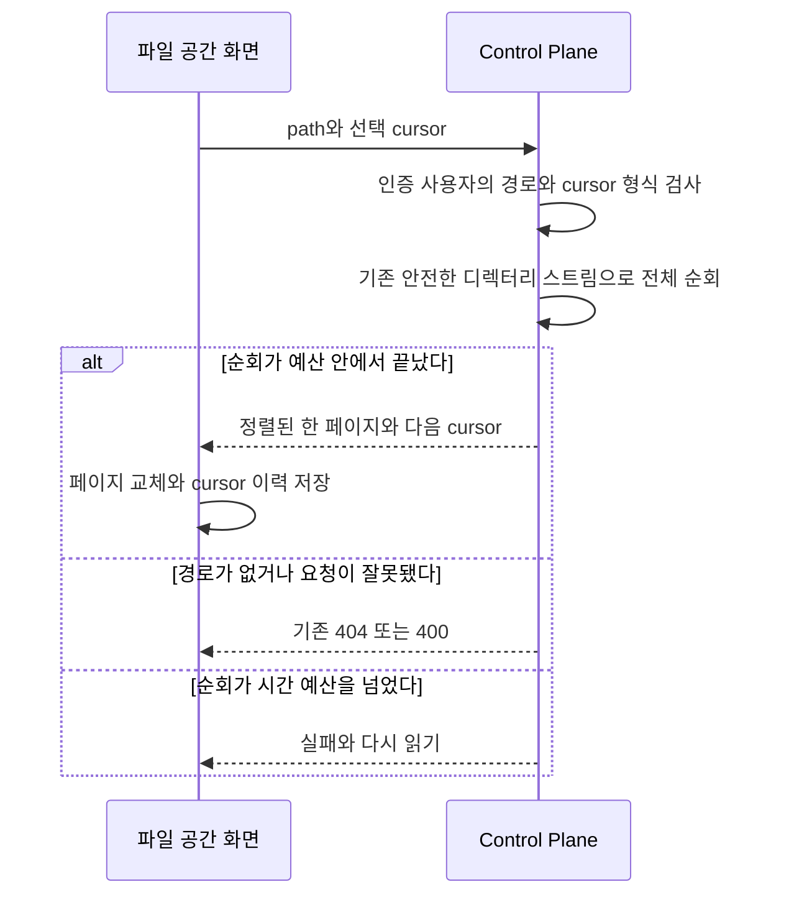
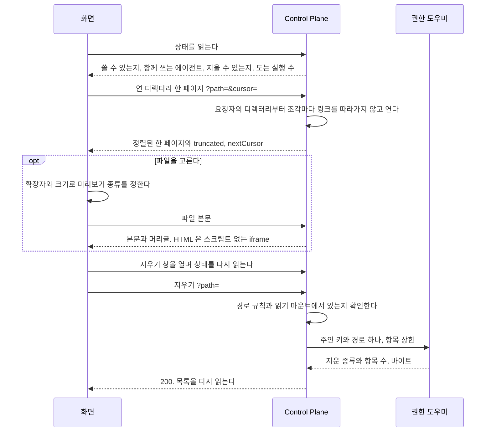
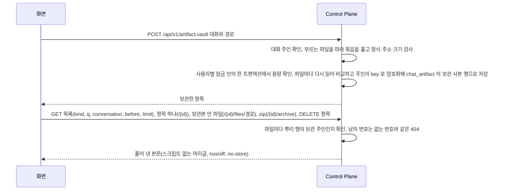
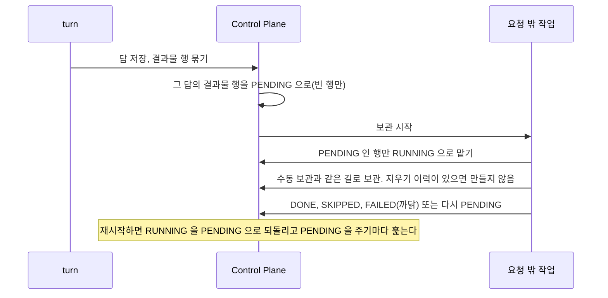

# 파일 공간 기능

사용자가 비서가 내준 파일을 「내 파일」 에서 찾고, 에이전트의 실행 공간(「에이전트 작업 폴더」)에 있는 파일을 열어 보는 기능이다.
`/files` 는 탭 없이 「내 파일」 이고, 작업 폴더는 그 머리의 링크로 들어가는 `/files/workspace` 다. 폴더나 파일을 가리키는 옛 `/files?path=…` 주소는 작업 폴더의 같은 자리로 넘어간다.

covers: `backend/src/main/java/com/bifos/assistant/workspace/`, `web/src/components/workspace/`, `web/src/app/admin/workspaces/`, `web/src/app/files/`, `web/src/lib/workspace-api.ts`, `web/src/lib/workspace-file.ts`, `backend/src/main/java/com/bifos/assistant/chat/artifact/`, `web/src/components/files/`, `web/src/app/api/artifact-vault/`, `web/src/lib/artifact-vault-api.ts`, `backend/src/main/java/com/bifos/assistant/mcp/application/McpFileSpaceTools.java`, `backend/src/main/java/com/bifos/assistant/mcp/presentation/McpFileSpaceCalls.java`, `backend/src/main/java/com/bifos/assistant/mcp/application/port/SandboxFiles.java`, `web/src/components/chat/artifact/put-files.tsx`, `web/src/lib/put-file.ts`

## 목록 페이지

디렉터리 전체에서 정렬 키 뒤의 항목을 골라 한 페이지씩 보여 준다. 고정된 목록은 끝까지 누락과 중복 없이 탐색할 수 있다.

- 목록 API는 선택 인자 `cursor`를 받고 `{path, entries, truncated, nextCursor}`를 돌려준다. 한 페이지는 1,000건이고, `truncated`는 다음 페이지가 있다는 뜻이다. 끝이면 `nextCursor`는 null이다.
- 정렬 키는 `(디렉터리인가, 이름)`이다. 디렉터리가 먼저이며 이름은 Java `String.compareTo`의 순서를 쓴다. 대소문자를 접거나 Unicode를 정규화하지 않아 서로 다른 실제 파일 이름을 합치지 않는다. 링크와 특수 파일의 기존 표시·열기 금지를 유지한다.
- 디렉터리 전체를 같은 안전한 스트림으로 훑고 cursor 뒤의 가장 작은 1,001건만 최대 힙에 유지한다. 열거 순서로 먼저 자르지 않는다. 요청당 메모리는 페이지 크기에 비례하고, 시간은 항목 수에 비례한다. 전체 목록 캐시와 별도 색인은 만들지 않는다.
- cursor는 버전, 상대 경로 원문 UTF-8의 SHA-256 지문, 표시한 마지막 항목의 정렬 키를 담은 base64url 값이다. 경로 원문을 담지 않아 기존 최대4,096바이트 경로와255바이트 이름도4,096자 상한 안에서 왕복한다. canonical base64url·strict UTF-8·정확한 키·타입·버전·지문과 요청 경로의 일치를 검사하고 실패하면400이다. 이름은 파일을 여는 경로로 쓰지 않으며 Linux의 정상 목록 이름을 본문 경로 규칙으로 배제하지 않는다. 지문은 권한이 아니며 주인 디렉터리는 매 요청의 인증 사용자로만 정한다. 다른 사용자의 cursor도 그 사용자의 자료를 읽을 권한을 주지 않는다.
- 고정된 디렉터리는 생성 순서에 관계없이 끝까지 누락·중복 없이 탐색한다. 페이지 사이 생성·삭제·이름 변경은 snapshot으로 고정하지 않는다. 지난 키 앞에 생긴 항목은 다시 읽기에 보이고, 이미 본 항목이 이름이나 종류를 바꾸면 다시 보일 수 있다. 화면은 이 한계를 안내한다.
- 스트림 순회 중 2초가 지나면 성공한 일부 목록으로 속이지 않고 기존 500 오류로 끝낸다. 파일 시스템 호출 자체가 멈춘 경우까지 이 제한이 끊어 주지는 못한다. 10,000건 합성 자료의 지연·힙 사용을 측정해 그 한계를 공개한다.
- 작업 폴더 화면(`/files/workspace`)은 「다음 목록」과 「이전 목록」으로 페이지를 교체한다. cursor 이력만 보관하고 앞 페이지의 항목을 계속 쌓지 않는다. 이동·다시 읽기·삭제 후에는 첫 페이지부터 읽으며 늦게 끝난 이전 요청의 결과로 현재 목록을 바꾸지 않는다. 빈 다음 페이지도 이전 목록이나 다시 읽기로 돌아갈 수 있다.
- 기존 미리보기의 `file` 주소와 선택한 파일 메타데이터 한 건은 페이지 상태와 분리해 유지한다. 다음·이전·빈 페이지에서도 주소와 미리보기를 함께 보존하며 목록 전체를 누적하지 않는다. 파일 접근은 기존 본문 API가 현재 권한으로 판정한다. 삭제 대상은 계속 실제 목록에서 누른 줄 하나다.

`WorkspaceTreeTest`는 0/1/999/1,000/1,001/1,002/10,000건의 역순·무작위 생성 목록을 끝까지 기준 정렬과 대조한다. 기존 `SecureDirectoryStream`과 대체 경로의 사후 검사를 모두 유지한다. 이름을 정규화하는 로컬 파일 시스템에서는 같은 이름의 대소문자·Unicode 차이 검사를 건너뛰며, Linux에서 실행한다. 최대 4,096바이트 경로는 codec으로, 실제 긴 경로는 파일 시스템에서 따로 확인한다. #359의 Alpine 유지와 링크 경쟁 위험 수용은 바꾸지 않으며 glibc 전환을 이 기능의 선행 조건으로 넣지 않는다.

로컬 합성 10,000건을 10번 조회한 마지막 측정은 p50 136ms, p95 152ms였다. 조회 전후 JVM 사용 힙은 2,747,720바이트 감소했다. 이 차이는 GC 시점과 임시 할당을 포함하므로 유지 메모리의 상한을 뜻하지 않는다. 후보 최대 힙은 시험에서 1,001건을 넘지 않음을 별도로 확인한다. 운영 파일 시스템의 성능은 아직 측정하지 않았다.

`workspace-pages.spec.ts`는 합성 사용자와 임시 실행 공간을 나눠 실제 Next → Control Plane → WorkspaceTree 왕복을 두 화면 폭에서 확인한다. 모바일 시트가 목록을 덮는 동안 선택 상태 검사는 페이지 단추의 클릭 핸들러로 요청을 보내며, 미리보기와 주소의 유지 여부를 확인한다. 삭제 후 페이지 초기화와 409의 재조회 생략은 기존 응답 대역 검사에서 확인한다. 실제 삭제 도우미의 운영 검증은 #370이 갖는다.

## 요구

- 사용자는 작업 폴더 화면(`/files/workspace`)에서 자기 에이전트들이 함께 쓰는 실행 공간을 보고, 미리 보고, 내려받고, 지운다. 다른 사용자의 공간은 보이지 않는다.
- HTML 미리보기는 결과물과 같은 격리로 스크립트 없이 뜬다.
- 지우기는 확인 창을 거치고, 운영의 권한 도우미가 할 수 있을 때만 단추가 보인다.

결정은 [ADR-20261009 / workspace-explorer](../adr/ADR-20261009-workspace-explorer.md), API 와 경로 규칙은 [`backend/docs/code-architecture.md`](../../backend/docs/code-architecture.md) 의 「실행 공간 파일」 이 갖는다.

## 흐름

목록을 열고 항목 하나를 지우는 흐름이다. 목록과 미리보기는 Control Plane 이 읽기 전용으로 붙인 실행 공간에서 읽고, 지우기만 권한 도우미가 한다.

## 파일 공간

| 자리 | 무엇 |
| --- | --- |
| 머리 | 「파일 공간」 제목과 함께 쓰는 에이전트 이름들. 그룹에 공개한 에이전트에는 「그룹 공개」 표시를 붙이고, 다른 사람이 그 에이전트를 쓰면 그 파일도 여기 생긴다고 한 줄 더한다 |
| 경로 줄 | 「파일 공간」 부터 연 디렉터리까지의 조각. 누르면 그 디렉터리로 간다 |
| 목록 | 디렉터리를 먼저, 이름 순서. 「다음 목록」과 「이전 목록」으로 교체한다. 디렉터리를 누르면 열고 파일을 누르면 미리보기를 연다 |
| 줄의 동작 | 「내려받기」, 「지우기」. 지우기는 상태의 `deletable` 일 때만 그린다 |
| 미리보기 | 넓은 화면은 목록 옆 패널, 좁은 화면은 전체 폭 시트. 결과물 패널과 같은 자리 규칙이다 |

| 목록의 줄 | 보이는 것 |
| --- | --- |
| `readable` 이 거짓 | 「읽을 수 없음」 을 붙이고 누르지 못한다. 주인만 읽는 파일이다 |
| `LINK` | 「링크」 를 붙이고 누르지 못한다. 링크를 따라가지 않는다 |
| `openable` 이 거짓 | 주소로 열 수 없는 이름이라 미리보기와 내려받기를 열지 않는다. 연 디렉터리의 경로가 그런 이름을 지나면 그 안의 파일도 같다 |
| `truncated` | 다음 페이지가 있어 「다음 목록」을 누를 수 있다 |

미리보기 종류는 화면이 확장자와 목록의 `size` 로 정하고, 상한과 형식은 [`backend/docs/code-architecture.md`](../../backend/docs/code-architecture.md) 의 「본문 머리글」 표와 같다.
글은 고정폭 글꼴로, CSV 와 TSV 는 표로, 사진은 `` 로, HTML 은 결과물 패널과 같은 `sandbox` 의 iframe 으로 그린다. 그 밖과 상한을 넘는 것은 「미리보기가 없어요」 와 내려받기다.
받은 글에 NUL 이 있으면 글 파일이 아니라고 보이고, 본문을 받지 못하면 내려받아 열라고 안내한다.
CSV 와 TSV 의 줄 상한과 따옴표 처리는 `web/src/components/workspace/csv-table.tsx` 가 갖는다. 미리보기와 지우기의 분기는 `web/test/browser/workspace-files.spec.ts` 가 확인한다.

| 상태 | 보이는 것 |
| --- | --- |
| `available` 이 거짓 | 「파일 공간을 쓸 수 없어요. 관리자에게 알려 주세요.」 |
| `exists` 가 거짓, 빈 디렉터리 | 「아직 에이전트가 만든 파일이 없어요」 |
| 400 | 「경로가 올바르지 않아요.」 와 맨 위로 가기 |
| 404 | 「찾을 수 없어요. 지워졌을 수 있어요.」 와 맨 위로 가기 |
| 그 밖의 실패 | 「불러오지 못했어요」 와 다시 읽기 |

**지우기는 확인 창을 거친다.** 창은 이름과 종류(파일, 폴더, 링크, 특수 파일)를 보이고, 디렉터리면 안의 파일까지 모두 지운다고 더한다.
창을 열 때 상태를 다시 읽어 `runningExecutions` 가 0 보다 크면 「에이전트가 지금 일하고 있어요. 쓰는 중인 파일이면 다시 생길 수 있어요.」 를 더한다.
**지운 경로는 목록에서 누른 줄의 경로 하나다.** 주소의 `file` 이나 미리보기의 경로를 지우기에 쓰지 않는다.
지운 뒤 목록을 다시 읽고, 미리 보던 파일이나 그 파일이 든 폴더를 지웠으면 미리보기를 닫는다.

| 지우기의 답 | 화면 |
| --- | --- |
| 409, 도우미가 항목 상한을 넘었다고 답했다 | 「항목이 너무 많아 지우지 않았어요. 안쪽 폴더부터 지워 주세요.」. 아무것도 지우지 않았다 |
| 502, 도우미가 실패했거나 답하지 않았다 | 「지우지 못했어요. 일부만 지워졌을 수 있어요.」. 목록을 다시 읽어 남은 것을 보인다 |
| 404 | 「찾을 수 없어요. 지워졌을 수 있어요.」. 목록을 다시 읽는다 |
| 그 밖의 실패(403, 500, 503, 400, 연결 끊김) | 「지우지 못했어요.」. 목록을 다시 읽는다 |

## 파일 공간을 열 때

상태와 목록은 브라우저가 읽고, 실패는 그 자리의 다시 읽기로 다룬다. 작업 폴더 페이지를 받을 때 서버에서 읽는 것은 없다.

| 무엇 | 어떻게 되나 |
| --- | --- |
| 루트가 설정되지 않았거나 디렉터리가 아니다 | 상태가 `available` 거짓이다 |
| 사용자 디렉터리가 없다 | 상태가 `exists` 거짓이다. 아직 에이전트가 파일을 만들지 않은 것이다 |
| 경로가 규칙에 어긋난다 | 400. 목록 대신 오류 안내와 맨 위로 가기 |
| 경로가 없거나 링크를 지난다 | 404 |
| 두 탭에서 같은 것을 지운다 | 늦은 쪽은 404 를 받고 목록을 다시 읽는다 |
| 목록을 연 사이 에이전트가 파일을 바꾼다 | 페이지는 snapshot이 아니다. 지난 정렬 키 앞에 생긴 항목은 다시 읽기로 보이며 이름이나 종류가 바뀐 항목은 다시 보일 수 있다. 화면은 스스로 다시 읽지 않는다 |

지우면 Control Plane 은 INFO 로그 한 줄을 남기고, 도우미는 지운 경로만 감사 기록에 남긴다.

## 보관한 결과물

대화의 결과물과 비서가 넣은 파일을 대화와 따로 암호화해 두고, `/files` 의 「내 파일」 에서 찾고 읽고 지우는 기능이다(#530 PR 1, PR 2, PR 3, [파일 공간 스펙](workspace/spec.md)). 화면에서는 「내 파일」, 코드와 이 문서에서는 보관함이라고 부른다. 결정은 [ADR-20261101 / artifact-vault](../adr/ADR-20261101-artifact-vault.md) 가 갖는다.
「에이전트 작업 폴더」(전의 「실행 공간」)는 에이전트 주인의 공간이고 「내 파일」 은 대화 요청자의 보관함이다. 둘은 저장소도 권한도 다르다.

- 대화의 결과물 패널 머리에 「보관」 단추가 있다. 누르면 그 파일을 지금 내용으로 보관한다. HTML 이 부르는 사진과 스타일도 함께 묶어 보관한다
- 보관 주인은 대화 요청자다. 그룹 공개 에이전트를 썼어도 에이전트 주인에게 자동으로 보이지 않는다
- 대화를 지워도 보관본은 남는다
- 사용자당 5GiB 를 넘으면 새 보관만 거절하고 이미 보관한 것은 그대로 둔다. 자동 삭제는 없다
- 본문은 사용자별 데이터 key 로 암호화해 둔다. 암호화를 쓸 수 없으면 평문으로 두지 않고 보관을 거절한다
- 대화의 「보관」 단추와 자동 보관은 HTML, CSS, 사진(PNG, JPEG, GIF, WebP)을 보관한다. HTML 과 CSS 가 상대 주소로 부르는 파일은 한 묶음으로 넣고, 부르지 않는 파일은 넣지 않는다
- 보관함이 받는 형식은 그보다 넓다. 표(CSV, TSV, XLSX)와 문서(PDF, MD, TXT, DOCX, PPTX)도 받는다. 이 형식은 바이트로 받은 파일 하나를 넣는 길(`ArtifactVaultService.keep`)로만 들어온다. MD, TXT, CSV, TSV 는 `text/plain` 으로 화면에서 열 수 있게 내주고, XLSX, DOCX, PPTX, PDF 는 내려받기로만 준다. 형식 표는 `VaultFileType` 이 갖고, 이진 형식은 파일 머리 바이트가 형식과 맞아야 받는다
- 에이전트는 MCP 도구 `file_space_put` 으로 작업 폴더(`/workspace/` 로 시작하는 경로)나 그 대화의 결과물 폴더의 파일을 요청자의 보관함에 넣는다. 작업 폴더는 origin 실행의 에이전트가 쓰는 실행 공간이고, 넣은 파일의 주인은 대화 요청자다. 대화 폴더의 HTML, CSS, 사진은 「보관」 단추와 같이 묶음으로, 그 밖의 형식과 작업 폴더의 파일은 파일 하나로 넣는다. 도구의 인자와 실패 결과는 [`mcp.md`](mcp.md) 의 「파일 공간에 넣는 도구」 가 갖는다
- 넣은 파일은 turn 이 끝날 때 그 답에 묶여 답 아래에 파일 줄(제목, 종류, 크기, 「내려받기」, 「내 파일에서 보기」)로 보인다. 메시지 응답에는 `kind` 가 `FILE` 인 항목으로 나간다. 같은 답에 같은 경로의 HTML 줄이 있으면 파일 줄을 겹쳐 보이지 않는다. 다시 넣어 이미 있다고 나오면 줄이 그 답으로 옮겨진다. 내 파일에서 지우면 줄은 「내 파일에서 지운 파일이에요」 로 남는다
- 보관본은 제목과 한 줄 설명을 가질 수 있다. 넣기 도구가 준 값이나, `artifact_write` 가 HTML 에 받은 값을 쓴다. 목록은 제목이 있으면 파일 이름 대신 제목을, 그 아래 설명을 보인다. 주인의 데이터 key 로 암호화해 두고 목록 응답에 풀어 준다. 같은 대화에서 제목이 겹치면 뒤에 번호를 붙인다. 같은 파일을 고쳐 다시 보관하면 번호가 늘지 않는다
- 외부 주소, `data:` 주소, 대화 폴더 밖 주소, 빠진 파일, 받지 않는 형식, 상한(파일 하나 25MiB, 묶음 100MiB, 1,000파일)을 넘는 묶음은 통째로 거절하고 안내만 보인다. 일부만 보관하지 않는다
- 보관하는 사이에 원본이 지워지거나 바뀌면 보관을 거절한다. 다시 누르면 지금 내용으로 보관한다
- 같은 대화·경로·본문을 다시 보관해도 한 건이다. 파일을 고친 뒤 보관하면 새 보관본이 생긴다
- 비서가 만든 그림은 답에 묶일 때 자동 보관의 대상이 된다([`generated-image.md`](generated-image.md)). 목록의 그림 줄은 제목 앞에 작은 그림을 보이고 이름에서 확장자를 뗀다. 대화의 「내 파일에서 보기」 로 오면 주소의 `item` 이 가리킨 파일의 미리보기를 연 채 연다. 그 파일이 목록 첫 쪽에 없어도 번호로 읽어 연다
- 「내 파일」 은 넣은 차례의 최신순 한 목록이다. 「오늘」, 「이번 주」(월요일부터), 「이번 달」, 그 앞은 달마다 날짜 구분이 있고 기기의 시간대로 나눈다. 줄마다 작은 그림(그림이 아니면 종류 아이콘), 제목, 한 줄 설명, 나온 대화, 날짜, 크기, 「내려받기」, 「지우기」 가 보인다. 목록 끝이 보이면 다음 쪽(30줄)을 읽는다
- 목록 위에서 종류(「전체」, 「그림」, 「문서」, 「표」)를 고르고 낱말로 찾는다. 낱말은 제목, 설명, 파일 경로, 대화 제목에서 대소문자를 가리지 않고 일부만 맞아도 찾는다. 제목과 대화 제목은 암호문이라 Control Plane 이 그 사용자의 보관본을 본문 없이 모두 읽고 메모리에서 필터링한 뒤 번호 역순으로 쪽을 나눈다. 본문은 찾지 않는다
- 대화 이름을 누르면 그 대화의 파일만 남고 「대화 열기」 가 보인다. 대화를 지웠으면 「지운 대화」 로 보이고 누를 수 없으며 그 제목으로 찾지 못한다
- 목록 위에 쓴 용량과 전체 용량(5GB)이 한 줄로 보인다. 남은 용량이 파일 하나 상한보다 작으면 새 파일이 들어오지 않는다는 안내가 함께 보인다
- 줄을 누르면 미리보기가 열린다. 넓은 화면은 목록 옆 패널, 좁은 화면은 전체 폭 시트다. 그림은 그대로, HTML 은 스크립트 없는 iframe 으로 부르는 사진과 스타일까지 보관본에서 읽고, CSV·TSV 는 표로, MD·TXT·CSS 는 원문 그대로 보인다. 글과 표는 1MiB 까지 받고 UTF-8 이 아니면 EUC-KR 로 읽는다. XLSX, DOCX, PPTX, PDF 는 「미리보기가 없어요」 와 내려받기다
- 묶음은 한 줄이고 묶음 전체 크기가 보이며 zip 으로 내려받는다. 내려받는 이름은 제목이 있으면 제목에 원래 확장자(묶음은 `.zip`)를 붙인 것이고, 파일 이름에 쓸 수 없는 글자는 `_` 로 바꾼다
- 지우기는 확인 창을 한 번 거친다. 지우면 그 줄이 목록에서 빠지고 용량 줄이 다시 읽힌다
- 보관본을 지우면 본문은 바로 사라지고, 같은 보관본을 자동 보관이 다시 만들지 않도록 본문 없는 지우기 이력만 남는다. 직접 「보관」 을 누르면 다시 보관한다
- 관리자가 정리를 예약한 사용자는 30일 뒤 사용자 정리가 보관본과 묶음 안 파일, 지우기 이력을 모두 지운 뒤 데이터 key 를 지운다. 다른 사용자의 보관본은 그대로다. 흐름은 [`users.md`](users.md) 의 「사용자 정리」 가 갖는다

보관본은 `chat_artifact` 의 `vault_user_id` 가 채워진 행이다. 컬럼은 [`backend/docs/data-schema.md`](../../backend/docs/data-schema.md) 의 `chat_artifact` 절이 갖는다.
묶음은 뿌리 행과 그 뿌리를 `vault_bundle_id` 로 가리키는 행들이다.
`McpFileSpacePutToolTest` 가 넣기 도구의 경로 판정, 그룹 공개 에이전트의 주인, 형식·크기·용량의 실패 결과, 되풀이, 먼저 살펴보기 규칙을 확인한다. `FileSpaceTurnTest` 가 답에 묶기와 `FILE` 항목, `artifact_write` 제목의 이동, 실행 입력의 단락을 본다. `WorkspaceSandboxFilesTest` 가 작업 폴더 읽기의 링크 규칙을 본다.
`ArtifactVaultListTest` 가 목록의 쪽 나누기, 종류·낱말·대화 필터, 지운 대화, 용량 칸, 항목 하나 읽기, 글 형식의 화면 열기와 제목으로 만든 내려받기 이름을 확인한다. 화면은 `my-files.spec.ts`(브라우저)와 `my-files.test.ts`(날짜 구분) 가 본다.
`ArtifactVaultFileTypeTest` 가 새 형식의 보관과 내려받기, 파일 하나 상한, 제목의 암호화와 겹침 번호, 같은 파일의 되풀이를 확인한다.
`ArtifactVaultTest` 가 암호문 저장, 남의 보관본 차단, 대화 정리 뒤의 보존, 용량 초과, 중복, 위변조를 확인한다.
`ArtifactVaultBundleTest` 가 묶음의 상대 주소 따라가기, 부르지 않는 파일 제외, 부분 묶음 금지, 남의 묶음 차단, 대화 정리 뒤의 보존, 상한과 용량, 보관 중 원본 변경, 다른 대화로 가는 링크, 동시 요청 상한을 확인한다. 주소 찾기는 `ArtifactReferencesTest` 가 본다.

### 자동 보관

turn 이 끝날 때 그 답에 묶인 결과물을 요청자의 보관함(「내 파일」)에 둔다(#530 PR 3). 사용자가 끄는 스위치는 없다(파일 공간 스펙 REQ16, DECISION13).

- **항상 켜져 있다**(2026-11-19 사용자 결정). 전의 「결과물 자동 보관」 스위치를 꺼 두었던 사용자도 스위치를 없앤 배포 뒤의 답부터 보관한다. 꺼 둔 동안의 결과물은 자동으로 넣지 않고, 대화 쪽 원본이 남아 있으면 「보관」 단추로 넣는다. 옛 설정 칸 `app_user.artifact_auto_vault` 는 남아 있지만 읽지 않는다
- 대상은 그 turn 이 결과물로 묶은 HTML 과 비서가 만든 그림이다. HTML 이 부르는 사진과 스타일은 수동 보관과 같이 묶음으로 들어간다. 로그나 중간 파일처럼 답에 묶이지 않은 파일은 넣지 않는다
- 완료한 turn 만 보관한다. 중지했거나 답이 없는 turn 의 파일은 완성본이라고 볼 수 없다. 재시작 뒤 복구로 끝난 turn 도 완료면 보관한다
- 보관 주인은 대화 요청자다. 그룹 공개 에이전트를 써도 에이전트 주인의 보관함에는 넣지 않는다
- 답 아래 결과물 줄 옆에 「보관 중」, 「보관 완료」, 「보관 실패」 와 까닭이 보인다. 실패하면 「다시 보관」 을 누를 수 있다. 실패해도 답과 원본 파일은 그대로다
- 같은 turn 의 완료가 두 번 와도, 재시작으로 끊겨도 보관본은 하나다. 사용자가 지운 보관본은 다른 답이 같은 파일을 묶어도 다시 만들지 않는다
- 보관은 답을 저장한 뒤 요청 밖에서 돈다. turn 을 기다리게 하지 않는다. 동시에 도는 보관이 꽉 차 거절되면 다음 훑기(1분)에 다시 시도하고, 세 번 시도해도 보관하지 못하면 실패로 둔다. 「보관 중」 은 대화를 다시 열면 끝난 상태로 바뀐다

작업 기록과 지우기 이력은 새 표 없이 `chat_artifact` 에 둔다. 칸은 [`backend/docs/data-schema.md`](../../backend/docs/data-schema.md) 의 `chat_artifact` 절이 갖는다.
`ArtifactAutoVaultTest` 가 옛 스위치를 끈 사용자도 보관하는 것, 같은 완료가 두 번 와도 한 건, 재시작 뒤 이어서 끝내기, 지운 보관본을 다시 만들지 않기, 그룹 공개 에이전트에서 요청자에게만 보관, 실패 뒤 답과 원본 유지와 다시 보관을 확인한다. 복구로 끝난 turn 은 `RecoveredRunRecorderTest` 가 본다.

이 기능이 아직 하지 않는 것은 아래와 같다.

- 대화를 지울 때 「보관본도 함께 지우기」 선택지
- HTML 이 부르는 사진 하나를 대화 화면에서 따로 보관하는 단추. 비서가 만든 그림은 크게 보기 화면에서 보관한다
- 「보관 중」 이 끝나면 대화 화면을 스스로 고치기. 지금은 대화를 다시 열어야 바뀐다
- 에이전트가 「내 파일」 을 찾는 도구와 작업 폴더 화면의 「내 파일로 가져오기」. 스펙의 PR3 이 더한다
